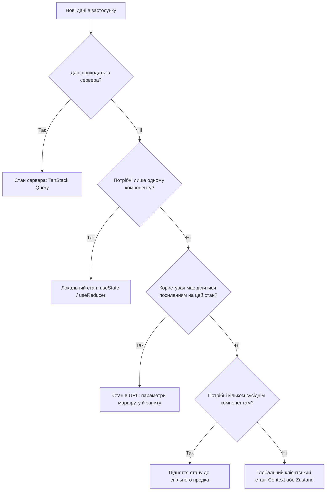
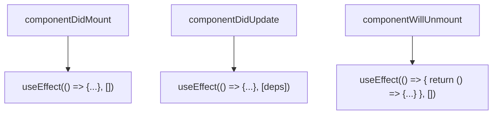
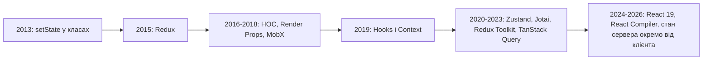
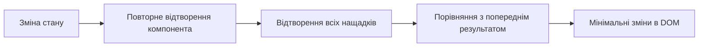

# Лекція 08 Управління станом у React (хуки, локальний і глобальний стан)

## Вступ: стан як центральна проблема інтерфейсу

### Навіщо потрібен стан

Інтерфейс користувача — це відображення даних у певний момент часу. Кнопка «Додати в кошик» змінює кількість товарів, перемикач теми змінює кольори, відповідь сервера з'являється у вигляді списку. Усі ці «дані, що змінюються з часом і впливають на вигляд сторінки», у React називають **станом** (state). У React інтерфейс є функцією від стану: ви описуєте, як має виглядати сторінка для будь-якого можливого стану, а бібліотека сама оновлює DOM, коли стан змінюється. Саме тому питання «де зберігати цей стан і хто його змінює» є центральним для архітектури будь-якого React-застосунку.

У попередніх лекціях ви створювали компоненти й передавали в них дані через props. Props рухаються тільки зверху вниз і не змінюються самим компонентом, тому для інтерактивності їх недостатньо. Для змінних даних потрібен механізм, який дозволяє компоненту «пам'ятати» значення між відтвореннями сторінки та запускати нове відтворення при зміні. Цей механізм у сучасному React реалізований через **хуки** (hooks). Їх розгляд — перша половина лекції. Друга половина присвячена питанню масштабу: що робити, коли той самий стан потрібен десяткам компонентів у різних частинах застосунку, як відрізнити стан інтерфейсу від даних сервера та які інструменти для цього існують у 2026 році.

### Види стану

Помилка більшості початківців — вважати, що «стан» — це одна категорія і для нього потрібен один інструмент, наприклад Redux. Насправді в застосунку співіснує кілька принципово різних видів стану, і кожен має власне найкраще місце для зберігання.

| Вид стану | Приклад | Де зберігати |
|-----------|---------|--------------|
| Локальний стан інтерфейсу | Відкрите модальне вікно, поточна вкладка, наведення курсора | `useState`, `useReducer` |
| Стан форми | Значення полів, помилки валідації, прапорець відправлення | `useState`, `useReducer`, бібліотеки форм |
| Спільний стан сусідніх компонентів | Вибраний елемент списку, що показується в сусідній панелі | Підняття стану до спільного предка |
| Стан в URL | Сторінка пагінації, фільтри, відкритий запис | Параметри маршруту та запиту (лекція 09) |
| Стан сервера | Список користувачів, товари, замовлення | TanStack Query, завантажувачі маршрутів |
| Глобальний клієнтський стан | Тема, кошик, сповіщення, поточний користувач | Context API, Zustand, Redux Toolkit |
| Збережений стан | Налаштування між сеансами, офлайн-дані | `localStorage`, IndexedDB |

Вибір місця для нового стану можна звести до послідовності запитань. Відповідаючи на них, ви щоразу обираєте найпростіше з підхожих рішень.



Золоте правило, яке проходить крізь усю лекцію: **стан має жити якомога ближче до місця, де він використовується**. Починайте з локального стану й переходьте до глобального лише тоді, коли виникає реальна потреба в спільному доступі. Надмірно глобальний стан робить застосунок складнішим для розуміння, тестування й оптимізації.

### Структура лекції

Спочатку ми розглянемо базові хуки: `useState` для простих значень, `useEffect` для взаємодії із зовнішнім світом, власні хуки для повторного використання логіки та `useReducer` для складніших переходів між станами. Потім перейдемо до спільного стану: Context API та його обмеження. Після цього розділимо стан клієнта й стан сервера та познайомимося з TanStack Query. Далі розглянемо зовнішні сховища (Zustand, Redux Toolkit), способи зберігання стану між сеансами та, нарешті, продуктивність, де ключову роль відіграє React Compiler.

## Вступ до React Hooks

### Історія та мотивація створення хуків

До лютого 2019 року (випуск React 16.8) функціональні компоненти були обмеженими: вони могли тільки отримати props і повернути розмітку, а будь-який стан чи доступ до життєвого циклу вимагали класового компонента. Через це простий компонент доводилося переписувати в клас, щойно йому знадобився хоча б один лічильник, що призводило до значного збільшення шаблонного коду (boilerplate).

Класові компоненти мали власні проблеми: плутанина з `this`, потреба прив'язувати методи до екземпляра, складність повторного використання логіки через компоненти вищого порядку (Higher-Order Components, HOC) і патерн Render Props. Методи життєвого циклу часто змішували непов'язану логіку: у `componentDidMount` поруч опинялися завантаження даних, підписка на події та налаштування таймера, а їхнє очищення розтікалося по `componentWillUnmount`.

Команда React сформулювала три проблеми, які хуки мали розв'язати:

**Складність повторного використання логіки зі станом**: HOC і Render Props створювали «пекло обгорток» (wrapper hell), де структура дерева компонентів ставала незрозумілою.

**Великі компоненти, які важко зрозуміти**: методи життєвого циклу об'єднують непов'язану логіку, через що компоненти складно підтримувати й тестувати.

**Класи заплутують і людей, і машини**: потрібно розуміти поведінку `this`, прив'язувати методи, а сам клас гірше піддається оптимізації інструментами збирання.

Хуки розв'язали ці проблеми, давши функціональним компонентам доступ до стану й побічних ефектів, дозволивши виносити логіку у власні хуки та усунувши потребу в класах. Сьогодні для нових компонентів класи не використовують, хоча старий код із ними продовжує працювати. Єдиний виняток — межі помилок (error boundaries), які досі потребують класового компонента або готової бібліотеки.

### Правила використання хуків

Хуки підпорядковуються двом правилам, без яких вони не працюють.

**Викликайте хуки тільки на верхньому рівні**: не всередині циклів, умов чи вкладених функцій. React не знає імен ваших змінних: він зберігає стан хуків компонента як впорядкований список і зіставляє кожен виклик із його місцем у списку. Якщо порядок викликів між відтвореннями змінюється, значення «з'їжджають» і потрапляють не до тих змінних.

```javascript
// НЕПРАВИЛЬНО: хук усередині умови
function UserProfile({ userId }) {
    if (userId) {
        const [user, setUser] = useState(null); // Порушення правила!
    }
}

// ПРАВИЛЬНО: хук на верхньому рівні, умова — після нього
function UserProfile({ userId }) {
    const [user, setUser] = useState(null);

    if (!userId) {
        return <div>Користувача не вибрано</div>;
    }

    return <div>{user?.name}</div>;
}
```

**Викликайте хуки тільки з функцій React**: у функціональних компонентах або у власних хуках. Звичайні функції JavaScript хуків викликати не можуть.

```javascript
// НЕПРАВИЛЬНО: хук у звичайній функції
function calculatePrice(price) {
    const [discount, setDiscount] = useState(0); // Порушення!
    return price * (1 - discount);
}

// ПРАВИЛЬНО: хук у власному хуку (назва починається з use)
function useDiscount() {
    const [discount, setDiscount] = useState(0);
    return [discount, setDiscount];
}
```

Є один виняток із першого правила: API `use`, яке з'явилося в React 19, можна викликати в умовах і циклах. Ми зустрінемося з ним у розділі про Context.

Дотримання правил перевіряє плагін `eslint-plugin-react-hooks`, який входить до шаблонів сучасних проєктів. Його рекомендований набір правил також містить перевірки, що спираються на React Compiler: вони знаходять код, який порушує «Правила React» (чистоту відтворення, заборону мутації стану), ще до запуску застосунку. Увімкніть плагін у проєкті з першого дня.

### Огляд хуків, які ми розглянемо

У React 19 додалося кілька нових хуків і API. У цій лекції ми детально розбираємо базові хуки та згадуємо нові там, де вони доречні.

| Хук / API | Призначення | Де розглянуто |
|-----------|-------------|---------------|
| `useState` | Локальний стан | Далі в цій лекції |
| `useEffect` | Синхронізація із зовнішніми системами | Далі в цій лекції |
| `useEffectEvent` (19.2) | Подія всередині ефекту, що бачить актуальні значення | Розділ про `useEffect` |
| `useReducer` | Складні переходи стану | Далі в цій лекції |
| `useContext` / `use` (19) | Читання значення з контексту | Розділ про Context |
| `useSyncExternalStore` | Підписка на зовнішнє джерело даних | Розділ про власні хуки |
| `useMemo`, `useCallback` | Ручна мемоїзація | Розділ про продуктивність |
| `useTransition`, `useDeferredValue` | Пріоритезація оновлень | Розділ про продуктивність |
| `useActionState`, `useOptimistic` (19) | Стан форм і оптимістичні оновлення | У лекціях про форми |

## useState: управління локальним станом

### Базове використання

`useState` — найпростіший і найчастіше вживаний хук. Він додає компоненту одну «комірку пам'яті», яка зберігається між відтвореннями.

```javascript
import { useState } from 'react';

function Counter() {
    // useState повертає масив з двох елементів:
    // 1. Поточне значення стану
    // 2. Функцію для його оновлення
    const [count, setCount] = useState(0);

    const increment = () => setCount(count + 1);
    const decrement = () => setCount(count - 1);
    const reset = () => setCount(0);

    return (
        <div className="counter">
            <h2>Лічильник: {count}</h2>
            <button onClick={increment}>+</button>
            <button onClick={decrement}>-</button>
            <button onClick={reset}>Скинути</button>
        </div>
    );
}
```

Аргумент `useState` — початкове значення, яке використовується лише під час першого відтворення. Виклик функції оновлення не змінює змінну `count` негайно: він повідомляє React, що стан змінився, і React відтворює компонент заново вже з новим значенням. Це принципова відмінність від звичайної змінної, яку ви могли б спробувати змінити через `count++`: React про таку зміну не дізнається, і інтерфейс не оновиться.

### Різні типи даних у useState

`useState` працює з будь-якими значеннями JavaScript: примітивами, об'єктами, масивами, навіть функціями.

```javascript
function UserForm() {
    // Примітивні типи
    const [name, setName] = useState('');
    const [age, setAge] = useState(0);
    const [isActive, setIsActive] = useState(false);

    // Об'єкти
    const [user, setUser] = useState({
        name: '',
        email: '',
        role: 'user'
    });

    // Масиви
    const [skills, setSkills] = useState(['JavaScript', 'React']);

    // Складні структури
    const [formData, setFormData] = useState({
        personal: { name: '', age: 0 },
        contacts: { email: '', phone: '' },
        preferences: { theme: 'light', language: 'uk' }
    });

    return (
        <form>
            {/* поля форми */}
        </form>
    );
}
```

Проте можливість зберігати все в одному об'єкті не означає, що так потрібно робити. Якщо значення змінюються незалежно, кілька окремих викликів `useState` читаються легше й не вимагають копіювати весь об'єкт при кожній зміні одного поля. Єдиний стан для пов'язаних значень доречний тоді, коли вони завжди змінюються разом (наприклад, координати `x` і `y`).

### Оновлення стану: значення чи функція

Функцію оновлення можна викликати двома способами: передати нове значення або передати функцію, яка отримує попереднє значення й повертає нове. Різниця стає помітною, коли в одному обробнику відбувається кілька оновлень.

```javascript
function Counter() {
    const [count, setCount] = useState(0);

    // Усі три виклики бачать те саме значення count з поточного відтворення,
    // тому результат — +1, а не +3
    const addThreeWrong = () => {
        setCount(count + 1);
        setCount(count + 1);
        setCount(count + 1);
    };

    // Кожен виклик отримує результат попереднього: +3
    const addThree = () => {
        setCount(prev => prev + 1);
        setCount(prev => prev + 1);
        setCount(prev => prev + 1);
    };

    return <button onClick={addThree}>Рахунок: {count}</button>;
}
```

Причина в тому, що React групує (batch) кілька оновлень стану з одного обробника в одне відтворення, а змінна `count` усередині обробника — це «знімок» значення на момент відтворення. З версії 18 групування працює в усіх контекстах, зокрема в `setTimeout` і після `await`. Правило просте: **якщо нове значення залежить від попереднього, використовуйте функціональну форму**. Це критично важливо при кількох оновленнях поспіль та в асинхронному коді.

```javascript
function TodoList() {
    const [todos, setTodos] = useState([]);

    const addTodo = (text) => {
        const newTodo = { id: crypto.randomUUID(), text, completed: false };
        setTodos(prev => [...prev, newTodo]); // завжди працюємо з найсвіжішим списком
    };

    return <div>{/* список todos */}</div>;
}
```

Зверніть увагу на `crypto.randomUUID()`: ідентифікатор, створений через `Date.now()`, може збігтися, якщо два елементи додано в одну мілісекунду, а `randomUUID` такої проблеми не має.

### Незмінність: оновлення об'єктів і масивів

React визначає, що стан змінився, порівнюючи старе й нове значення **за посиланням**. Якщо ви змінили вміст існуючого об'єкта (мутація) й передали в `setState` той самий об'єкт, React бачить те саме посилання й вирішує, що змін немає. Тому стан завжди оновлюють, створюючи нові об'єкти й масиви.

```javascript
function UserProfile() {
    const [profile, setProfile] = useState({
        personal: { name: 'Олена', age: 25 },
        settings: { theme: 'light', notifications: true }
    });

    // НЕПРАВИЛЬНО: мутація існуючого об'єкта
    const updateNameWrong = (newName) => {
        profile.personal.name = newName; // Мутація!
        setProfile(profile);             // React не виявить зміну
    };

    // ПРАВИЛЬНО: новий об'єкт на кожному рівні, що змінюється
    const updateName = (newName) => {
        setProfile(prev => ({
            ...prev,
            personal: { ...prev.personal, name: newName }
        }));
    };

    const updateTheme = (theme) => {
        setProfile(prev => ({
            ...prev,
            settings: { ...prev.settings, theme }
        }));
    };

    return <div>{/* профіль */}</div>;
}
```

Для масивів діє той самий принцип. Методи, що змінюють масив на місці, замінюють на ті, що повертають новий.

| Операція | Не використовуйте (мутація) | Використовуйте (новий масив) |
|----------|-----------------------------|------------------------------|
| Додати | `push`, `unshift` | `[...arr, item]`, `[item, ...arr]` |
| Видалити | `splice`, `pop` | `filter` |
| Замінити | `arr[i] = x` | `map` |
| Відсортувати | `sort`, `reverse` | `toSorted`, `toReversed` або `[...arr].sort()` |

```javascript
function UserList() {
    const [data, setData] = useState({ users: [], selectedIds: [] });

    const addUser = (user) => {
        setData(prev => ({ ...prev, users: [...prev.users, user] }));
    };

    // Одне оновлення змінює два пов'язані масиви
    const removeUser = (userId) => {
        setData(prev => ({
            ...prev,
            users: prev.users.filter(u => u.id !== userId),
            selectedIds: prev.selectedIds.filter(id => id !== userId)
        }));
    };

    return <div>{/* список */}</div>;
}
```

Глибоко вкладені структури оновлювати таким способом незручно. Тому для складних об'єктів вибирають одне з двох: сплощують структуру стану (про це далі) або використовують бібліотеку Immer, яка дозволяє «мутувати» тимчасову копію, а на виході видає незмінний результат. Ми побачимо Immer у Zustand і Redux Toolkit.

### Ледача ініціалізація

Якщо початкове значення потребує складних обчислень, його можна передати у вигляді функції. Тоді вона викликається лише під час першого відтворення. Без цього значення обчислюватиметься при кожному відтворенні, хоча результат використовується тільки раз.

```javascript
// НЕЕФЕКТИВНО: processLargeDataset викликається при кожному відтворенні,
// хоча React використає результат лише для першого
function Slow({ initialData }) {
    const [data, setData] = useState(processLargeDataset(initialData));
    return <div>{/* контент */}</div>;
}

// ЕФЕКТИВНО: функція викликається один раз
function Fast({ initialData }) {
    const [data, setData] = useState(() => processLargeDataset(initialData));
    return <div>{/* контент */}</div>;
}

// Типовий приклад: читання налаштувань із localStorage
function Preferences() {
    const [preferences, setPreferences] = useState(() => {
        const saved = localStorage.getItem('userPreferences');
        return saved ? JSON.parse(saved) : defaultPreferences;
    });

    return <div>{/* контент */}</div>;
}
```

### Не зберігайте у стані те, що можна обчислити

Одна з найчастіших помилок — дублювати в стані дані, які є функцією від іншого стану чи props. Дубльовані значення доводиться синхронізувати вручну, і рано чи пізно вони розходяться.

```javascript
// ПОГАНО: fullName — окремий стан, який треба синхронізувати
function Profile() {
    const [firstName, setFirstName] = useState('');
    const [lastName, setLastName] = useState('');
    const [fullName, setFullName] = useState('');

    useEffect(() => {
        setFullName(`${firstName} ${lastName}`); // зайвий ефект і зайве відтворення
    }, [firstName, lastName]);
}

// ДОБРЕ: значення обчислюється під час відтворення
function Profile() {
    const [firstName, setFirstName] = useState('');
    const [lastName, setLastName] = useState('');
    const fullName = `${firstName} ${lastName}`;
}
```

Той самий принцип діє для відфільтрованих списків, сум, лічильників: зберігайте мінімальний набір «першоджерел», а решту обчислюйте. У розділі про `useReducer` і Context ми побачимо, що підсумок кошика зручно обчислювати зі списку товарів, а не тримати поряд із ним.

### Підняття стану

Коли два компоненти мають показувати або змінювати одне й те саме значення, стан піднімають до їхнього найближчого спільного предка й передають вниз через props. Це найпростіший спосіб поділитися станом, і до Context чи зовнішніх сховищ варто переходити лише тоді, коли props доводиться передавати надто глибоко.

```javascript
function TemperaturePanel() {
    // Стан живе в спільному предку
    const [celsius, setCelsius] = useState(20);

    return (
        <div>
            <CelsiusInput value={celsius} onChange={setCelsius} />
            <FahrenheitDisplay celsius={celsius} />
        </div>
    );
}

function CelsiusInput({ value, onChange }) {
    return (
        <input
            type="number"
            value={value}
            onChange={e => onChange(Number(e.target.value))}
        />
    );
}

function FahrenheitDisplay({ celsius }) {
    return <p>{(celsius * 9) / 5 + 32} °F</p>;
}
```

## useEffect: побічні ефекти та синхронізація

### Концепція побічних ефектів

Відтворення компонента має бути «чистим»: за однакових props і стану воно повертає однакову розмітку й нічого не змінює поза компонентом. Проте реальним застосункам потрібно взаємодіяти із зовнішнім світом: надсилати запити, підписуватися на події браузера, керувати таймерами, змінювати заголовок вкладки. Такі операції називають **побічними ефектами** (side effects), а `useEffect` — це місце, де їх виконують після того, як React оновив DOM.

Корисно мислити про ефект не як про «код, що виконується після відтворення», а як про **синхронізацію**: ефект описує, як зовнішня система (сервер, таймер, підписка) має відповідати поточним props і стану. Коли props чи стан змінюються, React припиняє попередню синхронізацію (очищення) і запускає нову.

```javascript
import { useState, useEffect } from 'react';

function UserData({ userId }) {
    const [user, setUser] = useState(null);
    const [loading, setLoading] = useState(true);
    const [error, setError] = useState(null);

    useEffect(() => {
        // AbortController дозволяє скасувати запит, якщо userId змінився
        // раніше, ніж прийшла відповідь
        const controller = new AbortController();

        async function fetchUser() {
            try {
                setLoading(true);
                setError(null);
                const response = await fetch(`/api/users/${userId}`, {
                    signal: controller.signal
                });
                if (!response.ok) {
                    throw new Error(`Помилка ${response.status}`);
                }
                setUser(await response.json());
            } catch (err) {
                if (err.name !== 'AbortError') {
                    setError(err.message);
                }
            } finally {
                if (!controller.signal.aborted) {
                    setLoading(false);
                }
            }
        }

        fetchUser();

        return () => controller.abort(); // очищення: скасувати застарілий запит
    }, [userId]); // ефект перезапускається при зміні userId

    if (loading) return <div>Завантаження...</div>;
    if (error) return <div>Помилка: {error}</div>;

    return (
        <div>
            <h2>{user.name}</h2>
            <p>{user.email}</p>
        </div>
    );
}
```

Цей приклад вчить кільком речам одночасно. Перевірка `response.ok` потрібна, бо `fetch` не вважає помилкою відповідь 404 чи 500. Скасування через `AbortController` вирішує проблему **гонки запитів** (race condition): без нього користувач, який швидко перемикає профілі, може отримати відповідь на старий запит після відповіді на новий і побачити чужі дані. Водночас такий ручний код швидко розростається, і ми побачимо далі, чому для завантаження даних зазвичай обирають спеціалізовані бібліотеки.

### Масив залежностей

Другий аргумент `useEffect` — масив залежностей, який визначає, коли ефект перезапускається.

```javascript
function ComponentWithEffects() {
    const [count, setCount] = useState(0);
    const [name, setName] = useState('');

    // Без масиву: після КОЖНОГО відтворення
    useEffect(() => {
        console.log('Відтворення відбулося');
    });

    // Порожній масив: один раз після монтування
    useEffect(() => {
        console.log('Компонент змонтовано');
    }, []);

    // При зміні count
    useEffect(() => {
        document.title = `Лічильник: ${count}`;
    }, [count]);

    // При зміні count АБО name
    useEffect(() => {
        localStorage.setItem('form', JSON.stringify({ count, name }));
    }, [count, name]);

    return <div>{/* контент */}</div>;
}
```

Правила роботи із залежностями:

**Завжди включайте всі значення, які ефект читає**: усі props, стан і функції, оголошені в компоненті. Залежності — це не «налаштування перезапуску», а чесний опис того, від чого ефект залежить. Якщо ви прибираєте значення з масиву, щоб «зупинити зайві запуски», ви майже напевно створюєте помилку із застарілими даними.

**Лінтер допомагає**: `eslint-plugin-react-hooks` знаходить пропущені залежності й пропонує виправлення.

**Остерігайтеся об'єктів і функцій як залежностей**: вони створюються заново при кожному відтворенні, тому ефект перезапускатиметься щоразу. Замість цього залежіть від примітивів (`user.id` замість `user`) або виносьте об'єкт за межі компонента.

### Очищення в useEffect

Багато ефектів потребують скасування: відписка від подій, закриття з'єднань, очищення таймерів. Для цього ефект повертає функцію очищення (cleanup). React викликає її перед кожним наступним запуском ефекту та при розмонтуванні компонента.

```javascript
function ChatRoom({ roomId }) {
    const [messages, setMessages] = useState([]);

    useEffect(() => {
        const connection = chatAPI.connect(roomId);

        connection.on('message', (message) => {
            setMessages(prev => [...prev, message]);
        });

        return () => {
            connection.disconnect(); // при зміні roomId та при розмонтуванні
        };
    }, [roomId]);

    return (
        <div>
            {messages.map(msg => (
                <div key={msg.id}>{msg.text}</div>
            ))}
        </div>
    );
}

function Timer() {
    const [seconds, setSeconds] = useState(0);

    useEffect(() => {
        const interval = setInterval(() => {
            setSeconds(prev => prev + 1);
        }, 1000);

        return () => clearInterval(interval);
    }, []);

    return <div>Минуло секунд: {seconds}</div>;
}

function WindowSize() {
    const [size, setSize] = useState({ width: 0, height: 0 });

    useEffect(() => {
        const handleResize = () => {
            setSize({ width: window.innerWidth, height: window.innerHeight });
        };

        handleResize(); // початковий розмір
        window.addEventListener('resize', handleResize);

        return () => window.removeEventListener('resize', handleResize);
    }, []);

    return <div>Розмір вікна: {size.width} x {size.height}</div>;
}
```

### Строгий режим і подвійний запуск ефектів

У режимі розробки React, обгорнутий у `<StrictMode>` (так створюють проєкти за замовчуванням), навмисно виконує кожен ефект двічі: запуск, очищення, повторний запуск. Це не помилка і не відбувається в продакшені. Таким чином React перевіряє, що ваша функція очищення справді повертає систему у вихідний стан. Якщо після такого «подвійного запуску» щось ламається (з'явилося два з'єднання, дублюються запити, таймер іде вдвічі швидше), значить, очищення в ефекті відсутнє або написане неправильно. Тому не боріться з подвійним запуском за допомогою прапорців, а виправляйте очищення.

### Життєвий цикл компонента та ефекти

Тим, хто знає класові компоненти, зручно зіставити їхні методи з ефектами.



```javascript
function LifecycleDemo({ userId }) {
    // Один раз після монтування (аналог componentDidMount)
    useEffect(() => {
        console.log('Компонент змонтовано');
    }, []);

    // Кожного разу, коли змінюється userId
    // (з очищенням — об'єднує didUpdate і willUnmount)
    useEffect(() => {
        console.log('Підписка на користувача', userId);
        const subscription = subscribeToUser(userId);

        return () => {
            console.log('Очищення перед наступним ефектом або розмонтуванням');
            subscription.unsubscribe();
        };
    }, [userId]);

    return <div>{/* контент */}</div>;
}
```

Це зіставлення корисне для переходу зі старого коду, але воно приблизне й не повинне стати вашою ментальною моделлю. Клас мислить моментами життя компонента («коли монтується, коли оновлюється»), а ефект мислить синхронізацією («що саме потрібно підтримувати узгодженим із поточними props»). Один ефект може відповідати і монтуванню, і оновленню, і розмонтуванню одночасно, а два непов'язані ефекти в одному компоненті не повинні знати один про одного.

### Коли ефект не потрібен

Ефекти — потужний, але найчастіше зловживаний інструмент. Перш ніж писати `useEffect`, запитайте себе, чи справді потрібна синхронізація із зовнішньою системою. Якщо ні, то ефект зайвий:

**Перетворення даних для відображення** виконуйте прямо під час відтворення (фільтрація, сортування, форматування), а не записуйте в стан через ефект.

**Реакцію на дії користувача** розміщуйте в обробниках подій (`onClick`, `onSubmit`), а не в ефектах, що «спостерігають» за змінами стану.

**Скидання стану при зміні props** (наприклад, очистити форму, коли змінився `userId`) краще робити через атрибут `key`: `<Profile key={userId} />` змушує React створити компонент заново зі свіжим станом.

**Завантаження даних** вручну в ефекті підходить для навчальних прикладів, але у виробничому коді дані сервера краще доручати бібліотекам, про що йтиметься в окремому розділі.

### Подія ефекту: useEffectEvent

Іноді ефект має прочитати найсвіжіше значення, але перезапускатися через його зміну не повинен. Класичний приклад: з'єднання з кімнатою чату залежить від `roomId`, а повідомлення «Підключено!» має відображатися в поточній темі. Додавши `theme` у залежності, ми змусимо з'єднання перепідключатися при кожному перемиканні теми.

Хук `useEffectEvent`, що став стабільним у React 19.2, розв'язує цю проблему: він створює функцію, яка завжди «бачить» актуальні props і стан, але сама не є залежністю ефекту.

```javascript
import { useEffect, useEffectEvent } from 'react';

function ChatRoom({ roomId, theme }) {
    // Подія ефекту: завжди читає актуальну тему
    const onConnected = useEffectEvent(() => {
        showNotification('Підключено!', theme);
    });

    useEffect(() => {
        const connection = createConnection(roomId);
        connection.on('connected', () => onConnected());
        connection.connect();

        return () => connection.disconnect();
    }, [roomId]); // theme у залежностях не потрібна
}
```

Подію ефекту викликають лише з ефектів і не передають іншим компонентам чи хукам як звичайну функцію. Актуальний `eslint-plugin-react-hooks` знає про цей хук і не вимагатиме додавати його в залежності.

## Власні хуки

### Концепція та переваги

Власний хук (custom hook) — це звичайна функція, назва якої починається з `use` і яка всередині викликає інші хуки. Вона дозволяє винести логіку зі станом із компонента й використовувати її повторно. Принципова відмінність від звичайної функції-утиліти: кожен компонент, що викликає власний хук, отримує **власну незалежну копію стану**. Хук поділяє логіку, а не дані.

Префікс `use` — не просто домовленість. За ним лінтер розпізнає, що функція містить хуки, і перевіряє для неї ті самі правила, що й для компонентів.

### useFetch: завантаження даних

Перший приклад — хук для запитів, який відокремлює від компонента всю механіку «завантаження — успіх — помилка».

```javascript
function useFetch(url) {
    const [data, setData] = useState(null);
    const [loading, setLoading] = useState(true);
    const [error, setError] = useState(null);

    useEffect(() => {
        const controller = new AbortController();

        async function load() {
            try {
                setLoading(true);
                setError(null);
                const response = await fetch(url, { signal: controller.signal });
                if (!response.ok) {
                    throw new Error(`Помилка ${response.status}`);
                }
                setData(await response.json());
            } catch (err) {
                if (err.name !== 'AbortError') {
                    setError(err.message);
                }
            } finally {
                if (!controller.signal.aborted) {
                    setLoading(false);
                }
            }
        }

        load();

        return () => controller.abort();
    }, [url]);

    return { data, loading, error };
}

function UserList() {
    const { data: users, loading, error } = useFetch('/api/users');

    if (loading) return <div>Завантаження...</div>;
    if (error) return <div>Помилка: {error}</div>;

    return (
        <ul>
            {users.map(user => (
                <li key={user.id}>{user.name}</li>
            ))}
        </ul>
    );
}
```

`useFetch` — хороша навчальна модель, але вона не вміє кешувати відповіді, об'єднувати однакові запити з різних компонентів, повторювати запит після збою чи оновлювати дані при поверненні на вкладку. Усе це реалізують бібліотеки для стану сервера (розділ «Стан сервера та стан клієнта»).

### useLocalStorage: збереження налаштувань

Другий приклад поєднує ледачу ініціалізацію та ефект: значення читається з `localStorage` при першому відтворенні й записується при кожній зміні.

```javascript
function useLocalStorage(key, initialValue) {
    const [value, setValue] = useState(() => {
        try {
            const saved = localStorage.getItem(key);
            return saved !== null ? JSON.parse(saved) : initialValue;
        } catch {
            return initialValue; // сховище недоступне або дані пошкоджено
        }
    });

    useEffect(() => {
        try {
            localStorage.setItem(key, JSON.stringify(value));
        } catch (error) {
            console.error('Не вдалося зберегти в localStorage:', error);
        }
    }, [key, value]);

    return [value, setValue];
}

function Settings() {
    const [theme, setTheme] = useLocalStorage('theme', 'light');
    const [language, setLanguage] = useLocalStorage('language', 'uk');

    return (
        <select value={theme} onChange={e => setTheme(e.target.value)}>
            <option value="light">Світла</option>
            <option value="dark">Темна</option>
        </select>
    );
}
```

Обгортання в `try/catch` потрібне, оскільки `localStorage` може бути недоступним (режим приватного перегляду, заборонені сторонні дані) або містити пошкоджений JSON.

### useDebounce: відкладення виклику

Якщо запит надсилається при кожному натисканні клавіші в полі пошуку, сервер отримує десятки зайвих звернень. Відкладення виклику (debounce) змінює значення лише після паузи в оновленнях.

```javascript
function useDebounce(value, delay) {
    const [debouncedValue, setDebouncedValue] = useState(value);

    useEffect(() => {
        const timer = setTimeout(() => setDebouncedValue(value), delay);
        return () => clearTimeout(timer); // нове введення скасовує попередній таймер
    }, [value, delay]);

    return debouncedValue;
}

function SearchComponent() {
    const [searchTerm, setSearchTerm] = useState('');
    const debouncedSearch = useDebounce(searchTerm, 500);

    return (
        <div>
            <input
                value={searchTerm}
                onChange={e => setSearchTerm(e.target.value)}
                placeholder="Пошук..."
            />
            {/* Порожній запит не надсилаємо */}
            {debouncedSearch && <SearchResults query={debouncedSearch} />}
        </div>
    );
}

function SearchResults({ query }) {
    const { data, loading } = useFetch(
        `/api/search?q=${encodeURIComponent(query)}`
    );

    if (loading) return <div>Пошук...</div>;
    return <ul>{data.map(item => <li key={item.id}>{item.title}</li>)}</ul>;
}
```

Під час введення поле реагує миттєво, оскільки `searchTerm` оновлюється при кожному символі, а запит надсилається лише з `debouncedSearch`. Параметр запиту завжди кодуйте через `encodeURIComponent`, щоб спеціальні символи не зламали URL.

### useMediaQuery і useSyncExternalStore

Третій приклад вводить новий хук React — `useSyncExternalStore`. Він призначений для підписки на дані, що живуть поза React (медіазапити браузера, стан мережі, зовнішні сховища). Саме на ньому побудовані Zustand, Redux і TanStack Query, тому варто розуміти його форму: він приймає функцію підписки, функцію читання поточного значення («знімка») та необов'язково функцію знімка для сервера.

```javascript
import { useSyncExternalStore } from 'react';

function useMediaQuery(query) {
    return useSyncExternalStore(
        // 1. Підписка: React викликає callback, коли значення може змінитися
        (callback) => {
            const media = window.matchMedia(query);
            media.addEventListener('change', callback);
            return () => media.removeEventListener('change', callback);
        },
        // 2. Читання поточного значення
        () => window.matchMedia(query).matches,
        // 3. Значення для серверного відтворення (там window відсутній)
        () => false
    );
}

function ResponsiveComponent() {
    const isMobile = useMediaQuery('(max-width: 768px)');
    const isDesktop = useMediaQuery('(min-width: 1024px)');

    return (
        <div>
            {isMobile && <MobileView />}
            {isDesktop && <DesktopView />}
        </div>
    );
}
```

Можна було б написати цей хук і через `useState` та `useEffect`, але версія з `useSyncExternalStore` не допускає короткочасної розбіжності між значенням у React і реальним станом зовнішнього джерела, а також коректно працює з серверним відтворенням.

### Як проєктувати власні хуки

Добрий власний хук має чітку відповідальність, зрозуміле API (що приймає й що повертає) та не залежить від конкретного компонента. Називайте хуки за призначенням (`useDebounce`, а не `useSearchHelper`), повертайте масив для пари «значення + функція» за аналогією з `useState` і об'єкт, коли значень багато. Перш ніж писати власний хук для загальної задачі (медіазапити, таймери, події миші), перевірте, чи немає перевіреної реалізації в бібліотеках на кшталт `usehooks-ts`: підтримуваний готовий код надійніший за написаний власноруч.

## useReducer: складні переходи стану

### Коли використовувати useReducer

`useReducer` — альтернатива `useState` для станів, де логіка оновлення складна. Він переносить усі правила переходів з обробників подій в одну чисту функцію — **reducer**, яка приймає поточний стан і опис події (дію, action) та повертає новий стан. Компонент більше не говорить «установи значення X», він повідомляє «сталася подія Y», а reducer вирішує, як вона змінює стан.

Він доречний, коли:

- стан має складну структуру з багатьма пов'язаними полями;
- є багато різних способів його змінити;
- наступний стан залежить від попереднього;
- одна подія має змінити кілька полів узгоджено;
- логіку оновлення хочеться тестувати окремо від інтерфейсу.

Простий лічильник чи перемикач краще залишити на `useState`: `useReducer` додає шаблонний код, який виправданий тільки складністю логіки.

### Базовий приклад: кошик

Reducer — це чиста функція: за однакових аргументів вона завжди повертає однаковий результат і не має побічних ефектів. Усередині `case` із оголошенням змінних завжди ставте фігурні дужки, інакше змінні потраплять в область видимості всього `switch` (за це лає `no-case-declarations` у ESLint).

```javascript
import { useReducer } from 'react';

export const initialCart = { items: [], discount: 0 };

export function cartReducer(state, action) {
    switch (action.type) {
        case 'ADD_ITEM': {
            const existing = state.items.find(item => item.id === action.payload.id);

            if (existing) {
                return {
                    ...state,
                    items: state.items.map(item =>
                        item.id === existing.id
                            ? { ...item, quantity: item.quantity + 1 }
                            : item
                    )
                };
            }

            return {
                ...state,
                items: [...state.items, { ...action.payload, quantity: 1 }]
            };
        }

        case 'REMOVE_ITEM':
            return {
                ...state,
                items: state.items.filter(item => item.id !== action.payload)
            };

        case 'UPDATE_QUANTITY': {
            const { id, quantity } = action.payload;

            if (quantity <= 0) {
                return {
                    ...state,
                    items: state.items.filter(item => item.id !== id)
                };
            }

            return {
                ...state,
                items: state.items.map(item =>
                    item.id === id ? { ...item, quantity } : item
                )
            };
        }

        case 'CLEAR_CART':
            return { ...state, items: [] };

        case 'APPLY_DISCOUNT':
            return { ...state, discount: action.payload }; // частка від 0 до 1

        default:
            return state;
    }
}
```

Компонент використовує reducer через `useReducer`, а підсумки обчислює зі стану, а не зберігає окремо (принцип «не зберігайте обчислюване»).

```javascript
function ShoppingCart() {
    const [cart, dispatch] = useReducer(cartReducer, initialCart);

    const subtotal = cart.items.reduce(
        (sum, item) => sum + item.price * item.quantity,
        0
    );
    const total = subtotal * (1 - cart.discount);

    return (
        <div>
            <h2>Кошик ({cart.items.length})</h2>
            <div>Усього: {total} грн</div>

            {cart.items.map(item => (
                <div key={item.id}>
                    {item.name} × {item.quantity} — {item.price * item.quantity} грн
                    <button onClick={() => dispatch({ type: 'REMOVE_ITEM', payload: item.id })}>
                        Видалити
                    </button>
                </div>
            ))}

            <button onClick={() => dispatch({ type: 'CLEAR_CART' })}>
                Очистити кошик
            </button>
        </div>
    );
}
```

У навчальних прикладах ціни наведено як числа з плаваючою комою. У реальних застосунках грошові суми зберігають у мінімальних одиницях (копійках) цілими числами, щоб уникнути похибок округлення.

### Складніші сценарії: форми та списки з фільтрами

Справжня сила `useReducer` проявляється, коли одна подія має узгоджено змінити кілька полів. У формі під час відправлення потрібно одночасно скинути помилку й увімкнути індикатор; після відповіді сервера — вимкнути індикатор і зафіксувати результат. Reducer гарантує, що жодних «проміжних» неузгоджених станів не виникає.

```javascript
const initialFormState = {
    values: {},
    errors: {},
    touched: {},
    isSubmitting: false,
    submitSuccess: false,
    submitError: null
};

function formReducer(state, action) {
    switch (action.type) {
        case 'SET_FIELD':
            return {
                ...state,
                values: { ...state.values, [action.field]: action.value },
                touched: { ...state.touched, [action.field]: true }
            };

        case 'SET_ERRORS':
            return { ...state, errors: action.errors };

        case 'SUBMIT_START':
            return { ...state, isSubmitting: true, submitError: null };

        case 'SUBMIT_SUCCESS':
            return { ...state, isSubmitting: false, submitSuccess: true };

        case 'SUBMIT_FAILURE':
            return { ...state, isSubmitting: false, submitError: action.error };

        case 'RESET_FORM':
            return initialFormState;

        default:
            return state;
    }
}

function ComplexForm() {
    const [state, dispatch] = useReducer(formReducer, initialFormState);

    const handleChange = (field, value) => {
        dispatch({ type: 'SET_FIELD', field, value });
    };

    const handleSubmit = async (e) => {
        e.preventDefault();
        dispatch({ type: 'SUBMIT_START' });

        try {
            await submitForm(state.values);
            dispatch({ type: 'SUBMIT_SUCCESS' });
        } catch (error) {
            dispatch({ type: 'SUBMIT_FAILURE', error: error.message });
        }
    };

    return (
        <form onSubmit={handleSubmit}>
            {/* поля форми */}
            <button type="submit" disabled={state.isSubmitting}>
                {state.isSubmitting ? 'Відправлення...' : 'Відправити'}
            </button>
        </form>
    );
}
```

Другий типовий приклад — стан списку з фільтрами, сортуванням і пагінацією. Ключова вимога тут: при зміні фільтра чи сортування номер сторінки скидається на першу. В окремих викликах `setState` про це легко забути, а в reducer ця умова записана в одному місці.

```javascript
const initialListState = {
    filters: { category: 'all', priceRange: [0, 1000], inStock: false },
    sort: { field: 'name', order: 'asc' },
    page: 1
};

function listReducer(state, action) {
    switch (action.type) {
        case 'FILTERS_CHANGED':
            return {
                ...state,
                filters: { ...state.filters, ...action.payload },
                page: 1 // нові фільтри — повертаємось на першу сторінку
            };

        case 'FILTERS_CLEARED':
            return { ...state, filters: initialListState.filters, page: 1 };

        case 'SORT_CHANGED':
            return { ...state, sort: action.payload, page: 1 };

        case 'PAGE_CHANGED':
            return { ...state, page: action.payload };

        default:
            return state;
    }
}
```

Зверніть увагу, чого в цьому reducer немає: ні даних, ні прапорців `loading` та `error`. Це свідома відмова від стану сервера, про що йтиметься в окремому розділі. Тут reducer описує лише те, що вибрав користувач, а результати запиту зберігатиме спеціалізований інструмент.

### Типи дій і підтримка коду

Назви дій записують у форматі подій, що відбулися («`FILTERS_CHANGED`», а не «`SET_FILTERS_AND_RESET_PAGE`»), бо reducer, а не відправник, відповідає за наслідки. Щоб уникнути друкарських помилок у рядках, типи дій іноді виносять у константи, а виклики `dispatch` обгортають у зручні функції («створювачі дій», action creators). У TypeScript ту саму роль виконують об'єднання типів із дискримінантним полем `type`, які змушують компілятор перевіряти повноту `switch`.

## Context API: спільний стан без передачі props

### Проблема prop drilling

Підняття стану до спільного предка має ціну: коли споживач стану розташований глибоко, дані доводиться передавати через усі проміжні компоненти, навіть якщо ті самі їх не використовують. Це явище називають **prop drilling**.

```javascript
// Проблема: user і theme пробираються через усі рівні
function App() {
    const [user, setUser] = useState(null);
    const [theme, setTheme] = useState('light');

    return (
        <Layout user={user} theme={theme}>
            <Dashboard user={user} theme={theme}>
                <UserProfile user={user} theme={theme} />
            </Dashboard>
        </Layout>
    );
}

function Layout({ children, user, theme }) {
    // Layout сам не використовує user, але змушений передавати його далі
    return (
        <div className={`layout theme-${theme}`}>
            <Header user={user} theme={theme} />
            {children}
        </div>
    );
}
```

Prop drilling створює три проблеми: багатослівний код, у якому кожна зміна даних зачіпає десяток файлів; проміжні компоненти, прив'язані до даних, які їх не стосуються; складність у підтримці, бо джерело істини для кожного значення розмите. Поки глибина невелика, це прийнятно. Коли вона зростає, потрібен механізм прямої доставки даних.

### Створення та використання Context

Context API — вбудований у React механізм, який дозволяє «телепортувати» значення з компонента-провайдера до будь-якого нащадка, оминаючи проміжні рівні. Процедура складається з трьох кроків: створити контекст, обгорнути частину дерева провайдером зі значенням, прочитати значення в потрібному компоненті.

```javascript
import { createContext, useContext, useState } from 'react';

// 1. Створення контексту
const ThemeContext = createContext(null);

// 2. Провайдер: у React 19 контекст використовують безпосередньо як компонент
export function ThemeProvider({ children }) {
    const [theme, setTheme] = useState('light');

    const toggleTheme = () => {
        setTheme(prev => (prev === 'light' ? 'dark' : 'light'));
    };

    return (
        <ThemeContext value={{ theme, toggleTheme }}>
            {children}
        </ThemeContext>
    );
}

// 3. Власний хук для зручного й безпечного доступу
export function useTheme() {
    const context = useContext(ThemeContext);

    if (!context) {
        throw new Error('useTheme потрібно викликати всередині ThemeProvider');
    }

    return context;
}

function App() {
    return (
        <ThemeProvider>
            <Layout>
                <Header />
            </Layout>
        </ThemeProvider>
    );
}

function Header() {
    const { theme, toggleTheme } = useTheme();

    return (
        <header className={`header-${theme}`}>
            <button onClick={toggleTheme}>
                Перемкнути на {theme === 'light' ? 'темну' : 'світлу'}
            </button>
        </header>
    );
}
```

У React 19 запис `<ThemeContext value={...}>` замінив `<ThemeContext.Provider value={...}>`. Старий синтаксис ще працює, і ви побачите його в більшості наявного коду та навчальних матеріалів, але надалі він буде вилучений. Також у React 19 з'явилося API `use`, яке читає контекст так само, як `useContext`, але, на відміну від хуків, може викликатися всередині умов і після ранніх `return`:

```javascript
import { use } from 'react';

function Panel({ isOpen }) {
    if (!isOpen) return null;

    const { theme } = use(ThemeContext); // допустимо після умови
    return <div className={`panel-${theme}`}>...</div>;
}
```

Обгортка `useTheme` з перевіркою на `null` має практичну цінність: якщо розробник забув провайдер, він одразу отримає зрозуміле повідомлення замість загадкової помилки доступу до властивості `null`.

### Кілька контекстів

Різні за природою дані краще розділяти на окремі контексти, ніж збирати в один великий: це спрощує код і зменшує кількість зайвих відтворень (про це нижче).

```javascript
const UserContext = createContext(null);
const NotificationContext = createContext(null);

export function NotificationProvider({ children }) {
    const [notifications, setNotifications] = useState([]);

    const removeNotification = (id) => {
        setNotifications(prev => prev.filter(n => n.id !== id));
    };

    const addNotification = (notification) => {
        const id = crypto.randomUUID();
        setNotifications(prev => [...prev, { ...notification, id }]);

        // Автоматичне видалення через 5 секунд
        setTimeout(() => removeNotification(id), 5000);
    };

    return (
        <NotificationContext value={{ notifications, addNotification, removeNotification }}>
            {children}
        </NotificationContext>
    );
}

// Вкладені провайдери
function App() {
    return (
        <UserProvider>
            <ThemeProvider>
                <NotificationProvider>
                    <Routes>{/* маршрути */}</Routes>
                </NotificationProvider>
            </ThemeProvider>
        </UserProvider>
    );
}
```

Коли провайдерів багато, піраміда вкладення стає незручною для читання. Її можна згорнути допоміжним компонентом:

```javascript
function ComposeProviders({ providers, children }) {
    return providers.reduceRight(
        (child, Provider) => <Provider>{child}</Provider>,
        children
    );
}

function App() {
    return (
        <ComposeProviders providers={[UserProvider, ThemeProvider, NotificationProvider]}>
            <Routes>{/* маршрути */}</Routes>
        </ComposeProviders>
    );
}
```

У прикладі зі сповіщеннями `setTimeout` не очищується при розмонтуванні провайдера. Для навчального коду це прийнятно, а для виробничого таймери варто зберігати й очищати в ефекті, як ми робили з `Timer`.

### Оптимізація Context

У Context є важлива особливість: коли значення провайдера змінюється, **усі** компоненти, що його читають, відтворюються повторно, навіть якщо їх цікавить лише невелика частина значення. Типова пастка — об'єкт, створений прямо у `value`: він має нове посилання при кожному відтворенні провайдера, тож споживачі оновлюються навіть тоді, коли дані фактично не змінилися.

```javascript
// ПРОБЛЕМА: нове посилання на value при кожному відтворенні AppWithProblem
function AppWithProblem({ children }) {
    const [user, setUser] = useState(null);
    const [settings, setSettings] = useState({});

    return (
        <AppContext value={{ user, setUser, settings, setSettings }}>
            {children}
        </AppContext>
    );
}

// РІШЕННЯ 1: useMemo стабілізує посилання
function AppOptimized({ children }) {
    const [user, setUser] = useState(null);
    const [settings, setSettings] = useState({});

    const value = useMemo(
        () => ({ user, setUser, settings, setSettings }),
        [user, settings]
    );

    return <AppContext value={value}>{children}</AppContext>;
}
```

Другий підхід — розділити контекст за частотою змін. Функція `setUser` від `useState` має стабільне посилання, тому її можна віддати окремим контекстом: компоненти, яким потрібна лише дія, не оновлюватимуться при зміні даних.

```javascript
const UserStateContext = createContext(null);
const UserDispatchContext = createContext(null);

function UserProvider({ children }) {
    const [user, setUser] = useState(null);

    return (
        <UserStateContext value={user}>
            <UserDispatchContext value={setUser}>
                {children}
            </UserDispatchContext>
        </UserStateContext>
    );
}

function UserDisplay() {
    const user = useContext(UserStateContext); // оновлюється при зміні user
    return <div>{user?.name}</div>;
}

function LogoutButton() {
    const setUser = useContext(UserDispatchContext); // не оновлюється при зміні user
    return <button onClick={() => setUser(null)}>Вийти</button>;
}
```

Третій підхід — розділення за відповідальністю: окремі контексти для користувача, теми, сповіщень, як у попередньому розділі. Нарешті, якщо компоненту потрібна лише частина великого контексту, а розбити його не вдається, використовують бібліотеки селекторів на кшталт `use-context-selector` або переходять на зовнішнє сховище з вбудованими селекторами (розділ про Zustand).

Зверніть увагу: з увімкненим React Compiler (див. розділ про продуктивність) мемоїзацію `value` значною мірою виконує компілятор. Але розділення контекстів за частотою змін залишається архітектурним рішенням, яке компілятор за вас не прийме.

### Context + useReducer: провайдер кошика

Поєднання Context і `useReducer` дає готову мінімальну систему глобального стану без додаткових залежностей. Reducer із розділу про `useReducer` залишається без змін: провайдер лише підключає його до дерева компонентів і додає обчислювані значення.

```javascript
import { createContext, useContext, useMemo, useReducer } from 'react';
import { cartReducer, initialCart } from './cartReducer.js';

const CartContext = createContext(null);

export function CartProvider({ children }) {
    const [state, dispatch] = useReducer(cartReducer, initialCart);

    const value = useMemo(() => {
        const subtotal = state.items.reduce(
            (sum, item) => sum + item.price * item.quantity,
            0
        );
        const itemCount = state.items.reduce((sum, item) => sum + item.quantity, 0);

        return {
            items: state.items,
            discount: state.discount,
            subtotal,
            total: subtotal * (1 - state.discount),
            itemCount,
            addItem: (item) => dispatch({ type: 'ADD_ITEM', payload: item }),
            removeItem: (id) => dispatch({ type: 'REMOVE_ITEM', payload: id }),
            updateQuantity: (id, quantity) =>
                dispatch({ type: 'UPDATE_QUANTITY', payload: { id, quantity } }),
            clearCart: () => dispatch({ type: 'CLEAR_CART' }),
            applyDiscount: (discount) =>
                dispatch({ type: 'APPLY_DISCOUNT', payload: discount })
        };
    }, [state]);

    return <CartContext value={value}>{children}</CartContext>;
}

export function useCart() {
    const context = useContext(CartContext);

    if (!context) {
        throw new Error('useCart потрібно викликати всередині CartProvider');
    }

    return context;
}
```

```javascript
function ProductCard({ product }) {
    const { addItem } = useCart();

    return (
        <div className="product-card">
            <h3>{product.name}</h3>
            <p>{product.price} грн</p>
            <button onClick={() => addItem(product)}>Додати в кошик</button>
        </div>
    );
}

function Cart() {
    const { items, total, itemCount, updateQuantity, clearCart } = useCart();

    return (
        <div className="cart">
            <h2>Кошик ({itemCount})</h2>

            {items.map(item => (
                <div key={item.id} className="cart-item">
                    <span>{item.name}</span>
                    <input
                        type="number"
                        value={item.quantity}
                        onChange={e => updateQuantity(item.id, Number(e.target.value))}
                        min="0"
                    />
                    <span>{item.price * item.quantity} грн</span>
                </div>
            ))}

            <div className="cart-total">Усього: {total} грн</div>
            <button onClick={clearCart}>Очистити кошик</button>
        </div>
    );
}
```

Компоненти, що користуються кошиком, нічого не знають про reducer чи Context: вони бачать лише хук `useCart` з іменованими діями. Це дає змогу пізніше замінити реалізацію (наприклад, на Zustand) без зміни компонентів.

### Провайдер автентифікації

Найчастіший приклад глобального стану — поточний користувач. Він потрібен і заголовку, і сторінці профілю, і захищеним маршрутам, тому його природно винести в контекст. Лекція 09 використовуватиме саме цей провайдер для захисту маршрутів.

```javascript
const AuthContext = createContext(null);

export function AuthProvider({ children }) {
    const [user, setUser] = useState(null);
    const [loading, setLoading] = useState(true);

    // При запуску питаємо сервер, чи є активний сеанс
    useEffect(() => {
        const controller = new AbortController();

        fetch('/api/auth/me', { credentials: 'include', signal: controller.signal })
            .then(res => (res.ok ? res.json() : null))
            .then(setUser)
            .catch(() => setUser(null))
            .finally(() => setLoading(false));

        return () => controller.abort();
    }, []);

    const login = useCallback(async (credentials) => {
        const res = await fetch('/api/auth/login', {
            method: 'POST',
            credentials: 'include',
            headers: { 'Content-Type': 'application/json' },
            body: JSON.stringify(credentials)
        });

        if (!res.ok) {
            throw new Error('Невірний логін або пароль');
        }

        setUser(await res.json());
    }, []);

    const logout = useCallback(async () => {
        await fetch('/api/auth/logout', { method: 'POST', credentials: 'include' });
        setUser(null);
    }, []);

    const value = useMemo(
        () => ({ user, loading, login, logout }),
        [user, loading, login, logout]
    );

    return <AuthContext value={value}>{children}</AuthContext>;
}

export function useAuth() {
    const context = useContext(AuthContext);

    if (!context) {
        throw new Error('useAuth потрібно викликати всередині AuthProvider');
    }

    return context;
}
```

У цьому коді є принципова відмінність від поширених старих прикладів: токен автентифікації **не зберігається** в `localStorage` і взагалі не доступний JavaScript. Сервер встановлює його в cookie з прапорцями `HttpOnly`, `Secure` та `SameSite`, а браузер сам додає її до запитів (звідси `credentials: 'include'`). Токен у `localStorage` може вкрасти будь-який шкідливий скрипт, що потрапив на сторінку через XSS-вразливість, тоді як `HttpOnly`-cookie для скрипта недоступна. Деталі цього підходу розглядає лекція 05 (автентифікація та безпека).

### Коли Context не підходить

Context вирішує проблему доставки даних, але не є повноцінним інструментом керування станом. Він малопридатний, коли значення змінюється дуже часто (координати курсора, таймер, анімація): кожна зміна відтворює всіх споживачів. Він незручний, коли стан великий і різні компоненти читають різні його частини. І він не дає готових засобів для відлагодження, проміжної обробки дій чи збереження стану. У таких випадках переходять до зовнішніх сховищ, які ми розглянемо далі. Але спочатку відокремимо від клієнтського стану принципово іншу його різновидність.

## Стан сервера та стан клієнта

### Чому дані з API — особливий вид стану

У багатьох навчальних прикладах (зокрема, у `useFetch` вище) дані із сервера зберігаються в `useState` або навіть у глобальному сховищі поруч із темою й кошиком. На практиці це призводить до проблем, бо природа цих даних інша.

| Властивість | Стан клієнта | Стан сервера |
|-------------|--------------|--------------|
| Власник | Застосунок у браузері | Сервер і база даних |
| Доступ | Синхронний | Асинхронний |
| Актуальність | Завжди актуальний | Може застаріти в будь-який момент |
| Спільне використання | Лише в цьому застосунку | Змінюється іншими користувачами |
| Приклади | Відкрите меню, тема, чернетка форми | Список товарів, профіль, замовлення |

Дані сервера — це лише локальний **кеш** чужого стану. Із цього випливає низка завдань, яких немає в клієнтського стану: скасовувати застарілі запити, не завантажувати двічі те саме, показувати старі дані під час оновлення, повторювати запит після збою, оновлювати дані при поверненні на вкладку, після змін скидати кеш. Якщо реалізовувати все це вручну через `useEffect` і `useState`, вийде багато коду з прихованими помилками (гонки запитів, нескінченні цикли, застарілі дані). Тому в сучасних проєктах розділяють відповідальність: **клієнтський стан** — у локальному стані, Context чи Zustand, **стан сервера** — у спеціалізованій бібліотеці.

### TanStack Query

TanStack Query (раніше React Query) — найпоширеніша бібліотека для стану сервера. У поточній версії 5 вона вимагає React 18 або новіший і має єдину форму виклику — об'єкт параметрів.

```bash
npm install @tanstack/react-query
npm install -D @tanstack/react-query-devtools
```

Спершу створюється клієнт кешу й підключається до застосунку провайдером.

```javascript
import { QueryClient, QueryClientProvider } from '@tanstack/react-query';
import { ReactQueryDevtools } from '@tanstack/react-query-devtools';

const queryClient = new QueryClient();

function Root() {
    return (
        <QueryClientProvider client={queryClient}>
            <App />
            <ReactQueryDevtools initialIsOpen={false} />
        </QueryClientProvider>
    );
}
```

Читання даних описується через `useQuery`. Ключ запиту (`queryKey`) однозначно ідентифікує дані в кеші, а функція `queryFn` повертає проміс.

```javascript
import { useQuery } from '@tanstack/react-query';

async function fetchTodos() {
    const res = await fetch('/api/todos');
    if (!res.ok) throw new Error(`Помилка ${res.status}`);
    return res.json();
}

function TodoList() {
    const { data: todos, isPending, error } = useQuery({
        queryKey: ['todos'],
        queryFn: fetchTodos
    });

    if (isPending) return <p>Завантаження...</p>;
    if (error) return <p>Помилка: {error.message}</p>;

    return (
        <ul>
            {todos.map(todo => <li key={todo.id}>{todo.text}</li>)}
        </ul>
    );
}
```

Якщо два компоненти викличуть `useQuery` з однаковим ключем, запит піде один раз, а обидва компоненти отримають ті самі дані з кешу. Ключ також містить параметри: `['users', userId]` — це інший запис кешу, ніж `['users', otherId]`, і при зміні `userId` запит виконується автоматично, без ручних залежностей.

Зміни даних на сервері описуються через `useMutation`. Після успішної зміни кеш потрібно оголосити застарілим, і бібліотека сама перезавантажить усі залежні запити.

```javascript
import { useMutation, useQueryClient } from '@tanstack/react-query';

function AddTodo() {
    const queryClient = useQueryClient();

    const mutation = useMutation({
        mutationFn: async (text) => {
            const res = await fetch('/api/todos', {
                method: 'POST',
                headers: { 'Content-Type': 'application/json' },
                body: JSON.stringify({ text })
            });
            if (!res.ok) throw new Error(`Помилка ${res.status}`);
            return res.json();
        },
        onSuccess: () => {
            queryClient.invalidateQueries({ queryKey: ['todos'] });
        }
    });

    return (
        <button
            onClick={() => mutation.mutate('Нове завдання')}
            disabled={mutation.isPending}
        >
            {mutation.isPending ? 'Додаємо...' : 'Додати'}
        </button>
    );
}
```

Порівняйте з нашим `useFetch`: кешування, об'єднання запитів, повтори, оновлення при поверненні на вкладку, оптимістичні оновлення та інструменти розробника надаються «з коробки». Тому в проєктах, де є робота з API (зокрема в лабораторних роботах курсу), використовуйте TanStack Query, а `useFetch` і ефекти розглядайте як спосіб зрозуміти, що відбувається всередині. Додатково майте на увазі, що в лекції 09 ми побачимо альтернативний підхід — завантажувачі (loaders) маршрутів у React Router, які завантажують дані ще до відтворення сторінки; обидва підходи можна поєднувати.

### Поєднання зі станом клієнта

Тепер можна повернутися до reducer зі списком і фільтрами. Він зберігає лише вибір користувача, а дані завантажує TanStack Query, використовуючи цей вибір як частину ключа.

```javascript
function ProductList() {
    const [state, dispatch] = useReducer(listReducer, initialListState);

    // При зміні фільтрів, сортування чи сторінки ключ змінюється,
    // і запит виконується автоматично
    const { data, isPending, error } = useQuery({
        queryKey: ['products', state.filters, state.sort, state.page],
        queryFn: () => fetchProducts(state)
    });

    return (
        <div>
            <Filters
                filters={state.filters}
                onChange={(payload) => dispatch({ type: 'FILTERS_CHANGED', payload })}
                onClear={() => dispatch({ type: 'FILTERS_CLEARED' })}
            />

            {isPending && <LoadingSpinner />}
            {error && <ErrorMessage error={error.message} />}
            {data && <ProductGrid products={data.items} />}

            <Pagination
                page={state.page}
                total={data?.total ?? 0}
                onChange={(page) => dispatch({ type: 'PAGE_CHANGED', payload: page })}
            />
        </div>
    );
}
```

У цьому компоненті кожен вид стану лежить на своєму місці: вибір користувача — у reducer, дані — у кеші запитів, а похідні значення (`data?.total`) обчислюються на льоту.

## Глобальний клієнтський стан: зовнішні сховища

### Еволюція підходів

Підходи до глобального стану в React змінювалися разом із самою бібліотекою. У 2013–2015 роках єдиним офіційним способом був `setState` у класових компонентах, а Redux (2015) запропонував єдине сховище з передбачуваними переходами. Протягом 2016–2018 років Redux став стандартом, а його шаблонний код і складність спонукали шукати альтернативи: MobX, Apollo Client, Unstated. Поява хуків і Context API у 2019 році зробила вбудовані засоби достатньо потужними для середніх застосунків. Наступна хвиля (2020–2023) принесла легкі сховища — Zustand, Jotai — а також Redux Toolkit, який радикально спростив Redux, і TanStack Query, що забрав на себе стан сервера. Сучасний етап (2024–2026) відзначений двома змінами: чітким розділенням стану сервера й клієнта та React Compiler, який автоматизує мемоїзацію.



Загальний напрям — від складних до простих рішень. Окремі бібліотеки цього покоління не витримали часу: наприклад, Recoil від Meta більше не розвивається, а спільнота перейшла на схожий за ідеєю Jotai.

### Zustand: чому саме він

Zustand — мінімалістичне сховище з простим API без шаблонного коду. Воно не потребує провайдера в дереві, а завдяки селекторам компонент підписується лише на потрібну частину стану й не відтворюється через чужі зміни. Порівняно з Context це виграш у продуктивності, порівняно з Redux — набагато менше коду. Поточна версія — v5, яка вимагає React 18 або новіший.

```bash
npm install zustand
```

### Створення сховища

Сховище створюється функцією `create`, яка приймає функцію-ініціалізатор. Вона отримує `set` (оновлення стану) і повертає об'єкт зі станом і діями. Результат — це хук, який можна викликати в будь-якому компоненті.

```javascript
import { create } from 'zustand';

const useCounterStore = create((set) => ({
    count: 0,
    increment: () => set((state) => ({ count: state.count + 1 })),
    decrement: () => set((state) => ({ count: state.count - 1 })),
    reset: () => set({ count: 0 })
}));

function Counter() {
    const count = useCounterStore((state) => state.count);
    const increment = useCounterStore((state) => state.increment);
    const decrement = useCounterStore((state) => state.decrement);

    return (
        <div>
            <h2>Лічильник: {count}</h2>
            <button onClick={increment}>+</button>
            <button onClick={decrement}>-</button>
        </div>
    );
}
```

`set` виконує поверхневе злиття: `set({ count: 0 })` змінить лише `count`, не торкаючись інших полів. Складніше сховище зі списком завдань виглядає так:

```javascript
const useTodoStore = create((set) => ({
    todos: [],
    filter: 'all',

    addTodo: (text) => set((state) => ({
        todos: [...state.todos, { id: crypto.randomUUID(), text, completed: false }]
    })),

    toggleTodo: (id) => set((state) => ({
        todos: state.todos.map(todo =>
            todo.id === id ? { ...todo, completed: !todo.completed } : todo
        )
    })),

    removeTodo: (id) => set((state) => ({
        todos: state.todos.filter(todo => todo.id !== id)
    })),

    setFilter: (filter) => set({ filter })
}));
```

### Селектори та useShallow

Селектор — це функція, яка вибирає з усього стану потрібну частину: `useTodoStore((state) => state.todos)`. Zustand порівнює результат селектора з попереднім значенням за посиланням і повторно відтворює компонент лише тоді, коли воно змінилося. Саме тому важливо підписуватися вузько.

```javascript
function TodoList() {
    // Підписка лише на потрібні поля
    const todos = useTodoStore((state) => state.todos);
    const filter = useTodoStore((state) => state.filter);
    const toggleTodo = useTodoStore((state) => state.toggleTodo);

    // Відфільтрований список — похідне значення, обчислюємо в компоненті
    const visibleTodos = todos.filter(todo => {
        if (filter === 'completed') return todo.completed;
        if (filter === 'active') return !todo.completed;
        return true;
    });

    return (
        <ul>
            {visibleTodos.map(todo => (
                <li key={todo.id} onClick={() => toggleTodo(todo.id)}>
                    {todo.text}
                </li>
            ))}
        </ul>
    );
}
```

Тут ховається важлива особливість версії 5. Якщо селектор щоразу створює новий об'єкт чи масив, посилання завжди «нове», і Zustand v5 вважає, що стан змінився: виникає нескінченний цикл відтворень з помилкою `Maximum update depth exceeded`. У версії 4 така помилка маскувалася, а в v5 вона проявляється явно, бо поведінка зроблена узгодженою з React.

```javascript
import { useShallow } from 'zustand/shallow';

function TodoFilters() {
    // НЕПРАВИЛЬНО у v5: селектор повертає новий об'єкт при кожному виклику
    // const { filter, setFilter } = useTodoStore((state) => ({
    //     filter: state.filter,
    //     setFilter: state.setFilter
    // }));

    // ПРАВИЛЬНО: useShallow порівнює вміст об'єкта, а не посилання
    const { filter, setFilter } = useTodoStore(
        useShallow((state) => ({ filter: state.filter, setFilter: state.setFilter }))
    );

    return (
        <div>
            {['all', 'active', 'completed'].map(name => (
                <button
                    key={name}
                    className={filter === name ? 'active' : ''}
                    onClick={() => setFilter(name)}
                >
                    {name}
                </button>
            ))}
        </div>
    );
}
```

Так само не варто викликати `useTodoStore()` без селектора: це підписує компонент на все сховище, і він відтворюється при будь-якій зміні. Також не кладіть у сховище методи-обчислювачі на кшталт `getFilteredTodos`: результат такого методу не бере участі в підписці, тому компонент не знатиме, що його треба оновити. Обчислюйте похідні значення поза сховищем, у компоненті або власному хуку.

### Middleware: збереження, інструменти розробника, Immer

Zustand розширюється проміжними шарами (middleware). Три з них трапляються найчастіше.

```javascript
import { create } from 'zustand';
import { persist, devtools } from 'zustand/middleware';
import { immer } from 'zustand/middleware/immer';

// Збереження в localStorage
const useSettingsStore = create(
    persist(
        (set) => ({
            theme: 'light',
            language: 'uk',
            setTheme: (theme) => set({ theme }),
            setLanguage: (language) => set({ language })
        }),
        {
            name: 'settings-storage', // ключ у localStorage
            partialize: (state) => ({  // зберігаємо дані, а не функції
                theme: state.theme,
                language: state.language
            })
        }
    )
);

// Інструменти розробника: дії видно в Redux DevTools
const useCartStore = create(
    devtools(
        (set) => ({
            items: [],
            addItem: (item) =>
                set(
                    (state) => ({ items: [...state.items, item] }),
                    false,
                    'cart/addItem' // назва дії в DevTools
                )
        }),
        { name: 'CartStore' }
    )
);

// Комбінування: devtools зовні, persist всередині
const useAppStore = create(
    devtools(
        persist(
            (set) => ({
                settings: {},
                updateSettings: (settings) => set({ settings })
            }),
            { name: 'app-storage' }
        ),
        { name: 'AppStore' }
    )
);

// Immer (потребує пакета immer): дозволяє «мутувати» чернетку стану
const useComplexStore = create(
    immer((set) => ({
        nested: { deeply: { value: 0 } },
        updateDeepValue: (value) => set((state) => {
            state.nested.deeply.value = value;
        })
    }))
);
```

Дві особливості, на які треба зважати. По-перше, у версії 5 `persist` не записує початковий стан у `localStorage` під час створення сховища, запис відбувається лише після першої зміни. По-друге, зберігайте тільки дані (`partialize`) і ніколи не зберігайте токени автентифікації: `localStorage` вразливий до XSS (див. розділ про провайдер автентифікації). Якщо структура збереженого стану змінюється між версіями застосунку, використовуйте параметри `version` і `migrate`, щоб не зламати користувачам старі дані.

### Асинхронні дії та оптимістичне оновлення

Дії Zustand можуть бути асинхронними: достатньо оголосити їх як `async` і викликати `set` у потрібний момент. Другий аргумент ініціалізатора, `get`, дозволяє прочитати поточний стан усередині дії.

```javascript
const useProfileStore = create((set, get) => ({
    profile: null,
    error: null,

    updateProfile: async (id, updates) => {
        const previous = get().profile;

        // Оптимістичне оновлення: показуємо результат до відповіді сервера
        set({ profile: { ...previous, ...updates }, error: null });

        try {
            const response = await fetch(`/api/profiles/${id}`, {
                method: 'PUT',
                headers: { 'Content-Type': 'application/json' },
                body: JSON.stringify(updates)
            });
            if (!response.ok) throw new Error(`Помилка ${response.status}`);
        } catch (error) {
            // Відкат при помилці
            set({ profile: previous, error: error.message });
        }
    }
}));
```

Цей приклад ілюструє механіку, але пам'ятайте про попередній розділ: **завантаження** даних із сервера краще віддавати TanStack Query, у якого оптимістичні оновлення й відкат є вбудованими. Zustand залишайте для того, що справді належить клієнту (тема, кошик, чернетки, стан інтерфейсу).

### Redux Toolkit

Redux залишається поширеним у великих кодових базах, тому його варто розуміти. Сучасний Redux — це Redux Toolkit (RTK) версії 2, який прибрав основні проблеми «класичного» Redux: шаблонний код, ручне налаштування сховища, незручну незмінність. Сховище налаштовується функцією `configureStore`, а стан і дії описуються «зрізами» (slice) через `createSlice`, усередині якого працює Immer.

```bash
npm install @reduxjs/toolkit react-redux
```

```javascript
import { configureStore, createSlice } from '@reduxjs/toolkit';
import { Provider, useSelector, useDispatch } from 'react-redux';

const counterSlice = createSlice({
    name: 'counter',
    initialState: { value: 0 },
    reducers: {
        incremented: (state) => { state.value += 1; }, // Immer: «мутація» безпечна
        reset: (state) => { state.value = 0; }
    }
});

export const { incremented, reset } = counterSlice.actions;

export const store = configureStore({
    reducer: { counter: counterSlice.reducer }
});

function Counter() {
    const value = useSelector((state) => state.counter.value);
    const dispatch = useDispatch();

    return (
        <div>
            <h2>{value}</h2>
            <button onClick={() => dispatch(incremented())}>+</button>
            <button onClick={() => dispatch(reset())}>Скинути</button>
        </div>
    );
}

function App() {
    return (
        <Provider store={store}>
            <Counter />
        </Provider>
    );
}
```

Redux Toolkit виправданий у великих командних проєктах із складною логікою стану, де цінні суворі конвенції, відтворення дій у DevTools («подорож у часі») та розвинена екосистема. Для більшості навчальних і середніх проєктів він надлишковий. Також у RTK є власний модуль RTK Query для стану сервера, але у цьому курсі для цього ми використовуємо TanStack Query.

### Jotai: атомарний підхід

Окремо згадаємо альтернативну модель — атомарну. Замість одного сховища стан розбивається на дрібні незалежні «атоми», а похідні значення описуються як атоми, що залежать від інших. Компонент підписується лише на ті атоми, які використовує. Найпоширеніша реалізація — Jotai.

```javascript
import { atom, useAtom, useAtomValue } from 'jotai';

const countAtom = atom(0);
const doubledAtom = atom((get) => get(countAtom) * 2); // похідний атом

function Counter() {
    const [count, setCount] = useAtom(countAtom);
    const doubled = useAtomValue(doubledAtom);

    return (
        <button onClick={() => setCount(c => c + 1)}>
            {count} (подвоєне: {doubled})
        </button>
    );
}
```

### Порівняння рішень

| | Context API | Zustand | Redux Toolkit |
|---|-------------|---------|---------------|
| **Складність** | Низька | Дуже низька | Середня |
| **Шаблонний код** | Середній | Мінімальний | Середній |
| **Оновлення споживачів** | Усі споживачі контексту | Лише підписані на змінену частину | Лише підписані на змінену частину |
| **Інструменти розробника** | Немає | Через middleware | Вбудовані |
| **Проміжні шари (middleware)** | Немає | Є | Є |
| **Додаткова залежність** | Ні (вбудований) | Так (дуже мала) | Так (більша) |
| **Типовий масштаб** | Малі й середні | Середні й великі | Великі |

Практичний вибір зводиться до того самого принципу «найпростіше, що працює»:

**Малі застосунки**: достатньо локального стану й підняття стану. Не додавайте складності без реальної потреби.

**Середні застосунки**: Context API з `useReducer` для рідко змінюваних даних (тема, користувач), а для частіше змінюваних — Zustand.

**Великі застосунки**: Zustand або Redux Toolkit залежно від досвіду команди та потреби в суворих конвенціях.

В усіх випадках дані сервера залишаються за TanStack Query.

## Збереження стану

### localStorage

`localStorage` зберігає пари «ключ — рядок» між сеансами. Хук `useLocalStorage`, який ми написали раніше, закриває більшість потреб, а при необхідності його можна поєднати з Context, щоб налаштування були доступні в усьому застосунку.

```javascript
const SettingsContext = createContext(null);

const defaultSettings = { theme: 'light', language: 'uk', notifications: true };

export function SettingsProvider({ children }) {
    const [settings, setSettings] = useLocalStorage('app-settings', defaultSettings);

    const updateSettings = (updates) => {
        setSettings(prev => ({ ...prev, ...updates }));
    };

    const resetSettings = () => setSettings(defaultSettings);

    return (
        <SettingsContext value={{ settings, updateSettings, resetSettings }}>
            {children}
        </SettingsContext>
    );
}
```

Обмеження `localStorage` важливо знати: обсяг близько 5 МБ, лише рядки, усі операції синхронні (великі обсяги «гальмують» інтерфейс), а вміст доступний будь-якому скрипту на сторінці. Тому його використовують для невеликих несекретних даних: тема, мова, чернетки.

### Синхронізація між вкладками

Коли користувач відкриває застосунок у кількох вкладках, зміна стану в одній має відобразитися в інших. Браузер надсилає подію `storage` в усі вкладки, **крім тієї**, де сталася зміна.

```javascript
function useSyncedState(key, initialValue) {
    const [value, setValue] = useLocalStorage(key, initialValue);

    useEffect(() => {
        const handleStorage = (e) => {
            if (e.storageArea === localStorage && e.key === key && e.newValue !== null) {
                setValue(JSON.parse(e.newValue));
            }
        };

        window.addEventListener('storage', handleStorage);
        return () => window.removeEventListener('storage', handleStorage);
    }, [key, setValue]);

    return [value, setValue];
}

function App() {
    const [cart, setCart] = useSyncedState('cart', []);

    // Зміни в одній вкладці автоматично відобразяться в інших
    return (
        <div>
            <CartDisplay cart={cart} />
            <button onClick={() => setCart([])}>Очистити</button>
        </div>
    );
}
```

Для обміну повідомленнями між вкладками без запису у сховище існує також `BroadcastChannel`.

### IndexedDB для великих обсягів

Коли даних багато (кеш для офлайн-режиму, великі списки, файли), `localStorage` не вистачає. Для цього призначена IndexedDB — асинхронна база даних у браузері зі структурованими даними, індексами та обсягом у сотні мегабайтів. Її «сире» API громіздке, тому його зазвичай обгортають.

```javascript
class IndexedDBStore {
    constructor(dbName, storeName) {
        this.dbName = dbName;
        this.storeName = storeName;
        this.db = null;
    }

    init() {
        return new Promise((resolve, reject) => {
            const request = indexedDB.open(this.dbName, 1);

            request.onupgradeneeded = () => {
                const db = request.result;
                if (!db.objectStoreNames.contains(this.storeName)) {
                    db.createObjectStore(this.storeName);
                }
            };
            request.onsuccess = () => {
                this.db = request.result;
                resolve(this);
            };
            request.onerror = () => reject(request.error);
        });
    }

    // Спільна обгортка для всіх операцій
    #run(mode, operation) {
        return new Promise((resolve, reject) => {
            const store = this.db
                .transaction(this.storeName, mode)
                .objectStore(this.storeName);
            const request = operation(store);

            request.onsuccess = () => resolve(request.result);
            request.onerror = () => reject(request.error);
        });
    }

    get(key) { return this.#run('readonly', (store) => store.get(key)); }
    set(key, value) { return this.#run('readwrite', (store) => store.put(value, key)); }
    remove(key) { return this.#run('readwrite', (store) => store.delete(key)); }
}

function useIndexedDB(dbName, storeName) {
    const [store, setStore] = useState(null);

    useEffect(() => {
        let ignore = false;

        new IndexedDBStore(dbName, storeName).init().then((db) => {
            if (!ignore) setStore(db);
        });

        return () => { ignore = true; };
    }, [dbName, storeName]);

    return store;
}

function DataManager() {
    const db = useIndexedDB('myApp', 'data');
    const [data, setData] = useState(null);

    useEffect(() => {
        if (db) db.get('userData').then(setData);
    }, [db]);

    const saveData = async (newData) => {
        await db.set('userData', newData);
        setData(newData);
    };

    return (
        <div>
            {data && <DataDisplay data={data} />}
            <button onClick={() => saveData({ updated: Date.now() })}>Зберегти</button>
        </div>
    );
}
```

Ми написали обгортку власноруч, щоб зрозуміти механіку. У реальних проєктах використовують невеликі бібліотеки з промісами, зокрема `idb` або `Dexie`.

### Вибір місця для збереження

Окрім `localStorage` та IndexedDB, стан можна зберігати й в інших місцях. Вибір залежить від того, чим має бути збережений стан: приватним чи доступним для посилання, довговічним чи тимчасовим.

| Сховище | Обсяг | Операції | Типове застосування |
|---------|-------|----------|---------------------|
| URL (параметри запиту) | Малий | Синхронні | Фільтри, сторінка, пошук — стан, яким діляться посиланням |
| `sessionStorage` | ~5 МБ | Синхронні | Дані, що живуть лише в межах вкладки |
| `localStorage` | ~5 МБ | Синхронні | Налаштування, чернетки |
| IndexedDB | Сотні МБ | Асинхронні | Офлайн-дані, великі кеші |
| Cookie `HttpOnly` | Малий | Керує сервер | Сеанс автентифікації |

Особливу роль має URL: стан у посиланні переживає оновлення сторінки, відновлюється кнопками «Назад» і «Вперед» та дозволяє поділитися конкретним виглядом сторінки. Те, що користувач може захотіти надіслати іншому (фільтри каталогу, відкритий запис), краще зберігати саме там. Як це робити, розглядає лекція 09.

## Продуктивність

### Як React вирішує, що відтворювати

Щоб розуміти оптимізацію, потрібно знати, що саме коштує дорого. Коли стан компонента змінюється, React викликає функцію цього компонента ще раз (етап відтворення), порівнює результат із попереднім і вносить мінімально потрібні зміни в DOM (етап оновлення). Але за замовчуванням разом із компонентом заново відтворюються і всі його нащадки, навіть якщо їхні props не змінилися. Для більшості застосунків це не проблема, бо функція компонента виконується швидко, а порівняння з DOM відсікає зайві зміни. Проблеми з'являються, коли відтворення дороге (великі списки, важкі обчислення) або відбувається занадто часто.



Історично розробники боролися із зайвими відтвореннями вручну, розставляючи `useMemo`, `useCallback` і `React.memo`. Сьогодні цю роботу бере на себе компілятор.

### React Compiler

React Compiler — інструмент часу збирання, який аналізує ваші компоненти й автоматично додає мемоїзацію там, де вона потрібна. Стабільна версія 1.0 вийшла у жовтні 2025 року, і для нових проєктів її рекомендовано вмикати з самого початку. Шаблони створення проєктів (наприклад, `npm create vite@latest`) і Next.js пропонують увімкнути компілятор під час налаштування, у Next.js 16 підтримка вбудована. Компілятор найкраще працює з React 19, але підтримує також React 17 і 18 (з додатковим пакетом `react-compiler-runtime`).

Практичний наслідок для вашого коду: ви пишете звичайну версію, а не обплутану мемоїзацією.

```javascript
// Раніше: ручна мемоїзація
const ProductList = memo(function ProductList({ products, filters, onAdd }) {
    const visible = useMemo(
        () => products.filter(p => p.category === filters.category),
        [products, filters]
    );
    const handleAdd = useCallback((product) => onAdd(product), [onAdd]);

    return visible.map(p => <ProductCard key={p.id} product={p} onAdd={handleAdd} />);
});

// Тепер: пишемо просто, компілятор мемоїзує сам
function ProductList({ products, filters, onAdd }) {
    const visible = products.filter(p => p.category === filters.category);

    return visible.map(p => <ProductCard key={p.id} product={p} onAdd={onAdd} />);
}
```

Компілятор спирається на «Правила React»: чисте відтворення, заборона мутації props і стану, стабільний порядок хуків. Саме тому лінт-правила в `eslint-plugin-react-hooks` застосовують ті самі перевірки: код, що порушує правила, компілятор пропускає без оптимізації. Окремі компоненти можна виключити з обробки директивою `"use no memo"`.

Налаштування залежить від зв'язки збирача й плагінів і змінювалося разом з виходом нових версій Vite, тому перед підключенням звіряйтеся з актуальною інструкцією на `react.dev/learn/react-compiler`.

Що робити з уже наявними `useMemo` і `useCallback`? Офіційна порада — не видаляти їх масово: вони продовжують працювати, а в новому коді слід покладатися на компілятор і додавати ручну мемоїзацію лише там, де потрібен точний контроль (наприклад, стабільне значення в залежностях ефекту). Але розуміти ці інструменти все одно потрібно: більшість коду, який вам доведеться читати, написаний із ними, а компілятор вмикають не скрізь.

### useMemo: мемоїзація обчислень

`useMemo` кешує результат обчислення між відтвореннями й перераховує його лише при зміні залежностей.

```javascript
import { useMemo } from 'react';

function ProductList({ products, filters }) {
    // Без useMemo: фільтрація й сортування виконуються при КОЖНОМУ відтворенні
    // З useMemo: лише при зміні products або filters
    const visibleProducts = useMemo(() => {
        return products
            .filter(p => p.category === filters.category)
            .filter(p => p.price <= filters.maxPrice)
            .sort((a, b) => b.price - a.price);
    }, [products, filters]);

    // Похідні значення, що залежать від попереднього результату
    const statistics = useMemo(() => {
        if (visibleProducts.length === 0) return null;

        const prices = visibleProducts.map(p => p.price);
        return {
            total: prices.length,
            avgPrice: prices.reduce((sum, p) => sum + p, 0) / prices.length,
            maxPrice: Math.max(...prices),
            minPrice: Math.min(...prices)
        };
    }, [visibleProducts]);

    return (
        <div>
            {statistics && (
                <>
                    <div>Знайдено товарів: {statistics.total}</div>
                    <div>Середня ціна: {statistics.avgPrice.toFixed(2)} грн</div>
                </>
            )}
            {visibleProducts.map(product => (
                <ProductCard key={product.id} product={product} />
            ))}
        </div>
    );
}
```

Зверніть увагу на захист від порожнього списку: без нього середня ціна дала б `NaN`, а `Math.max()` — `-Infinity`.

### useCallback і React.memo

`useCallback` повертає мемоїзовану версію функції, яка змінюється лише при зміні залежностей. Сам по собі він нічого не прискорює: його користь у парі з `React.memo`. Це обгортка для компонента, що пропускає його повторне відтворення, якщо props не змінилися (порівняння поверхневе, за посиланням). Проблема в тому, що функція, оголошена в батьківському компоненті, при кожному відтворенні батька є **новим об'єктом**, і `memo` бачить «змінений» prop. `useCallback` робить посилання стабільним.

```javascript
import { useCallback, useState, memo } from 'react';

const ProductCard = memo(function ProductCard({ product, onAddToCart }) {
    console.log('Відтворення ProductCard', product.id);

    return (
        <div className="product-card">
            <h3>{product.name}</h3>
            <p>{product.price} грн</p>
            <button onClick={() => onAddToCart(product)}>Додати до кошика</button>
        </div>
    );
});

function ProductList({ products }) {
    const [cart, setCart] = useState([]);
    const [discount, setDiscount] = useState(0);

    // Без useCallback: нова функція при кожному відтворенні батька,
    // тож memo не допомагає і ВСІ ProductCard відтворюються
    // З useCallback і порожнім масивом: функція створюється один раз
    // (безпечно, бо використовує лише функціональне оновлення setCart)
    const handleAddToCart = useCallback((product) => {
        setCart(prev => [...prev, product]);
    }, []);

    // Із залежністю: функція перестворюється лише при зміні discount
    const addWithDiscount = useCallback((product) => {
        const finalPrice = product.price * (1 - discount);
        setCart(prev => [...prev, { ...product, finalPrice }]);
    }, [discount]);

    return (
        <div>
            {products.map(product => (
                <ProductCard
                    key={product.id}
                    product={product}
                    onAddToCart={handleAddToCart}
                />
            ))}
        </div>
    );
}
```

`React.memo` приймає також власну функцію порівняння props. Вона повертає `true`, якщо props вважаються однаковими (відтворення пропускається), і `false`, якщо потрібно відтворити.

```javascript
const CustomMemoComponent = memo(
    function Component({ user, settings }) {
        return <div>{user.name}</div>;
    },
    (prevProps, nextProps) =>
        prevProps.user.id === nextProps.user.id &&
        prevProps.settings.theme === nextProps.settings.theme
);
```

Власні порівняння — крайній засіб: легко забути поле й отримати застарілий інтерфейс.

### Коли оптимізація не потрібна

Не кожен компонент потребує оптимізації. Передчасна мемоїзація ускладнює код і може навіть сповільнити його, бо порівняння залежностей теж має ціну.

```javascript
// НЕ ПОТРІБНО оптимізувати:

// 1. Прості компоненти: відтворення дуже швидке
function SimpleButton({ text, onClick }) {
    return <button onClick={onClick}>{text}</button>;
}

// 2. Компоненти, що й так оновлюються щосекунди: memo не допоможе
function Clock() {
    const [time, setTime] = useState(new Date());

    useEffect(() => {
        const timer = setInterval(() => setTime(new Date()), 1000);
        return () => clearInterval(timer);
    }, []);

    return <div>{time.toLocaleTimeString()}</div>;
}

// 3. Дрібні обчислення: useMemo додасть більше накладних витрат, ніж заощадить
function UserAge({ birthYear }) {
    const age = new Date().getFullYear() - birthYear;
    return <span>Вік: {age}</span>;
}

// ПОТРІБНО оптимізувати:

// 1. Важкі обчислення над великими даними
function DataAnalytics({ data }) {
    const analytics = useMemo(() => processLargeDataset(data), [data]);
    return <div>{/* відображення analytics */}</div>;
}

// 2. Великі списки з важкими рядками
const TableRow = memo(function TableRow({ item }) {
    return <tr>{/* 20+ колонок */}</tr>;
});
```

Для дуже великих списків (тисячі рядків) мемоїзації недостатньо: застосовують віртуалізацію, коли в DOM відтворюються лише видимі рядки (бібліотеки `TanStack Virtual`, `react-window`).

### Інші інструменти: профайлер, useTransition, useDeferredValue

Золоте правило оптимізації — **спочатку виміряйте, потім оптимізуйте**. Вкладка Profiler в інструментах розробника React показує, які компоненти відтворювалися, чому й скільки часу це забрало. Без вимірювання ви ризикуєте оптимізувати те, що не є вузьким місцем.

Якщо повільне відтворення виникає саме через реакцію на введення (користувач друкує, а список із тисяч елементів фільтрується), допомагають хуки пріоритезації оновлень. `useDeferredValue` дозволяє відкласти відтворення важкої частини, залишивши поле введення чутливим.

```javascript
import { useState, useDeferredValue } from 'react';

function Search({ items }) {
    const [query, setQuery] = useState('');
    const deferredQuery = useDeferredValue(query); // «відстає» від query під час вводу

    // Важке фільтрування використовує відкладене значення
    const results = items.filter(item => item.name.includes(deferredQuery));

    return (
        <>
            <input value={query} onChange={e => setQuery(e.target.value)} />
            <ResultList results={results} />
        </>
    );
}
```

`useTransition` працює за схожим принципом, але позначає саме оновлення стану як неважливе: `startTransition(() => setTab('reports'))`. Інтерфейс залишається чутливим, а перехід виконується у фоні, і `isPending` дозволяє показати індикатор.

## Тестування логіки стану

Стан застосунку має бути легко тестованим. Найпростіше це зробити, виокремивши логіку в чисті функції: reducer, селектори, функції обчислення. Їх можна перевіряти без React і без браузера. Наприклад, reducer кошика тестується вбудованим у Node.js виконавцем тестів `node:test`, з яким ви працювали в лекції 02; у проєктах на Vite для тих самих цілей використовують Vitest з аналогічним синтаксисом.

```javascript
import { test } from 'node:test';
import assert from 'node:assert/strict';
import { cartReducer, initialCart } from './cartReducer.js';

test('ADD_ITEM збільшує кількість, якщо товар уже є в кошику', () => {
    const item = { id: 1, name: 'Книга', price: 200 };

    let state = cartReducer(initialCart, { type: 'ADD_ITEM', payload: item });
    state = cartReducer(state, { type: 'ADD_ITEM', payload: item });

    assert.equal(state.items.length, 1);
    assert.equal(state.items[0].quantity, 2);
});

test('UPDATE_QUANTITY з нульовою кількістю видаляє товар', () => {
    const start = { items: [{ id: 1, price: 200, quantity: 3 }], discount: 0 };

    const state = cartReducer(start, {
        type: 'UPDATE_QUANTITY',
        payload: { id: 1, quantity: 0 }
    });

    assert.equal(state.items.length, 0);
});
```

Для компонентів і хуків, які залежать від Context, використовують бібліотеку React Testing Library: її функція `renderHook` дозволяє викликати хук поза компонентом, а параметр `wrapper` — обгорнути його у потрібний провайдер. При тестуванні сховищ Zustand не забувайте скидати стан між тестами, оскільки сховище є глобальним об'єктом, що живе протягом усього запуску. Нарешті, тестуйте інтеграцію: переконайтеся, що компоненти справді реагують на зміни стану так, як ви очікуєте.

## Висновки та найкращі практики

### Розуміння хуків

Хуки змінили парадигму розробки на React, зробивши функціональні компоненти повноцінними будівельними блоками застосунків. `useState` і `useEffect` покривають більшість потреб у локальному стані та побічних ефектах, `useReducer` дає структурований підхід до складної логіки, а Context вирішує проблему prop drilling для рідко змінюваних даних. Ключ до ефективної роботи з хуками — розуміти їхні правила: викликати їх тільки на верхньому рівні, чесно вказувати залежності й завжди мати лінтер.

Ефект — це синхронізація із зовнішньою системою, а не універсальне місце для будь-якої логіки. Перш ніж писати `useEffect`, перевірте, чи не можна обчислити значення під час відтворення чи обробити подію в обробнику. А якщо ефект потрібен, подумайте про його очищення, адже саме Строгий режим перевіряє його правильність.

### Вибір підходу до стану

Різні види стану мають різні місця. Локальний стан інтерфейсу тримайте в компоненті, спільний стан сусідів піднімайте до предка, стан, яким користувачі діляться посиланням, зберігайте в URL, дані сервера доручайте TanStack Query, а справді глобальний клієнтський стан розміщуйте в Context (для рідко змінюваного) або в Zustand чи Redux Toolkit (для частіше змінюваного й більшого). Найпростіше рішення, яке справляється із задачею, — найкраще: ускладнюйте архітектуру тільки при виникненні реальних проблем.

### Продуктивність

React вже досить швидкий для більшості застосунків. З появою React Compiler ручна мемоїзація перестає бути обов'язковою частиною повсякденної роботи: пишіть зрозумілий код за Правилами React і дозвольте компілятору оптимізувати. `useMemo`, `useCallback` і `React.memo` лишаються інструментами точного керування та необхідним знанням для читання наявного коду. Незалежно від підходу: спочатку вимірюйте за допомогою профайлера, а вже потім оптимізуйте вузькі місця.

### Найкращі практики

1. **Дотримуйтеся правил хуків** і використовуйте `eslint-plugin-react-hooks` у кожному проєкті;
2. **Починайте з локального стану** й переходьте до глобального лише за реальної потреби;
3. **Не зберігайте обчислюване**: тримайте мінімальний набір першоджерел, а решту обчислюйте;
4. **Не мутуйте стан**: оновлюйте об'єкти й масиви, створюючи нові;
5. **Правильно визначайте залежності** й завжди очищайте побічні ефекти;
6. **Розділяйте стан сервера й стан клієнта**: дані API — у TanStack Query, не в `useState` чи глобальному сховищі;
7. **Виносьте логіку у власні хуки** й обгортайте доступ до Context власним хуком із перевіркою провайдера;
8. **Розділяйте контексти** за відповідальністю та частотою змін; використовуйте селектори (`useShallow` у Zustand v5) для вузьких підписок;
9. **Не зберігайте токени й секрети** в `localStorage`: використовуйте `HttpOnly`-cookie;
10. **Вимірюйте перед оптимізацією** й вмикайте React Compiler у нових проєктах;
11. **Тестуйте логіку стану окремо** від компонентів: reducer та селектори — це чисті функції.

Розуміння цих принципів і вміння вибрати інструмент під конкретний вид стану дозволяє створювати масштабовані React-застосунки з чистою архітектурою, які легко підтримувати й розширювати. У наступній лекції ми побачимо, як стан у URL і маршрутизація доповнюють усе, що ви вивчили тут.

### Джерела для подальшого вивчення

- Офіційна документація React: [react.dev/reference/react](https://react.dev/reference/react)
- React Compiler: [react.dev/learn/react-compiler](https://react.dev/learn/react-compiler)
- TanStack Query: [tanstack.com/query](https://tanstack.com/query/latest)
- Zustand: [zustand.docs.pmnd.rs](https://zustand.docs.pmnd.rs)
- Redux Toolkit: [redux-toolkit.js.org](https://redux-toolkit.js.org)
