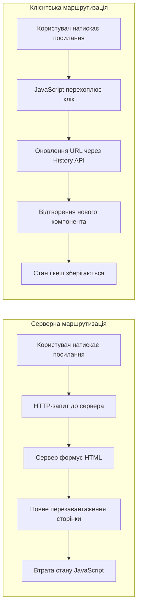
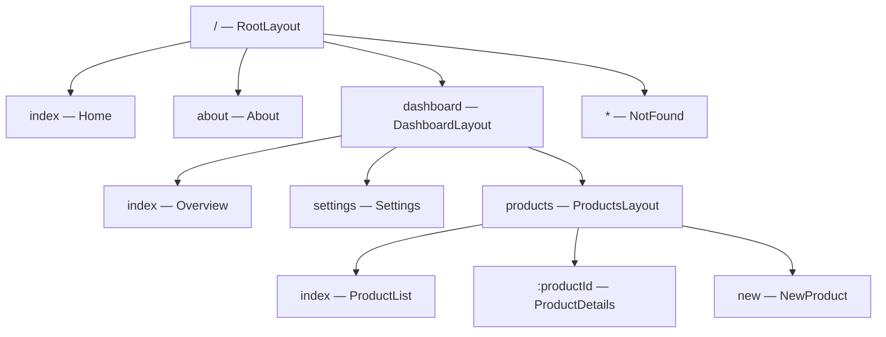
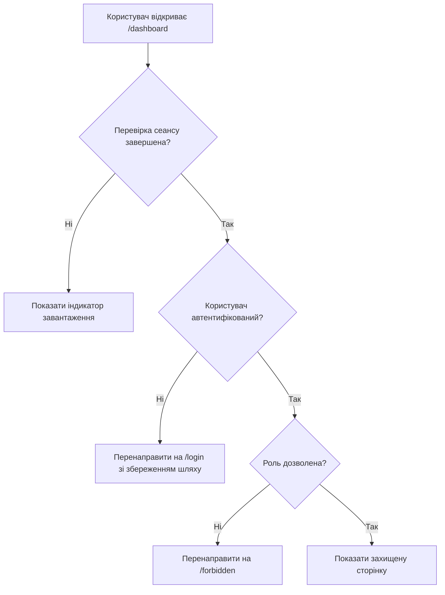
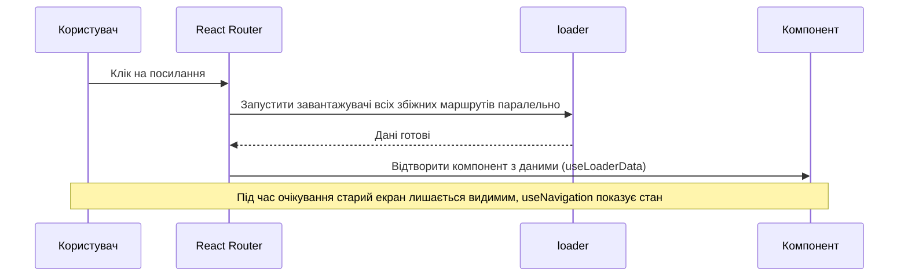

# Лекція 09 Маршрутизація та навігація (React Router)

## Вступ до клієнтської маршрутизації

### Навіщо застосунку маршрути

У попередній лекції ми розібралися, де зберігати стан застосунку. Але одне питання лишилося відкритим: що саме користувач бачить на екрані в цю мить? Відповідь на нього дає не лише стан у пам'яті, а й адреса в рядку браузера. Адреса дозволяє надіслати колезі посилання на конкретний товар, додати сторінку в закладки, повернутися на попередній екран кнопкою «Назад» і оновити сторінку, не втративши місце, на якому ви зупинилися. Усе це користувачі сприймають як належне, і застосунок, який цього не вміє, здається зламаним.

**Маршрутизація** (routing) — це механізм, який зіставляє адресу (URL) з тим, що відображається на екрані. Вона відповідає на два запитання: який компонент показати за цією адресою та як змінити адресу, коли користувач щось натискає. У цій лекції ми розглянемо, як це робить React Router — найпоширеніша бібліотека маршрутизації для React, — і як вона поєднується зі станом, про який ішлося в лекції 08. Адресу варто розглядати як ще один вид стану застосунку: спільний, публічний і такий, що переживає оновлення сторінки.

### Серверна маршрутизація та односторінкові застосунки

У традиційних вебзастосунках кожен перехід між сторінками означає новий HTTP-запит до сервера. Сервер формує нову HTML-сторінку, браузер завантажує її повністю, скидаючи весь стан JavaScript, і користувач на мить бачить порожній екран або мерехтіння. Такий підхід простий і добре працює для сайтів із переважно статичним вмістом, але для інтерактивних застосунків він надто повільний і фрагментований.

Односторінкові застосунки (Single Page Applications, SPA) працюють інакше. Сервер віддає одну HTML-сторінку під час першого завантаження, а подальші переходи обробляє JavaScript у браузері: він змінює адресу, не завантажуючи сторінку заново, і замінює потрібну частину інтерфейсу. Дані при цьому надходять окремими запитами до API (лекція 03), а не у складі готової HTML-розмітки.



Клієнтська маршрутизація дає кілька відчутних переваг:

**Швидкість**: перехід не потребує завантаження нового документа, браузер лише оновлює змінені частини сторінки.

**Плавність**: між екранами можливі анімації, а спільні елементи інтерфейсу (шапка, бічна панель) не відтворюються заново.

**Збереження стану**: форми, кеш запитів і глобальні сховища переживають навігацію.

**Відчуття нативного застосунку**: інтерфейс реагує миттєво, а «Назад» і «Вперед» працюють так, як звик користувач.

Проте за це доводиться платити. Застосунку потрібно самому стежити за історією переходів, показувати сторінку «не знайдено», керувати фокусом і прокручуванням, а також домовитися із сервером, щоб прямий перехід за адресою `/products/42` не закінчувався помилкою 404 (про це ми докладно поговоримо в розділі про розгортання). Крім того, SPA гірше піддається індексації пошуковими системами, ніж сторінки, сформовані на сервері. Для сайтів, де це критично, використовують серверне відтворення, і ми побачимо, що сучасний React Router має для цього окремий режим.

### Основні поняття

Клієнтська маршрутизація базується на кількох ідеях, які варто засвоїти до того, як переходити до коду.

**URL як частина стану застосунку.** Адреса відображає, що користувач зараз бачить. Зміна адреси призводить до зміни вмісту, а прямий вхід за адресою відновлює той самий вигляд сторінки.

**History API.** Це браузерний інтерфейс для керування історією переходів. Метод `pushState` додає в історію новий запис, а `replaceState` замінює поточний, причому обидва змінюють адресу без перезавантаження сторінки. Саме на них побудовано всю роботу React Router, а подія `popstate` повідомляє бібліотеці про натискання «Назад» і «Вперед».

**Декларативний опис маршрутів.** Замість імперативного коду «якщо адреса така, показати те» ви описуєте відповідність між шляхами й компонентами, а бібліотека сама вирішує, що відтворювати.

**Вкладені маршрути.** Адреса `/dashboard/users/42` природно складається з вкладених частин, і кожній відповідає власна ділянка інтерфейсу. Вкладені маршрути дозволяють відобразити цю ієрархію у структурі компонентів.

### Історія та сучасний стан React Router

React Router створили 2014 року Райан Флоренс і Майкл Джексон. За понад десять років бібліотека пройшла значну еволюцію.

- **v1–v3 (2014–2016)**: статична конфігурація маршрутів, здебільшого поза компонентами;
- **v4 (2017)**: повне переосмислення — маршрути стали звичайними компонентами, які можна розміщувати будь-де в дереві;
- **v5 (2019)**: додано хуки (`useParams`, `useHistory`) і покращено підтримку TypeScript;
- **v6 (2021)**: компактніший API, вкладені маршрути з `Outlet`, відносні шляхи, ранжування маршрутів;
- **v6.4 (2022)**: «маршрутизатори даних» (data routers) — завантажувачі `loader`, дії `action`, обробка помилок на рівні маршруту; ідеї прийшли з фреймворку Remix, створеного тією самою командою;
- **v7 (листопад 2024)**: Remix і React Router об'єднано в один проєкт. Пакет `react-router-dom` більше не потрібен — усе доступне з єдиного пакета `react-router`, мінімальна версія React — 18, а сама бібліотека розділена на три режими використання.

Тобто станом на жовтень 2026 року актуальною є гілка 7.x, і саме її ми вивчатимемо. Версія 6 багато в чому залишається сумісною з нею, тому більшість навчальних матеріалів і наявного коду, які ви зустрінете, написані для v6 і з імпортом із `react-router-dom`. Різниця майже ніколи не стосується логіки, а здебільшого — шляхів імпорту, і нижче ми розберемо, як мігрувати.

### Три режими React Router

Головна новація версії 7 — чітке розмежування трьох способів користуватися бібліотекою. Кожен наступний режим додає можливості до попереднього, ціною дедалі більшого впливу бібліотеки на архітектуру застосунку.

| Режим | Як визначаються маршрути | Що додає | Коли обирати |
|-------|--------------------------|----------|--------------|
| **Декларативний** (declarative) | JSX: `<BrowserRouter>`, `<Routes>`, `<Route>` | Зіставлення URL і компонентів, навігація, параметри | Простий SPA, навчальні проєкти, поступова міграція з v5 і v6 |
| **Режим даних** (data) | Об'єкти в `createBrowserRouter`, поза відтворенням | Завантажувачі `loader`, дії `action`, форми, стани очікування, межі помилок | SPA, де завантаження даних зручно прив'язати до переходів |
| **Режим фреймворку** (framework) | Файл `routes.ts` і плагін Vite | Серверне відтворення, розбиття коду, типобезпечні маршрути, попереднє формування сторінок | Повноцінні застосунки зі SEO, наступник Remix |

У цій лекції ми починаємо з декларативного режиму, бо він найпростіший і найкраще пояснює основні ідеї. Потім розглянемо режим даних, який є природним кроком уперед, а режим фреймворку лише окреслимо. Усі три режими поділяють спільне ядро, тому знання одного переноситься на інші.

## Основи React Router

### Встановлення та базове налаштування

Для нових проєктів на Vite достатньо одного пакета. Не плутайте його зі старим `react-router-dom`: у версії 7 той пакет залишився лише як перехідна оболонка.

```bash
# Створення проєкту на React (Vite)
npm create vite@latest my-app -- --template react
cd my-app

# Встановлення React Router
npm install react-router
```

Далі потрібно підключити маршрутизатор до застосунку. Зазвичай це робиться в точці входу, щоб усі компоненти мали доступ до інформації про поточну адресу.

```javascript
// src/main.jsx
import { StrictMode } from 'react';
import { createRoot } from 'react-dom/client';
import { BrowserRouter } from 'react-router';
import App from './App.jsx';

createRoot(document.getElementById('root')).render(
    <StrictMode>
        <BrowserRouter>
            <App />
        </BrowserRouter>
    </StrictMode>
);
```

```javascript
// src/App.jsx
import { Routes, Route } from 'react-router';

function App() {
    return (
        <Routes>
            <Route path="/" element={<Home />} />
            <Route path="/about" element={<About />} />
            <Route path="/contact" element={<Contact />} />
        </Routes>
    );
}

function Home() {
    return <h1>Головна сторінка</h1>;
}

function About() {
    return <h1>Про нас</h1>;
}

function Contact() {
    return <h1>Контакти</h1>;
}

export default App;
```

Три компоненти тут мають чітко розподілені ролі. `BrowserRouter` підписується на зміни історії браузера й надає поточну адресу всьому дереву. `Routes` читає цю адресу та вибирає серед своїх дочірніх `Route` найкращий збіг. `Route` описує одну відповідність: шлях (`path`) та елемент (`element`), який потрібно відтворити.

### Міграція з версії 6

Якщо ви працюєте з наявним проєктом, написаним для v6, перехід на v7 зазвичай відбувається без переписування логіки. Рекомендований порядок такий: спершу оновіть бібліотеку до останньої версії 6.x і ввімкніть «майбутні прапорці» (future flags), щоб побачити застереження в консолі; після цього перейдіть на v7 і замініть імпорти.

```bash
npm install react-router-dom@6    # останній v6: з'являться застереження про майбутні зміни
npm install react-router@latest   # перехід на v7
npm uninstall react-router-dom
```

```javascript
// Було
import { Link, useLocation } from 'react-router-dom';

// Стало
import { Link, useLocation } from 'react-router';

// Єдиний виняток: у режимі даних RouterProvider імпортується з окремого шляху
import { RouterProvider } from 'react-router/dom';
```

На практиці міграція зводиться до масової заміни рядка `from 'react-router-dom'` на `from 'react-router'` у файлах проєкту. Цього досить, якщо ви вже виконали вимоги прапорців.

### BrowserRouter і HashRouter

React Router надає кілька типів маршрутизаторів для різних умов розгортання.

**BrowserRouter** використовує звичайні шляхи та History API, тож адреси виглядають як `https://example.com/about`. Це вибір за замовчуванням для більшості застосунків. Він вимагає від сервера повертати `index.html` для будь-якої адреси застосунку, інакше пряме відкриття `/about` дасть помилку 404.

**HashRouter** зберігає маршрут у частині адреси після знака `#`, наприклад `https://example.com/#/about`. Браузер не надсилає цю частину на сервер, тому налаштовувати сервер не потрібно.

```javascript
import { HashRouter, Routes, Route } from 'react-router';

function App() {
    return (
        <HashRouter>
            {/* Адреса виглядає як https://example.com/#/about */}
            <Routes>
                <Route path="/about" element={<About />} />
            </Routes>
        </HashRouter>
    );
}
```

`HashRouter` доречний на статичних хостингах, де неможливо налаштувати перенаправлення. Його недоліки — менш охайні адреси, неможливість використовувати якорі `#section` у звичному значенні й складніша аналітика. Нарешті, **MemoryRouter** тримає історію в пам'яті, не змінюючи адреси браузера. Він використовується в тестах і середовищах без браузерної адресної стрічки (наприклад, у вбудованих віджетах).

Якщо застосунок розгортається не в корені домену, а в підкаталозі (скажімо, `https://user.github.io/my-app/`), маршрутизатору потрібно повідомити базовий шлях: `<BrowserRouter basename="/my-app">`. Те саме значення задають у налаштуванні `base` у Vite.

### Routes і Route

`Routes` вибирає з-поміж маршрутів той, що найкраще відповідає поточній адресі. Кожен `Route` описується шляхом і елементом.

```javascript
import { Routes, Route } from 'react-router';

function App() {
    return (
        <Routes>
            {/* Корінь застосунку */}
            <Route path="/" element={<Home />} />

            {/* Статичні шляхи */}
            <Route path="/about" element={<About />} />
            <Route path="/services" element={<Services />} />

            {/* Динамічні сегменти: двокрапка на початку сегмента позначає параметр */}
            <Route path="/users/:userId" element={<UserProfile />} />
            <Route path="/posts/:postId" element={<Post />} />

            {/* Необов'язковий сегмент: /about та /uk/about */}
            <Route path="/:lang?/pricing" element={<Pricing />} />

            {/* Решта: сторінка «не знайдено» */}
            <Route path="*" element={<NotFound />} />
        </Routes>
    );
}
```

Порядок оголошення маршрутів тут майже не має значення, адже бібліотека **ранжує** кандидатів: статичні сегменти важать більше за динамічні, а динамічні — більше за зірочку. Тому `/users/new` виграє у `/users/:userId`, навіть якщо оголошено пізніше. Це істотна відмінність від версії 4 і ранніх версій, де порядок був вирішальним.

Зірочка `*` у кінці шляху збирає «все, що лишилося» (її називають splat), і саме тому маршрут `path="*"` ловить усі невідомі адреси й чудово підходить для сторінки 404. Значення, зібране зірочкою, доступне як `useParams()['*']`.

### Link і NavLink

Звичайне HTML-посилання `<a href>` змусило б браузер завантажити сторінку заново, а отже, і втратити всі переваги SPA. Тому для внутрішньої навігації використовують компонент `Link`: він відтворює справжній елемент `<a>` (отже, працюють відкриття в новій вкладці, копіювання посилання й доступність), але перехоплює клік і виконує перехід через History API.

```javascript
import { Link } from 'react-router';

function Navigation() {
    return (
        <nav>
            <Link to="/">Головна</Link>
            <Link to="/about">Про нас</Link>
            <Link to="/contact">Контакти</Link>

            {/* Передача стану розташування (location state) */}
            <Link to="/profile" state={{ from: 'navigation' }}>
                Профіль
            </Link>

            {/* Відносні шляхи: рахуються від маршруту, у якому відтворено посилання */}
            <Link to="settings">Налаштування</Link>
            <Link to="..">На рівень вище</Link>
        </nav>
    );
}
```

Відносні шляхи заслуговують на окреме пояснення. За замовчуванням вони обчислюються відносно **маршруту**, у якому відтворено посилання, а не відносно всієї адреси. Тобто `..` піднімається на один рівень ієрархії маршрутів, а не на один сегмент URL. Якщо потрібна друга поведінка, додайте `relative="path"`. Така вибірковість зручна: розташування посилання у вкладеному маршруті залишає його коректним, навіть якщо ви змінили структуру адреси.

`NavLink` — це `Link`, який знає, чи веде він на поточну сторінку. Він додає до елемента клас `active` (а також `pending` під час завантаження даних) і дозволяє налаштувати вигляд через функції у `className` і `style`.

```javascript
import { NavLink } from 'react-router';

function Navigation() {
    return (
        <nav className="navigation">
            {/* end: активне лише за точного збігу, а не для всіх вкладених адрес */}
            <NavLink
                to="/"
                end
                className={({ isActive }) => (isActive ? 'nav-link active' : 'nav-link')}
            >
                Головна
            </NavLink>

            <NavLink
                to="/about"
                style={({ isActive }) => ({
                    color: isActive ? 'red' : 'black',
                    fontWeight: isActive ? 'bold' : 'normal'
                })}
            >
                Про нас
            </NavLink>

            <NavLink
                to="/dashboard"
                className={({ isActive, isPending }) =>
                    isPending ? 'pending' : isActive ? 'active' : ''
                }
            >
                Панель керування
            </NavLink>
        </nav>
    );
}
```

Зверніть увагу на атрибут `end` у першому посиланні. Без нього `NavLink to="/"` вважається активним для **будь-якої** адреси, оскільки всі вони починаються з `/`. Це одна з найтиповіших помилок у навігаційних меню: пункт «Головна» постійно підсвічений. Коротко кажучи, `end` потрібен корінню та будь-якому розділу, який має вкладені сторінки, якщо ви не хочете підсвічувати його разом з ними.

## Динамічні маршрути та параметри

Адреса може нести три різних види інформації, і для кожного існує свій інструмент. Параметри шляху (`/users/42`) ідентифікують **ресурс**, параметри запиту (`?sort=price`) описують його **подання**, а стан розташування передає **тимчасові** дані, які не повинні потрапити в адресу.

### Параметри шляху: useParams

Параметр шляху — це змінна частина маршруту, позначена двокрапкою. Хук `useParams` повертає об'єкт зі значеннями всіх параметрів поточного маршруту.

```javascript
import { useParams } from 'react-router';
import { useQuery } from '@tanstack/react-query';

// Маршрут: <Route path="/users/:userId" element={<UserProfile />} />
function UserProfile() {
    const { userId } = useParams();

    // Ключ запиту містить userId, тому при зміні адреси дані завантажуються автоматично
    const { data: user, isPending, error } = useQuery({
        queryKey: ['users', userId],
        queryFn: async ({ signal }) => {
            const res = await fetch(`/api/users/${userId}`, { signal });
            if (res.status === 404) throw new Error('Користувача не знайдено');
            if (!res.ok) throw new Error(`Помилка ${res.status}`);
            return res.json();
        }
    });

    if (isPending) return <p>Завантаження...</p>;
    if (error) return <p>{error.message}</p>;

    return (
        <article className="user-profile">
            <h1>{user.name}</h1>
            <p>{user.email}</p>
        </article>
    );
}

// Кілька параметрів
// <Route path="/posts/:postId/comments/:commentId" element={<Comment />} />
function Comment() {
    const { postId, commentId } = useParams();

    return <h2>Коментар {commentId} до допису {postId}</h2>;
}
```

Порівняйте цей код із завантаженням даних через `useEffect` з лекції 08: ключ запиту автоматично реагує на зміну `userId`, скасовує застарілий запит і кешує результат, тому повернення на вже відвідану сторінку відбувається миттєво. Кілька рядків спеціального коду для гонок запитів просто зникають.

Усі параметри шляху — **рядки**. Користувач може вручну набрати в адресі будь-що, тож значення потрібно перевіряти, перш ніж довіряти йому.

```javascript
function ProductPage() {
    const { productId } = useParams();

    // Number('42') === 42, але Number('abc') — NaN, а Number('4.5') — 4.5
    const id = Number(productId);

    if (!Number.isInteger(id) || id <= 0) {
        return <NotFound message="Некоректний ідентифікатор товару" />;
    }

    return <ProductDetails id={id} />;
}
```

Перевірка `Number.isInteger` відсікає і `NaN`, і дробові значення. Якщо ж у вас ідентифікатори — UUID або слаги, перевіряйте їх регулярним виразом. Пам'ятайте, що перевірка в браузері лише поліпшує досвід користувача; остаточну валідацію завжди виконує сервер.

### Параметри запиту: useSearchParams

Параметри запиту зручні для фільтрів, сортування, пошуку та пагінації: усього, що змінює подання списку, але не ідентифікує ресурс. Їхня головна перевага в тому, що посилання на відфільтрований список можна надіслати іншій людині, і вона побачить те саме.

Хук `useSearchParams` повертає пару, схожу на `useState`: об'єкт `URLSearchParams` і функцію для його оновлення.

```javascript
import { useSearchParams } from 'react-router';

function ProductList() {
    const [searchParams, setSearchParams] = useSearchParams();

    // Читання з розумними значеннями за замовчуванням
    const category = searchParams.get('category') ?? 'all';
    const sortBy = searchParams.get('sortBy') ?? 'name';
    const page = Math.max(1, Number.parseInt(searchParams.get('page') ?? '1', 10) || 1);

    // Єдина функція оновлення: змінюємо лише вказані ключі, решту зберігаємо.
    // null або порожній рядок видаляє параметр, щоб адреса лишалась охайною.
    function updateParams(changes) {
        setSearchParams((prev) => {
            const next = new URLSearchParams(prev);

            for (const [key, value] of Object.entries(changes)) {
                if (value === null || value === '') {
                    next.delete(key);
                } else {
                    next.set(key, value);
                }
            }

            return next;
        });
    }

    return (
        <div>
            {/* Адреса: /products?category=electronics&sortBy=price&page=2 */}
            <div className="filters">
                <select
                    value={category}
                    // Після зміни фільтра повертаємося на першу сторінку
                    onChange={(e) => updateParams({ category: e.target.value, page: null })}
                >
                    <option value="all">Усі категорії</option>
                    <option value="electronics">Електроніка</option>
                    <option value="books">Книги</option>
                </select>

                <select
                    value={sortBy}
                    onChange={(e) => updateParams({ sortBy: e.target.value, page: null })}
                >
                    <option value="name">За назвою</option>
                    <option value="price">За ціною</option>
                    <option value="date">За датою</option>
                </select>

                <button onClick={() => setSearchParams({})}>Скинути фільтри</button>
            </div>

            <ProductGrid category={category} sortBy={sortBy} page={page} />

            <button disabled={page === 1} onClick={() => updateParams({ page: String(page - 1) })}>
                Назад
            </button>
            <button onClick={() => updateParams({ page: String(page + 1) })}>Далі</button>
        </div>
    );
}
```

Тут варто звернути увагу на три речі. По-перше, функція `updateParams` копіює наявні параметри й змінює лише потрібні. Поширена помилка — передати в `setSearchParams` новий об'єкт `{ sortBy: newSort }`, і тоді всі інші параметри (наприклад, категорія) безслідно зникнуть. По-друге, значення за замовчуванням задаються під час читання (`?? 'all'`), і URL не засмічується параметрами, які дорівнюють цим значенням. По-третє, номер сторінки перетворюється на число явно: `parseInt` без другого аргументу (основи системи числення) вважається поганою практикою.

Для текстового пошуку, де адреса змінюється при кожному натисканні клавіші, використовуйте режим заміни, щоб не засмічувати історію сотнями записів:

```javascript
setSearchParams({ q: value }, { replace: true });
```

Для параметрів із кількома значеннями (теги, мультивибір) `URLSearchParams` має методи `getAll` і `append`:

```javascript
function TagFilter() {
    const [searchParams, setSearchParams] = useSearchParams();

    const tags = searchParams.getAll('tag'); // ['react', 'javascript']

    function addTag(tag) {
        if (tags.includes(tag)) return;

        setSearchParams((prev) => {
            const next = new URLSearchParams(prev);
            next.append('tag', tag);
            return next;
        });
    }

    function removeTag(tagToRemove) {
        setSearchParams((prev) => {
            const next = new URLSearchParams(prev);
            next.delete('tag');
            tags.filter((t) => t !== tagToRemove).forEach((t) => next.append('tag', t));
            return next;
        });
    }

    return (
        <div className="tags">
            {tags.map((tag) => (
                <span key={tag} className="tag">
                    {tag}
                    <button onClick={() => removeTag(tag)} aria-label={`Прибрати тег ${tag}`}>
                        ×
                    </button>
                </span>
            ))}
        </div>
    );
}
```

Наприкінці лекції 08 ми казали, що стан, яким користувачі діляться посиланням, слід зберігати в URL. Це саме той випадок: замість окремого `useReducer` для фільтрів списку (приклад із попередньої лекції) адреса сама стає джерелом істини, а `useQuery` бере ключ із параметрів. Reducer зберігає сенс для складніших випадків, коли стан не є переглядом списку.

### Стан розташування: useLocation

Хук `useLocation` повертає об'єкт поточного розташування. З нього можна прочитати не лише складові адреси, а й **стан розташування** (location state) — довільні дані, передані під час переходу, які не потрапляють в URL.

```javascript
import { useEffect } from 'react';
import { useLocation } from 'react-router';

function PageComponent() {
    const location = useLocation();

    console.log(location.pathname); // "/users/123"
    console.log(location.search);   // "?sort=name&page=2"
    console.log(location.hash);     // "#section-3"
    console.log(location.state);    // { from: '/products' } або null
    console.log(location.key);      // унікальний ключ запису в історії

    return <h1>Поточний шлях: {location.pathname}</h1>;
}

// Відстеження переходів: корисно для аналітики
function Analytics() {
    const { pathname, search } = useLocation();

    useEffect(() => {
        trackPageView(pathname + search);
    }, [pathname, search]);

    return null;
}
```

Стан розташування підходить для коротких повідомлень на кшталт «Профіль збережено» або для шляху, звідки прийшов користувач. Його не варто використовувати для даних, без яких сторінка не працює: при прямому вході за адресою, у новій вкладці чи після копіювання посилання стану не буде, а значення `location.state` дорівнюватиме `null`. Тому код завжди має вміти обійтися без нього.

```javascript
function ProductList() {
    return products.map((product) => (
        <Link
            key={product.id}
            to={`/products/${product.id}`}
            state={{ from: '/products?category=electronics' }}
        >
            {product.name}
        </Link>
    ));
}

function ProductDetails() {
    const location = useLocation();
    // Якщо стану немає (прямий вхід), повертаємося до загального списку
    const backTo = location.state?.from ?? '/products';

    return (
        <div>
            <Link to={backTo}>← Назад до списку</Link>
            <h1>Деталі товару</h1>
        </div>
    );
}
```

## Вкладені маршрути та макети

### Навіщо потрібна вкладеність

Спробуйте уявити типовий застосунок: шапка з навігацією завжди на місці, а під нею змінюється вміст. У розділі «Панель керування» додається бічне меню, а всередині нього — перелік користувачів і картка вибраного користувача. Інтерфейс складається з вкладених ділянок, і кожна змінюється незалежно від зовнішніх. Вкладені маршрути дозволяють описати цю структуру напряму: батьківський маршрут відповідає за спільну оболонку (макет, layout), а дочірні — за змінний вміст усередині неї.

Для порівняння: без вкладеності кожна сторінка повинна була б сама підключати шапку, меню й підвал, повторюючи їх в усіх файлах, а при переході вони відтворювалися б знову, втрачаючи свій стан (наприклад, згорнуте бічне меню).



### Outlet

Компонент `Outlet` — це місце в батьківському макеті, куди React Router вставляє відповідний дочірній маршрут. Без нього вкладені маршрути нікуди було б відтворити.

```javascript
import { Routes, Route, Outlet, NavLink } from 'react-router';

function App() {
    return (
        <Routes>
            {/* Батьківський маршрут із макетом */}
            <Route path="/" element={<RootLayout />}>
                <Route index element={<Home />} />
                <Route path="about" element={<About />} />
                <Route path="contact" element={<Contact />} />

                {/* Глибша вкладеність */}
                <Route path="dashboard" element={<DashboardLayout />}>
                    <Route index element={<Overview />} />
                    <Route path="settings" element={<Settings />} />

                    <Route path="products" element={<ProductsLayout />}>
                        <Route index element={<ProductList />} />
                        <Route path=":productId" element={<ProductDetails />} />
                        <Route path="new" element={<NewProduct />} />
                    </Route>
                </Route>

                <Route path="*" element={<NotFound />} />
            </Route>
        </Routes>
    );
}

function RootLayout() {
    return (
        <div className="layout">
            <header>
                <nav>
                    <NavLink to="/" end>Головна</NavLink>
                    <NavLink to="/about">Про нас</NavLink>
                    <NavLink to="/dashboard">Панель керування</NavLink>
                </nav>
            </header>

            <main className="content">
                {/* Сюди потрапляє відповідний дочірній маршрут */}
                <Outlet />
            </main>

            <footer>
                <p>© {new Date().getFullYear()} Мій застосунок</p>
            </footer>
        </div>
    );
}
```

Зауважте, що шляхи дочірніх маршрутів записано відносно батьківського: `path="about"` у `RootLayout` відповідає `/about`, а `path="settings"` усередині `dashboard` — `/dashboard/settings`. Під час переходу між дочірніми сторінками `RootLayout` не відтворюється заново, лише змінюється вміст `Outlet`.

### Індексні маршрути

Що має показуватися за адресою `/dashboard`, коли жоден із дочірніх шляхів не збігається? Без підказки — порожній `Outlet`, тобто макет без вмісту. Для цього існують **індексні маршрути** (`index`): вони відтворюються в `Outlet` батька, коли адреса збігається саме з батьківським шляхом.

```javascript
<Route path="dashboard" element={<DashboardLayout />}>
    {/* /dashboard → DashboardLayout + Overview */}
    <Route index element={<Overview />} />

    {/* /dashboard/settings → DashboardLayout + Settings */}
    <Route path="settings" element={<Settings />} />
</Route>
```

Без `index` адреса `/dashboard` показала б лише бічне меню і порожню область справа.

### Безшляхові макети та маршрути-префікси

Вкладеність не обов'язково прив'язана до сегмента адреси. Маршрут **без `path`**, але з `element` називається макетним (layout route): він додає спільну оболонку групі маршрутів, не змінюючи їхніх адрес. Цим зручно користуватися, щоб розділити публічну та приватну частини застосунку.

```javascript
<Routes>
    {/* Публічний макет: шлях не додається */}
    <Route element={<PublicLayout />}>
        <Route path="/" element={<Home />} />
        <Route path="/about" element={<About />} />
        <Route path="/login" element={<LoginPage />} />
    </Route>

    {/* Приватна частина: спільна оболонка плюс перевірка автентифікації */}
    <Route element={<RequireAuth />}>
        <Route path="/dashboard" element={<DashboardLayout />}>
            <Route index element={<Overview />} />
            <Route path="users" element={<UsersLayout />}>
                <Route index element={<UserList />} />
                <Route path=":userId" element={<UserDetails />} />
            </Route>
        </Route>
    </Route>

    {/* Маршрут-префікс: є path, але немає element — лише спільна частина адреси */}
    <Route path="docs">
        <Route index element={<DocsHome />} />
        <Route path=":slug" element={<DocPage />} />
    </Route>
</Routes>
```

Макет `RequireAuth` ми напишемо в наступному розділі: ця ідея добре ілюструє, чому безшляхові маршрути такі корисні. Одна обгортка закриває ціле піддерево, і потрібну перевірку неможливо забути додати до окремої сторінки.

### Передавання даних через Outlet

Батьківський макет може передати дані дочірнім маршрутам через властивість `context` компонента `Outlet`, а дочірні читають її хуком `useOutletContext`.

```javascript
import { Outlet, useOutletContext } from 'react-router';

function DashboardLayout() {
    const [notifications, setNotifications] = useState([]);

    return (
        <div className="dashboard">
            <Sidebar count={notifications.length} />
            <main>
                <Outlet context={{ notifications, setNotifications }} />
            </main>
        </div>
    );
}

function Overview() {
    const { notifications } = useOutletContext();

    return <p>Нових сповіщень: {notifications.length}</p>;
}
```

Цей механізм підходить для невеликої кількості даних, що стосуються лише одного піддерева маршрутів. Для глобального стану (поточний користувач, тема, кошик) і далі використовуйте Context або Zustand, як описано в лекції 08, а для даних сервера — TanStack Query.

## Захищені маршрути та автентифікація

### Ідея захисту маршрутів

Деякі сторінки мають бути доступні лише тим, хто увійшов у систему, або лише користувачам певної ролі. Типовий підхід — компонент-охоронець, який стоїть перед захищеним вмістом і вирішує, пустити користувача далі чи перенаправити його, наприклад, на сторінку входу. Він використовує провайдер автентифікації `AuthProvider` та хук `useAuth`, які ми побудували в лекції 08.

Одразу зазначимо важливий момент, який часто губиться в навчальних прикладах. **Захищений маршрут на клієнті не є захистом даних.** Увесь код застосунку завантажується в браузер, і будь-який користувач може відкрити його, змінити значення в пам'яті або обійти перевірку. Клієнтські захищені маршрути вирішують завдання досвіду користувача: не показувати людині сторінку, яку вона все одно не зможе використати, і вчасно запропонувати увійти. Справжній захист забезпечує сервер, який перевіряє автентифікацію й права доступу **при кожному запиті до API**, як описано в лекції 05. Інакше кажучи, навіть якщо хтось примусово відкриє адміністративну сторінку, сервер не віддасть йому жодних даних.



Перший крок діаграми — перевірка сеансу — особливо важливий. Після оновлення сторінки застосунок ще не знає, чи є активний сеанс: потрібно звернутися до сервера. Якщо в цей час вважати користувача «неавторизованим», його одразу ж викине на сторінку входу, хоча сеанс дійсний. Тому провайдер автентифікації має окремий прапорець `loading`, а охоронець чекає на його завершення.

### Охоронець на основі Outlet

Найпростіший спосіб — написати охоронця як макетний маршрут: він або відтворює `Outlet` (пускає далі), або перенаправляє. Такий компонент одразу захищає всі вкладені маршрути.

```javascript
import { Navigate, Outlet, useLocation } from 'react-router';
import { useAuth } from './AuthProvider.jsx';

export function RequireAuth() {
    const { user, loading } = useAuth();
    const location = useLocation();

    // Поки не знаємо, чи є сеанс, нічого не вирішуємо
    if (loading) {
        return <LoadingSpinner />;
    }

    if (!user) {
        // Запам'ятовуємо, куди хотів потрапити користувач
        return <Navigate to="/login" state={{ from: location }} replace />;
    }

    return <Outlet />;
}

// Використання: один охоронець для групи маршрутів
function App() {
    return (
        <Routes>
            <Route path="/login" element={<LoginPage />} />

            <Route element={<RequireAuth />}>
                <Route path="/dashboard" element={<Dashboard />} />
                <Route path="/profile" element={<Profile />} />
                <Route path="/settings" element={<Settings />} />
            </Route>
        </Routes>
    );
}
```

Параметр `replace` у `Navigate` замінює запис в історії, а не додає новий. Якби його не було, користувач, який натиснув «Назад» зі сторінки входу, повертався б на захищену сторінку, звідки його знову перенаправляло б на вхід, і так у нескінченному циклі.

### Повернення після входу

Користувач, якого перенаправили на вхід, очікує після автентифікації потрапити туди, куди йшов. Для цього охоронець передає початкове розташування в стані переходу, а сторінка входу його зчитує.

```javascript
import { useState } from 'react';
import { Navigate, useLocation, useNavigate } from 'react-router';

function LoginPage() {
    const { user, login } = useAuth();
    const navigate = useNavigate();
    const location = useLocation();
    const [error, setError] = useState(null);
    const [pending, setPending] = useState(false);

    // Куди повернути користувача: шлях разом із параметрами запиту
    const origin = location.state?.from;
    const target = origin ? origin.pathname + origin.search + origin.hash : '/dashboard';

    // Уже автентифікований користувач не повинен бачити форму входу
    if (user) {
        return <Navigate to={target} replace />;
    }

    async function handleSubmit(event) {
        event.preventDefault(); // без цього браузер перезавантажить сторінку

        const form = new FormData(event.currentTarget);
        setPending(true);
        setError(null);

        try {
            await login({ email: form.get('email'), password: form.get('password') });
            // replace: «Назад» не повертає до форми входу
            navigate(target, { replace: true });
        } catch (err) {
            setError(err.message);
        } finally {
            setPending(false);
        }
    }

    return (
        <form onSubmit={handleSubmit}>
            <label>
                Електронна пошта
                <input name="email" type="email" required autoComplete="username" />
            </label>
            <label>
                Пароль
                <input name="password" type="password" required autoComplete="current-password" />
            </label>

            {error && <p role="alert">{error}</p>}

            <button type="submit" disabled={pending}>
                {pending ? 'Вхід...' : 'Увійти'}
            </button>
        </form>
    );
}
```

Кілька деталей цього прикладу заслуговують на увагу. Виклик `event.preventDefault()` обов'язковий, інакше браузер виконає звичайне надсилання форми й перезавантажить сторінку; саме його часто забувають у спрощених прикладах. Дані форми читаються через `FormData`, тому для неї не потрібно окремого стану на кожне поле. Помилка входу відображається в елементі з `role="alert"`, щоб програми екранного доступу озвучили її. Нарешті, `try/finally` гарантує, що кнопка розблокується за будь-якого результату.

### Захист на основі ролей

Найпростіша перевірка ролей розширює охоронця параметром `roles`. Ті самі правила діють і для перевірки окремих прав доступу (permissions): тоді замість `user.role` порівнюється набір дозволів користувача.

```javascript
export function RequireAuth({ roles }) {
    const { user, loading } = useAuth();
    const location = useLocation();

    if (loading) return <LoadingSpinner />;

    if (!user) {
        return <Navigate to="/login" state={{ from: location }} replace />;
    }

    // Автентифікований, але без потрібної ролі
    if (roles && !roles.includes(user.role)) {
        return <Navigate to="/forbidden" replace />;
    }

    return <Outlet />;
}

function App() {
    return (
        <Routes>
            <Route path="/login" element={<LoginPage />} />
            <Route path="/forbidden" element={<Forbidden />} />

            {/* Будь-який автентифікований користувач */}
            <Route element={<RequireAuth />}>
                <Route path="/dashboard" element={<Dashboard />} />
                <Route path="/profile" element={<Profile />} />
            </Route>

            {/* Лише адміністратори */}
            <Route element={<RequireAuth roles={['admin']} />}>
                <Route path="/admin" element={<AdminPanel />} />
                <Route path="/admin/users" element={<UserManagement />} />
            </Route>

            {/* Модератори та адміністратори */}
            <Route element={<RequireAuth roles={['moderator', 'admin']} />}>
                <Route path="/moderate" element={<ModerationPanel />} />
            </Route>

            <Route path="*" element={<NotFound />} />
        </Routes>
    );
}
```

Розрізняйте дві ситуації: користувач не автентифікований (HTTP 401, потрібно увійти) і користувач автентифікований, але не має прав (HTTP 403, входити знову безглуздо). Перша веде на сторінку входу, друга — на сторінку «Доступ заборонено». Змішувати їх погана ідея: людині, яка вже увійшла, пропонувати знову ввести пароль — безглуздо й дратує.

## Програмна навігація

Посилання вирішують більшість потреб, але інколи перехід має відбутися як наслідок певної події: після успішного надсилання форми, збереження запису, закінчення таймера. Тоді вдаються до програмної навігації.

### useNavigate

Хук `useNavigate` повертає функцію, яка виконує перехід. Викликати її слід в обробниках подій або ефектах, але ніколи не під час відтворення компонента.

```javascript
import { useNavigate } from 'react-router';

function ProductForm() {
    const navigate = useNavigate();

    async function handleSave(event) {
        event.preventDefault();

        const saved = await saveProduct(new FormData(event.currentTarget));

        // Перехід зі станом: показуємо повідомлення на новій сторінці
        navigate(`/products/${saved.id}`, {
            state: { message: 'Товар збережено' }
        });
    }

    return (
        <form onSubmit={handleSave}>
            {/* поля форми */}
            <button type="button" onClick={() => navigate(-1)}>
                Скасувати
            </button>
            <button type="submit">Зберегти</button>
        </form>
    );
}
```

Числовий аргумент працює як кнопки браузера: `navigate(-1)` — назад, `navigate(1)` — вперед, `navigate(-2)` — на два записи назад. Слід, однак, пам'ятати, що `navigate(-1)` веде на попередню сторінку **історії**, а не обов'язково на попередню сторінку **застосунку**: якщо користувач відкрив форму за прямим посиланням, «назад» виведе його з вашого сайту. Коли відомо, куди саме потрібно повернутися, надійніше вказати цей шлях явно.

Відносні шляхи в `navigate` поводяться так само, як і в `Link`: вони відраховуються від маршруту, у якому відтворено компонент.

```javascript
function SettingsPage() {
    const navigate = useNavigate();

    return (
        <div>
            <button onClick={() => navigate('profile')}>Профіль</button>
            <button onClick={() => navigate('..')}>На рівень вище</button>
        </div>
    );
}
```

### Додавання запису чи заміна: push і replace

Кожен перехід або додає в історію новий запис (`push`, поведінка за замовчуванням), або замінює поточний (`replace`). Різниця проявляється в поведінці кнопки «Назад».

```javascript
function Navigation() {
    const navigate = useNavigate();

    // push: «Назад» поверне на попередню сторінку
    const goToDashboard = () => navigate('/dashboard');

    // replace: поточний запис замінюється, «Назад» його «пропустить»
    const redirectHome = () => navigate('/', { replace: true });

    return (
        <div>
            <button onClick={goToDashboard}>Панель керування</button>
            <button onClick={redirectHome}>На головну (replace)</button>
        </div>
    );
}
```

Замість `push` використовуйте `replace`, коли попередня сторінка вже втратила сенс: після входу чи виходу з системи, після завершення багатокрокового процесу, під час перенаправлень, а також для частих оновлень адреси (пошук за вводом). Вибір між ними — це рішення щодо досвіду користувача: що він очікує побачити, натиснувши «Назад»?

### Багатокрокові форми й адреса

У спрощених прикладах багатокрокову форму часто реалізують із двома джерелами істини: номером кроку в `useState` та адресою в URL. Вони легко розходяться, наприклад, коли користувач натискає «Назад» і URL змінюється, а стан — ні. Надійніше зробити адресу єдиним джерелом: номер кроку береться з параметра маршруту.

```javascript
import { Navigate, useNavigate, useParams } from 'react-router';

const STEPS = [1, 2, 3];

// <Route path="/form/:step" element={<Wizard />} />
function Wizard() {
    const { step } = useParams();
    const navigate = useNavigate();
    const current = Number(step);

    // Некоректний крок у URL — повертаємо на початок
    if (!STEPS.includes(current)) {
        return <Navigate to="/form/1" replace />;
    }

    function goNext() {
        if (current < STEPS.length) {
            navigate(`/form/${current + 1}`); // push: «Назад» повертає на попередній крок
        } else {
            navigate('/success', { replace: true }); // завершення: не повертатися у форму
        }
    }

    return (
        <section>
            <h2>Крок {current} із {STEPS.length}</h2>
            {/* введені дані зберігаються в Context або Zustand — див. лекцію 08 */}
            <button onClick={goNext}>{current < STEPS.length ? 'Далі' : 'Завершити'}</button>
        </section>
    );
}
```

Тепер кнопки «Назад» і «Вперед» у браузері працюють природно, а оновлення сторінки не скидає користувача на перший крок. Введені на кроках дані тримайте у стані, який не залежить від маршрутів (Context, Zustand), інакше вони зникнуть разом із компонентом кроку.

### Декларативне перенаправлення: Navigate

Компонент `Navigate` виконує перехід під час відтворення. Фактичний перехід відбувається в ефекті, тому його безпечно повертати прямо з компонента, чого не можна робити з `navigate()`.

```javascript
import { Navigate } from 'react-router';

// Умовне перенаправлення всередині компонента
function Dashboard() {
    const { user } = useAuth();

    if (!user) return <Navigate to="/login" replace />;
    if (!user.emailVerified) return <Navigate to="/verify-email" replace />;

    return <h1>Панель керування</h1>;
}

// Перенаправлення як частина таблиці маршрутів
function App() {
    return (
        <Routes>
            {/* Старі адреси ведуть на нові */}
            <Route path="/old-dashboard" element={<Navigate to="/dashboard" replace />} />
            <Route path="/home" element={<Navigate to="/" replace />} />

            <Route path="/" element={<Home />} />
            <Route path="*" element={<NotFound />} />
        </Routes>
    );
}
```

Для старих адрес, які вже проіндексовано пошуковими системами або збережено в закладках, клієнтське перенаправлення є лише тимчасовим доповненням. Справжнє постійне перенаправлення (HTTP 301) налаштовують на сервері.

## Режим даних: завантажувачі та дії

### Проблема «водоспаду» запитів

У декларативному режимі дані завантажує сам компонент уже після відтворення: спочатку з'являється макет, потім сторінка, потім її вкладений компонент, і кожен у свою чергу запускає запит. Такі послідовні завантаження називають **водоспадом** (waterfall): запит вкладеного компонента починається лише після того, як завершиться відтворення батька. Користувач при цьому довше бачить індикатори завантаження.

Режим даних вирішує проблему інакше: маршрути оголошуються як об'єкти поза відтворенням, і до кожного можна прив'язати функцію `loader`, яка запускається **в момент переходу**, паралельно для всіх вкладених маршрутів, ще до того, як компонент з'явиться на екрані.



### Створення маршрутизатора

Маршрути описуються масивом об'єктів і передаються в `createBrowserRouter`. Зверніть увагу, що `RouterProvider` у v7 імпортується з окремого шляху `react-router/dom`.

```javascript
// src/router.jsx
import { createBrowserRouter } from 'react-router';

export const router = createBrowserRouter([
    {
        path: '/',
        Component: RootLayout,
        ErrorBoundary: RootError,
        children: [
            { index: true, Component: Home },
            {
                path: 'products',
                Component: ProductsLayout,
                children: [
                    { index: true, loader: productsLoader, Component: ProductList },
                    { path: ':productId', loader: productLoader, Component: ProductDetails },
                    { path: 'new', action: createProductAction, Component: NewProduct }
                ]
            },
            { path: '*', Component: NotFound }
        ]
    }
]);
```

```javascript
// src/main.jsx
import { createRoot } from 'react-dom/client';
import { RouterProvider } from 'react-router/dom';
import { router } from './router.jsx';

createRoot(document.getElementById('root')).render(<RouterProvider router={router} />);
```

Зверніть увагу: це лише інший спосіб запису тієї самої ієрархії, яку ми будували в JSX. Усі знання про `Outlet`, `NavLink`, `useParams`, індексні та безшляхові маршрути лишаються чинними.

### Завантажувачі: loader

Завантажувач — це функція, яка отримує параметри маршруту та об'єкт `request`, а повертає дані (або кидає помилку). Компонент читає результат через `useLoaderData`.

```javascript
// Завантажувач отримує params з адреси та request із AbortSignal
export async function productLoader({ params, request }) {
    const response = await fetch(`/api/products/${params.productId}`, {
        signal: request.signal // запит скасується, якщо користувач перейшов кудись інде
    });

    if (response.status === 404) {
        throw new Response('Товар не знайдено', { status: 404 });
    }
    if (!response.ok) {
        throw new Response('Помилка сервера', { status: response.status });
    }

    return response.json();
}

import { useLoaderData } from 'react-router';

function ProductDetails() {
    const product = useLoaderData(); // дані вже готові, без стану завантаження

    return (
        <article>
            <h1>{product.name}</h1>
            <p>{product.description}</p>
        </article>
    );
}
```

Компонент отримує готові дані, і йому не потрібні ні `useEffect`, ні проміжні стани `loading` та `error`. Помилки перехоплює межа помилок маршруту, про яку ми зараз розкажемо.

### Межі помилок

Якщо завантажувач кидає виняток, або відтворення компонента завершується помилкою, React Router показує елемент `ErrorBoundary` ближчого маршруту, не руйнуючи весь застосунок. Помилку отримують хуком `useRouteError`.

```javascript
import { isRouteErrorResponse, useRouteError, Link } from 'react-router';

function RootError() {
    const error = useRouteError();

    // Відповіді, кинуті як Response (наприклад, 404 із завантажувача)
    if (isRouteErrorResponse(error)) {
        return (
            <div role="alert">
                <h1>{error.status}</h1>
                <p>{error.data}</p>
                <Link to="/">На головну</Link>
            </div>
        );
    }

    // Неочікувані помилки в коді
    return (
        <div role="alert">
            <h1>Щось пішло не так</h1>
            <p>Спробуйте оновити сторінку.</p>
        </div>
    );
}
```

Межі помилок працюють ієрархічно: помилка в завантажувачі сторінки товару показується в найближчій межі помилок, а решта макета (шапка, меню) лишається працездатною. Це набагато зручніше, ніж одна загальна сторінка помилки на весь застосунок.

### Форми та дії: Form і action

Для змін даних режим даних пропонує дії (`action`). Компонент `Form` відправляє дані на дію маршруту без перезавантаження сторінки, після чого React Router **автоматично повторно викликає завантажувачі**, щоб інтерфейс показав актуальні дані.

```javascript
import { Form, redirect, useActionData, useNavigation } from 'react-router';

export async function createProductAction({ request }) {
    const formData = await request.formData();
    const name = String(formData.get('name') ?? '').trim();

    // Помилки валідації повертаємо як дані — вони потраплять у useActionData
    if (name.length < 2) {
        return { errors: { name: 'Назва має містити щонайменше 2 символи' } };
    }

    const response = await fetch('/api/products', {
        method: 'POST',
        headers: { 'Content-Type': 'application/json' },
        body: JSON.stringify({ name })
    });

    if (!response.ok) {
        throw new Response('Не вдалося створити товар', { status: response.status });
    }

    const product = await response.json();
    return redirect(`/products/${product.id}`); // успіх: перейти на сторінку товару
}

function NewProduct() {
    const actionData = useActionData();
    const navigation = useNavigation();
    const isSubmitting = navigation.state === 'submitting';

    return (
        <Form method="post">
            <label>
                Назва
                <input name="name" required />
            </label>
            {actionData?.errors?.name && <p role="alert">{actionData.errors.name}</p>}

            <button type="submit" disabled={isSubmitting}>
                {isSubmitting ? 'Збереження...' : 'Створити'}
            </button>
        </Form>
    );
}
```

Хук `useNavigation` повідомляє про поточний стан переходу: `idle`, `loading` (виконуються завантажувачі) або `submitting` (виконується дія). Завдяки йому можна показати індикатор над усім застосунком, не заводячи для цього власного стану.

Для дій, що не повинні змінювати адресу (наприклад, кнопка «вподобати» чи видалення рядка в таблиці), існує `useFetcher`: він надсилає запит до дії або завантажувача, не здійснюючи переходу.

### Поєднання з TanStack Query

Режим даних і TanStack Query не конкурують, а доповнюють один одного. Завантажувач запускає запит під час переходу (щоб уникнути водоспаду), а кеш бібліотеки робить повторні переходи миттєвими. Спільний «опис запиту» використовується в обох місцях.

```javascript
import { queryOptions } from '@tanstack/react-query';

export const productQuery = (id) =>
    queryOptions({
        queryKey: ['products', id],
        queryFn: ({ signal }) => fetchProduct(id, { signal })
    });

// Завантажувач розігріває кеш; якщо дані свіжі, запит не повторюється
export const productLoader = (queryClient) => async ({ params }) => {
    await queryClient.ensureQueryData(productQuery(params.productId));
    return null;
};

function ProductDetails() {
    const { productId } = useParams();
    const { data: product } = useQuery(productQuery(productId));
    // ...
}
```

Для невеликих навчальних застосунків достатньо чогось одного: або TanStack Query в компонентах, або завантажувачів. Для великих корисно знати обидва підходи.

## Ледаче завантаження та продуктивність

### Розбиття коду за маршрутами

Чим більший застосунок, тим більший початковий пакет JavaScript, який користувач має завантажити, щоб побачити першу сторінку. Більшість користувачів ніколи не відкриє адміністративну панель, тож завантажувати її код разом із головною сторінкою марно. Маршрути — природні межі для розбиття коду: сторінка завантажується лише тоді, коли користувач до неї переходить.

У декларативному режимі для цього використовують `React.lazy` і `Suspense`.

```javascript
import { lazy, Suspense } from 'react';
import { Outlet } from 'react-router';

// Динамічний імпорт: збирач створює окремий файл для цієї сторінки
const Reports = lazy(() => import('./pages/Reports.jsx'));
const AdminPanel = lazy(() => import('./pages/AdminPanel.jsx'));

function RootLayout() {
    return (
        <div className="layout">
            <Header />
            <main>
                {/* Одна межа очікування для всіх ледачих сторінок */}
                <Suspense fallback={<LoadingSpinner />}>
                    <Outlet />
                </Suspense>
            </main>
        </div>
    );
}
```

Помістивши `Suspense` у макет навколо `Outlet`, ви обходитеся однією межею очікування замість обгортання кожної сторінки. Компоненти, на які посилається `lazy`, мають експортуватися за замовчуванням.

У режимі даних для цього є окрема властивість `lazy` маршруту. Вона підвантажує модуль, який експортує `Component` та, за потреби, `loader` й `action`, тож код і завантажувач сторінки приходять разом.

```javascript
{
    path: 'reports',
    lazy: () => import('./routes/reports.jsx') // модуль експортує Component і loader
}
```

### Прокручування й фокус після переходу

У класичному вебі кожен перехід починається з верхньої частини нової сторінки, а екранні програми оголошують нову сторінку. У SPA нічого цього не відбувається автоматично: після кліку на посилання у кінці довгої сторінки користувач потрапить на нову сторінку зі збереженою прокруткою. У режимі даних цю проблему вирішує компонент `<ScrollRestoration />`, а в декларативному — просте рішення на основі ефекту.

```javascript
import { useEffect, useRef } from 'react';
import { Outlet, useLocation } from 'react-router';

function RootLayout() {
    const { pathname } = useLocation();
    const mainRef = useRef(null);

    useEffect(() => {
        window.scrollTo(0, 0);        // нова сторінка починається зверху
        mainRef.current?.focus();     // фокус переходить до вмісту для екранних програм
    }, [pathname]);

    return (
        <>
            <Header />
            {/* tabIndex={-1} дозволяє програмно фокусувати елемент без додавання в порядок Tab */}
            <main ref={mainRef} tabIndex={-1}>
                <Outlet />
            </main>
        </>
    );
}
```

Додатково на кожній сторінці бажано оновлювати заголовок вкладки (`document.title`), адже саме його читає екранна програма під час переходу і саме його бачить користувач в історії браузера. У React 19 зручно просто відтворити елемент `<title>` у компоненті сторінки: React самостійно перемістить його в `<head>`.

## Режим фреймворку

Режим фреймворку обгортає режим даних плагіном Vite та додає те, чого не вистачає чистому SPA: серверне відтворення, автоматичне розбиття коду за маршрутами, попереднє формування статичних сторінок, типобезпечні параметри й дані маршрутів. Маршрути тут задаються в окремому файлі `app/routes.ts`, а кожен маршрут — це модуль, який експортує компонент, завантажувач і дію.

```bash
npx create-react-router@latest my-framework-app
```

```typescript
// app/routes.ts
import { type RouteConfig, index, route, layout } from '@react-router/dev/routes';

export default [
    index('routes/home.tsx'),
    route('about', 'routes/about.tsx'),
    layout('routes/dashboard-layout.tsx', [
        route('dashboard', 'routes/dashboard.tsx'),
        route('products/:productId', 'routes/product.tsx')
    ])
] satisfies RouteConfig;
```

```typescript
// app/routes/product.tsx
import type { Route } from './+types/product';

export async function loader({ params }: Route.LoaderArgs) {
    return fetchProduct(params.productId); // працює на сервері
}

export default function Product({ loaderData }: Route.ComponentProps) {
    return <h1>{loaderData.name}</h1>;
}
```

Зверніть увагу, що `loaderData` і `params` тут мають точні типи, згенеровані з опису маршрутів. Серверне відтворення можна вимкнути, і тоді фреймворк збирає звичайний SPA, але зберігає решту переваг.

Режим фреймворку є прямим наступником Remix і суперником Next.js, який ми згадували в лекції 01. Принципова відмінність у способі оголошення маршрутів: Next.js виводить їх зі структури папок (файлова маршрутизація), а React Router — з явного файлу конфігурації, хоча й дозволяє підключити файлову маршрутизацію пакетом. У цьому курсі ми зосереджуємось на декларативному режимі та режимі даних, оскільки вони складають основу, а інші підходи на них спираються.

## Робота із сервером та розгортання

### Резервний перехід на index.html

Тут ми повертаємося до обіцяної проблеми. Користувач натискає на посилання в застосунку: React Router змінює адресу на `/products/42` без жодного запиту. Але якщо той самий користувач оновить сторінку або відкриє це посилання у новій вкладці, браузер надішле серверу запит `GET /products/42`. Сервер не має такого файлу й відповідає 404. Рішення — налаштувати сервер так, щоб на всі адреси, яким не відповідає реальний файл, він віддавав `index.html`: далі маршрутизатор у браузері сам розбереться, що показувати.

Dev-сервер Vite робить це автоматично, тому під час розробки проблема не проявляється, і з'являється вона лише після розгортання. Ось як це налаштовується.

**Nginx:**

```nginx
location / {
    try_files $uri $uri/ /index.html;
}
```

**Express 5** (ES-модулі, Node.js 24):

```javascript
import express from 'express';
import path from 'node:path';

const app = express();
const distDir = path.join(import.meta.dirname, 'dist'); // Vite збирає застосунок у dist

// 1. Маршрути API — до резервного переходу
app.use('/api', apiRouter);

// 2. Статичні файли збірки
app.use(express.static(distDir));

// 3. Решта запитів — на index.html (у Express 5 символ-замінник має бути іменованим)
app.get('/{*splat}', (req, res) => {
    res.sendFile(path.join(distDir, 'index.html'));
});

app.listen(3000);
```

Зверніть увагу на три відмінності від багатьох застарілих прикладів. По-перше, у Express 5 запис `app.get('*', ...)` викликає помилку: символ-замінник має ім'я, а запис `/{*splat}` додатково охоплює кореневу адресу. По-друге, у модулях ES змінної `__dirname` немає, замість неї використовують `import.meta.dirname`. По-третє, Vite збирає проєкт у каталог `dist`, а не `build` (так було в застарілому Create React App, підтримку якого припинено). Також важливо, щоб маршрути API були оголошені **до** резервного переходу: інакше неправильний запит до `/api/...` отримає у відповідь HTML-сторінку замість JSON.

Резервний перехід має побічний наслідок: сервер відповідає кодом 200 навіть на неіснуючі адреси, і пошукові системи можуть вважати їх нормальними сторінками. Якщо для вас це має значення, використовуйте режим фреймворку із серверним відтворенням або сервер, який знає список допустимих маршрутів.

На статичних хостингах без такого налаштування (наприклад, GitHub Pages) є два шляхи: використати `HashRouter` або створити копію `index.html` під назвою `404.html`, яку хостинг показуватиме на невідомі адреси. Не забудьте також про `basename` і `base`, якщо застосунок розміщується в підкаталозі.

## Тестування маршрутів

Компоненти, які використовують хуки маршрутизації, не можна відтворювати без маршрутизатора: у них просто немає звідки взяти адресу. Для тестів використовують `MemoryRouter`, який приймає початкову історію у властивості `initialEntries`.

```javascript
import { render, screen } from '@testing-library/react';
import { MemoryRouter, Routes, Route } from 'react-router';
import { expect, test } from 'vitest';

test('показує профіль користувача за параметром адреси', () => {
    render(
        <MemoryRouter initialEntries={['/users/42']}>
            <Routes>
                <Route path="/users/:userId" element={<UserBadge />} />
            </Routes>
        </MemoryRouter>
    );

    expect(screen.getByText('Користувач 42')).toBeInTheDocument();
});
```

Для режиму даних відповідна функція — `createMemoryRouter`. Вона дозволяє перевіряти й завантажувачі та дії, не залежачи від браузера. Захищені маршрути тестують, подаючи компоненту різні значення `AuthProvider`: з користувачем, без нього та в стані завантаження.

## Висновки та найкращі практики

### Розуміння React Router

React Router залишається стандартом клієнтської маршрутизації в екосистемі React. Версія 7 об'єднала його з Remix і запропонувала три режими використання: декларативний для простих застосунків, режим даних для тих, де завантаження даних зручно прив'язати до переходів, і режим фреймворку для повноцінних застосунків із серверним відтворенням. Ядро — зіставлення адреси й компонентів, вкладені маршрути та хуки — спільне для всіх трьох, тому знання з одного режиму легко переносяться в інший.

Центральна ідея лекції полягає в тому, що адреса — це частина стану застосунку. Вона ідентифікує ресурс (параметри шляху), описує подання (параметри запиту) і лишається незмінною при оновленні сторінки та надсиланні посилання. Те, що користувач має вміти запам'ятати чи передати комусь, варто зберігати в URL, а не в `useState`.

### Організація маршрутів

Будуйте маршрути ієрархічно: використовуйте вкладеність для спільних макетів, безшляхові маршрути для груп із загальною поведінкою (автентифікація) і індексні маршрути для вмісту за замовчуванням. Описуйте шляхи через `NavLink` із атрибутом `end` там, де потрібна підсвітка активного пункту, і завжди додавайте сторінку 404 через `path="*"`. Пам'ятайте, що відносні шляхи рахуються від маршруту, а не від адреси.

### Параметри й дані

Параметри шляху — завжди рядки, тому їх перевіряють, а параметри запиту читають із розумними значеннями за замовчуванням і оновлюють, зберігаючи решту параметрів. Дані сервера завантажуйте через TanStack Query у компонентах або через `loader` у режимі даних, а не вручну через `useEffect`. Стан розташування використовуйте лише для тимчасових даних, без яких сторінка вміє працювати.

### Безпека

Клієнтські захищені маршрути — це інструмент зручності, а не захисту. Кожне обмеження доступу має дублюватися на сервері. Обробляйте стан завантаження сеансу, щоб користувача не перенаправляло помилково, розрізняйте відсутність автентифікації та брак прав, повертайте користувача туди, куди він ішов, і ніколи не зберігайте токени в `localStorage`.

### Найкращі практики

1. **Починайте з декларативного режиму**, переходьте до режиму даних, коли потрібні завантажувачі й дії, а режим фреймворку обирайте для застосунків із серверним відтворенням;
2. **Імпортуйте все з `react-router`**: пакет `react-router-dom` у версії 7 не потрібен;
3. **Використовуйте `Link` і `NavLink` замість `<a>`** для внутрішніх посилань, а `end` додавайте до кореня й розділів із вкладеними сторінками;
4. **Організовуйте маршрути ієрархічно**: вкладені макети, `Outlet`, індексні й безшляхові маршрути;
5. **Перевіряйте параметри шляху** та обробляйте некоректні значення;
6. **Зберігайте в URL стан, яким діляться**: фільтри, пошук, сторінку; оновлюйте параметри, не втрачаючи інших;
7. **Охороняйте приватні маршрути одним макетом** з обробкою стану завантаження, збереженням шляху повернення та розрізненням 401 і 403;
8. **Не покладайтеся на клієнтські перевірки** як на захист: авторизація виконується на сервері;
9. **Вибирайте між `push` і `replace` свідомо**: `replace` — для входу, завершення процесів і частих оновлень;
10. **Розбивайте код за маршрутами** через `lazy` і `Suspense`;
11. **Налаштуйте резервний перехід на `index.html`** на сервері й оголошуйте маршрути API до нього;
12. **Піклуйтеся про прокручування й фокус** після переходів і оновлюйте заголовок сторінки;
13. **Тестуйте маршрути через `MemoryRouter`** та `createMemoryRouter`.

Розуміння цих принципів дозволяє створювати застосунки зі зручною, передбачуваною й безпечною навігацією, у яких адреса є повноцінною частиною архітектури. У наступних лекціях ми побачимо, як маршрутизація та стан поєднуються з формами, перевіркою даних і взаємодією з API.

### Джерела для подальшого вивчення

- Документація React Router: [reactrouter.com](https://reactrouter.com)
- Перехід з версії 6 на 7: [reactrouter.com/upgrading/v6](https://reactrouter.com/upgrading/v6)
- Огляд режимів: [reactrouter.com/start/modes](https://reactrouter.com/start/modes)
- History API: [developer.mozilla.org/docs/Web/API/History_API](https://developer.mozilla.org/docs/Web/API/History_API)
