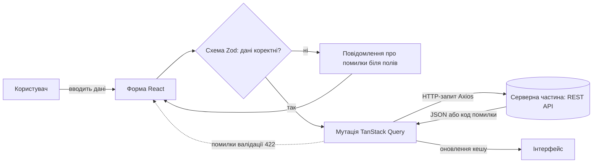
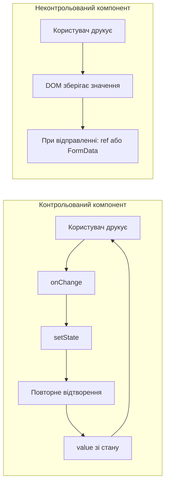
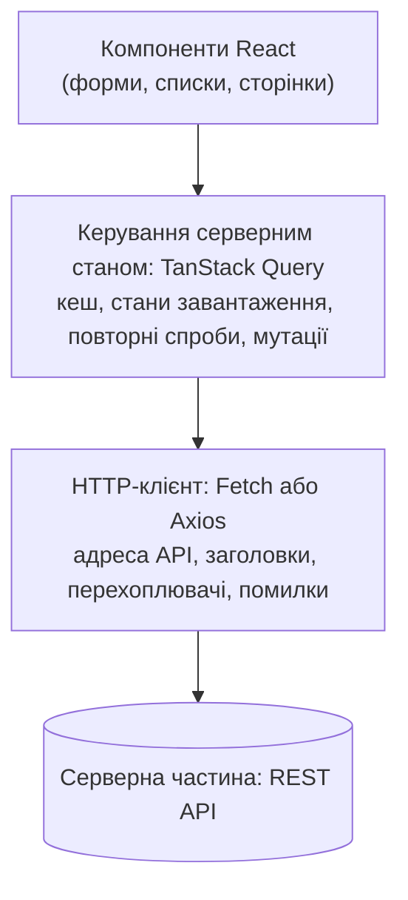
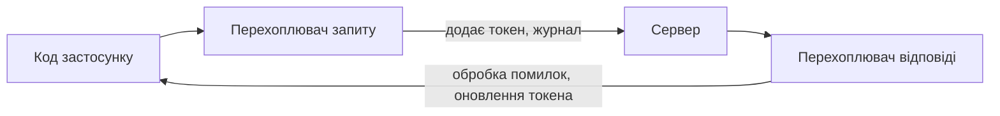
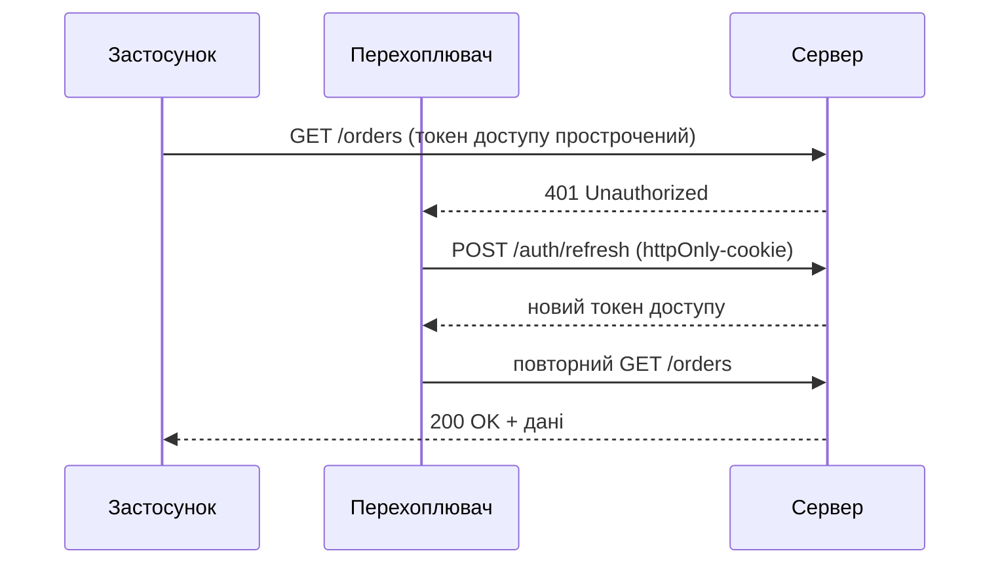
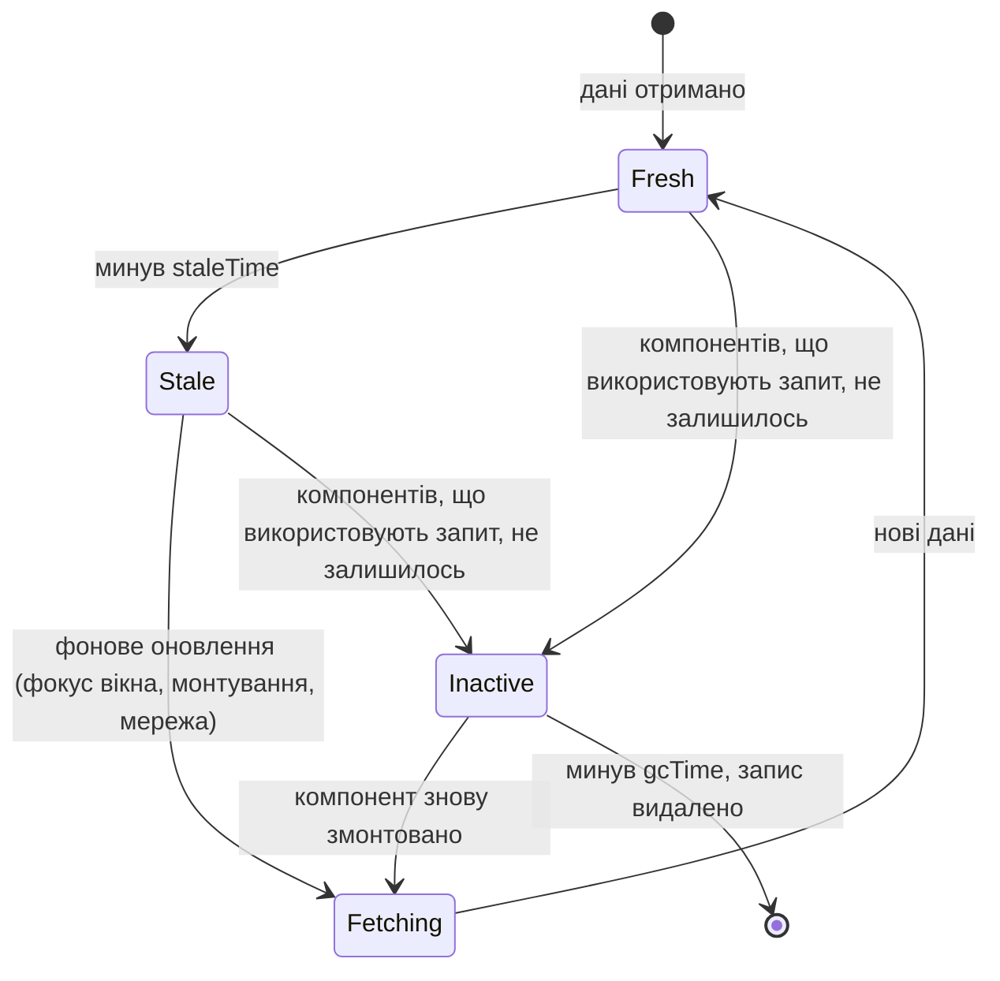
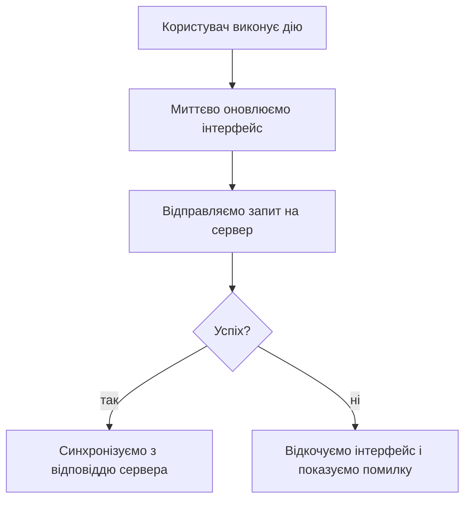

# Лекція 10 Форми, валідація та інтеграція із серверною частиною

## Вступ: форма як місце зустрічі користувача й сервера

Попередні лекції React-блоку навчили нас будувати інтерфейс із компонентів, керувати станом (лекція 08) і організовувати навігацію (лекція 09). Але поки що наш застосунок «живе» лише в браузері: дані, які в ньому з'являються, або жорстко прописані в коді, або існують до оновлення сторінки. Справжній вебзастосунок починається там, де користувач вводить інформацію, а вона потрапляє на сервер, змінює дані та повертається в інтерфейс. Цей шлях має два ключові етапи, і саме їм присвячена лекція.

Перший етап — **форма**: компонент, що збирає дані від людини, перевіряє їх і допомагає виправити помилки. Форми — найчастіше місце, де користувач «залишає» застосунок: незрозуміла помилка, втрачений через перезавантаження текст чи кнопка, що не реагує на натискання, коштують реальних клієнтів. Другий етап — **взаємодія із серверною частиною**: HTTP-запити до REST API, яке ми проєктували в лекції 03, обробка відповідей і помилок, кешування, оновлення інтерфейсу. Ці етапи тісно пов'язані: форма — це «вхідні двері» для більшості запитів, а відповідь сервера (зокрема помилки валідації) має повернутися саме до форми.

Тому ми розглядаємо їх разом. На рисунку нижче показано наскрізний шлях даних, який ми поступово збудуємо.



Лекцію побудовано від простого до складного. Спочатку ми розберемо, як React працює з полями форм (контрольовані та неконтрольовані компоненти), перейдемо до бібліотеки React Hook Form і схем валідації Zod, навчимося створювати власні поля, завантажувати файли та проєктувати зручні форми. Потім познайомимося з нативними можливостями форм у React 19. У другій частині перейдемо до HTTP-клієнта: порівняємо Fetch і Axios, налаштуємо перехоплювачі, централізуємо обробку помилок, дійдемо до TanStack Query й оптимістичних оновлень. Завершить лекцію наскрізний приклад, у якому всі ці елементи працюють разом.

Після вивчення матеріалу ви зможете:

- обирати між контрольованими й неконтрольованими полями та пояснювати наслідки вибору;
- будувати форми з React Hook Form та описувати правила валідації схемами Zod;
- створювати доступні багаторазові поля введення й обробляти завантаження файлів;
- налаштовувати HTTP-клієнт із перехопленням запитів, оновленням токенів і типізованими помилками;
- керувати серверним станом за допомогою TanStack Query, зокрема застосовувати оптимістичні оновлення;
- повертати серверні помилки валідації у форму.

## Частина 1. Форми в React

### Чому форми в React потребують окремої уваги

У звичайному HTML форма сама зберігає значення полів, а браузер сам збирає їх при відправленні. React же будує інтерфейс як функцію від стану, і тут виникає питання: хто є «власником» значення в полі — браузер (DOM) чи React (стан компонента)? Від відповіді залежить архітектура всієї форми.

Крім цього, під час роботи з формами доводиться вирішувати кілька взаємопов'язаних завдань: зберігати значення полів, перевіряти їх (під час вводу, після виходу з поля чи при відправленні), показувати помилки, блокувати повторне відправлення, обробляти відповідь сервера й забезпечити доступність для користувачів клавіатури та екранних читачів. Протягом років спільнота React виробила підходи й бібліотеки, які знімають із розробника більшу частину цієї рутини.

## Контрольовані та неконтрольовані компоненти

### Концептуальні відмінності

Фундаментальна відмінність полягає в тому, де зберігається поточне значення поля.

**Контрольовані компоненти** — це елементи форми, значення яких повністю контролюються React через стан компонента. Кожна зміна в полі спричиняє виклик обробника `onChange`, який оновлює стан, а значення поля завжди відображає поточний стан. Так забезпечується єдине джерело правди для даних форми.

**Неконтрольовані компоненти** зберігають свій стан у DOM, подібно до традиційних HTML-елементів. React отримує доступ до значень лише тоді, коли це потрібно, — зазвичай під час відправлення форми, — за допомогою `ref` або об'єкта `FormData`.



| Критерій | Контрольований | Неконтрольований |
|---|---|---|
| Де зберігається значення | Стан React | DOM |
| Валідація під час вводу | Природна | Потребує додаткових обробників |
| Кількість коду | Більше | Менше |
| Повторне відтворення при вводі | На кожну зміну | Немає |
| Поле `<input type="file">` | Не може бути контрольованим | Єдиний варіант |
| Інтеграція зі сторонніми бібліотеками | Складніша | Простіша |

### Контрольовані компоненти: глибоке розуміння

```javascript
import { useState } from 'react';

function ControlledForm() {
    const [formData, setFormData] = useState({
        username: '',
        email: '',
        password: '',
        agreeToTerms: false,
        country: 'Ukraine'
    });

    // Універсальний обробник для всіх полів
    const handleChange = (event) => {
        const { name, value, type, checked } = event.target;

        setFormData(prevData => ({
            ...prevData,
            [name]: type === 'checkbox' ? checked : value
        }));
    };

    const handleSubmit = (event) => {
        event.preventDefault();
        console.log('Надіслані дані:', formData);
    };

    return (
        <form onSubmit={handleSubmit}>
            <input
                type="text"
                name="username"
                value={formData.username}
                onChange={handleChange}
                placeholder="Ім'я користувача"
            />

            <input
                type="email"
                name="email"
                value={formData.email}
                onChange={handleChange}
                placeholder="Email"
            />

            <input
                type="password"
                name="password"
                value={formData.password}
                onChange={handleChange}
                placeholder="Пароль"
            />

            <select
                name="country"
                value={formData.country}
                onChange={handleChange}
            >
                <option value="Ukraine">Україна</option>
                <option value="Poland">Польща</option>
                <option value="Germany">Німеччина</option>
            </select>

            <label>
                <input
                    type="checkbox"
                    name="agreeToTerms"
                    checked={formData.agreeToTerms}
                    onChange={handleChange}
                />
                Погоджуюсь з умовами використання
            </label>

            <button type="submit">Зареєструватися</button>
        </form>
    );
}
```

Зверніть увагу на універсальний обробник: завдяки атрибуту `name` та обчислюваній властивості `[name]` одна функція обслуговує всі поля, а для прапорців (checkbox) значення береться з `checked`, а не з `value`.

Переваги контрольованих компонентів: повний контроль над даними форми, можливість валідації в реальному часі, проста реалізація складної логіки (наприклад, поле, що з'являється залежно від іншого) та синхронізація даних між частинами інтерфейсу. Недоліки: більше коду, а також повторне відтворення компонента після кожного натискання клавіші, що у великих формах з десятками полів може позначитися на швидкодії.

### Неконтрольовані компоненти: практичне застосування

```javascript
import { useRef } from 'react';

function UncontrolledForm() {
    const usernameRef = useRef(null);
    const emailRef = useRef(null);
    const passwordRef = useRef(null);
    const fileRef = useRef(null);

    const handleSubmit = (event) => {
        event.preventDefault();

        const formData = {
            username: usernameRef.current.value,
            email: emailRef.current.value,
            password: passwordRef.current.value,
            file: fileRef.current.files[0]
        };

        console.log('Надіслані дані:', formData);
    };

    return (
        <form onSubmit={handleSubmit}>
            <input
                type="text"
                ref={usernameRef}
                defaultValue="Іван"
                placeholder="Ім'я користувача"
            />

            <input type="email" ref={emailRef} placeholder="Email" />
            <input type="password" ref={passwordRef} placeholder="Пароль" />
            <input type="file" ref={fileRef} />

            <button type="submit">Відправити</button>
        </form>
    );
}
```

Початкове значення неконтрольованого поля задається атрибутом `defaultValue` (для прапорців — `defaultChecked`), а не `value`.

Однак `ref` для кожного поля — не єдиний і не найзручніший спосіб. Браузер уже вміє збирати дані форми, і цим можна скористатися через стандартний інтерфейс `FormData`:

```javascript
function FormDataForm() {
    const handleSubmit = (event) => {
        event.preventDefault();

        // Збираємо всі поля з атрибутом name без жодного ref
        const data = Object.fromEntries(new FormData(event.currentTarget));
        console.log('Надіслані дані:', data);
    };

    return (
        <form onSubmit={handleSubmit}>
            <input name="username" placeholder="Ім'я користувача" />
            <input name="email" type="email" placeholder="Email" />
            <button type="submit">Відправити</button>
        </form>
    );
}
```

Такий підхід — основа нативних форм React 19, які ми розглянемо далі. Неконтрольовані поля особливо корисні для інтеграції з нереактивними бібліотеками, роботи з файлами та оптимізації великих форм. Вони також зменшують кількість коду для простих форм.

### Гібридний підхід

На практиці ці підходи комбінують: контрольованим робиться лише те поле, для якого потрібна реакція «на льоту», решта залишається неконтрольованою.

```javascript
import { useState, useRef } from 'react';

function HybridForm() {
    // Контрольоване поле для email з валідацією в реальному часі
    const [email, setEmail] = useState('');
    const [emailError, setEmailError] = useState('');

    // Неконтрольовані поля для інших даних
    const nameRef = useRef(null);
    const messageRef = useRef(null);

    const validateEmail = (value) => {
        const emailRegex = /^[^\s@]+@[^\s@]+\.[^\s@]+$/;
        setEmailError(emailRegex.test(value) ? '' : 'Некоректний формат email');
    };

    const handleEmailChange = (e) => {
        const value = e.target.value;
        setEmail(value);
        validateEmail(value);
    };

    const handleSubmit = (e) => {
        e.preventDefault();

        if (emailError) return;

        console.log('Відправлені дані:', {
            name: nameRef.current.value,
            email,
            message: messageRef.current.value
        });
    };

    return (
        <form onSubmit={handleSubmit}>
            <input type="text" ref={nameRef} placeholder="Ім'я" />

            <input
                type="email"
                value={email}
                onChange={handleEmailChange}
                placeholder="Email"
            />
            {emailError && <span className="error">{emailError}</span>}

            <textarea ref={messageRef} placeholder="Повідомлення" />

            <button type="submit">Надіслати</button>
        </form>
    );
}
```

Саме такий «гібрид» і реалізує бібліотека, до якої ми переходимо: React Hook Form робить поля неконтрольованими, але дає зручний API для валідації та реакції на зміни там, де це справді потрібно.

## React Hook Form: сучасний підхід до форм

### Концепція та переваги

Ручне керування формою через `useState` швидко стає громіздким: для кожного поля потрібні значення, помилки, ознака «чіпали/не чіпали», а валідацію доводиться писати вручну. **React Hook Form** (RHF) вирішує ці проблеми. Її філософія базується на трьох ідеях: використовувати неконтрольовані поля й `ref`, щоб мінімізувати повторне відтворення; надати компактний декларативний API для правил валідації; не прив'язуватися до конкретної бібліотеки схем.

Основні переваги:

- висока швидкодія завдяки мінімальній кількості повторних відтворень;
- невеликий розмір у збірці й відсутність залежностей;
- вбудована підтримка правил валідації та інтеграція зі схемами (Zod, Yup та іншими через пакет `@hookform/resolvers`);
- інтуїтивний API з підтримкою TypeScript;
- зручна робота з вкладеними об'єктами та динамічними масивами полів.

```bash
npm install react-hook-form
```

Основні елементи API зведено в таблиці.

| Елемент | Призначення |
|---|---|
| `register(name, rules)` | Підключає поле до форми, повертає `name`, `onChange`, `onBlur`, `ref` |
| `handleSubmit(onValid, onInvalid)` | Обгортка для `onSubmit`: запускає валідацію й викликає ваш обробник лише для коректних даних |
| `formState` | Стан форми: `errors`, `isSubmitting`, `isDirty`, `isValid`, `touchedFields` |
| `watch` / `useWatch` | Спостереження за значеннями полів |
| `setValue`, `reset` | Програмна зміна значень, скидання форми |
| `trigger` | Запуск валідації вручну (повністю або для окремих полів) |
| `setError`, `clearErrors` | Ручне додавання й очищення помилок (наприклад, від сервера) |
| `control` | Об'єкт для `Controller`, `useFieldArray`, `useWatch` |

Режим запуску валідації задається параметром `mode` у `useForm`:

| `mode` | Коли перевіряється поле |
|---|---|
| `onSubmit` (за замовчуванням) | При відправленні; після першої помилки — при кожній зміні |
| `onBlur` | Після виходу з поля |
| `onChange` | При кожній зміні (більше повторних відтворень) |
| `onTouched` | Після першого виходу з поля, далі — при кожній зміні |
| `all` | При виході з поля й при зміні |

### Базове використання

```javascript
import { useForm } from 'react-hook-form';

function RegistrationForm() {
    const {
        register,
        handleSubmit,
        formState: { errors, isSubmitting }
    } = useForm();

    const onSubmit = async (data) => {
        // Симуляція API-запиту; handleSubmit дочекається завершення промісу
        await new Promise(resolve => setTimeout(resolve, 1000));
        console.log('Дані форми:', data);
    };

    return (
        <form onSubmit={handleSubmit(onSubmit)} noValidate>
            <div>
                <label htmlFor="username">Ім'я користувача</label>
                <input
                    id="username"
                    aria-invalid={!!errors.username}
                    {...register('username', {
                        required: "Ім'я користувача обов'язкове",
                        minLength: {
                            value: 3,
                            message: 'Мінімум 3 символи'
                        }
                    })}
                />
                {errors.username && (
                    <span role="alert" className="error">
                        {errors.username.message}
                    </span>
                )}
            </div>

            <div>
                <label htmlFor="email">Email</label>
                <input
                    id="email"
                    type="email"
                    aria-invalid={!!errors.email}
                    {...register('email', {
                        required: "Email обов'язковий",
                        pattern: {
                            value: /^[^\s@]+@[^\s@]+\.[^\s@]+$/,
                            message: 'Некоректний формат email'
                        }
                    })}
                />
                {errors.email && (
                    <span role="alert" className="error">
                        {errors.email.message}
                    </span>
                )}
            </div>

            <div>
                <label htmlFor="password">Пароль</label>
                <input
                    id="password"
                    type="password"
                    aria-invalid={!!errors.password}
                    {...register('password', {
                        required: "Пароль обов'язковий",
                        minLength: {
                            value: 8,
                            message: 'Пароль має містити мінімум 8 символів'
                        }
                    })}
                />
                {errors.password && (
                    <span role="alert" className="error">
                        {errors.password.message}
                    </span>
                )}
            </div>

            <button type="submit" disabled={isSubmitting}>
                {isSubmitting ? 'Обробка...' : 'Зареєструватися'}
            </button>
        </form>
    );
}
```

Кілька важливих деталей. Вираз `{...register('username', {...})}` розгортає в `<input>` атрибути `name`, `onChange`, `onBlur` і `ref`, тож поле лишається неконтрольованим. Атрибут `noValidate` на `<form>` вимикає вбудовану валідацію браузера, щоб помилки показував лише наш код, а ролі `role="alert"` та `aria-invalid` роблять повідомлення помітними для екранних читачів. Наостанок, `isSubmitting` автоматично дорівнює `true`, поки проміс із `onSubmit` не завершиться, — тому кнопку легко заблокувати від подвійного натискання.

### Складні сценарії використання

Реальні форми рідко складаються лише з плоских полів. Хук `useFieldArray` дає змогу керувати динамічними списками (учасники команди, позиції замовлення, телефони), а `watch` — реагувати на значення інших полів.

```javascript
import { useForm, useFieldArray } from 'react-hook-form';

function ProjectForm() {
    const {
        register,
        control,
        handleSubmit,
        watch,
        formState: { errors }
    } = useForm({
        defaultValues: {
            projectName: '',
            teamMembers: [{ name: '', role: '' }],
            priority: 'medium'
        }
    });

    const { fields, append, remove } = useFieldArray({
        control,
        name: 'teamMembers'
    });

    // Спостереження за значенням поля
    const projectName = watch('projectName');

    const onSubmit = (data) => {
        console.log('Дані проєкту:', data);
    };

    return (
        <form onSubmit={handleSubmit(onSubmit)}>
            <div>
                <label htmlFor="projectName">Назва проєкту</label>
                <input
                    id="projectName"
                    {...register('projectName', {
                        required: "Назва проєкту обов'язкова"
                    })}
                />
                {errors.projectName && (
                    <span className="error">{errors.projectName.message}</span>
                )}
            </div>

            <div>
                <h3>Учасники команди</h3>
                {fields.map((field, index) => (
                    <div key={field.id} className="team-member">
                        <input
                            {...register(`teamMembers.${index}.name`, {
                                required: "Ім'я обов'язкове"
                            })}
                            placeholder="Ім'я"
                        />

                        <input
                            {...register(`teamMembers.${index}.role`, {
                                required: "Роль обов'язкова"
                            })}
                            placeholder="Роль"
                        />

                        <button type="button" onClick={() => remove(index)}>
                            Видалити
                        </button>

                        {errors.teamMembers?.[index] && (
                            <span className="error">
                                Заповніть усі поля учасника
                            </span>
                        )}
                    </div>
                ))}

                <button
                    type="button"
                    onClick={() => append({ name: '', role: '' })}
                >
                    Додати учасника
                </button>
            </div>

            <div>
                <label htmlFor="priority">Пріоритет</label>
                <select id="priority" {...register('priority')}>
                    <option value="low">Низький</option>
                    <option value="medium">Середній</option>
                    <option value="high">Високий</option>
                </select>
            </div>

            {projectName && (
                <div className="preview">
                    Попередній перегляд: проєкт «{projectName}»
                </div>
            )}

            <button type="submit">Створити проєкт</button>
        </form>
    );
}
```

У `useFieldArray` обов'язково використовуйте `field.id` як `key`, а не індекс: так React правильно зберігає стан полів при видаленні чи перестановці елементів. Також запам'ятайте нюанс щодо `watch`: він змушує повторно відтворювати весь компонент форми при кожній зміні відстежуваного поля. Якщо потрібно лише відобразити значення в окремому місці, винесіть його в дочірній компонент і скористайтеся `useWatch({ control, name })` — тоді оновлюватиметься лише він.

## Валідація зі схемами Zod

### Навіщо потрібні схеми

Правила, записані прямо в `register`, зручні для простих випадків, але мають недоліки: їх складно повторно використовувати, вони перемішані з розміткою, а перевірки, що стосуються кількох полів одночасно (наприклад, «паролі збігаються»), виглядають незграбно. Альтернатива — описати структуру й обмеження даних окремо, у **схемі**, і передати її формі.

**Zod** — бібліотека для опису схем даних, яка водночас перевіряє значення та виводить із схеми типи TypeScript. Її сильні сторони: виразний ланцюговий синтаксис, зрозумілі повідомлення про помилки, підтримка складних і вкладених структур, трансформацій і асинхронних перевірок. Zod працює і в браузері, і на сервері, тож **одну й ту саму схему можна імпортувати в Express-застосунок із лекції 02** — клієнт і сервер перевірятимуть дані за однаковими правилами.

```bash
npm install zod @hookform/resolvers
```

> **Версія.** Нині актуальна гілка Zod 4. Порівняно з Zod 3 змінилися, зокрема, записи форматів рядків: замість `z.string().email()` тепер `z.email()` (старий запис ще працює, але вважається застарілим), а різні параметри повідомлень (`message`, `invalid_type_error`, `required_error`) замінено єдиним параметром `error`. Якщо ви читаєте старі приклади в інтернеті, звертайте на це увагу.

### Базова інтеграція

```javascript
import { useForm } from 'react-hook-form';
import { zodResolver } from '@hookform/resolvers/zod';
import { z } from 'zod';

// Визначення схеми валідації
const registrationSchema = z.object({
    username: z.string()
        .min(3, 'Ім\'я користувача має містити мінімум 3 символи')
        .max(20, 'Ім\'я користувача не може перевищувати 20 символів')
        .regex(/^[a-zA-Z0-9_]+$/, 'Лише латинські літери, цифри та підкреслення'),

    email: z.email('Некоректний формат email').toLowerCase(),

    password: z.string()
        .min(8, 'Пароль має містити мінімум 8 символів')
        .regex(/[A-Z]/, 'Пароль має містити хоча б одну велику літеру')
        .regex(/[a-z]/, 'Пароль має містити хоча б одну малу літеру')
        .regex(/[0-9]/, 'Пароль має містити хоча б одну цифру'),

    confirmPassword: z.string(),

    // Для поля з valueAsNumber порожнє значення дає NaN,
    // тому задаємо власне повідомлення для помилки типу
    age: z.number({ error: 'Вкажіть вік числом' })
        .int('Вік має бути цілим числом')
        .min(18, 'Вік має бути не менше 18 років')
        .max(120, 'Некоректний вік'),

    // Дозволяємо лише http(s)-посилання; порожній рядок — теж допустимий
    website: z.url({ protocol: /^https?$/, error: 'Некоректна адреса сайту' })
        .or(z.literal(''))
        .optional(),

    agreeToTerms: z.literal(true, {
        error: 'Необхідно прийняти умови використання'
    })
}).refine(data => data.password === data.confirmPassword, {
    error: 'Паролі не збігаються',
    path: ['confirmPassword']
});

function RegistrationFormWithZod() {
    const {
        register,
        handleSubmit,
        formState: { errors, isSubmitting }
    } = useForm({
        resolver: zodResolver(registrationSchema),
        defaultValues: { agreeToTerms: false }
    });

    const onSubmit = async (data) => {
        // До цього місця доходять лише провалідовані (та перетворені схемою) дані
        console.log('Валідні дані:', data);
    };

    return (
        <form onSubmit={handleSubmit(onSubmit)} noValidate>
            <div>
                <input {...register('username')} placeholder="Ім'я користувача" />
                {errors.username && (
                    <span className="error">{errors.username.message}</span>
                )}
            </div>

            <div>
                <input {...register('email')} type="email" placeholder="Email" />
                {errors.email && (
                    <span className="error">{errors.email.message}</span>
                )}
            </div>

            <div>
                <input {...register('password')} type="password" placeholder="Пароль" />
                {errors.password && (
                    <span className="error">{errors.password.message}</span>
                )}
            </div>

            <div>
                <input
                    {...register('confirmPassword')}
                    type="password"
                    placeholder="Підтвердження пароля"
                />
                {errors.confirmPassword && (
                    <span className="error">{errors.confirmPassword.message}</span>
                )}
            </div>

            <div>
                <input
                    {...register('age', { valueAsNumber: true })}
                    type="number"
                    placeholder="Вік"
                />
                {errors.age && (
                    <span className="error">{errors.age.message}</span>
                )}
            </div>

            <div>
                <input {...register('website')} placeholder="Сайт (необов'язково)" />
                {errors.website && (
                    <span className="error">{errors.website.message}</span>
                )}
            </div>

            <div>
                <label>
                    <input {...register('agreeToTerms')} type="checkbox" />
                    Погоджуюсь з умовами використання
                </label>
                {errors.agreeToTerms && (
                    <span className="error">{errors.agreeToTerms.message}</span>
                )}
            </div>

            <button type="submit" disabled={isSubmitting}>
                Зареєструватися
            </button>
        </form>
    );
}
```

Тут варто звернути увагу на три речі. По-перше, `.refine()` на рівні всього об'єкта дає змогу перевіряти взаємозв'язок полів, а `path` вказує, до якого поля прив'язати помилку. По-друге, `<input type="number">` усе одно повертає рядок, тому в `register` потрібен параметр `valueAsNumber: true`. По-третє, схема не лише перевіряє, а й **перетворює** дані: `toLowerCase()` приведе email до нижнього регістру ще до виклику `onSubmit`.

Якщо ви працюєте з TypeScript, тип даних форми виводиться зі схеми — писати його вручну не потрібно:

```typescript
type RegistrationFormData = z.infer<typeof registrationSchema>;

const { register, handleSubmit } = useForm<RegistrationFormData>({
    resolver: zodResolver(registrationSchema)
});
```

Коли схема містить перетворення (`transform`, значення за замовчуванням), тип *вхідних* даних форми та тип *вихідних* даних відрізняються. Тоді їх розрізняють: `z.input<typeof schema>` описує те, що вводить користувач, а `z.output<typeof schema>` — те, що отримає `onSubmit`.

### Складні схеми валідації

```javascript
import { z } from 'zod';

// Вкладені об'єкти та масиви
const projectSchema = z.object({
    title: z.string().min(1, 'Назва обов\'язкова'),

    description: z.string()
        .min(10, 'Опис має містити мінімум 10 символів')
        .max(500, 'Опис не може перевищувати 500 символів'),

    budget: z.object({
        amount: z.number().positive('Сума має бути додатною'),
        currency: z.enum(['UAH', 'USD', 'EUR'])
    }),

    tags: z.array(z.string())
        .min(1, 'Додайте хоча б один тег')
        .max(5, 'Максимум 5 тегів'),

    team: z.array(
        z.object({
            name: z.string().min(1, 'Ім\'я обов\'язкове'),
            role: z.enum(['developer', 'designer', 'manager']),
            email: z.email('Некоректний email')
        })
    ).min(1, 'Команда має містити хоча б одного учасника'),

    // Рядок формату РРРР-ММ-ДД (саме його повертає <input type="date">)
    startDate: z.iso.date('Некоректна дата'),

    status: z.enum(['planning', 'active', 'completed', 'cancelled'])
        .default('planning')
});
```

Умовна валідація — коли набір обов'язкових полів залежить від значення іншого поля, — зручно записується через `refine` або, що виразніше, через дискримінантне об'єднання `z.discriminatedUnion`:

```javascript
// Варіант 1: refine для однієї залежності
const taskSchema = z.object({
    title: z.string().min(1),
    assigneeRequired: z.boolean(),
    assignee: z.string().optional()
}).refine(
    data => !data.assigneeRequired || (data.assignee && data.assignee.length > 0),
    {
        error: 'Виконавець обов\'язковий для цього завдання',
        path: ['assignee']
    }
);

// Варіант 2: різні набори полів залежно від способу доставки
const deliverySchema = z.discriminatedUnion('method', [
    z.object({
        method: z.literal('pickup'),
        pickupPoint: z.string().min(1, 'Оберіть відділення')
    }),
    z.object({
        method: z.literal('courier'),
        address: z.string().min(5, 'Вкажіть адресу доставки'),
        phone: z.string().regex(/^\+380\d{9}$/, 'Формат: +380XXXXXXXXX')
    })
]);
```

Асинхронні перевірки (наприклад, чи вільне ім'я користувача) теж можна описати в схемі:

```javascript
const usernameSchema = z.string()
    .min(3)
    .refine(
        async (username) => {
            const response = await fetch(
                `/api/check-username?username=${encodeURIComponent(username)}`
            );
            const data = await response.json();
            return data.available;
        },
        { error: 'Це ім\'я користувача вже зайняте' }
    );
```

Утім, на практиці такий запис має недолік: схема виконується при кожній валідації, і сервер отримуватиме зайві запити. Для перевірки унікальності краще скористатися правилом `validate` у `register` у поєднанні з режимом `onBlur` (приклад — у розділі про UX-патерни) або затримкою запиту (*debounce*). І в усіх випадках пам'ятайте: **перевірка на клієнті покращує зручність, але не замінює перевірку на сервері** — клієнтський код користувач може обійти, надіславши запит напряму.

## Кастомні поля введення

### Принципи створення багаторазових компонентів

Коли форм у застосунку багато, повторення розмітки «мітка + поле + повідомлення про помилку» стає джерелом неузгодженості та помилок доступності. Власний компонент поля інкапсулює розмітку, стилі та поведінку в одному місці.

Хороше поле введення має: пов'язувати `<label>` з `<input>` через `id`; повідомляти про помилку через `aria-invalid` й `aria-describedby`; приймати довільні атрибути (`...props`) і передавати `ref`, щоб працювати з `register`.

Починаючи з React 19, `ref` передається компоненту як звичайна властивість, тому обгортка `forwardRef` більше не потрібна.

```javascript
import { useId } from 'react';

function Input({ label, error, helperText, id, ref, ...props }) {
    // useId гарантує унікальний id, навіть якщо компонент використано багато разів
    const generatedId = useId();
    const inputId = id ?? generatedId;
    const errorId = `${inputId}-error`;
    const helperId = `${inputId}-helper`;

    return (
        <div className="input-wrapper">
            {label && (
                <label htmlFor={inputId}>
                    {label}
                    {props.required && <span className="required"> *</span>}
                </label>
            )}

            <input
                ref={ref}
                id={inputId}
                className={`input ${error ? 'input-error' : ''}`}
                aria-invalid={Boolean(error)}
                aria-describedby={error ? errorId : helperText ? helperId : undefined}
                {...props}
            />

            {error && (
                <span id={errorId} role="alert" className="error-message">
                    {error}
                </span>
            )}

            {helperText && !error && (
                <span id={helperId} className="helper-text">{helperText}</span>
            )}
        </div>
    );
}

// Використання з React Hook Form
function FormWithCustomInputs() {
    const {
        register,
        handleSubmit,
        formState: { errors }
    } = useForm();

    return (
        <form onSubmit={handleSubmit(data => console.log(data))} noValidate>
            <Input
                label="Електронна пошта"
                type="email"
                {...register('email', { required: "Email обов'язковий" })}
                error={errors.email?.message}
                helperText="Ми не передаємо вашу пошту третім особам"
            />

            <Input
                label="Пароль"
                type="password"
                {...register('password', { required: "Пароль обов'язковий" })}
                error={errors.password?.message}
            />

            <button type="submit">Увійти</button>
        </form>
    );
}
```

> **Для проєктів на React 18.** Там `ref` не передається як властивість, тож компонент треба обгорнути: `const Input = forwardRef(({ label, error, ...props }, ref) => { ... })`. У React 19 `forwardRef` ще працює, але вважається застарілим підходом.

### Складні кастомні компоненти

Поле пароля з перемикачем видимості та індикатором надійності — типовий приклад компонента з власним станом. Важливо не «перехопити» значення поля: ми залишаємо його неконтрольованим, а локальний стан використовуємо лише для індикатора.

```javascript
import { useState } from 'react';

function calculateStrength(password) {
    let strength = 0;
    if (password.length >= 8) strength++;
    if (/[A-Z]/.test(password)) strength++;
    if (/[a-z]/.test(password)) strength++;
    if (/[0-9]/.test(password)) strength++;
    if (/[^A-Za-z0-9]/.test(password)) strength++;
    return strength;
}

const strengthLabels = ['Дуже слабкий', 'Слабкий', 'Середній', 'Сильний', 'Дуже сильний'];
const strengthColors = ['red', 'orange', 'gold', 'lightgreen', 'green'];

function PasswordInput({ label, error, showStrength = false, onChange, ref, ...props }) {
    const [strength, setStrength] = useState(0);
    const [visible, setVisible] = useState(false);

    // Передаємо подію далі (це потрібно для register) і оновлюємо індикатор
    const handleChange = (e) => {
        setStrength(calculateStrength(e.target.value));
        onChange?.(e);
    };

    return (
        <div className="password-input-wrapper">
            {label && <label htmlFor={props.id}>{label}</label>}

            <div className="password-input-container">
                <input
                    ref={ref}
                    type={visible ? 'text' : 'password'}
                    onChange={handleChange}
                    className={error ? 'input-error' : ''}
                    aria-invalid={Boolean(error)}
                    {...props}
                />

                <button
                    type="button"
                    onClick={() => setVisible(v => !v)}
                    aria-label={visible ? 'Сховати пароль' : 'Показати пароль'}
                    aria-pressed={visible}
                    className="toggle-password"
                >
                    {visible ? '🙈' : '👁️'}
                </button>
            </div>

            {showStrength && strength > 0 && (
                <div className="password-strength" aria-live="polite">
                    <div className="strength-bar">
                        {[...Array(5)].map((_, i) => (
                            <div
                                key={i}
                                className="strength-segment"
                                style={{
                                    backgroundColor: i < strength
                                        ? strengthColors[strength - 1]
                                        : '#e0e0e0'
                                }}
                            />
                        ))}
                    </div>
                    <span className="strength-label">
                        Надійність: {strengthLabels[strength - 1]}
                    </span>
                </div>
            )}

            {error && <span role="alert" className="error-message">{error}</span>}
        </div>
    );
}
```

Поля, які не мають нативного `<input>` усередині (випадний список із пошуком, вибір дати, редактор тексту), не можна підключити через `register`. Для них RHF пропонує компонент `Controller` (або хук `useController`): він «перекладає» контрольований компонент на мову RHF, передаючи `value`, `onChange` та `onBlur` через `field`.

```javascript
import { useState } from 'react';
import { Controller, useForm } from 'react-hook-form';

// Чисто контрольований компонент: нічого не знає про React Hook Form
function SearchableSelect({ options, value, onChange, error, placeholder = 'Оберіть...' }) {
    const [isOpen, setIsOpen] = useState(false);
    const [searchTerm, setSearchTerm] = useState('');

    const filtered = options.filter(option =>
        option.label.toLowerCase().includes(searchTerm.toLowerCase())
    );
    const selected = options.find(option => option.value === value);

    const handleSelect = (optionValue) => {
        onChange(optionValue);
        setIsOpen(false);
        setSearchTerm('');
    };

    return (
        <div className="searchable-select">
            <button
                type="button"
                className={`select-trigger ${error ? 'error' : ''}`}
                onClick={() => setIsOpen(open => !open)}
                aria-haspopup="listbox"
                aria-expanded={isOpen}
            >
                {selected ? selected.label : placeholder}
            </button>

            {isOpen && (
                <div className="select-dropdown">
                    <input
                        type="text"
                        placeholder="Пошук..."
                        value={searchTerm}
                        onChange={(e) => setSearchTerm(e.target.value)}
                        autoFocus
                    />
                    <ul role="listbox">
                        {filtered.length > 0 ? filtered.map(option => (
                            <li
                                key={option.value}
                                role="option"
                                aria-selected={option.value === value}
                                onClick={() => handleSelect(option.value)}
                            >
                                {option.label}
                            </li>
                        )) : <li className="no-options">Нічого не знайдено</li>}
                    </ul>
                </div>
            )}

            {error && <span role="alert" className="error-message">{error}</span>}
        </div>
    );
}

// Підключення через Controller
const countries = [
    { value: 'UA', label: 'Україна' },
    { value: 'PL', label: 'Польща' },
    { value: 'DE', label: 'Німеччина' }
];

function ProfileForm() {
    const { control, handleSubmit } = useForm({ defaultValues: { country: '' } });

    return (
        <form onSubmit={handleSubmit(console.log)}>
            <Controller
                name="country"
                control={control}
                rules={{ required: 'Оберіть країну' }}
                render={({ field, fieldState }) => (
                    <SearchableSelect
                        options={countries}
                        value={field.value}
                        onChange={field.onChange}
                        error={fieldState.error?.message}
                    />
                )}
            />
            <button type="submit">Зберегти</button>
        </form>
    );
}
```

Цей приклад навчальний: повноцінний випадний список із пошуком має підтримувати навігацію стрілками, `Escape`, фокус і ще десяток нюансів доступності. У реальних проєктах для цього використовують готові «безголові» (*headless*) компоненти, наприклад `Combobox` із Headless UI, який ми розглянемо в лекції 11.

## Завантаження файлів

### Базове завантаження файлів

Поле `<input type="file">` завжди неконтрольоване — програма не може задати йому значення, лише прочитати вибрані файли. З RHF воно працює через `register`, а `watch` дозволяє побудувати попередній перегляд.

```javascript
import { useEffect, useState } from 'react';
import { useForm } from 'react-hook-form';

function FileUploadForm() {
    const [preview, setPreview] = useState(null);
    const { register, handleSubmit, watch, formState: { errors } } = useForm();

    // Спостереження за змінами файлу
    const files = watch('avatar');

    // Побудова попереднього перегляду. useEffect (а не useState!) потрібен для побічних ефектів,
    // а cleanup звільняє пам'ять, виділену під тимчасове посилання
    useEffect(() => {
        const file = files?.[0];
        if (!file) {
            setPreview(null);
            return;
        }

        const url = URL.createObjectURL(file);
        setPreview(url);

        return () => URL.revokeObjectURL(url);
    }, [files]);

    const onSubmit = async (data) => {
        const formData = new FormData();
        formData.append('avatar', data.avatar[0]);
        formData.append('name', data.name);

        // Заголовок Content-Type для FormData вказувати не потрібно:
        // браузер сам додасть boundary
        const response = await fetch('/api/upload', {
            method: 'POST',
            body: formData
        });

        if (!response.ok) throw new Error('Не вдалося завантажити файл');
        console.log('Файл завантажено:', await response.json());
    };

    return (
        <form onSubmit={handleSubmit(onSubmit)}>
            <input
                {...register('name', { required: true })}
                placeholder="Ваше ім'я"
            />

            <div>
                <label htmlFor="avatar">Аватар</label>
                <input
                    id="avatar"
                    type="file"
                    accept="image/jpeg,image/png,image/gif"
                    {...register('avatar', {
                        required: "Файл обов'язковий",
                        validate: {
                            fileSize: files =>
                                files[0]?.size <= 5 * 1024 * 1024 ||
                                'Розмір файлу не може перевищувати 5 МБ',
                            fileType: files =>
                                ['image/jpeg', 'image/png', 'image/gif']
                                    .includes(files[0]?.type) ||
                                'Підтримуються лише JPEG, PNG та GIF'
                        }
                    })}
                />
                {errors.avatar && (
                    <span className="error">{errors.avatar.message}</span>
                )}

                {preview && (
                    <div className="image-preview">
                        
                    </div>
                )}
            </div>

            <button type="submit">Завантажити</button>
        </form>
    );
}
```

Атрибут `accept` лише підказує діалогу вибору файлів, які формати показувати, але не гарантує нічого: користувач може обрати «Усі файли» або підмінити розширення. Тому типи та розмір **обов'язково повторно перевіряються на сервері**, причому за вмістом файлу, а не за розширенням (докладніше — у лекції 05).

### Drag and Drop завантаження

Для перетягування файлів у область сторінки зручно використати бібліотеку `react-dropzone`.

```javascript
import { useCallback, useEffect, useState } from 'react';
import { useDropzone } from 'react-dropzone';

function DragDropUpload() {
    const [files, setFiles] = useState([]);
    const [progress, setProgress] = useState({});

    const onDrop = useCallback((acceptedFiles) => {
        setFiles(prev => [
            ...prev,
            ...acceptedFiles.map(file =>
                Object.assign(file, { preview: URL.createObjectURL(file) })
            )
        ]);
    }, []);

    const { getRootProps, getInputProps, isDragActive, fileRejections } = useDropzone({
        onDrop,
        accept: { 'image/*': ['.jpeg', '.jpg', '.png', '.gif'] },
        maxSize: 5 * 1024 * 1024, // 5 МБ
        multiple: true
    });

    // Звільняємо тимчасові посилання при видаленні компонента
    useEffect(() => {
        return () => files.forEach(file => URL.revokeObjectURL(file.preview));
    }, [files]);

    // XMLHttpRequest дає прогрес відправлення (у Fetch API його немає)
    const uploadFile = (file, index) => {
        const formData = new FormData();
        formData.append('file', file);

        const xhr = new XMLHttpRequest();

        xhr.upload.addEventListener('progress', (e) => {
            if (e.lengthComputable) {
                setProgress(prev => ({ ...prev, [index]: (e.loaded / e.total) * 100 }));
            }
        });

        xhr.addEventListener('load', () => {
            if (xhr.status === 200) console.log('Файл завантажено:', file.name);
        });

        xhr.open('POST', '/api/upload');
        xhr.send(formData);
    };

    const removeFile = (index) => {
        setFiles(prev => prev.filter((_, i) => i !== index));
    };

    return (
        <div className="drag-drop-container">
            <div
                {...getRootProps()}
                className={`dropzone ${isDragActive ? 'active' : ''}`}
            >
                <input {...getInputProps()} />
                {isDragActive
                    ? <p>Відпустіть файли тут...</p>
                    : <p>Перетягніть файли сюди або клацніть для вибору</p>}
            </div>

            {fileRejections.length > 0 && (
                <p className="error" role="alert">
                    Деякі файли відхилено: перевірте формат і розмір (до 5 МБ).
                </p>
            )}

            {files.map((file, index) => (
                <div key={file.preview} className="file-item">
                    

                    <div className="file-info">
                        <p>{file.name} ({(file.size / 1024).toFixed(1)} КБ)</p>

                        {progress[index] !== undefined && (
                            <progress value={progress[index]} max="100" />
                        )}
                    </div>

                    <button
                        type="button"
                        onClick={() => removeFile(index)}
                        aria-label={`Видалити ${file.name}`}
                    >
                        ✕
                    </button>
                </div>
            ))}

            {files.length > 0 && (
                <button onClick={() => files.forEach(uploadFile)}>
                    Завантажити всі файли
                </button>
            )}
        </div>
    );
}
```

У другій частині лекції ми побачимо, що Axios дає прогрес відправлення «з коробки» через параметр `onUploadProgress`, і код стає значно простішим.

## UX-патерни для форм

Технічно коректна форма ще не означає зручна. Розглянемо кілька патернів, які суттєво впливають на сприйняття.

### Валідація: коли показувати помилку

Показувати помилку на першому ж символі («Некоректний email», коли користувач ще набирає «i») — дратівливо. Не показувати її до натискання «Відправити» — незручно в довгих формах. Золота середина — режим `onTouched` (або `onBlur`): перша перевірка після виходу з поля, далі — під час кожної зміни, щоб помилка зникла, щойно її виправлено.

Асинхронну перевірку унікальності зручно описати правилом `validate` — RHF покаже стан перевірки через `isValidating`:

```javascript
import { useForm } from 'react-hook-form';

async function isUsernameAvailable(username) {
    const response = await fetch(
        `/api/check-username?username=${encodeURIComponent(username)}`
    );
    const data = await response.json();
    return data.available;
}

function SmartValidationForm() {
    const {
        register,
        handleSubmit,
        watch,
        formState: { errors, isValidating, touchedFields }
    } = useForm({ mode: 'onTouched' });

    const password = watch('password');

    return (
        <form onSubmit={handleSubmit(data => console.log(data))} noValidate>
            <div className="form-field">
                <label htmlFor="username">Ім'я користувача</label>
                <input
                    id="username"
                    {...register('username', {
                        required: "Обов'язкове поле",
                        validate: async (value) =>
                            (await isUsernameAvailable(value)) || 'Це ім\'я вже зайняте'
                    })}
                />

                {isValidating && <span className="checking">Перевірка доступності...</span>}

                {touchedFields.username && !errors.username && !isValidating && (
                    <span className="success">✓ Ім'я доступне</span>
                )}

                {errors.username && (
                    <span className="error" role="alert">{errors.username.message}</span>
                )}
            </div>

            <div className="form-field">
                <label htmlFor="password">Пароль</label>
                <input
                    id="password"
                    type="password"
                    {...register('password', {
                        required: "Обов'язкове поле",
                        minLength: { value: 8, message: 'Мінімум 8 символів' }
                    })}
                />

                {password && (
                    <ul className="password-requirements">
                        <li className={password.length >= 8 ? 'met' : ''}>
                            Мінімум 8 символів
                        </li>
                        <li className={/[A-Z]/.test(password) ? 'met' : ''}>
                            Одна велика літера
                        </li>
                        <li className={/[0-9]/.test(password) ? 'met' : ''}>
                            Одна цифра
                        </li>
                    </ul>
                )}

                {errors.password && (
                    <span className="error" role="alert">{errors.password.message}</span>
                )}
            </div>

            <button type="submit">Зареєструватися</button>
        </form>
    );
}
```

### Багатокрокові форми

Довгу форму краще розбити на кроки: це знижує когнітивне навантаження й робить прогрес видимим. Технічно найпростіше мати **один екземпляр `useForm` на всю форму**, а кроки — це лише різні групи полів. RHF за замовчуванням зберігає значення полів, навіть коли вони тимчасово зникають з екрана, тому дані не губляться при переході «Назад». Перед переходом далі перевіряємо лише поля поточного кроку за допомогою `trigger`.

```javascript
import { useState } from 'react';
import { useForm } from 'react-hook-form';

// Які поля належать до якого кроку
const stepFields = {
    1: ['firstName', 'lastName', 'email'],
    2: ['address', 'city', 'country'],
    3: ['deliveryMethod', 'comment']
};

function MultiStepForm() {
    const [step, setStep] = useState(1);
    const totalSteps = 3;

    const {
        register,
        handleSubmit,
        trigger,
        formState: { errors }
    } = useForm({ defaultValues: { deliveryMethod: 'pickup' } });

    const nextStep = async () => {
        const isValid = await trigger(stepFields[step]);
        if (isValid) setStep(s => Math.min(s + 1, totalSteps));
    };

    const prevStep = () => setStep(s => Math.max(s - 1, 1));

    const onSubmit = (data) => {
        console.log('Фінальні дані:', data);
    };

    return (
        <div className="multi-step-form">
            <p aria-live="polite">Крок {step} з {totalSteps}</p>
            <progress value={step} max={totalSteps} />

            <form onSubmit={handleSubmit(onSubmit)} noValidate>
                {step === 1 && (
                    <fieldset>
                        <legend>Особиста інформація</legend>

                        <Input
                            label="Ім'я"
                            {...register('firstName', { required: "Обов'язкове поле" })}
                            error={errors.firstName?.message}
                        />
                        <Input
                            label="Прізвище"
                            {...register('lastName', { required: "Обов'язкове поле" })}
                            error={errors.lastName?.message}
                        />
                        <Input
                            label="Email"
                            type="email"
                            {...register('email', {
                                required: "Обов'язкове поле",
                                pattern: {
                                    value: /^[^\s@]+@[^\s@]+\.[^\s@]+$/,
                                    message: 'Некоректний email'
                                }
                            })}
                            error={errors.email?.message}
                        />
                    </fieldset>
                )}

                {step === 2 && (
                    <fieldset>
                        <legend>Адреса</legend>

                        <Input
                            label="Адреса"
                            {...register('address', { required: "Обов'язкове поле" })}
                            error={errors.address?.message}
                        />
                        <Input
                            label="Місто"
                            {...register('city', { required: "Обов'язкове поле" })}
                            error={errors.city?.message}
                        />

                        <label htmlFor="country">Країна</label>
                        <select
                            id="country"
                            {...register('country', { required: "Обов'язкове поле" })}
                        >
                            <option value="">Оберіть країну</option>
                            <option value="UA">Україна</option>
                            <option value="PL">Польща</option>
                            <option value="DE">Німеччина</option>
                        </select>
                        {errors.country && (
                            <span className="error" role="alert">{errors.country.message}</span>
                        )}
                    </fieldset>
                )}

                {step === 3 && (
                    <fieldset>
                        <legend>Доставка</legend>

                        <label>
                            <input type="radio" value="pickup" {...register('deliveryMethod')} />
                            Самовивіз
                        </label>
                        <label>
                            <input type="radio" value="courier" {...register('deliveryMethod')} />
                            Кур'єр
                        </label>

                        <label htmlFor="comment">Коментар до замовлення</label>
                        <textarea id="comment" {...register('comment')} />
                    </fieldset>
                )}

                <div className="form-navigation">
                    {step > 1 && <button type="button" onClick={prevStep}>Назад</button>}

                    {step < totalSteps
                        ? <button type="button" onClick={nextStep}>Далі</button>
                        : <button type="submit">Завершити</button>}
                </div>
            </form>
        </div>
    );
}
```

> **Платіжні дані.** У навчальних прикладах іноді трапляються кроки «Дані картки» з полями номера, терміну дії й CVV. У реальному проєкті так робити не можна: номер картки не повинен проходити через ваш код і сервер. Для оплати використовують готові рішення платіжних провайдерів (поля, що вбудовуються з їхнього боку, або перенаправлення на сторінку оплати), які знімають із вас вимоги безпеки платіжної галузі (PCI DSS).

### Автозбереження та відновлення

Для довгих форм (стаття, звіт, заявка) корисно періодично зберігати чернетку, щоб випадкове закриття вкладки не знищило хвилини роботи. Офіційний спосіб спостерігати за всією формою без зайвих повторних відтворень — підписка `watch(callback)`:

```javascript
import { useEffect } from 'react';
import { useForm } from 'react-hook-form';

const DRAFT_KEY = 'formDraft';

function loadDraft() {
    try {
        return JSON.parse(localStorage.getItem(DRAFT_KEY)) ?? undefined;
    } catch {
        return undefined;
    }
}

function AutoSaveForm() {
    // Чернетка підставляється як початкове значення, без «моргання» та confirm
    const { register, handleSubmit, watch, reset } = useForm({
        defaultValues: loadDraft() ?? { title: '', content: '' }
    });

    // Автозбереження із затримкою після останньої зміни
    useEffect(() => {
        let timer;

        const subscription = watch((values) => {
            clearTimeout(timer);
            timer = setTimeout(() => {
                localStorage.setItem(DRAFT_KEY, JSON.stringify(values));
            }, 1000);
        });

        return () => {
            clearTimeout(timer);
            subscription.unsubscribe();
        };
    }, [watch]);

    const onSubmit = (data) => {
        console.log('Відправка даних:', data);
        localStorage.removeItem(DRAFT_KEY);
        reset({ title: '', content: '' });
    };

    return (
        <form onSubmit={handleSubmit(onSubmit)}>
            <input {...register('title')} placeholder="Заголовок" />
            <textarea {...register('content')} placeholder="Текст" rows={10} />

            <p className="autosave-indicator">Чернетка зберігається автоматично</p>

            <button type="submit">Опублікувати</button>
        </form>
    );
}
```

Не зберігайте в чернетках чутливі дані (паролі, дані карток): `localStorage` доступний будь-якому скрипту на сторінці й не очищується сам.

## Нативні форми в React 19: Actions

React 19 додав до самого фреймворку інструменти, які раніше потребували сторонніх бібліотек. Атрибуту `action` елемента `<form>` тепер можна передати **функцію**: React викличе її при відправленні, передасть їй `FormData` і сам відстежуватиме, чи триває виконання. Така функція називається **дією** (*Action*). Основні інструменти:

- `useActionState(action, initialState)` — повертає поточний стан, функцію для `<form action>` та ознаку виконання (`isPending`);
- `useFormStatus()` — дає *дочірнім* компонентам форми доступ до її стану (`pending`) без передавання властивостей вниз; працює лише в компоненті, відтвореному всередині `<form>`;
- `useOptimistic` — для оптимістичних оновлень (докладно — у другій частині лекції).

```javascript
import { useActionState } from 'react';
import { useFormStatus } from 'react-dom';

// Дія: приймає попередній стан і FormData, повертає новий стан
async function subscribeAction(prevState, formData) {
    const email = formData.get('email');

    if (!email || !email.includes('@')) {
        return { ok: false, message: 'Вкажіть коректну адресу' };
    }

    const response = await fetch('/api/subscribe', {
        method: 'POST',
        headers: { 'Content-Type': 'application/json' },
        body: JSON.stringify({ email })
    });

    return response.ok
        ? { ok: true, message: 'Дякуємо за підписку!' }
        : { ok: false, message: 'Сталася помилка, спробуйте пізніше' };
}

function SubmitButton() {
    const { pending } = useFormStatus();
    return <button type="submit" disabled={pending}>
        {pending ? 'Надсилаємо...' : 'Підписатися'}
    </button>;
}

function SubscribeForm() {
    const [state, formAction] = useActionState(subscribeAction, { ok: false, message: '' });

    return (
        <form action={formAction}>
            <input name="email" type="email" placeholder="Email" />
            <SubmitButton />
            {state.message && (
                <p role="status" className={state.ok ? 'success' : 'error'}>
                    {state.message}
                </p>
            )}
        </form>
    );
}
```

Зверніть увагу: тут немає ні `useState` для значень, ні `onSubmit`, ні `preventDefault`. Після успішного виконання дії React автоматично скидає неконтрольовані поля форми. Цей підхід чудово підходить для простих форм (підписка, пошук, коментар) і є основою для форм у Next.js із серверними діями. Для складних форм — з вкладеними масивами, перевіркою за схемою, залежними полями та детальним керуванням помилками — RHF з Zod лишається практичнішим вибором. Обидва підходи не суперечать один одному: RHF можна поєднати з `<form action>` та `useActionState`, але це окрема тема.

## Частина 2. Взаємодія із серверною частиною

### Як влаштована взаємодія: три рівні відповідальності

Коли форма пройшла валідацію, дані потрібно відправити на сервер. На перший погляд, достатньо викликати `fetch` у обробнику `onSubmit`. Але щойно застосунок виростає, з'являються питання, на які цей виклик не відповідає: де зберігати адресу API, як додавати токен авторизації до кожного запиту, що робити, коли токен прострочився, як показувати індикатор завантаження, як не завантажувати ті самі дані вдруге при поверненні на сторінку, як оновити список після додавання запису.

Ці завдання належать до різних рівнів, і важливо не змішувати їх.



- **HTTP-клієнт** відповідає за *транспорт*: сформувати запит, додати заголовки, розібрати відповідь, перетворити помилки на зрозумілі винятки.
- **Менеджер серверного стану** (TanStack Query) відповідає за *дані*: коли їх завантажувати, скільки зберігати, коли вважати застарілими, як синхронізувати між компонентами.
- **Компоненти** відповідають за *відображення* та взаємодію з користувачем.

Зверніть увагу: TanStack Query — не HTTP-клієнт, а надбудова над ним. Він не знає, як надсилати запити; йому потрібна будь-яка функція, що повертає проміс. Тому в проєкті поєднують, наприклад, Axios і TanStack Query, і це не дублювання.

| Інструмент | Рівень | Основне призначення |
|---|---|---|
| Fetch API | Транспорт | Нативний API браузера для HTTP-запитів |
| Axios | Транспорт | Надбудова над HTTP: екземпляри з конфігурацією, перехоплювачі, автоматичні винятки на помилкові статуси |
| TanStack Query | Дані | Кешування, синхронізація, стани завантаження, мутації |

### Fetch API: базовий рівень

Fetch вбудований у кожен сучасний браузер і в Node.js, тому для простих завдань додаткові бібліотеки не потрібні. Але в нього є особливість, яка щороку стає причиною багатьох помилок: **проміс від `fetch` відхиляється лише при мережевому збої**. Відповідь зі статусом 404 чи 500 для Fetch — цілком «успішна», і перевіряти `response.ok` потрібно самостійно.

```javascript
async function fetchJson(url, options = {}) {
    const response = await fetch(url, {
        ...options,
        headers: { 'Content-Type': 'application/json', ...options.headers },
        // Автоматичне скасування через 10 секунд
        signal: options.signal ?? AbortSignal.timeout(10_000)
    });

    if (!response.ok) {
        throw new Error(`HTTP ${response.status}`);
    }

    return response.json();
}
```

### Axios: коли варто його використовувати

Axios — одна з найпопулярніших бібліотек для HTTP-запитів у JavaScript. Колись вона мала очевидну перевагу над Fetch у підтримці старих браузерів; сьогодні ця причина зникла, і вибір ґрунтується на зручності. Axios залишається доречним, коли потрібні:

- **екземпляри з базовою конфігурацією** (`axios.create`): одна адреса API, заголовки, тайм-аут для всього застосунку;
- **перехоплювачі** запитів і відповідей для централізованої роботи з авторизацією, журналюванням та помилками;
- **автоматичне відхилення промісу** для статусів поза діапазоном 2xx та автоматична робота з JSON;
- **прогрес відправлення файлів** (`onUploadProgress`), якого немає у Fetch;
- вбудована підтримка скасування запитів, тайм-аутів і читання cookie для захисту від CSRF (параметри `xsrfCookieName`/`xsrfHeaderName`; сам захист мають забезпечувати налаштування сервера).

Для невеликого проєкту Fetch із невеликою функцією-обгорткою (як вище) — цілком достатній вибір. У нашій лекції ми використовуємо Axios, бо на ньому добре показується центральна ідея — перехоплювачі.

```bash
npm install axios
```

### Базове налаштування та використання

```javascript
import axios from 'axios';

// Створення екземпляра з базовою конфігурацією.
// У Vite змінні середовища читаються через import.meta.env,
// і лише ті, що починаються з VITE_
export const api = axios.create({
    baseURL: import.meta.env.VITE_API_URL ?? 'https://api.example.com',
    timeout: 10_000,
    headers: { 'Content-Type': 'application/json' }
});

// Функції доступу до API: одна відповідальність — виконати запит і повернути дані.
// Обробку помилок ми винесемо в перехоплювачі, тож try/catch у кожній функції не потрібен.
export const usersApi = {
    getAll: async () => (await api.get('/users')).data,
    getById: async (id) => (await api.get(`/users/${id}`)).data,
    create: async (userData) => (await api.post('/users', userData)).data,
    update: async (id, userData) => (await api.put(`/users/${id}`, userData)).data,
    remove: async (id) => { await api.delete(`/users/${id}`); }
};
```

Відповідність HTTP-методів операціям CRUD ви вже знаєте з лекції 03: `GET` читає, `POST` створює, `PUT`/`PATCH` змінює, `DELETE` видаляє. Зверніть увагу, що Axios повертає об'єкт відповіді, а корисні дані лежать у властивості `data`.

### Конфігурація окремих запитів

```javascript
// Параметри рядка запиту: ?q=...&limit=20&offset=0
async function searchUsers(query) {
    const response = await api.get('/users/search', {
        params: { q: query, limit: 20, offset: 0 }
    });
    return response.data;
}

// Скасування запиту: корисно при швидкій зміні пошукового рядка
async function searchUsersCancellable(query, signal) {
    const response = await api.get('/users/search', {
        params: { q: query },
        signal
    });
    return response.data;
}

// Індивідуальний тайм-аут для «повільного» запиту
async function fetchReport() {
    const response = await api.get('/reports/annual', { timeout: 30_000 });
    return response.data;
}

// Завантаження файлу з індикацією прогресу
async function uploadFile(file, onProgress) {
    const formData = new FormData();
    formData.append('file', file);

    // Content-Type для FormData вручну не вказуємо — Axios зробить це сам
    const response = await api.post('/upload', formData, {
        onUploadProgress: (event) => {
            if (event.total) {
                onProgress(Math.round((event.loaded * 100) / event.total));
            }
        }
    });

    return response.data;
}
```

Зверніть увагу: заголовок `Authorization` ми не вказуємо в кожному запиті. Його додаватиме перехоплювач — це наша наступна тема.

## Перехоплювачі запитів та відповідей

### Концепція перехоплювачів

**Перехоплювач** (*interceptor*) — функція, яку Axios викликає для кожного запиту перед його відправленням або для кожної відповіді перед тим, як вона потрапить у ваш код. Це точка, у якій зручно розв'язувати наскрізні завдання: додавати токен, вимірювати час, перетворювати помилки, оновлювати прострочену авторизацію. Без перехоплювачів ці фрагменти довелося б дублювати в кожній функції доступу до API.



### Перехоплювач запитів

```javascript
// Токен доступу зберігаємо в пам'яті модуля (чому не в localStorage — див. розділ про безпеку)
let accessToken = null;

export function setAccessToken(token) {
    accessToken = token;
}

api.interceptors.request.use(
    (config) => {
        // Додаємо токен автентифікації до кожного запиту
        if (accessToken) {
            config.headers.Authorization = `Bearer ${accessToken}`;
        }

        // Запам'ятовуємо час початку для вимірювання тривалості
        config.metadata = { startTime: performance.now() };

        return config;
    },
    (error) => Promise.reject(error)
);

api.interceptors.response.use((response) => {
    if (import.meta.env.DEV) {
        const duration = Math.round(performance.now() - response.config.metadata.startTime);
        console.log(
            `[API] ${response.config.method.toUpperCase()} ${response.config.url} → ${response.status} (${duration} мс)`
        );
    }
    return response;
});
```

### Автоматичне оновлення токенів

Токен доступу (*access token*) живе недовго — зазвичай хвилини. Коли він спливає, сервер відповідає статусом `401`. Користувачу не слід показувати помилку й змушувати входити знову: перехоплювач може непомітно отримати новий токен за допомогою довгоживучого *refresh-токена* й повторити запит.



Головна складність виникає, коли одночасно завершуються кілька запитів: усі отримують `401`, і кожен спробує оновити токен. Правильне рішення — щоб оновлення відбулося **один раз**, а решта запитів дочекалися його результату. Найпростіше досягти цього, зберігаючи в змінній сам проміс оновлення.

```javascript
let refreshPromise = null;

async function refreshAccessToken() {
    // Refresh-токен лежить в httpOnly-cookie: його неможливо прочитати з JavaScript,
    // браузер надсилає його автоматично завдяки withCredentials
    const { data } = await axios.post(
        `${api.defaults.baseURL}/auth/refresh`,
        null,
        { withCredentials: true }
    );
    return data.accessToken;
}

api.interceptors.response.use(
    (response) => response,
    async (error) => {
        const original = error.config;
        const isAuthRequest = original?.url?.includes('/auth/');

        if (error.response?.status === 401 && !original._retry && !isAuthRequest) {
            original._retry = true; // запобігаємо нескінченному циклу

            try {
                // Усі одночасні запити чекають на один і той самий проміс
                refreshPromise ??= refreshAccessToken().finally(() => {
                    refreshPromise = null;
                });

                const token = await refreshPromise;
                setAccessToken(token);
                original.headers.Authorization = `Bearer ${token}`;

                return api(original); // повторюємо початковий запит
            } catch (refreshError) {
                setAccessToken(null);
                window.location.assign('/login');
                return Promise.reject(refreshError);
            }
        }

        return Promise.reject(error);
    }
);
```

Для запиту на оновлення ми свідомо використовуємо «чистий» `axios`, а не екземпляр `api`: інакше при помилці оновлення перехоплювач спробував би оновлювати токен для самого запиту на оновлення. Прапорець `_retry` на конфігурації запиту — це механізм, який гарантує, що кожен запит буде повторено щонайбільше один раз.

## Обробка помилок API

### Типізація помилок

Помилки, що надходять із різних джерел (мережа, сервер, валідація), потребують різної реакції. Тому замість універсального `Error` створюють власну ієрархію класів.

```javascript
export class ApiError extends Error {
    constructor(message, status, data) {
        super(message);
        this.name = 'ApiError';
        this.status = status;
        this.data = data;
    }
}

export class NetworkError extends Error {
    constructor(message) {
        super(message);
        this.name = 'NetworkError';
    }
}

export class ValidationError extends ApiError {
    constructor(message, errors) {
        super(message, 422, errors);
        this.name = 'ValidationError';
        this.errors = errors; // { поле: 'повідомлення' }
    }
}
```

### Централізоване перетворення помилок

Перехоплювач відповіді перетворює «сирі» помилки Axios на наші типізовані. Він лише *перетворює*, а не показує повідомлення: рішення, що саме показати користувачу, ухвалює інтерфейс. Так ми розділяємо відповідальність, і той самий API-шар можна використати в різних сценаріях.

Порядок підключення має значення: перехоплювачі відповіді виконуються в порядку реєстрації. Тому перехоплювач оновлення токена (він працює з «сирою» помилкою Axios) реєструємо **першим**, а перехоплювач перетворення — **після** нього. Крім того, повторений запит із першого перехоплювача може повернути вже перетворену помилку, тому другий перехоплювач повинен пропускати чужі винятки.

```javascript
api.interceptors.response.use(
    (response) => response,
    (error) => {
        // Уже перетворені або чужі винятки пропускаємо без змін
        if (!axios.isAxiosError(error)) return Promise.reject(error);

        // Скасований запит — це не помилка
        if (axios.isCancel(error)) return Promise.reject(error);

        if (error.response) {
            // Сервер відповів зі статусом помилки
            const { status, data } = error.response;
            const message = data?.message ?? error.message;

            if (status === 422) {
                return Promise.reject(new ValidationError(message, data?.errors ?? {}));
            }
            return Promise.reject(new ApiError(message, status, data));
        }

        if (error.request) {
            // Запит відправлено, відповіді немає (мережа, тайм-аут)
            return Promise.reject(new NetworkError('Немає відповіді від сервера'));
        }

        return Promise.reject(error); // помилка налаштування запиту
    }
);
```

Для користувача ж потрібен зрозумілий текст. Його зручно сформувати в одній допоміжній функції:

```javascript
export function getErrorMessage(error) {
    if (error instanceof ValidationError) {
        return 'Перевірте правильність введених даних';
    }
    if (error instanceof NetworkError) {
        return 'Немає зв\'язку із сервером. Перевірте підключення до інтернету';
    }
    if (error instanceof ApiError) {
        switch (error.status) {
            case 401: return 'Потрібно увійти в обліковий запис';
            case 403: return 'У вас немає доступу до цієї дії';
            case 404: return 'Запитаний ресурс не знайдено';
            case 409: return 'Конфлікт даних: такий запис уже існує';
            case 429: return 'Забагато запитів. Спробуйте за хвилину';
            default:
                return error.status >= 500
                    ? 'Помилка на сервері. Спробуйте пізніше'
                    : error.message;
        }
    }
    return 'Сталася непередбачена помилка';
}
```

Типова реакція інтерфейсу на коди відповідей:

| Код | Значення | Реакція інтерфейсу |
|---|---|---|
| 400 | Некоректний запит | Повідомлення біля форми; зазвичай це помилка програмування |
| 401 | Не автентифіковано | Оновити токен або перенаправити на вхід |
| 403 | Немає прав | Повідомити про відсутність доступу |
| 404 | Не знайдено | Сторінка «Не знайдено» або повідомлення про відсутній запис |
| 409 | Конфлікт | Пояснити конфлікт (дублікат, застаріла версія) |
| 422 | Помилки валідації | Показати помилки біля відповідних полів форми |
| 429 | Забагато запитів | Попросити зачекати, повторити із затримкою |
| 5xx | Помилка сервера | Загальне повідомлення; можна запропонувати повторити |

## Стани завантаження та UX

### Чотири стани будь-якого запиту

Кожне місце інтерфейсу, що залежить від даних із сервера, має бути готовим до чотирьох ситуацій: дані **завантажуються**, запит **завершився помилкою**, відповідь прийшла, але даних **немає**, дані **є**. Типова помилка початківців — передбачити лише останню. Користувач бачить порожню сторінку або «зависання» й не розуміє, що відбувається.

Ось як виглядає ручне керування цими станами:

```javascript
import { useEffect, useState } from 'react';
import axios from 'axios';
import { api } from './api';

function UserList() {
    const [users, setUsers] = useState([]);
    const [isLoading, setIsLoading] = useState(true);
    const [error, setError] = useState(null);

    useEffect(() => {
        // Скасовуємо запит, якщо компонент зникає раніше, ніж прийшла відповідь
        const controller = new AbortController();

        api.get('/users', { signal: controller.signal })
            .then(response => setUsers(response.data))
            .catch(err => {
                if (!axios.isCancel(err)) setError(err);
            })
            .finally(() => setIsLoading(false));

        return () => controller.abort();
    }, []);

    if (isLoading) return <p>Завантаження даних...</p>;

    if (error) {
        return (
            <div role="alert">
                <p>{getErrorMessage(error)}</p>
            </div>
        );
    }

    if (users.length === 0) return <p>Користувачів поки немає</p>;

    return (
        <ul>
            {users.map(user => <li key={user.id}>{user.name}</li>)}
        </ul>
    );
}
```

Тут уже видно частину проблем, які доводиться вирішувати вручну. У режимі розробки React Strict Mode навмисно монтує компонент двічі, щоб виявити ефекти без очищення, — тому без `AbortController` ми б виконали два запити. Якщо користувач швидко змінює параметр (наприклад, пошуковий рядок), відповіді можуть надійти не по порядку, і на екрані залишиться результат старого запиту (*стан гонитви*, race condition). До того ж кожному компоненту, що показує ті самі дані, довелося б повторювати цей код. Далі ми побачимо, як TanStack Query знімає більшість цих проблем.

### Скелетні заглушки

Замість спінера, який нічого не повідомляє про майбутній вигляд сторінки, краще показувати **скелетні заглушки** (*skeleton screens*) — сірі блоки, що повторюють розмітку майбутнього вмісту. Користувач бачить структуру сторінки заздалегідь, і очікування сприймається коротшим. У лекції 11 ми побачимо, що такі заглушки у Tailwind CSS створюються одним класом `animate-pulse`.

```javascript
function SkeletonCard() {
    return (
        <div className="skeleton-card" aria-hidden="true">
            <div className="skeleton skeleton-avatar" />
            <div className="skeleton skeleton-title" />
            <div className="skeleton skeleton-text" />
            <div className="skeleton skeleton-text short" />
        </div>
    );
}

function UserCards({ users, isLoading }) {
    if (isLoading) {
        return (
            <div className="user-list" aria-busy="true">
                {Array.from({ length: 5 }, (_, i) => <SkeletonCard key={i} />)}
            </div>
        );
    }

    return (
        <div className="user-list">
            {users.map(user => <UserCard key={user.id} user={user} />)}
        </div>
    );
}
```

## Кешування запитів

Найшвидший запит — той, якого не було. Якщо користувач повертається на сторінку, що показує ті самі дані, немає сенсу завантажувати їх знову. Кешування працює на кількох рівнях: HTTP-кеш браузера (керується заголовками `Cache-Control` та `ETag`, які ми розглядали в лекції 03), кеш у пам'яті застосунку та кеш бібліотеки керування серверним станом. Розглянемо простий кеш у пам'яті — він наочно показує ідею та її обмеження.

```javascript
class APICache {
    constructor(ttl = 5 * 60 * 1000) { // 5 хвилин за замовчуванням
        this.cache = new Map();
        this.ttl = ttl;
    }

    key(url, params) {
        return `${url}?${JSON.stringify(params ?? {})}`;
    }

    get(url, params) {
        const key = this.key(url, params);
        const cached = this.cache.get(key);
        if (!cached) return null;

        // Перевірка, чи не застарів запис
        if (Date.now() - cached.timestamp > this.ttl) {
            this.cache.delete(key);
            return null;
        }
        return cached.data;
    }

    set(url, params, data) {
        this.cache.set(this.key(url, params), { data, timestamp: Date.now() });
    }

    invalidate(url, params) {
        this.cache.delete(this.key(url, params));
    }
}

const apiCache = new APICache();

async function cachedGet(url, params = {}) {
    const cached = apiCache.get(url, params);
    if (cached) return cached;

    const { data } = await api.get(url, { params });
    apiCache.set(url, params, data);
    return data;
}
```

Такий кеш працює, але лишає багато відкритих питань: що робити, коли два компоненти одночасно запитують одні й ті самі дані (запит піде двічі); як оновити кеш після зміни даних; як показати застарілі дані, поки завантажуються свіжі; коли очищати пам'ять. Саме ці проблеми вирішує спеціалізована бібліотека.

## TanStack Query: керування серверним станом

### Концепція

Дані, які живуть на сервері, принципово відрізняються від локального стану інтерфейсу (відкрите модальне вікно, текст у полі). Серверні дані: належать не нам, а серверу; можуть змінитися без нашої участі; завантажуються асинхронно; використовуються багатьма компонентами одночасно. Спроба керувати ними через `useState` і `useEffect` породжує повторюваний код і помилки, про які ми говорили вище.

**TanStack Query** (раніше React Query) — бібліотека, яка бере на себе життєвий цикл серверних даних: завантаження, кешування, повторні спроби, фонове оновлення, скасування та синхронізацію. Ви описуєте *що* потрібно (ключ запиту та функцію отримання даних), а бібліотека визначає *коли* і *як* це робити.

```bash
npm install @tanstack/react-query
npm install -D @tanstack/react-query-devtools
```

> **Версія.** Усі приклади написано для актуальної версії 5. Порівняно з 4-ю у ній перейменовано `cacheTime` → `gcTime` та `isLoading` → `isPending`, функції приймають лише об'єкт параметрів, замість `keepPreviousData` використовують `placeholderData`, а зворотні виклики `onSuccess`/`onError` видалено з `useQuery`. У застарілих посібниках ви ще зустрінете старі назви.

### Підключення

`QueryClient` зберігає кеш і налаштування, а `QueryClientProvider` робить його доступним для всього дерева компонентів.

```javascript
import { QueryClient, QueryClientProvider, QueryCache } from '@tanstack/react-query';
import { ReactQueryDevtools } from '@tanstack/react-query-devtools';
import { toast } from 'react-toastify';
import { ApiError, getErrorMessage } from './api';

const queryClient = new QueryClient({
    // Глобальна обробка помилок запитів: одне місце замість зворотних викликів у кожному запиті
    queryCache: new QueryCache({
        onError: (error, query) => {
            // Повідомляємо лише, коли не вдалося оновити вже показані дані
            if (query.state.data !== undefined) {
                toast.error(getErrorMessage(error));
            }
        }
    }),
    defaultOptions: {
        queries: {
            staleTime: 60_000, // 1 хвилина вважаємо дані свіжими
            // Повторні спроби лише для мережевих збоїв і помилок 5xx
            retry: (failureCount, error) =>
                error instanceof ApiError && error.status < 500 ? false : failureCount < 2
        }
    }
});

function App() {
    return (
        <QueryClientProvider client={queryClient}>
            <Routes />
            <ReactQueryDevtools initialIsOpen={false} />
        </QueryClientProvider>
    );
}
```

`ReactQueryDevtools` — панель інструментів розробника, що показує всі запити, їх стан і вміст кешу; вона автоматично вимикається у збірці для продакшену.

### Запити: useQuery

```javascript
import { useQuery } from '@tanstack/react-query';
import { usersApi } from './api';

function UserList() {
    const {
        data: users,
        isPending,
        isError,
        error,
        refetch,
        isFetching
    } = useQuery({
        queryKey: ['users'],
        queryFn: usersApi.getAll
    });

    if (isPending) return <p>Завантаження користувачів...</p>;

    if (isError) {
        return (
            <div role="alert">
                <p>{getErrorMessage(error)}</p>
                <button onClick={() => refetch()}>Спробувати знову</button>
            </div>
        );
    }

    return (
        <div>
            <button onClick={() => refetch()} disabled={isFetching}>
                {isFetching ? 'Оновлення...' : 'Оновити'}
            </button>
            <ul>
                {users.map(user => <li key={user.id}>{user.name}</li>)}
            </ul>
        </div>
    );
}
```

Порівняйте цей компонент із ручною версією з попереднього розділу: немає ні `useEffect`, ні кількох `useState`, ні `AbortController`. Нові поняття, на яких ґрунтується вся робота бібліотеки:

- **`queryKey`** — масив, що однозначно ідентифікує дані в кеші. Різні ключі — різні записи; однакові — спільні дані. У ключ входять усі змінні, від яких залежить запит: `['users', { page: 2 }]`.
- **`queryFn`** — функція, що повертає проміс з даними. Вона отримує об'єкт із полем `signal`, який варто передати в Axios, щоб запити скасовувалися автоматично.
- **`isPending`** — даних у кеші ще немає (перше завантаження). **`isFetching`** — запит виконується просто зараз (зокрема і фонове оновлення, коли дані вже показані).

### Свіжі й застарілі дані

Ключова ідея TanStack Query — розрізнення *свіжих* (`fresh`) і *застарілих* (`stale`) даних. Поки дані свіжі, бібліотека віддає їх із кешу без запитів. Коли вони стають застарілими, вона все одно миттєво показує їх із кешу, але на тлі оновлює з сервера (наприклад, коли користувач повертається на вкладку чи поновлюється з'єднання). Інтерфейс не блимає спінером при кожному поверненні на сторінку, а дані при цьому лишаються актуальними.



Два параметри визначають цей цикл, і їх часто плутають:

| Параметр | За замовчуванням | Що визначає |
|---|---|---|
| `staleTime` | 0 | Скільки часу після отримання дані вважаються свіжими й не потребують повторного запиту |
| `gcTime` | 5 хв | Скільки часу «неактивний» запис (без підписників) зберігається в кеші, перш ніж його видалять |

Типові значення за замовчуванням — `staleTime: 0` та `retry: 3`, оновлення при поверненні на вікно (`refetchOnWindowFocus`) і при відновленні зв'язку — увімкнені. Для довідникових даних (список країн) `staleTime` варто збільшувати до годин, для стрічки новин — залишати малим.

### Організація запитів: ключі й параметри в одному місці

Щоб ключ і функція запиту не розходилися по різних компонентах, їх збирають разом. У версії 5 для цього є допоміжна функція `queryOptions`: один опис можна використовувати і в `useQuery`, і для попереднього завантаження, і в тестах.

```javascript
import { queryOptions, useQuery } from '@tanstack/react-query';
import { api, usersApi } from './api';

export const usersQueries = {
    list: () => queryOptions({
        queryKey: ['users'],
        queryFn: usersApi.getAll
    }),

    detail: (id) => queryOptions({
        queryKey: ['users', id],
        queryFn: async ({ signal }) => (await api.get(`/users/${id}`, { signal })).data
    })
};

// У компонентах: useQuery(usersQueries.list()), useQuery(usersQueries.detail(5))
export const useUsers = () => useQuery(usersQueries.list());
```

Ключі організовано ієрархічно: `['users']` — «батько» для `['users', 5]`. Це важливо для інвалідації: скинувши `['users']`, ви позначите застарілими і список, і всі картки.

### Мутації та оновлення кешу

Запити *читають* дані, а **мутації** (`useMutation`) їх *змінюють*: створення, редагування, видалення. Після успішної мутації кеш потрібно привести у відповідність до сервера. Найпростіший і найнадійніший спосіб — **інвалідація**: позначити пов'язані запити застарілими, і бібліотека заново завантажить ті з них, що зараз використовуються.

```javascript
import { useMutation, useQueryClient } from '@tanstack/react-query';
import { toast } from 'react-toastify';
import { usersApi } from './api';

export function useCreateUser() {
    const queryClient = useQueryClient();

    return useMutation({
        mutationFn: usersApi.create,
        onSuccess: () => {
            // Список застарів — Query сам завантажить свіжий
            queryClient.invalidateQueries({ queryKey: ['users'] });
            toast.success('Користувача створено');
        }
    });
}

export function useDeleteUser() {
    const queryClient = useQueryClient();

    return useMutation({
        mutationFn: usersApi.remove,
        onSuccess: () => {
            queryClient.invalidateQueries({ queryKey: ['users'] });
            toast.success('Користувача видалено');
        }
    });
}

function UserManager() {
    const { data: users = [] } = useUsers();
    const createUser = useCreateUser();
    const deleteUser = useDeleteUser();

    return (
        <div>
            <UserForm
                onSubmit={(values) => createUser.mutate(values)}
                isSubmitting={createUser.isPending}
            />

            <ul>
                {users.map(user => (
                    <li key={user.id}>
                        {user.name}
                        <button
                            onClick={() => {
                                if (window.confirm('Видалити користувача?')) {
                                    deleteUser.mutate(user.id);
                                }
                            }}
                            disabled={deleteUser.isPending}
                        >
                            Видалити
                        </button>
                    </li>
                ))}
            </ul>
        </div>
    );
}
```

Альтернатива інвалідації — **безпосередня зміна кешу** (`queryClient.setQueryData`) відповіддю сервера. Це економить один запит, але вимагає ретельності: потрібно врахувати всі кешовані варіанти списку (з іншими фільтрами, сторінками). Тому за замовчуванням обирайте інвалідацію.

### Залежні та паралельні запити

Іноді один запит не можна виконати, поки не завершиться інший: пости користувача можна завантажити, лише знаючи його `id`. Для цього використовується параметр `enabled`.

```javascript
function UserProfile({ userId }) {
    // Спочатку завантажується користувач
    const { data: user } = useQuery(usersQueries.detail(userId));

    // Потім його пости; запит «чекає», доки user не з'явиться
    const { data: posts } = useQuery({
        queryKey: ['posts', { userId }],
        queryFn: () => fetchUserPosts(userId),
        enabled: !!user
    });

    if (!user) return <p>Завантаження...</p>;

    return (
        <div>
            <h1>{user.name}</h1>
            {posts && posts.map(post => <PostCard key={post.id} post={post} />)}
        </div>
    );
}
```

Незалежні запити, навпаки, мають виконуватися **одночасно**. Якщо в одному компоненті кілька викликів `useQuery`, вони стартують паралельно, а загальний час дорівнює найдовшому запиту, а не сумі.

```javascript
function Dashboard() {
    const users = useQuery({ queryKey: ['users'], queryFn: fetchUsers });
    const posts = useQuery({ queryKey: ['posts'], queryFn: fetchPosts });
    const stats = useQuery({ queryKey: ['stats'], queryFn: fetchStats });

    // Усі три запити виконуються паралельно
    if (users.isPending || posts.isPending || stats.isPending) {
        return <p>Завантаження панелі...</p>;
    }

    return (
        <div>
            <StatsSummary stats={stats.data} />
            <UserList users={users.data} />
            <PostList posts={posts.data} />
        </div>
    );
}
```

Порівняйте з «водоспадом», коли запити виконуються послідовно (`await fetchUsers(); await fetchPosts(); ...`): при трьох запитах по секунді паралельне завантаження займає близько секунди, а послідовне — близько трьох.

### Пагінація, нескінченне прокручування та попереднє завантаження

Великі списки не завантажують повністю. Є два типові сценарії.

**Посторінкове завантаження.** Номер сторінки входить у ключ запиту. Параметр `placeholderData: keepPreviousData` залишає на екрані попередню сторінку, поки завантажується наступна, — інтерфейс не мигає порожнім станом.

```javascript
import { useQuery, keepPreviousData } from '@tanstack/react-query';

function PaginatedUsers() {
    const [page, setPage] = useState(1);

    const { data, isPending, isPlaceholderData } = useQuery({
        queryKey: ['users', { page }],
        queryFn: () => fetchUsers(page),
        placeholderData: keepPreviousData
    });

    if (isPending) return <p>Завантаження...</p>;

    return (
        <div style={{ opacity: isPlaceholderData ? 0.6 : 1 }}>
            <UserList users={data.users} />
            <Pagination
                currentPage={page}
                totalPages={data.totalPages}
                onPageChange={setPage}
            />
        </div>
    );
}
```

**Нескінченне прокручування** реалізується хуком `useInfiniteQuery`. Обов'язково потрібно задати початковий параметр сторінки `initialPageParam` і функцію `getNextPageParam`, що повертає параметр наступної сторінки (або `undefined`, якщо сторінок більше немає).

```javascript
import { useInfiniteQuery } from '@tanstack/react-query';

function InfiniteUserList() {
    const {
        data,
        fetchNextPage,
        hasNextPage,
        isFetchingNextPage
    } = useInfiniteQuery({
        queryKey: ['users', 'infinite'],
        queryFn: ({ pageParam }) => fetchUsers(pageParam),
        initialPageParam: 1,
        getNextPageParam: (lastPage) => lastPage.nextPage
    });

    return (
        <div>
            {data?.pages.map(page =>
                page.users.map(user => <UserCard key={user.id} user={user} />)
            )}

            {hasNextPage && (
                <button onClick={() => fetchNextPage()} disabled={isFetchingNextPage}>
                    {isFetchingNextPage ? 'Завантаження...' : 'Показати більше'}
                </button>
            )}
        </div>
    );
}
```

**Попереднє завантаження** (*prefetching*) прискорює перехід: коли користувач наводить курсор на посилання, ми вже завантажуємо дані, які знадобляться, і до моменту кліку вони, ймовірно, будуть у кеші.

```javascript
function UserList() {
    const queryClient = useQueryClient();
    const { data: users } = useUsers();

    const prefetchUser = (userId) => {
        queryClient.prefetchQuery({
            ...usersQueries.detail(userId),
            staleTime: 60_000
        });
    };

    return (
        <ul>
            {users?.map(user => (
                <li key={user.id} onMouseEnter={() => prefetchUser(user.id)}>
                    <Link to={`/users/${user.id}`}>{user.name}</Link>
                </li>
            ))}
        </ul>
    );
}
```

Компонент `Link` походить із React Router, який ми вивчали в лекції 09.

## Оптимістичні оновлення

### Концепція

Навіть при швидкому з'єднанні на відповідь сервера потрібні сотні мілісекунд. Для дій, які майже завжди завершуються успіхом (позначити завдання виконаним, поставити «вподобайку»), очікування відчувається як затримка. **Оптимістичне оновлення** змінює інтерфейс одразу, «оптимістично» припускаючи успіх, а при помилці відкочує зміни назад і повідомляє про неї.



Оптимістичні оновлення доречні, коли ймовірність помилки низька, а наслідки неуспіху незначні. Для оплати чи видалення важливих даних краще дочекатися підтвердження.

### Реалізація через кеш TanStack Query

Класична схема складається з чотирьох кроків: `onMutate` — скасовуємо поточні запити (щоб вони не перезаписали наше оновлення), запам'ятовуємо попередній стан, змінюємо кеш; `onError` — повертаємо попередній стан; `onSettled` — незалежно від результату синхронізуємося з сервером.

```javascript
import { useMutation, useQueryClient } from '@tanstack/react-query';
import { toast } from 'react-toastify';
import { api } from './api';

export function useToggleTodo() {
    const queryClient = useQueryClient();

    return useMutation({
        mutationFn: ({ id, completed }) => api.patch(`/todos/${id}`, { completed }),

        onMutate: async ({ id, completed }) => {
            // 1. Скасовуємо активні запити, щоб вони не перезаписали оновлення
            await queryClient.cancelQueries({ queryKey: ['todos'] });

            // 2. Зберігаємо попередній стан для можливого відкату
            const previousTodos = queryClient.getQueryData(['todos']);

            // 3. Оптимістично змінюємо кеш
            queryClient.setQueryData(['todos'], (old = []) =>
                old.map(todo => (todo.id === id ? { ...todo, completed } : todo))
            );

            // Повернене значення стає контекстом для onError
            return { previousTodos };
        },

        onError: (_error, _variables, context) => {
            // 4. Відкат до попереднього стану
            queryClient.setQueryData(['todos'], context.previousTodos);
            toast.error('Не вдалося оновити завдання');
        },

        onSettled: () => {
            // 5. У будь-якому разі синхронізуємося з сервером
            queryClient.invalidateQueries({ queryKey: ['todos'] });
        }
    });
}

function TodoList() {
    const { data: todos = [] } = useQuery({ queryKey: ['todos'], queryFn: fetchTodos });
    const toggleTodo = useToggleTodo();

    return (
        <ul>
            {todos.map(todo => (
                <li key={todo.id}>
                    <label>
                        <input
                            type="checkbox"
                            checked={todo.completed}
                            onChange={() =>
                                toggleTodo.mutate({ id: todo.id, completed: !todo.completed })
                            }
                        />
                        <span className={todo.completed ? 'completed' : ''}>
                            {todo.title}
                        </span>
                    </label>
                </li>
            ))}
        </ul>
    );
}
```

### Простіші варіанти

Версія 5 пропонує простіший шлях: не змінювати кеш, а лише **показати** очікуваний результат, поки мутація виконується. Змінна `mutation.variables` містить дані, що надсилаються, а `mutation.isPending` — ознаку виконання. Якщо запит завершиться помилкою, елемент просто зникне, а кеш відкочувати не потрібно.

```javascript
function AddTodo() {
    const queryClient = useQueryClient();
    const { data: todos = [] } = useQuery({ queryKey: ['todos'], queryFn: fetchTodos });

    const addTodo = useMutation({
        mutationFn: (title) => api.post('/todos', { title }),
        onSettled: () => queryClient.invalidateQueries({ queryKey: ['todos'] })
    });

    return (
        <>
            <ul>
                {todos.map(todo => <li key={todo.id}>{todo.title}</li>)}

                {/* Оптимістичний елемент: показуємо, поки запит у дорозі */}
                {addTodo.isPending && (
                    <li style={{ opacity: 0.5 }}>{addTodo.variables}</li>
                )}
            </ul>

            <button onClick={() => addTodo.mutate('Нове завдання')}>Додати</button>
        </>
    );
}
```

Ще один варіант — хук `useOptimistic` із React 19. Він зберігає тимчасовий (оптимістичний) стан поверх «справжнього» й автоматично повертається до справжнього, коли асинхронна дія завершується. Він особливо зручний у зв'язці з `<form action>` та серверними діями.

## Наскрізний приклад: форма, мутація й помилки сервера

Тепер зберемо докупи обидві частини лекції. Задача: форма реєстрації, яка перевіряє дані за схемою Zod, відправляє їх через мутацію TanStack Query та показує помилки, що повернув сервер, біля відповідних полів. Припустимо, що наш API (згідно з контрактом, узгодженим у лекції 03) на помилку валідації повертає `422` з тілом `{ "errors": { "email": "Цей email уже зареєстровано" } }`.

```javascript
import { useForm } from 'react-hook-form';
import { zodResolver } from '@hookform/resolvers/zod';
import { useMutation } from '@tanstack/react-query';
import { useNavigate } from 'react-router-dom';
import { z } from 'zod';
import { api, setAccessToken, ValidationError, NetworkError, getErrorMessage } from './api';

const registerSchema = z.object({
    name: z.string().min(2, 'Мінімум 2 символи'),
    email: z.email('Некоректний email'),
    password: z.string().min(8, 'Мінімум 8 символів')
});

function RegisterPage() {
    const navigate = useNavigate();

    const {
        register,
        handleSubmit,
        setError,
        formState: { errors, isSubmitting }
    } = useForm({ resolver: zodResolver(registerSchema) });

    const registerUser = useMutation({
        mutationFn: async (values) => (await api.post('/auth/register', values)).data
    });

    const onSubmit = async (values) => {
        try {
            // mutateAsync повертає проміс, тож isSubmitting коректно відображає очікування
            const { accessToken } = await registerUser.mutateAsync(values);
            setAccessToken(accessToken);
            navigate('/dashboard');
        } catch (error) {
            if (error instanceof ValidationError) {
                // Серверні помилки переносимо до відповідних полів форми
                Object.entries(error.errors).forEach(([field, message]) => {
                    setError(field, { type: 'server', message });
                });
            } else if (error instanceof NetworkError) {
                setError('root.serverError', {
                    type: 'network',
                    message: 'Немає зв\'язку із сервером. Спробуйте ще раз'
                });
            } else {
                setError('root.serverError', {
                    type: 'server',
                    message: getErrorMessage(error)
                });
            }
        }
    };

    return (
        <form onSubmit={handleSubmit(onSubmit)} noValidate>
            {errors.root?.serverError && (
                <div role="alert" className="error-banner">
                    {errors.root.serverError.message}
                </div>
            )}

            <Input
                label="Ім'я"
                {...register('name')}
                error={errors.name?.message}
            />
            <Input
                label="Email"
                type="email"
                {...register('email')}
                error={errors.email?.message}
            />
            <Input
                label="Пароль"
                type="password"
                {...register('password')}
                error={errors.password?.message}
            />

            <button type="submit" disabled={isSubmitting}>
                {isSubmitting ? 'Реєстрація...' : 'Зареєструватися'}
            </button>
        </form>
    );
}
```

Зверніть увагу, як у цьому прикладі взаємодіють усі шари: схема Zod відсіює очевидні помилки ще на клієнті (без запиту), мутація відповідає за мережу, типізовані помилки з перехоплювача дозволяють по-різному реагувати на різні причини збою, а `setError` повертає серверні помилки туди, де користувач їх очікує побачити. Клієнтська валідація не підміняє серверну: сервер може знати те, чого не знає форма (наприклад, що такий email уже існує), і саме тому ми завжди готові приймати від нього помилки валідації.

## Безпека взаємодії

Роботу з токенами й даними користувача варто розглядати разом з уразливостями, про які йшлося в лекції 05.

**Де зберігати токени.** Дані з `localStorage` доступні будь-якому скрипту на сторінці, тому XSS-уразливість (впроваджений чужий скрипт) дозволить викрасти токен. Часта порада «шифруйте токен перед збереженням» не допомагає: ключ шифрування теж мав би лежати в коді, доступному зловмиснику. Надійніша схема, яку ми використали в лекції, така: короткоживучий токен доступу зберігається **в пам'яті** застосунку, а довгоживучий refresh-токен — в **httpOnly-cookie**, недоступній для JavaScript. Користувач після перезавантаження сторінки «непомітно» отримує новий токен доступу через ендпоінт оновлення.

**Cookie вимагають захисту від CSRF.** Якщо браузер автоматично надсилає cookie, потрібні атрибути `SameSite`, `Secure`, а для небезпечних запитів — додаткові механізми захисту (наприклад, токен CSRF). Також серверу потрібно дозволити запити з credentials у налаштуваннях CORS (`credentials: true` та конкретний `origin`, а не `*`).

**Загальні правила.** Усі запити — лише через HTTPS; не зберігайте паролі й персональні дані в `localStorage`, чернетках і журналах (`console.log` із тілами запитів прибирайте з продакшену, як ми зробили умовою `import.meta.env.DEV`); не довіряйте клієнтській валідації й обмеженням розміру файлів; не вставляйте в адресу запиту чутливі дані.

## Висновки та найкращі практики

Робота з формами та сервером поєднує дві частини одного ланцюга, і якість користувацького досвіду залежить від обох. Основні принципи, які варто запам'ятати.

**Вибір підходу до форм:** контрольовані компоненти надають більше контролю, неконтрольовані — кращу швидкодію і менше коду. React Hook Form пропонує найкращий баланс для складних форм, а нативні дії React 19 (`useActionState`, `useFormStatus`) — найпростіший шлях для невеликих форм.

**Валідація:** описуйте правила схемами (Zod) і, за можливості, використовуйте одну схему на клієнті й сервері. Клієнтська валідація покращує зручність, але ніколи не замінює серверну.

**Користувацький досвід:** показуйте помилки в доречний момент (після виходу з поля), надавайте чіткі повідомлення, підтримуйте скелетні заглушки для завантаження, прогрес для довгих операцій і автозбереження для великих форм.

**Доступність:** пов'язуйте `<label>` з полями, використовуйте `aria-invalid`, `aria-describedby`, `role="alert"`, забезпечуйте роботу з клавіатури. Це не лише етична вимога, а й запорука зручності: ті самі атрибути використовують автоматизовані тести (лекція 12).

**Розподіл відповідальності:** HTTP-клієнт відповідає за транспорт, TanStack Query — за серверні дані, компоненти — за відображення. Централізуйте конфігурацію, авторизацію та перетворення помилок у перехоплювачах, а повідомлення для користувача формуйте на рівні інтерфейсу.

**Керування серверним станом:** не дублюйте серверні дані у `useState`; використовуйте інвалідацію кешу після мутацій, паралелізуйте незалежні запити, застосовуйте оптимістичні оновлення лише для дій із низьким ризиком помилки.

**Безпека:** тримайте токен доступу в пам'яті, refresh-токен — у httpOnly-cookie, працюйте тільки через HTTPS і не довіряйте клієнтським перевіркам.

Розуміння цих принципів дає змогу створювати форми та інтерфейси, які не лише коректно працюють, а й залишаються зручними, швидкими та безпечними. У наступній лекції ми приділимо увагу тому, як зробити такі інтерфейси привабливими, — познайомимося зі сучасним підходом до стилізації на основі Tailwind CSS.

## Питання для самоперевірки

1. Чим контрольований компонент відрізняється від неконтрольованого? Для яких полів неможливий контрольований варіант?
2. Чому React Hook Form викликає менше повторних відтворень, ніж форма на `useState`?
3. Яку проблему вирішує `Controller` і коли він потрібен?
4. Що змінилося в Zod 4 порівняно з Zod 3 у записі перевірок рядків і повідомлень про помилки?
5. Чому клієнтська валідація не може замінити серверну?
6. Чим відрізняється поведінка `fetch` і Axios при відповіді зі статусом 404?
7. Для чого потрібні перехоплювачі? Чому оновлення токена виконують одним спільним промісом?
8. Де безпечніше зберігати токен доступу й refresh-токен та чому?
9. У чому різниця між `staleTime` і `gcTime` в TanStack Query?
10. Коли краще використати інвалідацію кешу, а коли — оптимістичне оновлення?
11. Як повернути помилки валідації від сервера в поля форми React Hook Form?
