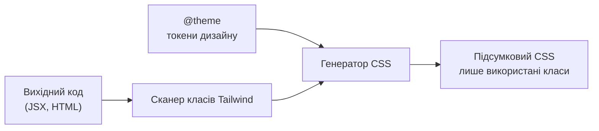

# Лекція 11 Tailwind CSS та сучасна стилізація

## Вступ: від логіки до вигляду

У попередніх лекціях ми навчилися будувати структуру застосунку, керувати станом, організовувати навігацію (лекції 08–09), а також працювати з формами й серверною частиною (лекція 10). Те, що ми створювали, працює, але виглядає як неоформлений документ із кнопками. Інтерфейс, яким приємно користуватися, потребує стилізації: відступів, кольорів, типографіки, адаптації до різних екранів, темної теми та анімацій. Саме на цьому етапі багато проєктів починають «обростати» тисячами рядків CSS, які ніхто не наважується видаляти.

**Tailwind CSS** пропонує радикально інший підхід порівняно з традиційними методами. Замість того щоб вигадувати назви класів і писати власні правила, розробник комбінує невеликі готові **утилітарні класи** (*utility classes*), кожен з яких відповідає за одну властивість, безпосередньо в розмітці. Така ідея може здатися дивною, особливо тим, хто звик до методологій BEM чи SMACSS. Проте вона розв'язує низку фундаментальних проблем CSS, роблячи розробку швидшою, передбачуванішою та простішою в супроводі.

У цій лекції ми розглянемо Tailwind CSS 4-ї версії, яка вийшла на початку 2025 року і є нині актуальною. Нам доведеться окремо звертати увагу на відмінності від 3-ї версії: більшість посібників в інтернеті досі написані для неї, тож ви часто бачитимете застарілий код. Ми почнемо з філософії підходу й встановлення, розглянемо базові класи й адаптивний дизайн, навчимося налаштовувати систему дизайну під власний проєкт, будувати з утиліт багаторазові компоненти, реалізовувати темну тему та користуватися «безголовими» (*headless*) компонентами для складних елементів інтерфейсу.

## Підхід «utility-first»: філософія та переваги

### Еволюція підходів до CSS

Щоб зрозуміти, чому з'явився Tailwind, корисно коротко простежити, як змінювалося ставлення до CSS.

На початку вебу стилі писали напряму: один великий файл і семантичні назви класів (`.card`, `.sidebar`). У великих проєктах це призводило до накопичення правил, непередбачуваних каскадних ефектів і страху щось видалити. Методології на кшталт **BEM** (`.card__title`, `.card__button--primary`) впорядкували іменування, але вимагали дисципліни й багато додаткового коду. **CSS Modules** та **CSS-in-JS** (styled-components, Emotion) локалізували стилі в межах компонента. Нарешті, **utility-first** підхід, який популяризував Tailwind, відмовився від самої ідеї «семантичного» CSS: стиль описується набором коротких класів, і CSS-файл майже не росте.

### Порівняння з традиційним CSS

```css
/* Традиційний підхід: написання власних класів */
.card {
    max-width: 28rem;
    margin: 0 auto;
    padding: 1.5rem;
    background-color: white;
    border-radius: 0.5rem;
    box-shadow: 0 4px 6px rgba(0, 0, 0, 0.1);
}

.card-title {
    font-size: 1.5rem;
    font-weight: 700;
    margin-bottom: 1rem;
    color: #1a202c;
}

.card-content {
    font-size: 1rem;
    line-height: 1.5;
    color: #4a5568;
}

.button-primary {
    padding: 0.75rem 1.5rem;
    background-color: #3b82f6;
    color: white;
    border-radius: 0.375rem;
    font-weight: 600;
    transition: background-color 0.2s;
}

.button-primary:hover {
    background-color: #2563eb;
}
```

```jsx
// Традиційне використання
<div className="card">
    <h2 className="card-title">Заголовок картки</h2>
    <p className="card-content">Це текст всередині картки.</p>
    <button className="button-primary">Натисни мене</button>
</div>
```

```jsx
// Підхід Tailwind: утилітарні класи
<div className="max-w-md mx-auto p-6 bg-white rounded-lg shadow-md">
    <h2 className="text-2xl font-bold mb-4 text-gray-900">
        Заголовок картки
    </h2>
    <p className="text-base leading-relaxed text-gray-600">
        Це текст всередині картки.
    </p>
    <button className="px-6 py-3 bg-blue-500 text-white rounded-md font-semibold hover:bg-blue-600 transition-colors">
        Натисни мене
    </button>
</div>
```

Результат в обох випадках однаковий. Різниця — в тому, що у другому варіанті немає окремого CSS-файлу, не потрібно вигадувати назви `card-title` і `button-primary`, а видалення компонента автоматично видаляє й усі його стилі.

### Переваги підходу

**Швидкість розробки.** Розробники не витрачають час на вигадування назв класів і перемикання між файлами розмітки та стилів. Усі стилі застосовуються безпосередньо в розмітці.

**Передбачуваність.** Кожен утилітарний клас робить рівно одну річ, тому поведінка стилів прозора. Немає каскадних ефектів чи несподіваних перевизначень, коли зміна в одному місці ламає інше.

**Відсутність мертвого коду.** Стилі «прив'язані» до елемента, що їх використовує. Видалили компонент — видалили стилі. CSS не накопичується.

**Дизайн-система з коробки.** Tailwind надає узгоджену шкалу значень для кольорів, відступів, шрифтів і тіней. Це забезпечує візуальну консистентність усього застосунку й унеможливлює «магічні» числа на кшталт `margin: 13px`.

**Адаптивність без медіазапитів.** Модифікатори точок зміни макета дозволяють створювати адаптивні дизайни, не пишучи `@media` вручну.

```jsx
// Адаптивний дизайн із Tailwind
<div className="
    w-full           /* На мобільних: 100% ширини */
    md:w-1/2         /* ≥768px: 50% ширини */
    lg:w-1/3         /* ≥1024px: 33% ширини */
    p-4              /* Відступ 16px на всіх пристроях */
    md:p-6           /* ≥768px: 24px */
    lg:p-8           /* ≥1024px: 32px */
">
    Адаптивний вміст
</div>
```

> **Примітка щодо коментарів.** Тут і в наступних прикладах `/* ... */` усередині `className` — це навчальні позначки. Насправді рядок класів є звичайним рядком JavaScript, тож такі «коментарі» стають його частиною (Tailwind просто ігнорує їх як невідомі класи). У робочому коді так не пишуть: пояснення виносять за межі рядка.

### Недоліки та критика

Було б нечесно не згадати, чому підхід викликає суперечки. Довгі списки класів роблять розмітку «шумною» і ускладнюють читання, особливо новачкам. Тісно «злипаються» структура та вигляд, що суперечить класичному принципу розділення відповідальності. Повторювані набори класів доводиться виносити в компоненти (у React це природно, а у простому HTML — незручно). Нарешті, потрібен час, щоб запам'ятати назви класів. Практика показує: вищі витрати на старті окупаються швидкістю подальшої роботи, а більшість проблем розв'язують компонентним підходом і сучасними засобами редактора, про які мова нижче.

## Встановлення та налаштування

У версії 4 встановлення значно спростилося: більше не потрібні ні `postcss`, ні `autoprefixer`, ні файл `tailwind.config.js`. Для проєктів на Vite достатньо двох пакетів і двох рядків коду.

```bash
npm install tailwindcss @tailwindcss/vite
```

```javascript
// vite.config.js
import { defineConfig } from 'vite';
import react from '@vitejs/plugin-react';
import tailwindcss from '@tailwindcss/vite';

export default defineConfig({
    plugins: [react(), tailwindcss()]
});
```

```css
/* src/index.css */
@import "tailwindcss";
```

Залишається підключити цей CSS-файл у точці входу (`import './index.css'` у `main.jsx`) — і утилітарні класи працюють. Для інших середовищ є свої інтеграції: наприклад, Next.js використовує пакет `@tailwindcss/postcss`.

Варто звернути увагу на те, чого *немає* в налаштуванні. Tailwind 4 **автоматично знаходить** файли з вашими класами (він сканує вихідний код проєкту, ігноруючи `node_modules` та файли з `.gitignore`), тож масив `content` більше не потрібен. Якщо потрібно просканувати додатковий каталог (наприклад, пакет у моно-репозиторії), використовують директиву `@source`.

> **Підтримувані браузери.** Tailwind 4 спирається на сучасні можливості CSS (каскадні шари, `@property`, `color-mix()`), тому потребує Safari 16.4+, Chrome 111+ та Firefox 128+. Якщо вам доводиться підтримувати старші браузери, лишайтеся на версії 3.4.

Як саме з утилітарних класів формується CSS, показано на схемі: Tailwind не містить заздалегідь згенерованої гігантської таблиці стилів, а створює лише ті правила, що справді зустрічаються у вашому коді.



Через це розмір підсумкового CSS залежить від використання, а не від розміру фреймворку. Це відрізняється від поширеного уявлення, що Tailwind «видаляє зайве» зовнішнім інструментом: він просто не створює того, чого ви не вживали. Звідси випливає й важливе правило, про яке часто забувають: Tailwind бачить лише **цілі назви класів**, записані в коді, тому динамічно скласти їх з частин не можна.

```jsx
// ❌ Tailwind не знайде такий клас у вихідному коді й не створить його
<div className={`bg-${color}-500`} />

// ✅ Повні назви класів записані явно
const colors = {
    blue: 'bg-blue-500',
    red: 'bg-red-500'
};
<div className={colors[color]} />
```

## Базові концепції та система дизайну

### Система відступів

Tailwind використовує передбачувану шкалу відступів. У версії 4 вона побудована на одній змінній `--spacing` (за замовчуванням `0.25rem`, тобто 4px), тому одна одиниця дорівнює 0.25rem, а будь-яке ціле число працює «автоматично» — `p-13` дасть відступ 3.25rem без жодного налаштування.

```jsx
// Margin та padding
<div className="m-4">Зовнішній відступ з усіх боків (16px)</div>
<div className="mx-4">Горизонтальний відступ (16px)</div>
<div className="my-4">Вертикальний відступ (16px)</div>
<div className="mt-4">Відступ зверху (16px)</div>
<div className="mr-4">Відступ праворуч (16px)</div>
<div className="mb-4">Відступ знизу (16px)</div>
<div className="ml-4">Відступ ліворуч (16px)</div>

// Padding працює аналогічно
<div className="p-6">Внутрішній відступ з усіх боків (24px)</div>
<div className="px-6 py-4">Горизонтальний 24px, вертикальний 16px</div>

// Від'ємні відступи
<div className="-mt-4">Від'ємний відступ зверху</div>

// Проміжки між дочірніми елементами
<div className="space-y-4">
    <div>Елемент 1</div>
    <div>Елемент 2</div>
    <div>Елемент 3</div>
</div>

// Квадратний елемент: ширина й висота одним класом
<div className="size-12 bg-blue-500" />
```

Для проміжків між елементами у `flex`- та `grid`-контейнерах сучасніше використовувати `gap-*`, ніж `space-*`: він не залежить від порядку елементів і не ламається при їх перестановці.

### Система кольорів

Tailwind надає багату палітру з градаціями від 50 (найсвітліший) до 950 (найтемніший). У версії 4 палітру перераховано в просторі `oklch`, завдяки чому кольори стали яскравішими на сучасних дисплеях. Для сірих відтінків є кілька родин (`gray`, `slate`, `zinc`, `neutral`, `stone`) з легкими відмінностями в тоні.

```jsx
// Кольори тексту
<p className="text-gray-900">Темно-сірий текст</p>
<p className="text-blue-500">Синій текст</p>
<p className="text-red-600">Червоний текст</p>

// Кольори фону
<div className="bg-white">Білий фон</div>
<div className="bg-gray-100">Світло-сірий фон</div>
<div className="bg-blue-500">Синій фон</div>

// Кольори рамки: колір слід вказувати явно
<div className="border border-gray-300">Сіра рамка</div>
<div className="border-2 border-blue-500">Товста синя рамка</div>

// Прозорість задається через «скісну риску» після назви кольору
<div className="bg-blue-500/50">Напівпрозорий синій фон</div>
<p className="text-gray-900/75">Напівпрозорий текст</p>
```

> **Змінилося у версії 4.** Окремих класів прозорості (`bg-opacity-50`, `text-opacity-75`) більше немає — натомість використовується запис із `/`. Крім того, колір рамки за замовчуванням тепер дорівнює поточному кольору тексту (раніше був світло-сірий), тому клас `border` без кольору виглядатиме інакше. Завжди вказуйте колір рамки явно: `border border-gray-200`.

### Типографіка

```jsx
// Розміри шрифту
<h1 className="text-4xl">Великий заголовок (36px)</h1>
<h2 className="text-3xl">Середній заголовок (30px)</h2>
<p className="text-base">Звичайний текст (16px)</p>
<small className="text-sm">Малий текст (14px)</small>

// Товщина шрифту
<p className="font-light">Легкий (300)</p>
<p className="font-normal">Звичайний (400)</p>
<p className="font-semibold">Напівжирний (600)</p>
<p className="font-bold">Жирний (700)</p>

// Міжрядковий інтервал
<p className="leading-tight">Щільний інтервал</p>
<p className="leading-normal">Звичайний інтервал</p>
<p className="leading-relaxed">Вільний інтервал</p>

// Вирівнювання тексту
<p className="text-left">Ліворуч</p>
<p className="text-center">По центру</p>
<p className="text-right">Праворуч</p>
<p className="text-justify">По ширині</p>

// Декорація та регістр
<p className="underline">Підкреслений текст</p>
<p className="line-through">Закреслений текст</p>
<p className="uppercase">ВЕЛИКІ ЛІТЕРИ</p>
<p className="lowercase">малі літери</p>
<p className="capitalize">Кожне Слово З Великої</p>

// Балансування рядків у заголовках
<h2 className="text-balance">Заголовок, який красиво переноситься на кілька рядків</h2>
```

### Flexbox та Grid

```jsx
// Flexbox
<div className="flex items-center justify-between">
    <div>Лівий елемент</div>
    <div>Правий елемент</div>
</div>

// Напрямок
<div className="flex flex-col">         {/* Вертикально */}
<div className="flex flex-row">         {/* Горизонтально */}
<div className="flex flex-col-reverse"> {/* Вертикально у зворотному порядку */}

// Вирівнювання вздовж основної осі
<div className="flex justify-start">    {/* На початку */}
<div className="flex justify-center">   {/* По центру */}
<div className="flex justify-end">      {/* В кінці */}
<div className="flex justify-between">  {/* Із проміжками між елементами */}
<div className="flex justify-around">   {/* Рівномірно навколо елементів */}

// Вирівнювання впоперек
<div className="flex items-start">      {/* Вгорі */}
<div className="flex items-center">     {/* По центру */}
<div className="flex items-end">        {/* Внизу */}
<div className="flex items-stretch">    {/* Розтягнуто */}

// Розтягування та стискання
<div className="flex-1">Займає вільний простір</div>
<div className="flex-none">Фіксований розмір</div>

// Проміжки між елементами
<div className="flex gap-4">            {/* 16px */}
<div className="flex gap-x-4 gap-y-2">  {/* Різні проміжки */}

// Grid
<div className="grid grid-cols-3 gap-4">
    <div>Колонка 1</div>
    <div>Колонка 2</div>
    <div>Колонка 3</div>
</div>

// Адаптивна сітка
<div className="grid grid-cols-1 md:grid-cols-2 lg:grid-cols-3 gap-4">
    {/* На мобільних — 1 колонка, на планшетах — 2, на десктопах — 3 */}
</div>

// Розтягування елемента на кілька колонок
<div className="grid grid-cols-4 gap-4">
    <div className="col-span-2">Займає 2 колонки</div>
    <div>Колонка 3</div>
    <div>Колонка 4</div>
</div>

// Довільні значення в квадратних дужках
<div className="grid grid-cols-[200px_auto_200px] gap-4">
    <div>Фіксована 200px</div>
    <div>Гнучка</div>
    <div>Фіксована 200px</div>
</div>
```

Останній приклад показує ще одну важливу можливість — **довільні значення** (*arbitrary values*) у квадратних дужках: `w-[372px]`, `bg-[#1da1f2]`, `top-[calc(100%-2rem)]`. Вони дозволяють виходити за межі шкали в одиничних випадках, не створюючи для цього окремого CSS. Але зловживати ними не слід: якщо одне й те саме значення зустрічається часто, його краще додати в налаштування (про це далі).

### Стани й варіанти

Окрім звичайних властивостей, Tailwind дозволяє змінювати стилі залежно від стану елемента за допомогою **модифікаторів** (префіксів). Достатньо додати до будь-якого класу префікс зі станом.

```jsx
<button className="
    bg-blue-500 text-white
    hover:bg-blue-600          /* при наведенні курсора */
    active:bg-blue-700         /* під час натискання */
    focus-visible:ring-2       /* при фокусі з клавіатури */
    focus-visible:ring-blue-500
    disabled:opacity-50        /* для вимкненої кнопки */
    disabled:cursor-not-allowed
">
    Зберегти
</button>
```

Є також модифікатори, що залежать від *іншого* елемента: `group` та `peer`. Клас `group` на батьківському елементі дозволяє дочірнім реагувати на його стан (`group-hover:`), а `peer` — сусіднім елементам, наприклад, показувати помилку біля невалідного поля (`peer-invalid:`). Модифікатор `hover:` у версії 4 спрацьовує лише на пристроях, які справді підтримують наведення, тож на сенсорних екранах «залипання» стану наведення зникає.

```jsx
<label className="group flex items-center gap-2 cursor-pointer">
    <input type="checkbox" className="peer sr-only" />
    <span className="size-5 rounded border border-gray-300 peer-checked:bg-blue-500 group-hover:border-blue-400" />
    Запам'ятати мене
</label>
```

## Адаптивний дизайн із Tailwind

### Система точок зміни макета

Tailwind застосовує підхід **mobile-first**: стилі без префікса діють на всіх екранах, а стилі з префіксом — починаючи із зазначеної ширини екрана (*breakpoint*) й вище.

| Префікс | Мінімальна ширина | Типовий пристрій |
|---|---|---|
| (без префікса) | 0 | Мобільні телефони |
| `sm:` | 640px | Великі телефони |
| `md:` | 768px | Планшети |
| `lg:` | 1024px | Ноутбуки |
| `xl:` | 1280px | Монітори |
| `2xl:` | 1536px | Великі монітори |

Проєктуючи, спершу описуйте мобільний вигляд, а потім «дописуйте» зміни для більших екранів. Помилка, якою часто зловживають початківці, — застосовувати `sm:` для «телефону»: цей префікс означає «від 640px і більше», а не «для малих екранів». Для обмеження «до певної ширини» є префікси `max-md:`, а для діапазону їх можна поєднувати: `md:max-lg:`.

```jsx
// Приклад адаптивного компонента
<div className="
    w-full          /* Мобільні: 100% */
    sm:w-auto       /* ≥640px: за вмістом */
    md:w-1/2        /* ≥768px: 50% */
    lg:w-1/3        /* ≥1024px: 33% */
    xl:w-1/4        /* ≥1280px: 25% */

    p-4             /* Усюди: 16px */
    md:p-6          /* ≥768px: 24px */
    lg:p-8          /* ≥1024px: 32px */

    text-sm         /* Мобільні: малий текст */
    md:text-base    /* ≥768px: звичайний */
    lg:text-lg      /* ≥1024px: великий */
">
    Адаптивний вміст
</div>
```

### Практичний приклад: адаптивна навігація

Для навігації між сторінками ми користуємося компонентом `Link` із React Router (лекція 09), а не звичайним `<a>`, щоб не перезавантажувати застосунок.

```jsx
import { useState } from 'react';
import { Link } from 'react-router-dom';

function ResponsiveNavigation() {
    const [isMenuOpen, setIsMenuOpen] = useState(false);

    return (
        <nav className="bg-white shadow-lg">
            <div className="max-w-7xl mx-auto px-4 sm:px-6 lg:px-8">
                <div className="flex justify-between h-16">
                    {/* Логотип */}
                    <div className="flex items-center">
                        
                    </div>

                    {/* Меню для великих екранів */}
                    <div className="hidden md:flex md:items-center md:space-x-4">
                        <Link to="/" className="px-3 py-2 text-gray-700 hover:text-blue-600">
                            Головна
                        </Link>
                        <Link to="/about" className="px-3 py-2 text-gray-700 hover:text-blue-600">
                            Про нас
                        </Link>
                        <Link to="/contact" className="px-3 py-2 text-gray-700 hover:text-blue-600">
                            Контакти
                        </Link>
                        <button className="px-4 py-2 bg-blue-500 text-white rounded-md hover:bg-blue-600">
                            Увійти
                        </button>
                    </div>

                    {/* Кнопка мобільного меню */}
                    <div className="flex items-center md:hidden">
                        <button
                            onClick={() => setIsMenuOpen(!isMenuOpen)}
                            className="p-2 rounded-md text-gray-700 hover:bg-gray-100"
                            aria-label={isMenuOpen ? 'Закрити меню' : 'Відкрити меню'}
                            aria-expanded={isMenuOpen}
                        >
                            <svg className="h-6 w-6" fill="none" viewBox="0 0 24 24" stroke="currentColor">
                                {isMenuOpen ? (
                                    <path strokeLinecap="round" strokeLinejoin="round" strokeWidth={2} d="M6 18L18 6M6 6l12 12" />
                                ) : (
                                    <path strokeLinecap="round" strokeLinejoin="round" strokeWidth={2} d="M4 6h16M4 12h16M4 18h16" />
                                )}
                            </svg>
                        </button>
                    </div>
                </div>
            </div>

            {/* Мобільне меню */}
            {isMenuOpen && (
                <div className="md:hidden">
                    <div className="px-2 pt-2 pb-3 space-y-1">
                        <Link to="/" className="block px-3 py-2 text-gray-700 hover:bg-gray-100 rounded-md">
                            Головна
                        </Link>
                        <Link to="/about" className="block px-3 py-2 text-gray-700 hover:bg-gray-100 rounded-md">
                            Про нас
                        </Link>
                        <Link to="/contact" className="block px-3 py-2 text-gray-700 hover:bg-gray-100 rounded-md">
                            Контакти
                        </Link>
                        <button className="w-full text-left px-3 py-2 bg-blue-500 text-white rounded-md hover:bg-blue-600">
                            Увійти
                        </button>
                    </div>
                </div>
            )}
        </nav>
    );
}
```

Зверніть увагу на логіку: класи `hidden md:flex` та `md:hidden` по черзі вмикають і вимикають показ блоків залежно від ширини екрана (повне меню — на великих екранах, кнопка — на малих), а кнопка меню отримала `aria-label` та `aria-expanded`, щоб бути зрозумілою для екранних читачів.

### Адаптивна сітка

```jsx
function ResponsiveGrid() {
    const items = Array.from({ length: 12 }, (_, i) => i + 1);

    return (
        <div className="container mx-auto px-4 py-8">
            <div className="grid grid-cols-1 sm:grid-cols-2 md:grid-cols-3 lg:grid-cols-4 gap-4">
                {items.map(item => (
                    <div
                        key={item}
                        className="
                            bg-white rounded-lg shadow-md p-6
                            hover:shadow-xl transition-shadow
                            hover:-translate-y-1
                        "
                    >
                        <h3 className="text-xl font-bold mb-2">Картка {item}</h3>
                        <p className="text-gray-600">Опис картки з адаптивним дизайном</p>
                    </div>
                ))}
            </div>
        </div>
    );
}
```

### Контейнерні запити

Адаптація до ширини *екрана* не завжди доречна: один і той самий компонент (картка) може опинитися і в широкій основній колонці, і у вузькій бічній панелі, і на однаковому екрані виглядати має по-різному. Для цього призначено **контейнерні запити** (*container queries*): компонент реагує на ширину свого *контейнера*. У Tailwind 4 вони вбудовані: достатньо позначити батьківський елемент класом `@container`, а до дочірніх застосувати префікси `@sm:`, `@md:`, `@lg:`.

```jsx
<div className="@container">
    <div className="flex flex-col gap-2 @md:flex-row @md:items-center">
        
        <div>
            <h3 className="font-bold">Заголовок</h3>
            <p className="text-gray-600">Розташування залежить від ширини контейнера</p>
        </div>
    </div>
</div>
```

## Налаштування та розширення

### Токени дизайну в директиві @theme

У версії 3 налаштування жили в JavaScript-файлі `tailwind.config.js`. У версії 4 їх перенесено в сам CSS — директиву `@theme`. Кожна змінна, оголошена в ній, стає **токеном дизайну**: Tailwind автоматично створює відповідні утилітарні класи, а в підсумковому CSS вони доступні як нативні змінні (`var(--color-primary-500)`), тому ними можна користуватися й у власному CSS та навіть у JavaScript.

```css
/* src/index.css */
@import "tailwindcss";

@theme {
    /* Власні кольори: --color-* → bg-primary-500, text-primary-900 тощо */
    --color-primary-50: #f0f9ff;
    --color-primary-100: #e0f2fe;
    --color-primary-500: #0ea5e9;
    --color-primary-900: #0c4a6e;
    --color-secondary-500: #8b5cf6;

    /* Власні шрифти: --font-* → font-heading */
    --font-sans: "Inter", sans-serif;
    --font-heading: "Poppins", sans-serif;

    /* Додаткові точки зміни макета: --breakpoint-* → xs:, 3xl: */
    --breakpoint-xs: 475px;
    --breakpoint-3xl: 1920px;

    /* Тіні та заокруглення */
    --shadow-card: 0 4px 6px -1px rgb(0 0 0 / 0.1), 0 2px 4px -1px rgb(0 0 0 / 0.06);
    --shadow-card-hover: 0 20px 25px -5px rgb(0 0 0 / 0.1), 0 10px 10px -5px rgb(0 0 0 / 0.04);
    --radius-card: 1.5rem;

    /* Анімації: --animate-* → animate-fade-in; кадри оголошуються поруч */
    --animate-fade-in: fade-in 0.5s ease-in-out;
    --animate-slide-up: slide-up 0.3s ease-out;

    @keyframes fade-in {
        0% { opacity: 0; }
        100% { opacity: 1; }
    }

    @keyframes slide-up {
        0% { transform: translateY(20px); opacity: 0; }
        100% { transform: translateY(0); opacity: 1; }
    }
}
```

Назва змінної визначає, які класи з'являться. Основні «простори імен» зведено в таблицю.

| Простір імен | Створює класи | Приклад |
|---|---|---|
| `--color-*` | `bg-*`, `text-*`, `border-*`, `ring-*` | `--color-primary-500` → `bg-primary-500` |
| `--font-*` | `font-*` | `--font-heading` → `font-heading` |
| `--text-*` | `text-*` (розмір) | `--text-huge` → `text-huge` |
| `--breakpoint-*` | Адаптивні префікси | `--breakpoint-3xl` → `3xl:` |
| `--shadow-*` | `shadow-*` | `--shadow-card` → `shadow-card` |
| `--radius-*` | `rounded-*` | `--radius-card` → `rounded-card` |
| `--animate-*` | `animate-*` | `--animate-fade-in` → `animate-fade-in` |
| `--spacing` | Уся шкала відступів | `--spacing: 0.25rem` |

За замовчуванням `@theme` *додає* значення до стандартних. Якщо потрібно замінити весь простір імен (наприклад, залишити тільки власну палітру), його спершу скидають: `--color-*: initial;`.

### Використання власних значень

```jsx
function CustomStyledComponent() {
    return (
        <div className="max-w-7xl mx-auto px-4 py-12">
            <div className="
                bg-primary-50
                text-primary-900
                font-heading
                shadow-card hover:shadow-card-hover
                rounded-card
                p-6
                animate-fade-in
            ">
                <h1 className="text-3xl xs:text-4xl lg:text-5xl 3xl:text-6xl">
                    Налаштований компонент
                </h1>
                <p className="text-secondary-500 mt-4">
                    Використання власних значень із файлу стилів
                </p>
            </div>
        </div>
    );
}
```

### Власні утилітарні класи та варіанти

Іноді потрібної утиліти немає. У версії 4 її оголошують директивою `@utility`: клас автоматично отримує підтримку всіх модифікаторів (`hover:`, `md:`, `dark:` тощо) і з'являється у підсумковому CSS лише тоді, коли його використано.

```css
/* Приховування смуги прокручування */
@utility scrollbar-hide {
    -ms-overflow-style: none;
    scrollbar-width: none;

    &::-webkit-scrollbar {
        display: none;
    }
}

/* Розмір табуляції */
@utility tab-4 {
    tab-size: 4;
}
```

> **Змінилося у версії 4.** Раніше такі класи оголошували в `@layer utilities { ... }`. Тепер для утиліт потрібен `@utility`. Також багато «звичних» власних класів уже вбудовані: наприклад, тіні тексту (`text-shadow-*`) з'явилися у версії 4.1, а градієнтний текст не потребує власного CSS — його можна скласти з готових класів: `bg-linear-to-r from-blue-500 to-violet-500 bg-clip-text text-transparent`.

Директива `@apply` дозволяє «зібрати» набір утиліт в один CSS-клас. Вона залишається працездатною, але її слід застосовувати помірно (докладніше — у розділі про компоненти).

```css
@layer components {
    .btn-primary {
        @apply px-6 py-3 bg-blue-500 text-white rounded-md font-semibold;
        @apply hover:bg-blue-600 active:bg-blue-700;
        @apply transition-colors duration-200;
        @apply focus-visible:outline-2 focus-visible:outline-offset-2 focus-visible:outline-blue-500;
    }
}
```

Власні модифікатори оголошуються директивою `@custom-variant`. Ми скористаємося нею в розділі про темну тему.

### Структура шарів і сумісність з версією 3

Tailwind 4 використовує нативні каскадні шари CSS (`@layer`) у порядку `theme → base → components → utilities`. Завдяки цьому утиліти завжди «перемагають» стилі компонентів, незалежно від порядку в файлі й специфічності селекторів.

Якщо вам потрібно підтримувати проєкт на версії 3 або перенести його, корисно знати, що змінилося. Офіційний засіб `npx @tailwindcss/upgrade` виконує більшу частину перетворень автоматично, але значення варто перевірити вручну.

| Версія 3 | Версія 4 |
|---|---|
| `@tailwind base; @tailwind components; @tailwind utilities;` | `@import "tailwindcss";` |
| `tailwind.config.js` | `@theme` у CSS (старий файл підключається через `@config`) |
| Масив `content` | Автоматичне знаходження (`@source` — для додаткових шляхів) |
| `postcss` + `autoprefixer` | Плагін `@tailwindcss/vite` (або `@tailwindcss/postcss`) |
| `@layer utilities { .x { } }` | `@utility x { }` |
| `bg-opacity-50`, `text-opacity-75` | `bg-blue-500/50`, `text-gray-900/75` |
| `shadow-sm`, `shadow` | `shadow-xs`, `shadow-sm` |
| `rounded-sm`, `rounded` | `rounded-xs`, `rounded-sm` |
| `outline-none` | `outline-hidden` |
| `ring` (3px) | `ring-3` (клас `ring` тепер 1px) |
| `bg-gradient-to-r` | `bg-linear-to-r` |
| `flex-shrink-0`, `flex-grow` | `shrink-0`, `grow` |
| `darkMode: 'class'` | `@custom-variant dark (...)` |

## Компонентний підхід з Tailwind

### Чому компоненти, а не @apply

Побачивши довгі списки класів, перша реакція — «зберу їх в одне ім'я за допомогою `@apply`». Така реакція зрозуміла, але веде назад до традиційного CSS з усіма його проблемами: потрібно вигадувати назви, стилі знову відокремлюються від розмітки. Правильна відповідь у React — **компонент**. Список класів записується *один раз* у компоненті `Button`, а далі скрізь використовується `<Button>`. `@apply` залишається корисним у вузьких випадках: стилізація вмісту, який згенерував сторонній код (Markdown, редактор тексту), де вставити класи в розмітку неможливо.

### Допоміжна функція cn

У компонентах з варіантами виникають дві проблеми. Умовні класи складно записувати (`cond ? 'a' : ''` у шаблонних рядках швидко стають нечитабельними). А ще при об'єднанні класів можливі **конфлікти**: якщо компонент має `px-6`, а викликаючий код додає `px-2`, переможе не «останній», а той клас, який вище в згенерованому CSS, тобто результат непередбачуваний. Обидві проблеми розв'язує невелика допоміжна функція, що поєднує пакети `clsx` (умовні класи) та `tailwind-merge` (вирішення конфліктів):

```bash
npm install clsx tailwind-merge
```

```javascript
// src/lib/cn.js
import { clsx } from 'clsx';
import { twMerge } from 'tailwind-merge';

export function cn(...inputs) {
    return twMerge(clsx(inputs));
}
```

### Багаторазові компоненти: кнопка

```jsx
import { cn } from '../lib/cn';

const baseStyles =
    'font-semibold rounded-md transition-colors duration-200 ' +
    'focus-visible:outline-2 focus-visible:outline-offset-2 ' +
    'disabled:opacity-50 disabled:cursor-not-allowed';

const variants = {
    primary: 'bg-blue-500 text-white hover:bg-blue-600 focus-visible:outline-blue-500',
    secondary: 'bg-gray-200 text-gray-900 hover:bg-gray-300 focus-visible:outline-gray-500',
    danger: 'bg-red-500 text-white hover:bg-red-600 focus-visible:outline-red-500',
    success: 'bg-green-500 text-white hover:bg-green-600 focus-visible:outline-green-500',
    outline: 'border-2 border-blue-500 text-blue-500 hover:bg-blue-50 focus-visible:outline-blue-500'
};

const sizes = {
    sm: 'px-3 py-1.5 text-sm',
    md: 'px-6 py-3 text-base',
    lg: 'px-8 py-4 text-lg'
};

function Button({
    children,
    variant = 'primary',
    size = 'md',
    fullWidth = false,
    className,
    ...props
}) {
    return (
        <button
            className={cn(
                baseStyles,
                variants[variant],
                sizes[size],
                fullWidth && 'w-full',
                className // дозволяє викликаючому коду доповнити або перевизначити стилі
            )}
            {...props}
        >
            {children}
        </button>
    );
}

// Використання
function Example() {
    return (
        <div className="space-y-4">
            <Button variant="primary" size="md">Первинна кнопка</Button>
            <Button variant="secondary" size="lg">Вторинна кнопка</Button>
            <Button variant="danger" fullWidth>Кнопка на всю ширину</Button>
            <Button variant="outline" disabled>Вимкнена кнопка</Button>
            <Button className="px-2">Перевизначений відступ</Button>
        </div>
    );
}
```

Вимкнений стан не потребує жодного умовного класу: модифікатор `disabled:` реагує на атрибут `disabled`, який ми просто передаємо в `...props`. А завдяки `tailwind-merge` останній приклад дасть кнопку з `px-2`, а не з двома конкурентними відступами.

Коли варіантів багато, їх зручно описувати бібліотекою `class-variance-authority` (`cva`): вона поєднує базові класи, варіанти й типові значення в одному об'єкті, який легко типізується. Саме цей підхід лежить в основі популярної колекції компонентів **shadcn/ui**.

```javascript
import { cva } from 'class-variance-authority';

const button = cva('font-semibold rounded-md transition-colors', {
    variants: {
        variant: {
            primary: 'bg-blue-500 text-white hover:bg-blue-600',
            secondary: 'bg-gray-200 text-gray-900 hover:bg-gray-300'
        },
        size: {
            sm: 'px-3 py-1.5 text-sm',
            md: 'px-6 py-3 text-base'
        }
    },
    defaultVariants: { variant: 'primary', size: 'md' }
});

// button({ variant: 'secondary', size: 'sm' }) → рядок класів
```

### Компонент картки

```jsx
import { cn } from '../lib/cn';

function Card({ title, description, image, footer, hoverable = true, className }) {
    return (
        <div className={cn(
            'bg-white rounded-lg shadow-md overflow-hidden',
            hoverable && 'hover:shadow-xl transition-shadow duration-300',
            className
        )}>
            {image && (
                <div className="h-48 overflow-hidden">
                    
                </div>
            )}

            <div className="p-6">
                {title && (
                    <h3 className="text-xl font-bold mb-2 text-gray-900">{title}</h3>
                )}
                {description && (
                    <p className="text-gray-600 leading-relaxed">{description}</p>
                )}
            </div>

            {footer && (
                <div className="px-6 py-4 bg-gray-50 border-t border-gray-200">
                    {footer}
                </div>
            )}
        </div>
    );
}

// Використання
function CardExample() {
    return (
        <div className="grid grid-cols-1 md:grid-cols-2 lg:grid-cols-3 gap-6">
            <Card
                title="Заголовок картки"
                description="Опис картки з важливою інформацією для користувача"
                image="/card-image.jpg"
                footer={<Button variant="primary" fullWidth>Дізнатися більше</Button>}
            />
        </div>
    );
}
```

### Поле введення з валідацією

Тут ми повертаємося до компонента `Input` із лекції 10: його розмітку ми вже зробили доступною, а тепер додаємо стилі. Зверніть увагу, що `aria-invalid` можна використати і як модифікатор Tailwind (`aria-invalid:`), тож окремий умовний клас для помилки не потрібен.

```jsx
import { useId } from 'react';
import { cn } from '../lib/cn';

function Input({ label, error, helperText, icon, id, className, ref, ...props }) {
    const generatedId = useId();
    const inputId = id ?? generatedId;

    return (
        <div className="w-full">
            {label && (
                <label htmlFor={inputId} className="block text-sm font-medium text-gray-700 mb-2">
                    {label}
                    {props.required && <span className="text-red-500 ml-1">*</span>}
                </label>
            )}

            <div className="relative">
                {icon && (
                    <div className="absolute inset-y-0 left-0 pl-3 flex items-center pointer-events-none">
                        {icon}
                    </div>
                )}

                <input
                    ref={ref}
                    id={inputId}
                    aria-invalid={Boolean(error)}
                    aria-describedby={error ? `${inputId}-error` : undefined}
                    className={cn(
                        'w-full px-4 py-2 rounded-md border border-gray-300',
                        'placeholder:text-gray-400',
                        'focus:outline-hidden focus:ring-2 focus:ring-blue-500 focus:border-transparent',
                        'aria-invalid:border-red-500 aria-invalid:focus:ring-red-500',
                        'disabled:bg-gray-100 disabled:cursor-not-allowed',
                        'transition-colors duration-200',
                        icon && 'pl-10',
                        className
                    )}
                    {...props}
                />
            </div>

            {error && (
                <p id={`${inputId}-error`} role="alert" className="mt-1 text-sm text-red-600">
                    {error}
                </p>
            )}

            {helperText && !error && (
                <p className="mt-1 text-sm text-gray-500">{helperText}</p>
            )}
        </div>
    );
}
```

### Скелетні заглушки на Tailwind

У лекції 10 ми будували скелетні заглушки з окремих CSS-класів. З Tailwind для цього потрібна одна утиліта анімації:

```jsx
function SkeletonCard() {
    return (
        <div className="animate-pulse rounded-lg bg-white p-6 shadow-md" aria-hidden="true">
            <div className="size-12 rounded-full bg-gray-200" />
            <div className="mt-4 h-4 w-3/4 rounded bg-gray-200" />
            <div className="mt-2 h-4 w-1/2 rounded bg-gray-200" />
        </div>
    );
}
```

## Темна та світла теми

### Як працює темна тема

За замовчуванням у Tailwind 4 модифікатор `dark:` спрацьовує, коли в операційній системі користувача увімкнено темну тему (медіазапит `prefers-color-scheme`). Це найпростіший варіант і для багатьох сайтів достатній. Але зазвичай користувач хоче мати перемикач у самому застосунку, незалежний від системного. Для цього модифікатор `dark:` перевизначають так, щоб він залежав від класу `dark` на кореневому елементі `<html>`.

> **Змінилося у версії 4.** Налаштування `darkMode: 'class'` у `tailwind.config.js` більше не діє. Власну поведінку модифікатора оголошують директивою `@custom-variant` у CSS.

```css
/* src/index.css */
@import "tailwindcss";

/* dark: працює, коли на <html> (або предку) є клас .dark */
@custom-variant dark (&:where(.dark, .dark *));
```

### Реалізація перемикання теми

Початкову тему обираємо за такою логікою: якщо користувач уже робив вибір — використовуємо його, якщо ні — слідуємо системним налаштуванням. Вибір зберігаємо в `localStorage`.

```jsx
import { createContext, useCallback, useContext, useEffect, useState } from 'react';

const ThemeContext = createContext(null);

function getInitialTheme() {
    try {
        const saved = localStorage.getItem('theme');
        if (saved === 'light' || saved === 'dark') return saved;
    } catch {
        // доступ до localStorage може бути заблокований
    }
    return window.matchMedia('(prefers-color-scheme: dark)').matches ? 'dark' : 'light';
}

export function ThemeProvider({ children }) {
    const [theme, setTheme] = useState(getInitialTheme);

    useEffect(() => {
        document.documentElement.classList.toggle('dark', theme === 'dark');
        try {
            localStorage.setItem('theme', theme);
        } catch {
            // ігноруємо помилку збереження
        }
    }, [theme]);

    const toggleTheme = useCallback(() => {
        setTheme(prev => (prev === 'light' ? 'dark' : 'light'));
    }, []);

    // У React 19 контекст можна використовувати як провайдер напряму
    return (
        <ThemeContext value={{ theme, toggleTheme }}>
            {children}
        </ThemeContext>
    );
}

export function useTheme() {
    const context = useContext(ThemeContext);
    if (!context) throw new Error('useTheme потрібно викликати всередині ThemeProvider');
    return context;
}

// Компонент перемикача теми
function ThemeToggle() {
    const { theme, toggleTheme } = useTheme();

    return (
        <button
            onClick={toggleTheme}
            className="
                p-2 rounded-lg
                bg-gray-200 dark:bg-gray-700
                text-gray-800 dark:text-gray-200
                hover:bg-gray-300 dark:hover:bg-gray-600
                transition-colors duration-200
            "
            aria-label={theme === 'light' ? 'Увімкнути темну тему' : 'Увімкнути світлу тему'}
        >
            {theme === 'light' ? '🌙' : '☀️'}
        </button>
    );
}
```

Ця реалізація має відомий недолік: React ще не завантажився, а сторінка вже відображена зі світлою темою, і користувач із темною побачить коротке «миготіння». Щоб його уникнути, клас виставляють найпершим вбудованим скриптом у `index.html`, до завантаження застосунку:

```html
<script>
    (function () {
        try {
            const saved = localStorage.getItem('theme');
            const prefersDark = window.matchMedia('(prefers-color-scheme: dark)').matches;
            if (saved === 'dark' || (!saved && prefersDark)) {
                document.documentElement.classList.add('dark');
            }
        } catch (e) {}
    })();
</script>
```

### Стилізація з підтримкою теми

```jsx
function ThemedCard() {
    return (
        <div className="
            bg-white dark:bg-gray-800
            text-gray-900 dark:text-gray-100
            border border-gray-200 dark:border-gray-700
            rounded-lg shadow-md
            p-6
            transition-colors duration-200
        ">
            <h2 className="text-2xl font-bold mb-4 text-gray-900 dark:text-white">
                Картка з підтримкою теми
            </h2>

            <p className="text-gray-600 dark:text-gray-300 leading-relaxed">
                Цей текст автоматично адаптується до обраної теми
            </p>

            <button className="
                mt-4 px-6 py-2 rounded-md text-white
                bg-blue-500 dark:bg-blue-600
                hover:bg-blue-600 dark:hover:bg-blue-700
                transition-colors duration-200
            ">
                Кнопка
            </button>
        </div>
    );
}
```

Якщо кожен елемент стилізується парою `light dark:dark`, розмітка швидко розростається. Масштабований підхід — **семантичні токени**: оголосити в `@theme` кольори на кшталт `--color-surface` та `--color-text`, а їх значення перевизначати для `.dark`. Тоді в розмітці досить писати `bg-surface text-text`, а тема змінюється в одному місці.

```css
@theme {
    --color-surface: #ffffff;
    --color-text: #111827;
}

@layer base {
    .dark {
        --color-surface: #1f2937;
        --color-text: #f3f4f6;
    }
}
```

## Headless UI: доступні компоненти без стилів

### Що таке «безголові» компоненти

Деякі елементи інтерфейсу (модальне вікно, випадне меню, вкладки, випадний список із пошуком) складні не візуально, а поведінково: треба керувати фокусом, закривати вікно по `Escape`, підтримувати навігацію стрілками, коректно озвучувати елементи екранним читачам. Реалізувати це вручну — довго й легко припуститися помилки. **Headless UI** надає такі компоненти *без жодного оформлення*: вони беруть на себе поведінку й доступність, а вигляд повністю визначаєте ви за допомогою класів Tailwind.

```bash
npm install @headlessui/react
```

> **Версія.** Нині актуальна гілка 2. Порівняно з 1-ю змінилися імена компонентів: замість точкових (`Dialog.Panel`, `Menu.Button`) використовуються окремі експорти (`DialogPanel`, `MenuButton`), а анімацію виконує проста властивість `transition` разом із модифікаторами станів `data-closed:`, `data-open:`, `data-focus:` — окремий компонент `Transition` здебільшого не потрібен. Користуйтеся цим при перегляді старих прикладів.

Серед альтернатив варто знати Radix UI та React Aria — вони пропонують схожий набір та глибшу підтримку доступності; на них побудовані, зокрема, компоненти shadcn/ui.

| Бібліотека | Особливості |
|---|---|
| Headless UI | Створена командою Tailwind, найтісніша інтеграція з ним |
| Radix UI | Дуже повний набір примітивів, основа shadcn/ui |
| React Aria | Максимальна глибина доступності й інтернаціоналізації |

### Діалогове вікно

```jsx
import { useState } from 'react';
import { Dialog, DialogBackdrop, DialogPanel, DialogTitle } from '@headlessui/react';

function Modal() {
    const [isOpen, setIsOpen] = useState(false);

    return (
        <>
            <button
                onClick={() => setIsOpen(true)}
                className="px-6 py-3 bg-blue-500 text-white rounded-md hover:bg-blue-600"
            >
                Відкрити модальне вікно
            </button>

            <Dialog open={isOpen} onClose={() => setIsOpen(false)} className="relative z-50">
                {/* Затемнення тла: transition вмикає анімацію, data-closed задає початковий стан */}
                <DialogBackdrop
                    transition
                    className="fixed inset-0 bg-black/25 duration-300 ease-out data-closed:opacity-0"
                />

                <div className="fixed inset-0 flex w-screen items-center justify-center p-4">
                    <DialogPanel
                        transition
                        className="
                            w-full max-w-md rounded-2xl bg-white p-6 shadow-xl
                            duration-300 ease-out
                            data-closed:scale-95 data-closed:opacity-0
                        "
                    >
                        <DialogTitle className="text-lg font-medium leading-6 text-gray-900">
                            Заголовок модального вікна
                        </DialogTitle>

                        <p className="mt-2 text-sm text-gray-500">
                            Вміст модального вікна з важливою інформацією
                        </p>

                        <div className="mt-4 flex gap-2">
                            <button
                                type="button"
                                className="px-4 py-2 bg-blue-500 text-white rounded-md hover:bg-blue-600"
                                onClick={() => setIsOpen(false)}
                            >
                                Підтвердити
                            </button>
                            <button
                                type="button"
                                className="px-4 py-2 bg-gray-200 text-gray-900 rounded-md hover:bg-gray-300"
                                onClick={() => setIsOpen(false)}
                            >
                                Скасувати
                            </button>
                        </div>
                    </DialogPanel>
                </div>
            </Dialog>
        </>
    );
}
```

Скільки поведінки ми отримали, не написавши жодного рядка для неї: фокус «замикається» всередині вікна, `Escape` і клік по затемненню закривають його, а скрол сторінки під ним блокується, екранні читачі розпізнають вікно як діалог і знають його заголовок.

### Випадне меню

```jsx
import { Menu, MenuButton, MenuItem, MenuItems } from '@headlessui/react';

function Dropdown() {
    return (
        <Menu>
            <MenuButton className="
                inline-flex items-center px-4 py-2
                bg-white border border-gray-300 rounded-md shadow-xs
                hover:bg-gray-50
                focus-visible:outline-2 focus-visible:outline-blue-500
            ">
                Опції
                <svg className="w-5 h-5 ml-2" fill="currentColor" viewBox="0 0 20 20" aria-hidden="true">
                    <path fillRule="evenodd" d="M5.293 7.293a1 1 0 011.414 0L10 10.586l3.293-3.293a1 1 0 111.414 1.414l-4 4a1 1 0 01-1.414 0l-4-4a1 1 0 010-1.414z" clipRule="evenodd" />
                </svg>
            </MenuButton>

            {/* anchor позиціонує меню відносно кнопки */}
            <MenuItems
                transition
                anchor="bottom end"
                className="
                    w-56 origin-top-right bg-white rounded-md shadow-lg
                    ring-1 ring-black/5 p-1
                    transition duration-100 ease-out
                    data-closed:scale-95 data-closed:opacity-0
                "
            >
                <MenuItem>
                    <button className="flex w-full items-center rounded-md px-2 py-2 text-sm text-gray-900 data-focus:bg-blue-500 data-focus:text-white">
                        Редагувати
                    </button>
                </MenuItem>
                <MenuItem>
                    <button className="flex w-full items-center rounded-md px-2 py-2 text-sm text-gray-900 data-focus:bg-blue-500 data-focus:text-white">
                        Дублювати
                    </button>
                </MenuItem>
                <MenuItem>
                    <button className="flex w-full items-center rounded-md px-2 py-2 text-sm text-gray-900 data-focus:bg-red-500 data-focus:text-white">
                        Видалити
                    </button>
                </MenuItem>
            </MenuItems>
        </Menu>
    );
}
```

Стан «елемент у фокусі» (навігація стрілками або наведення) компонент позначає атрибутом `data-focus`, який ми підхоплюємо модифікатором `data-focus:`. У 1-й версії для цього використовували функцію `({ active }) => ...` та умовні класи — тепер вона не потрібна.

### Випадний список із пошуком

Тепер ми можемо повернутися до `SearchableSelect` із лекції 10. Там ми попередили, що повноцінний випадний список із пошуком потребує складної поведінки. Саме її й дає `Combobox`:

```jsx
import { useState } from 'react';
import { Combobox, ComboboxInput, ComboboxOption, ComboboxOptions } from '@headlessui/react';

function CountrySelect({ countries, value, onChange }) {
    const [query, setQuery] = useState('');

    const filtered = query === ''
        ? countries
        : countries.filter(c => c.label.toLowerCase().includes(query.toLowerCase()));

    return (
        <Combobox value={value} onChange={onChange} onClose={() => setQuery('')}>
            <ComboboxInput
                aria-label="Країна"
                displayValue={(country) => country?.label ?? ''}
                onChange={(e) => setQuery(e.target.value)}
                className="w-full rounded-md border border-gray-300 px-4 py-2 focus:outline-hidden focus:ring-2 focus:ring-blue-500"
            />

            <ComboboxOptions
                anchor="bottom"
                className="w-(--input-width) rounded-md border border-gray-200 bg-white p-1 shadow-lg empty:invisible"
            >
                {filtered.map(country => (
                    <ComboboxOption
                        key={country.value}
                        value={country}
                        className="cursor-pointer rounded px-3 py-2 data-focus:bg-blue-500 data-focus:text-white"
                    >
                        {country.label}
                    </ComboboxOption>
                ))}
            </ComboboxOptions>
        </Combobox>
    );
}
```

Такий компонент легко підключається до React Hook Form через `Controller`, як і наш навчальний варіант, що ми розглядали раніше.

## Продуктивність, інструменти та альтернативи

### Розмір CSS і швидкість збірки

Як ми бачили на початку, Tailwind генерує лише ті правила, які реально використовуються, тому підсумковий CSS зазвичай невеликий і майже не росте разом із проєктом: нові компоненти повторно використовують уже наявні утиліти. Новий рушій версії 4, написаний на Rust, суттєво швидший за попередній: розробники заявляють прискорення повних збірок до 5 разів і інкрементальних — більш ніж у 100 разів. Реальний ефект залежить від проєкту, тож орієнтуйтеся не на цифри, а на власні вимірювання.

### Інструменти розробника

- **Tailwind CSS IntelliSense** — розширення для VS Code: автодоповнення класів, підказки значень, попередження про конфлікти.
- **prettier-plugin-tailwindcss** — автоматично впорядковує класи в єдиному, узгодженому порядку, що значно полегшує перегляд змін у команді.
- **Tailwind Play** (play.tailwindcss.com) — онлайн-пісочниця для експериментів.

```bash
npm install -D prettier prettier-plugin-tailwindcss
```

### Альтернативи і коли Tailwind не підходить

| Підхід | Коли доречний |
|---|---|
| CSS Modules | Проста локалізація стилів, звичний синтаксис CSS |
| CSS-in-JS (styled-components, Emotion) | Динамічні стилі на основі властивостей; врахуйте додаткові витрати виконання та складнощі із серверним відтворенням |
| Власна система на змінних CSS | Повний контроль, жорсткі вимоги до дизайн-системи компанії |
| Tailwind CSS | Швидка розробка, командна консистентність, компонентна архітектура |

Tailwind менш зручний, коли дизайн дуже специфічний та складно виражається через шкалу значень, коли команда принципово не приймає utility-first підхід або коли потрібно підтримувати старі браузери. Важливо й те, що в **тестах** не слід перевіряти наявність класів Tailwind: вони є деталлю реалізації. У лекції 12 ми поговоримо про це докладніше.

## Висновки та найкращі практики

Tailwind CSS пропонує сучасний підхід до стилізації, який значно прискорює розробку та полегшує супровід коду. Основні принципи ефективного використання:

**Прийміть філософію utility-first.** Спочатку вона здається незвичною, але забезпечує консистентність, передбачуваність і швидкість. Не бійтеся довгих списків класів у JSX — це нормально, якщо вони інкапсульовані в компоненти.

**Налаштовуйте систему дизайну через `@theme`.** Tailwind пропонує продуману шкалу «з коробки», але кольори бренду, шрифти й точки зміни макета слід винести в токени, а не повторювати довільні значення в розмітці.

**Створюйте компоненти, а не класи.** Замість дублювання довгих списків класів інкапсулюйте їх у React-компоненти з варіантами. `@apply` використовуйте лише в винятках. Для об'єднання класів застосовуйте `cn` (clsx + tailwind-merge).

**Пишіть mobile-first.** Спершу описуйте мобільний вигляд, потім додавайте префікси `md:`, `lg:` для більших екранів, а для компонентів, що опиняються в контейнерах різної ширини, застосовуйте контейнерні запити.

**Не складайте назви класів динамічно.** Tailwind бачить лише цілі рядки в коді: `bg-${color}-500` не працюватиме.

**Пам'ятайте про доступність.** Використовуйте семантичні елементи, видимий фокус (`focus-visible:`), атрибути `aria-*`; для складних інтерактивних елементів беріть готові «безголові» компоненти (Headless UI, Radix UI, React Aria) замість власних реалізацій.

**Слідкуйте за версіями.** Більшість матеріалів в інтернеті описують Tailwind 3. Перш ніж копіювати код, перевірте, чи не змінилася назва класу чи спосіб налаштування.

Розуміння та застосування цих принципів дозволяє створювати красиві, консистентні й доступні інтерфейси швидше, зберігаючи високу якість і підтримуваність коду в довгостроковій перспективі. А щоб упевнитися, що такий інтерфейс працює й надалі після кожної зміни, у наступній лекції ми навчимося його тестувати.

## Питання для самоперевірки

1. У чому суть підходу utility-first і які його переваги та недоліки?
2. Як працює адаптивний дизайн у Tailwind? Що означає «mobile-first»?
3. Яку роль відіграє директива `@theme` і чим вона замінила `tailwind.config.js`?
4. Чому клас `bg-${color}-500` не працює, і як правильно записувати динамічні класи?
5. Для чого потрібна функція `cn` і яку проблему розв'язує `tailwind-merge`?
6. Коли доречно використовувати `@apply`, а коли краще створити компонент?
7. Як налаштувати перемикання темної теми у версії 4?
8. Що таке «безголові» компоненти і навіщо вони потрібні? Чим Headless UI 2 відрізняється від 1-ї версії?
9. Як Tailwind формує розмір підсумкового CSS?
10. Які основні зміни у Tailwind 4 порівняно з версією 3?
