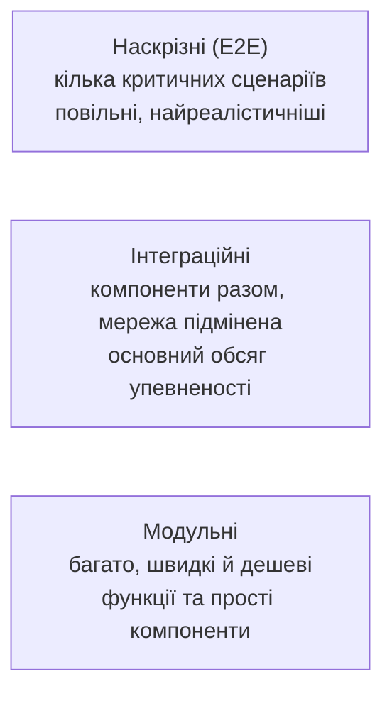
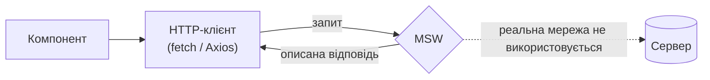
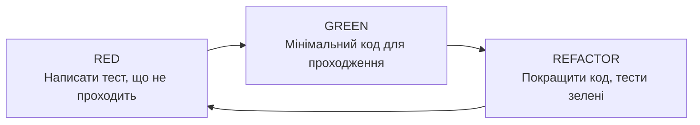

# Лекція 12 Тестування React-компонентів

## Вступ: навіщо тестувати інтерфейс

У попередніх лекціях ми навчилися будувати форми й обмінюватися даними із сервером (лекція 10) та оформлювати інтерфейс за допомогою Tailwind CSS (лекція 11). Ми писали код, відкривали сторінку в браузері й перевіряли «на око», що все працює. Для невеликого прикладу це можливо. Але уявіть застосунок із двома десятками форм, сотнею компонентів і складною логікою оновлення даних: після кожної зміни перевіряти все вручну неможливо, а непомічена помилка в реєстрації чи оплаті коштує реальних користувачів.

**Автоматизовані тести** — це код, який перевіряє інший код. Один раз написаний тест запускається за секунди й щоразу гарантує, що те, що працювало вчора, працює й сьогодні. Додаткові вигоди менш очевидні: тести виконують роль живої документації (за ними видно, як компонент має поводитися), дають впевненість під час рефакторингу (можна переписати внутрішню реалізацію й одразу перевірити, що поведінка не зламалась) і полегшують командну роботу (змінюючи чужий код, ви бачите, що саме можна порушити). Окрему вагу мають тести для форм і запитів до сервера, оскільки саме там помилки найдорожчі й найменш помітні.

Тестування інтерфейсу має свою специфіку: складна взаємодія з користувачем, асинхронна природа багатьох операцій (запити, анімації, затримки) та високі вимоги до якості користувацького досвіду. Водночас React-застосунки з їхньою компонентною архітектурою добре піддаються тестуванню: кожен компонент можна перевірити ізольовано, що спрощує виявлення помилок на ранніх етапах.

### Види тестів та піраміда тестування

Існує кілька рівнів тестування клієнтської частини, кожен з яких має власну мету.

| Рівень | Що перевіряє | Інструменти в цій лекції | Швидкість |
|---|---|---|---|
| Модульні (*unit*) | Окремий компонент або функція в ізоляції | Vitest + React Testing Library | Дуже швидкі |
| Інтеграційні (*integration*) | Взаємодія кількох компонентів, запити до (підміненого) сервера | Vitest + RTL + MSW | Швидкі |
| Наскрізні (*E2E*) | Повний сценарій у справжньому браузері | Playwright | Повільні |

Правильна стратегія передбачає баланс: швидких і дешевих тестів має бути багато, повільних і крихких — небагато, але лише для найважливіших сценаріїв. Цю ідею виражають піраміда тестування й її сучасний варіант — «трофей тестування», у якому найбільше ваги надається саме інтеграційним тестам, бо вони найкраще співвідносять упевненість і витрати. Конкретні відсотки (скажімо, «70/20/10») — лише орієнтир, а не закон: у застосунку, що майже повністю складається з форм і запитів, інтеграційних тестів буде більше, ніж модульних.



У цій лекції ми пройдемо всі три рівні, а також познайомимося з підходом розробки через тестування (TDD), покриттям коду тестами та запуском тестів у процесі безперервної інтеграції.

## React Testing Library: філософія та основи

### Концептуальні принципи

React Testing Library (RTL) базується на фундаментальному принципі, який її автор сформулював так: чим більше тести нагадують спосіб, у який користувач працює із застосунком, тим більшу впевненість вони дають. Замість перевірки *деталей реалізації* (який стан у компонента, яка функція викликана всередині) бібліотека заохочує перевіряти *видиму поведінку*: що користувач бачить на екрані та що відбувається, коли він натискає кнопку чи вводить текст.

Цей підхід має кілька важливих переваг. По-перше, тести стійкі до рефакторингу: ви можете замінити `useState` на `useReducer` чи на React Hook Form, а тест залишиться незмінним, бо користувач нічого не помітить. По-друге, тести краще відображають реальний досвід користувача. По-третє, вони природним чином покращують доступність застосунку: бібліотека пропонує знаходити елементи за ролями й мітками — тими самими атрибутами, що використовують екранні читачі. Якщо елемент не вдається знайти через `getByRole` чи `getByLabelText`, це часто означає, що його справді складно знайти й користувачу з допоміжними технологіями.

Для порівняння: старіша бібліотека Enzyme давала прямий доступ до стану й методів компонентів, що робило тести крихкими. Вона не отримала офіційної підтримки сучасних версій React (18 та 19), тому в нових проєктах не застосовується.

### Налаштування тестового середовища

Для проєктів на Vite природним вибором засобу запуску тестів є **Vitest**: він використовує ту саму конфігурацію й плагіни, що й Vite, не потребує окремого налаштування перетворення коду та має сумісний із Jest API (`describe`, `it`, `expect`, `vi.fn`). Тести виконуються в Node.js, а браузерне середовище імітує бібліотека **jsdom**.

```bash
# Встановлення необхідних пакетів
npm install --save-dev vitest jsdom \
    @testing-library/react @testing-library/dom \
    @testing-library/jest-dom @testing-library/user-event
```

> **Зверніть увагу.** Починаючи з версії 16, `@testing-library/react` вимагає окремого встановлення `@testing-library/dom` (це peer-залежність). Якщо ви її пропустите, пакетний менеджер видасть помилку. У проєктах із TypeScript додатково потрібен `@types/react-dom`.

Конфігурацію тестів додаємо в файл налаштування Vite (імпорт `defineConfig` береться з `vitest/config`, щоб розпізнавався розділ `test`):

```javascript
// vite.config.js
import { defineConfig } from 'vitest/config';
import react from '@vitejs/plugin-react';

export default defineConfig({
    plugins: [react()],
    test: {
        globals: true,              // describe, it, expect доступні без імпорту
        environment: 'jsdom',       // імітація браузерного середовища
        setupFiles: './src/test/setup.js',
        env: {
            // У Node fetch не приймає відносні адреси, тож у тестах адреса API має бути повною
            VITE_API_URL: 'http://localhost:3000/api'
        }
    }
});
```

```javascript
// src/test/setup.js
// Підключає matchers із jest-dom (toBeInTheDocument, toHaveValue тощо) до Vitest
import '@testing-library/jest-dom/vitest';
```

У старих посібниках трапляється ручне розширення `expect.extend(matchers)` та виклик `cleanup()` після кожного тесту. Зараз цього не потрібно: єдиний рядок імпорту підключає matchers, а при `globals: true` бібліотека RTL сама очищає DOM після кожного тесту. Якщо ви вимкнете `globals`, функцію `cleanup` доведеться викликати власноруч в `afterEach`.

Скрипти для `package.json`:

```json
{
    "scripts": {
        "test": "vitest",
        "test:run": "vitest run",
        "test:coverage": "vitest run --coverage"
    }
}
```

Команда `npm test` запускає Vitest у режимі спостереження: після кожної зміни коду автоматично перезапускаються лише ті тести, яких вона стосується.

### Базовий приклад тестування

Почнемо з найпростішого компонента — кнопки:

```jsx
// Button.jsx
function Button({ onClick, children, disabled = false }) {
    return (
        <button
            onClick={onClick}
            disabled={disabled}
            className="px-6 py-3 bg-blue-500 text-white rounded-md disabled:opacity-50"
        >
            {children}
        </button>
    );
}

export default Button;
```

```javascript
// Button.test.jsx
import { describe, it, expect, vi } from 'vitest';
import { render, screen } from '@testing-library/react';
import userEvent from '@testing-library/user-event';
import Button from './Button';

describe('Button', () => {
    it('відображає переданий текст', () => {
        render(<Button>Натисни мене</Button>);

        const button = screen.getByRole('button', { name: /натисни мене/i });
        expect(button).toBeInTheDocument();
    });

    it('викликає onClick при натисканні', async () => {
        const handleClick = vi.fn();
        const user = userEvent.setup();

        render(<Button onClick={handleClick}>Натисни</Button>);

        await user.click(screen.getByRole('button'));

        expect(handleClick).toHaveBeenCalledTimes(1);
    });

    it('не викликає onClick, коли кнопку вимкнено', async () => {
        const handleClick = vi.fn();
        const user = userEvent.setup();

        render(<Button onClick={handleClick} disabled>Натисни</Button>);

        await user.click(screen.getByRole('button'));

        expect(screen.getByRole('button')).toBeDisabled();
        expect(handleClick).not.toHaveBeenCalled();
    });
});
```

Кожен тест має чітку структуру, яку називають **Arrange–Act–Assert** («підготувати — виконати — перевірити»): відтворюємо компонент (`render`), виконуємо дію (`user.click`), перевіряємо результат (`expect`). Зверніть увагу й на те, чого в цих тестах немає: ми не перевіряємо, що кнопка має клас `bg-blue-500`. Класи Tailwind — це деталь *вигляду*, а не *поведінки*: їх змінять, переходячи на іншу палітру, а тест без причини зламається. Перевіряйте те, що важливо для користувача: текст, доступність, реакцію на дії.

## Запити: як знаходити елементи

### Пріоритет запитів

Усі способи знайти елемент у RTL об'єднані об'єктом `screen`. Їх навмисно впорядковано за пріоритетом — від найближчих до сприйняття користувача до найбільш «технічних».

| Пріоритет | Запит | Коли використовувати |
|---|---|---|
| 1 | `getByRole` | Інтерактивні елементи й структура: кнопки, поля, заголовки, списки. Найкращий вибір для доступності |
| 2 | `getByLabelText` | Поля форм, пов'язані з `<label>` |
| 3 | `getByPlaceholderText` | Якщо немає мітки (але мітка — кращий варіант) |
| 4 | `getByText` | Неінтерактивний текст |
| 5 | `getByAltText`, `getByTitle` | Зображення, елементи з `title` |
| 6 | `getByTestId` | Остання надія, коли жоден із запитів вище не підходить |

```javascript
screen.getByRole('button', { name: /надіслати/i });  // кнопка з доступним ім'ям
screen.getByLabelText(/email/i);                     // поле, пов'язане з міткою «Email»
screen.getByText(/привіт, світе/i);                  // текст на сторінці
screen.getByTestId('custom-element');                // атрибут data-testid
```

Запит `getByRole` із параметром `name` перевіряє *доступне ім'я* елемента — те, що озвучує екранний читач. Тому тест одночасно перевіряє і наявність елемента, і його доступність. Допоміжні інструменти: `screen.debug()` виводить поточний DOM у консоль, а `logRoles` та сервіс Testing Playground підказують, які ролі й імена мають елементи.

### Три варіанти кожного запиту

Для кожного запиту існують три «сімейства» залежно від того, чого ви очікуєте від елемента.

| Сімейство | Якщо елемент не знайдено | Коли використовувати |
|---|---|---|
| `getBy…` | Кидає помилку | Елемент має бути на сторінці зараз |
| `queryBy…` | Повертає `null` | Перевірка *відсутності* елемента |
| `findBy…` | Асинхронно чекає до тайм-ауту (за замовчуванням 1 с), потім кидає помилку | Елемент з'явиться після асинхронної дії |

До кожного з них є варіант `…AllBy…` для множини елементів (`getAllByRole`, `findAllByText`).

```javascript
// Елемент має бути
const button = screen.getByRole('button');

// Елемента не має бути: getBy тут не підійде, бо кине помилку
expect(screen.queryByRole('dialog')).not.toBeInTheDocument();

// Елемент з'явиться пізніше (після запиту)
const heading = await screen.findByRole('heading', { name: /профіль/i });

// Кілька елементів
const items = screen.getAllByRole('listitem');
expect(items).toHaveLength(3);
```

## Взаємодія користувача: userEvent

Для імітації дій користувача є два інструменти: `fireEvent` та `userEvent`. Перший надсилає одну подію («клік») і нічого більше. Другий відтворює *послідовність* реальних подій: щоб «клікнути», браузер надсилає наведення, натискання, відпускання, зміну фокуса й лише потім клік; щоб «ввести текст», — подію для кожного символа. `userEvent` також враховує нюанси, як-от неможливість натиснути на вимкнену кнопку. Тому для тестів рекомендовано саме його.

```javascript
import userEvent from '@testing-library/user-event';

it('демонструє можливості userEvent', async () => {
    // Створюємо екземпляр ДО відтворення компонента
    const user = userEvent.setup();
    render(<LoginForm onSubmit={vi.fn()} />);

    // Введення тексту
    await user.type(screen.getByLabelText(/email/i), 'test@example.com');

    // Клік
    await user.click(screen.getByRole('button', { name: /увійти/i }));

    // Інші дії
    await user.dblClick(element);          // подвійний клік
    await user.hover(element);             // наведення курсора
    await user.keyboard('{Enter}');        // натискання клавіші
    await user.selectOptions(select, 'UA'); // вибір у випадному списку
    await user.clear(input);               // очищення поля
});
```

Усі методи `userEvent` асинхронні — не забувайте `await`. Типова причина «дивної» поведінки тестів — пропущене очікування.

## Модульне тестування компонентів

### Тестування простих компонентів

```jsx
// UserCard.jsx
function UserCard({ user }) {
    if (!user) {
        return <div>Користувача не знайдено</div>;
    }

    return (
        <div className="user-card">
            
            <h2>{user.name}</h2>
            <p>{user.email}</p>
            <span className={user.isActive ? 'active' : 'inactive'}>
                {user.isActive ? 'Активний' : 'Неактивний'}
            </span>
        </div>
    );
}

export default UserCard;
```

```javascript
// UserCard.test.jsx
import { describe, it, expect } from 'vitest';
import { render, screen } from '@testing-library/react';
import UserCard from './UserCard';

describe('UserCard', () => {
    const mockUser = {
        name: 'Іван Петренко',
        email: 'ivan@example.com',
        avatar: '/avatar.jpg',
        isActive: true
    };

    it('відображає інформацію про користувача', () => {
        render(<UserCard user={mockUser} />);

        expect(screen.getByRole('heading', { name: 'Іван Петренко' })).toBeInTheDocument();
        expect(screen.getByText('ivan@example.com')).toBeInTheDocument();
        expect(screen.getByAltText('Аватар користувача Іван Петренко')).toBeInTheDocument();
    });

    it('показує статус активного користувача', () => {
        render(<UserCard user={mockUser} />);

        expect(screen.getByText('Активний')).toBeInTheDocument();
    });

    it('показує статус неактивного користувача', () => {
        render(<UserCard user={{ ...mockUser, isActive: false }} />);

        expect(screen.getByText('Неактивний')).toBeInTheDocument();
    });

    it('відображає повідомлення, коли користувача немає', () => {
        render(<UserCard user={null} />);

        expect(screen.getByText('Користувача не знайдено')).toBeInTheDocument();
    });

    it('використовує правильну адресу аватара', () => {
        render(<UserCard user={mockUser} />);

        const avatar = screen.getByAltText('Аватар користувача Іван Петренко');
        expect(avatar).toHaveAttribute('src', '/avatar.jpg');
    });
});
```

У цьому прикладі ми свідомо не перевіряємо класи `active` та `inactive`: користувач бачить *текст* статусу, а не назву класу. Якби статус передавався лише кольором без тексту, це була б проблема доступності, яку тест виявив би, бо перевірити нічого було б.

### Тестування форм

Форми — найважливіший об'єкт тестування: тут і взаємодія з користувачем, і валідація, і асинхронність. Розглянемо форму входу (ми будували подібні в лекції 10).

```jsx
// LoginForm.jsx
import { useState } from 'react';

function LoginForm({ onSubmit }) {
    const [email, setEmail] = useState('');
    const [password, setPassword] = useState('');
    const [errors, setErrors] = useState({});

    const validate = () => {
        const newErrors = {};

        if (!email) {
            newErrors.email = "Email обов'язковий";
        } else if (!/\S+@\S+\.\S+/.test(email)) {
            newErrors.email = 'Некоректний email';
        }

        if (!password) {
            newErrors.password = "Пароль обов'язковий";
        } else if (password.length < 6) {
            newErrors.password = 'Пароль має містити мінімум 6 символів';
        }

        return newErrors;
    };

    const handleSubmit = (e) => {
        e.preventDefault();

        const newErrors = validate();
        setErrors(newErrors);

        if (Object.keys(newErrors).length === 0) {
            onSubmit({ email, password });
        }
    };

    return (
        <form onSubmit={handleSubmit} aria-label="Форма входу" noValidate>
            <div>
                <label htmlFor="email">Email</label>
                <input
                    id="email"
                    type="email"
                    value={email}
                    onChange={(e) => setEmail(e.target.value)}
                    aria-invalid={!!errors.email}
                    aria-describedby={errors.email ? 'email-error' : undefined}
                />
                {errors.email && (
                    <span id="email-error" role="alert">{errors.email}</span>
                )}
            </div>

            <div>
                <label htmlFor="password">Пароль</label>
                <input
                    id="password"
                    type="password"
                    value={password}
                    onChange={(e) => setPassword(e.target.value)}
                    aria-invalid={!!errors.password}
                    aria-describedby={errors.password ? 'password-error' : undefined}
                />
                {errors.password && (
                    <span id="password-error" role="alert">{errors.password}</span>
                )}
            </div>

            <button type="submit">Увійти</button>
        </form>
    );
}

export default LoginForm;
```

```javascript
// LoginForm.test.jsx
import { describe, it, expect, vi } from 'vitest';
import { render, screen } from '@testing-library/react';
import userEvent from '@testing-library/user-event';
import LoginForm from './LoginForm';

describe('LoginForm', () => {
    it('відображає всі поля', () => {
        render(<LoginForm onSubmit={vi.fn()} />);

        expect(screen.getByLabelText(/email/i)).toBeInTheDocument();
        expect(screen.getByLabelText(/пароль/i)).toBeInTheDocument();
        expect(screen.getByRole('button', { name: /увійти/i })).toBeInTheDocument();
    });

    it('дозволяє вводити email та пароль', async () => {
        const user = userEvent.setup();
        render(<LoginForm onSubmit={vi.fn()} />);

        await user.type(screen.getByLabelText(/email/i), 'test@example.com');
        await user.type(screen.getByLabelText(/пароль/i), 'password123');

        expect(screen.getByLabelText(/email/i)).toHaveValue('test@example.com');
        expect(screen.getByLabelText(/пароль/i)).toHaveValue('password123');
    });

    it('показує помилку при порожньому email', async () => {
        const user = userEvent.setup();
        render(<LoginForm onSubmit={vi.fn()} />);

        await user.click(screen.getByRole('button', { name: /увійти/i }));

        expect(screen.getByText(/email обов'язковий/i)).toBeInTheDocument();
    });

    it('показує помилку при некоректному email', async () => {
        const user = userEvent.setup();
        render(<LoginForm onSubmit={vi.fn()} />);

        await user.type(screen.getByLabelText(/email/i), 'invalid-email');
        await user.click(screen.getByRole('button', { name: /увійти/i }));

        expect(screen.getByText(/некоректний email/i)).toBeInTheDocument();
    });

    it('показує помилку при короткому паролі', async () => {
        const user = userEvent.setup();
        render(<LoginForm onSubmit={vi.fn()} />);

        await user.type(screen.getByLabelText(/пароль/i), '123');
        await user.click(screen.getByRole('button', { name: /увійти/i }));

        expect(screen.getByText(/мінімум 6 символів/i)).toBeInTheDocument();
    });

    it('позначає некоректне поле як недійсне для допоміжних технологій', async () => {
        const user = userEvent.setup();
        render(<LoginForm onSubmit={vi.fn()} />);

        await user.click(screen.getByRole('button', { name: /увійти/i }));

        expect(screen.getByLabelText(/email/i)).toBeInvalid();
        expect(screen.getAllByRole('alert')).toHaveLength(2);
    });

    it('викликає onSubmit із правильними даними при валідному вводі', async () => {
        const handleSubmit = vi.fn();
        const user = userEvent.setup();
        render(<LoginForm onSubmit={handleSubmit} />);

        await user.type(screen.getByLabelText(/email/i), 'test@example.com');
        await user.type(screen.getByLabelText(/пароль/i), 'password123');
        await user.click(screen.getByRole('button', { name: /увійти/i }));

        expect(handleSubmit).toHaveBeenCalledWith({
            email: 'test@example.com',
            password: 'password123'
        });
    });

    it('не викликає onSubmit при невалідних даних', async () => {
        const handleSubmit = vi.fn();
        const user = userEvent.setup();
        render(<LoginForm onSubmit={handleSubmit} />);

        await user.click(screen.getByRole('button', { name: /увійти/i }));

        expect(handleSubmit).not.toHaveBeenCalled();
    });
});
```

Ці тести — гарна ілюстрація головної переваги підходу RTL. Припустимо, ми вирішили переписати форму з `useState` на React Hook Form і схему Zod (як у лекції 10). Внутрішня реалізація повністю змінюється, але **тести залишаються без змін** — за умови, що тексти повідомлень і доступна розмітка ті самі. Тест не знає, як компонент влаштований усередині, він знає лише, що побачить користувач.

```jsx
// Той самий компонент, але на React Hook Form + Zod: тести вище проходять без змін
import { useForm } from 'react-hook-form';
import { zodResolver } from '@hookform/resolvers/zod';
import { z } from 'zod';

const loginSchema = z.object({
    email: z.string().min(1, "Email обов'язковий").pipe(z.email('Некоректний email')),
    password: z.string()
        .min(1, "Пароль обов'язковий")
        .min(6, 'Пароль має містити мінімум 6 символів')
});

function LoginForm({ onSubmit }) {
    const { register, handleSubmit, formState: { errors } } = useForm({
        resolver: zodResolver(loginSchema)
    });

    return (
        <form onSubmit={handleSubmit(onSubmit)} aria-label="Форма входу" noValidate>
            <label htmlFor="email">Email</label>
            <input id="email" type="email" aria-invalid={!!errors.email} {...register('email')} />
            {errors.email && <span role="alert">{errors.email.message}</span>}

            <label htmlFor="password">Пароль</label>
            <input id="password" type="password" aria-invalid={!!errors.password} {...register('password')} />
            {errors.password && <span role="alert">{errors.password.message}</span>}

            <button type="submit">Увійти</button>
        </form>
    );
}
```

## Мокування API-викликів

### Навіщо підміняти зовнішні залежності

Тест має бути швидким, повторюваним і незалежним від зовнішнього світу. Справжній сервер повільний, може бути недоступним, повертає різні дані при кожному запуску. Тому у тестах компоненти не звертаються до реальної мережі: запити *підміняють* (*мокують*) контрольованими відповідями. Є два основні підходи: підміна модуля, що виконує запити, та підміна самої мережі (MSW).

### Підміна функцій та модулів у Vitest

Базовий інструмент — функція-шпигун `vi.fn()`: вона запам'ятовує, як і з якими аргументами її викликали, і дозволяє задати, що повернути.

```javascript
const mockFunction = vi.fn();

mockFunction('arg1', 'arg2');

expect(mockFunction).toHaveBeenCalled();
expect(mockFunction).toHaveBeenCalledTimes(1);
expect(mockFunction).toHaveBeenCalledWith('arg1', 'arg2');

// Налаштування поведінки
mockFunction.mockReturnValue(42);
mockFunction.mockResolvedValue({ data: 'success' });     // повертає виконаний проміс
mockFunction.mockRejectedValue(new Error('Failed'));     // повертає відхилений проміс
mockFunction.mockImplementation((x, y) => x + y);
```

Для підміни цілого модуля використовують `vi.mock`. Розглянемо компонент, який отримує користувача із сервера.

```javascript
// api.js
const API_URL = import.meta.env.VITE_API_URL ?? 'http://localhost:3000/api';

export async function fetchUser(userId) {
    const response = await fetch(`${API_URL}/users/${userId}`);
    if (!response.ok) {
        throw new Error('Не вдалося завантажити користувача');
    }
    return response.json();
}

export async function updateUser(userId, data) {
    const response = await fetch(`${API_URL}/users/${userId}`, {
        method: 'PUT',
        headers: { 'Content-Type': 'application/json' },
        body: JSON.stringify(data)
    });
    if (!response.ok) {
        throw new Error('Не вдалося оновити користувача');
    }
    return response.json();
}
```

```jsx
// UserProfile.jsx
import { useState, useEffect } from 'react';
import { fetchUser, updateUser } from './api';

function UserProfile({ userId }) {
    const [user, setUser] = useState(null);
    const [isLoading, setIsLoading] = useState(true);
    const [error, setError] = useState(null);
    const [isEditing, setIsEditing] = useState(false);

    useEffect(() => {
        let ignore = false; // захист від «гонитви»: ігноруємо застарілу відповідь

        async function loadUser() {
            try {
                setIsLoading(true);
                setError(null);
                const data = await fetchUser(userId);
                if (!ignore) setUser(data);
            } catch (err) {
                if (!ignore) setError(err.message);
            } finally {
                if (!ignore) setIsLoading(false);
            }
        }

        loadUser();
        return () => { ignore = true; };
    }, [userId]);

    const handleUpdate = async (newData) => {
        try {
            const updated = await updateUser(userId, newData);
            setUser(updated);
            setIsEditing(false);
        } catch (err) {
            setError(err.message);
        }
    };

    if (isLoading) return <div>Завантаження...</div>;
    if (error) return <div role="alert">Помилка: {error}</div>;
    if (!user) return null;

    return (
        <div>
            <h1>{user.name}</h1>
            <p>{user.email}</p>
            {isEditing ? (
                <button onClick={() => handleUpdate({ name: 'Нове ім\'я' })}>
                    Зберегти
                </button>
            ) : (
                <button onClick={() => setIsEditing(true)}>
                    Редагувати
                </button>
            )}
        </div>
    );
}

export default UserProfile;
```

```javascript
// UserProfile.test.jsx
import { describe, it, expect, vi, beforeEach } from 'vitest';
import { render, screen } from '@testing-library/react';
import userEvent from '@testing-library/user-event';
import UserProfile from './UserProfile';
import * as api from './api';

// Підміна всього модуля api: усі експортовані функції стають vi.fn()
vi.mock('./api');

describe('UserProfile', () => {
    const mockUser = {
        id: 1,
        name: 'Іван Петренко',
        email: 'ivan@example.com'
    };

    beforeEach(() => {
        vi.clearAllMocks();
    });

    it('показує стан завантаження', () => {
        // Проміс, який ніколи не завершується
        vi.mocked(api.fetchUser).mockImplementation(() => new Promise(() => {}));

        render(<UserProfile userId={1} />);

        expect(screen.getByText('Завантаження...')).toBeInTheDocument();
    });

    it('відображає дані користувача після завантаження', async () => {
        vi.mocked(api.fetchUser).mockResolvedValue(mockUser);

        render(<UserProfile userId={1} />);

        // findBy сам чекає появи елемента
        expect(await screen.findByText('Іван Петренко')).toBeInTheDocument();
        expect(screen.getByText('ivan@example.com')).toBeInTheDocument();
    });

    it('показує помилку при невдалому завантаженні', async () => {
        vi.mocked(api.fetchUser).mockRejectedValue(new Error('Мережева помилка'));

        render(<UserProfile userId={1} />);

        expect(await screen.findByRole('alert')).toHaveTextContent('Помилка: Мережева помилка');
    });

    it('викликає API з правильним userId', async () => {
        vi.mocked(api.fetchUser).mockResolvedValue(mockUser);

        render(<UserProfile userId={1} />);
        await screen.findByText('Іван Петренко');

        expect(api.fetchUser).toHaveBeenCalledWith(1);
    });

    it('дозволяє оновити дані користувача', async () => {
        const updatedUser = { ...mockUser, name: 'Нове ім\'я' };
        vi.mocked(api.fetchUser).mockResolvedValue(mockUser);
        vi.mocked(api.updateUser).mockResolvedValue(updatedUser);

        const user = userEvent.setup();
        render(<UserProfile userId={1} />);

        await screen.findByText('Іван Петренко');

        await user.click(screen.getByRole('button', { name: /редагувати/i }));
        await user.click(screen.getByRole('button', { name: /зберегти/i }));

        expect(await screen.findByText('Нове ім\'я')).toBeInTheDocument();
        expect(api.updateUser).toHaveBeenCalledWith(1, { name: 'Нове ім\'я' });
    });
});
```

Зверніть увагу на заміну `waitFor` на `findBy…`: для очікування появи елемента запит `findBy` коротший і виразніший. Функція `waitFor` потрібна, коли треба зачекати на щось інше, ніж поява елемента (зміна атрибута, виклик моку).

Підміна модуля — простий, але грубий інструмент: компонент тестується разом із припущеннями про те, *як саме* він звертається до сервера (яка функція викликається, з яким аргументом). Якщо завтра замінимо `fetch` на Axios чи TanStack Query, усі тести доведеться переписувати. Надійнішим вважається підхід, у якому підміняється не код, а сама мережа.

### MSW: підміна на рівні мережі

**Mock Service Worker (MSW)** перехоплює HTTP-запити на низькому рівні й відповідає на них за описаними правилами. Компонент та API-шар працюють «по-справжньому» — відправляють запити, розбирають відповіді, — а замість реального сервера їм відповідає MSW. Тому тест не залежить від того, чим саме користується код (`fetch`, Axios) і чи використано TanStack Query.



```bash
npm install --save-dev msw
```

```javascript
// src/mocks/handlers.js
import { http, HttpResponse } from 'msw';

const API = 'http://localhost:3000/api';

export const handlers = [
    http.get(`${API}/users/:userId`, ({ params }) => {
        return HttpResponse.json({
            id: Number(params.userId),
            name: 'Іван Петренко',
            email: 'ivan@example.com'
        });
    }),

    http.put(`${API}/users/:userId`, async ({ params, request }) => {
        const data = await request.json();
        return HttpResponse.json({ id: Number(params.userId), ...data });
    }),

    http.get(`${API}/users`, () => {
        return HttpResponse.json([
            { id: 1, name: 'Іван' },
            { id: 2, name: 'Марія' }
        ]);
    })
];
```

```javascript
// src/mocks/server.js
import { setupServer } from 'msw/node';
import { handlers } from './handlers';

export const server = setupServer(...handlers);
```

```javascript
// src/test/setup.js
import '@testing-library/jest-dom/vitest';
import { beforeAll, afterEach, afterAll } from 'vitest';
import { server } from '../mocks/server';

// 'error': запит без обробника завершить тест помилкою (не пропустить випадковий реальний запит)
beforeAll(() => server.listen({ onUnhandledRequest: 'error' }));

// Скидаємо обробники, змінені в окремих тестах
afterEach(() => server.resetHandlers());

afterAll(() => server.close());
```

Тепер тест компонента не потребує жодних `vi.mock`. Окремий сценарій, наприклад помилку сервера, задаємо локально через `server.use`:

```javascript
import { http, HttpResponse } from 'msw';
import { server } from '../mocks/server';

it('показує дані користувача, отриманого із сервера', async () => {
    render(<UserProfile userId={1} />);

    // Спершу — стан завантаження
    expect(screen.getByText(/завантаження/i)).toBeInTheDocument();

    // Потім — дані з обробника MSW
    expect(await screen.findByText('Іван Петренко')).toBeInTheDocument();
    expect(screen.queryByText(/завантаження/i)).not.toBeInTheDocument();
});

it('показує помилку, коли сервер відповідає 500', async () => {
    // Перевизначаємо обробник лише для цього тесту
    server.use(
        http.get('http://localhost:3000/api/users/:userId', () => {
            return new HttpResponse(null, { status: 500 });
        })
    );

    render(<UserProfile userId={1} />);

    expect(await screen.findByRole('alert')).toHaveTextContent(/помилка/i);
});
```

Оскільки поведінка перевіряється так, як її побачить користувач, цей самий тест не доведеться змінювати, якщо ви переведете `UserProfile` на TanStack Query.

### Тестування компонентів із TanStack Query та маршрутизацією

Компоненти, що користуються TanStack Query (лекція 10) або React Router (лекція 09), потребують відповідних провайдерів. Щоб не повторювати їх у кожному тесті, створюють допоміжну функцію `renderWithProviders`. Для кожного тесту створюється *новий* `QueryClient` — інакше кеш «протікатиме» між тестами. Повторні спроби вимикають, щоб тест із помилкою не чекав кількох невдалих спроб.

```jsx
// src/test/renderWithProviders.jsx
import { render } from '@testing-library/react';
import userEvent from '@testing-library/user-event';
import { QueryClient, QueryClientProvider } from '@tanstack/react-query';
import { MemoryRouter } from 'react-router-dom';

export function renderWithProviders(ui, { route = '/' } = {}) {
    const queryClient = new QueryClient({
        defaultOptions: {
            queries: { retry: false },
            mutations: { retry: false }
        }
    });

    return {
        user: userEvent.setup(),
        queryClient,
        ...render(
            <QueryClientProvider client={queryClient}>
                <MemoryRouter initialEntries={[route]}>
                    {ui}
                </MemoryRouter>
            </QueryClientProvider>
        )
    };
}
```

```javascript
import { renderWithProviders } from '../test/renderWithProviders';

it('відображає список користувачів із сервера', async () => {
    renderWithProviders(<UserList />);

    expect(await screen.findByText('Іван')).toBeInTheDocument();
    expect(screen.getByText('Марія')).toBeInTheDocument();
});
```

`MemoryRouter` — версія маршрутизатора, що зберігає історію в пам'яті й не потребує браузера: початковий маршрут задається властивістю `initialEntries`.

### Керування часом: фальшиві таймери

Логіку із затримками (наприклад, автозбереження чернетки з паузою в 1 секунду з лекції 10) не варто тестувати, реально чекаючи. Vitest дозволяє «перемотувати» час.

```javascript
import { vi, afterEach } from 'vitest';

afterEach(() => {
    vi.useRealTimers();
});

it('зберігає чернетку через секунду після останньої зміни', async () => {
    vi.useFakeTimers();
    // userEvent має знати, що таймери підроблені
    const user = userEvent.setup({ advanceTimers: vi.advanceTimersByTime });

    render(<AutoSaveForm />);
    await user.type(screen.getByPlaceholderText('Заголовок'), 'Привіт');

    // Одразу після введення нічого не збережено
    expect(localStorage.getItem('formDraft')).toBeNull();

    // «Перемотуємо» годинник на 1 секунду
    await vi.advanceTimersByTimeAsync(1000);

    expect(JSON.parse(localStorage.getItem('formDraft')).title).toBe('Привіт');
});
```

## Інтеграційні тести

### Тестування взаємодії компонентів

Модульні тести перевіряють деталі, а інтеграційні — що компоненти працюють *разом*, як єдиний сценарій користувача. Саме вони зазвичай дають найкраще співвідношення упевненості й витрат. Розглянемо список завдань, у якому форма додавання, список, прапорці й кнопки видалення працюють в одному компоненті.

```jsx
// TodoList.jsx
import { useState } from 'react';

function TodoList() {
    const [todos, setTodos] = useState([]);
    const [inputValue, setInputValue] = useState('');

    const addTodo = (e) => {
        e.preventDefault();
        if (inputValue.trim()) {
            setTodos([...todos, {
                id: Date.now(),
                text: inputValue,
                completed: false
            }]);
            setInputValue('');
        }
    };

    const toggleTodo = (id) => {
        setTodos(todos.map(todo =>
            todo.id === id ? { ...todo, completed: !todo.completed } : todo
        ));
    };

    const deleteTodo = (id) => {
        setTodos(todos.filter(todo => todo.id !== id));
    };

    return (
        <div>
            <h1>Список завдань</h1>

            <form onSubmit={addTodo}>
                <input
                    type="text"
                    value={inputValue}
                    onChange={(e) => setInputValue(e.target.value)}
                    placeholder="Додати завдання"
                    aria-label="Нове завдання"
                />
                <button type="submit">Додати</button>
            </form>

            <ul>
                {todos.map(todo => (
                    <li key={todo.id}>
                        <input
                            type="checkbox"
                            checked={todo.completed}
                            onChange={() => toggleTodo(todo.id)}
                            aria-label={`Позначити "${todo.text}" як виконане`}
                        />
                        <span className={todo.completed ? 'completed' : ''}>
                            {todo.text}
                        </span>
                        <button
                            onClick={() => deleteTodo(todo.id)}
                            aria-label={`Видалити "${todo.text}"`}
                        >
                            Видалити
                        </button>
                    </li>
                ))}
            </ul>

            {todos.length === 0 && (
                <p>Немає завдань. Додайте нове!</p>
            )}
        </div>
    );
}

export default TodoList;
```

```javascript
// TodoList.test.jsx
import { describe, it, expect } from 'vitest';
import { render, screen } from '@testing-library/react';
import userEvent from '@testing-library/user-event';
import TodoList from './TodoList';

describe('TodoList (інтеграційні тести)', () => {
    it('підтримує повний цикл: створення, виконання, видалення', async () => {
        const user = userEvent.setup();
        render(<TodoList />);

        // Початковий стан
        expect(screen.getByText(/немає завдань/i)).toBeInTheDocument();

        // Створення завдання
        const input = screen.getByLabelText(/нове завдання/i);
        await user.type(input, 'Купити молоко');
        await user.click(screen.getByRole('button', { name: /додати/i }));

        expect(screen.getByText('Купити молоко')).toBeInTheDocument();
        expect(input).toHaveValue('');
        expect(screen.queryByText(/немає завдань/i)).not.toBeInTheDocument();

        // Додавання ще одного завдання
        await user.type(input, 'Прочитати книгу');
        await user.click(screen.getByRole('button', { name: /додати/i }));

        expect(screen.getAllByRole('listitem')).toHaveLength(2);

        // Позначення першого як виконаного: перевіряємо стан прапорця, а не CSS-клас
        const checkbox = screen.getByRole('checkbox', {
            name: /позначити "купити молоко" як виконане/i
        });
        await user.click(checkbox);
        expect(checkbox).toBeChecked();

        // Видалення
        await user.click(screen.getByRole('button', { name: /видалити "купити молоко"/i }));

        expect(screen.queryByText('Купити молоко')).not.toBeInTheDocument();
        expect(screen.getByText('Прочитати книгу')).toBeInTheDocument();
    });

    it('не додає порожні завдання', async () => {
        const user = userEvent.setup();
        render(<TodoList />);

        await user.type(screen.getByLabelText(/нове завдання/i), '   ');
        await user.click(screen.getByRole('button', { name: /додати/i }));

        expect(screen.getByText(/немає завдань/i)).toBeInTheDocument();
    });

    it('очищує поле введення після додавання завдання', async () => {
        const user = userEvent.setup();
        render(<TodoList />);

        const input = screen.getByLabelText(/нове завдання/i);
        await user.type(input, 'Тестове завдання');
        await user.click(screen.getByRole('button', { name: /додати/i }));

        expect(input).toHaveValue('');
    });
});
```

Одна з цікавих якостей цього тесту — він користується лише тим, що доступно користувачу: мітками, ролями й текстом. Оскільки кнопки й прапорці мають доступні імена (`aria-label`), їх легко знайти й за допомогою екранного читача. Без цих атрибутів ми були б змушені використовувати `getByTestId`, і це було б сигналом, що з доступністю не все гаразд.

### Доступність у тестах

Запити за ролями вже перевіряють доступність непрямо. Для автоматичного пошуку типових порушень (відсутні мітки, недостатній контраст, невалідні ARIA-атрибути) існують бібліотеки на основі рушія axe — наприклад, `vitest-axe`. Вони не замінюють ручної перевірки (значну частину проблем доступності автоматично не знайти), але легко виявляють очевидні помилки. Додавати таку перевірку варто до тестів ключових сторінок і спільних компонентів.

## Наскрізне (E2E) тестування з Playwright

### Коли потрібен E2E

Модульні й інтеграційні тести працюють у штучному середовищі jsdom із підміненою мережею. Вони не покажуть, що застосунок реально не запускається через помилку в конфігурації, що кнопку перекриває інший елемент, що запит не пройшов через налаштування CORS. Для цього призначені **E2E-тести** (*end-to-end*): справжній браузер відкриває справжній застосунок, і тест виконує сценарії як користувач. Вони повільні й вимагають більшого супроводу, тому їх пишуть лише для **найкритичніших шляхів**: реєстрація, вхід, оформлення замовлення.

**Playwright** — сучасний інструмент для таких тестів, що підтримує Chromium, Firefox і WebKit (рушій Safari). Серед його сильних сторін: автоматичне очікування готовності елементів, потужні локатори на основі ролей і міток (як в RTL), паралельний запуск, запис дій у відео й «слід» (*trace*) для налагодження. Часто згадуваною альтернативою є Cypress; вибір між ними — скоріше питання смаку й екосистеми.

| Критерій | Playwright | Cypress |
|---|---|---|
| Браузери | Chromium, Firefox, WebKit | Chromium-браузери, Firefox, WebKit (експериментально) |
| Модель роботи | Керує браузером ззовні | Виконується всередині браузера |
| Паралельне виконання | Вбудоване | Потребує окремого налаштування або платного сервісу |
| Локатори | За ролями, мітками, текстом | Переважно CSS-селектори (+ плагін для ролей) |
| Мови | JavaScript/TypeScript, Python, Java, .NET | JavaScript/TypeScript |

### Налаштування Playwright

```bash
npm init playwright@latest
```

Команда запитає, де зберігати тести, чи додати файл для GitHub Actions та чи встановити браузери. Файл конфігурації виглядатиме приблизно так:

```javascript
// playwright.config.js
import { defineConfig, devices } from '@playwright/test';

export default defineConfig({
    testDir: './e2e',
    fullyParallel: true,
    forbidOnly: !!process.env.CI,          // заборона test.only у CI
    retries: process.env.CI ? 2 : 0,       // повторні спроби лише в CI
    workers: process.env.CI ? 1 : undefined,
    reporter: 'html',
    use: {
        baseURL: 'http://localhost:5173',
        trace: 'on-first-retry'            // запис «сліду» для невдалих тестів
    },
    projects: [
        // Окремий проєкт входить в систему один раз і зберігає сесію
        { name: 'setup', testMatch: /.*\.setup\.js/ },

        {
            name: 'chromium',
            use: { ...devices['Desktop Chrome'], storageState: 'playwright/.auth/user.json' },
            dependencies: ['setup']
        },
        {
            name: 'firefox',
            use: { ...devices['Desktop Firefox'], storageState: 'playwright/.auth/user.json' },
            dependencies: ['setup']
        },
        {
            name: 'webkit',
            use: { ...devices['Desktop Safari'], storageState: 'playwright/.auth/user.json' },
            dependencies: ['setup']
        }
    ],
    webServer: {
        command: 'npm run dev',
        url: 'http://localhost:5173',
        reuseExistingServer: !process.env.CI
    }
});
```

Секція `webServer` автоматично запускає застосунок перед тестами. Поле `storageState` дозволяє *не входити в систему перед кожним тестом*: перший проєкт `setup` авторизується один раз і зберігає cookie та локальне сховище у файл, який решта проєктів підхоплює. Це значно прискорює тести. Файл `playwright/.auth/` потрібно додати до `.gitignore`, бо він містить дані сесії. Оскільки в лекції 10 ми зберігали refresh-токен в httpOnly-cookie, збережена сесія коректно відтворює авторизацію.

```javascript
// e2e/auth.setup.js
import { test as setup, expect } from '@playwright/test';

const authFile = 'playwright/.auth/user.json';

setup('автентифікація тестового користувача', async ({ page }) => {
    await page.goto('/login');
    await page.getByLabel('Email').fill('test@example.com');
    await page.getByLabel('Пароль').fill('password123');
    await page.getByRole('button', { name: 'Увійти' }).click();

    await expect(page).toHaveURL('/dashboard');

    await page.context().storageState({ path: authFile });
});
```

### Написання E2E-тестів

Playwright має ті самі пріоритети пошуку, що й RTL: **локатори за роллю та міткою** (`getByRole`, `getByLabel`, `getByText`) надійніші за CSS-селектори, які ламаються при кожній зміні розмітки. Перевірки (`expect`) — «веб-орієнтовані»: вони автоматично чекають, поки умова виконається, тому явні затримки не потрібні.

Тести входу й реєстрації перевіряють саме процес автентифікації, тож їм потрібна *порожня* сесія:

```javascript
// e2e/auth.spec.js
import { test, expect } from '@playwright/test';

// Для цього файлу ігноруємо збережену сесію
test.use({ storageState: { cookies: [], origins: [] } });

test.describe('Автентифікація', () => {
    test('користувач може зареєструватися', async ({ page }) => {
        await page.goto('/register');

        await page.getByLabel("Ім'я").fill('Іван Петренко');
        await page.getByLabel('Email').fill(`ivan-${Date.now()}@example.com`);
        await page.getByLabel('Пароль', { exact: true }).fill('securePassword123');
        await page.getByLabel('Підтвердження пароля').fill('securePassword123');

        await page.getByRole('button', { name: 'Зареєструватися' }).click();

        await expect(page).toHaveURL('/dashboard');
        await expect(page.getByText('Вітаємо, Іван Петренко!')).toBeVisible();
    });

    test('показує помилку при неправильних даних', async ({ page }) => {
        await page.goto('/login');

        await page.getByLabel('Email').fill('wrong@example.com');
        await page.getByLabel('Пароль').fill('wrongPassword');
        await page.getByRole('button', { name: 'Увійти' }).click();

        await expect(page.getByRole('alert')).toContainText('Некоректний email або пароль');
    });

    test('користувач може вийти', async ({ page }) => {
        await page.goto('/login');
        await page.getByLabel('Email').fill('test@example.com');
        await page.getByLabel('Пароль').fill('password123');
        await page.getByRole('button', { name: 'Увійти' }).click();
        await expect(page).toHaveURL('/dashboard');

        await page.getByRole('button', { name: 'Вийти' }).click();

        await expect(page).toHaveURL('/');
    });
});
```

Зверніть увагу на унікальну адресу пошти з `Date.now()` у першому тесті: E2E-тести працюють із реальною базою даних, тому повторний запуск із тією самою поштою спричинить помилку «користувач уже існує». Незалежність тестів — одна з головних вимог: кожен тест має створювати свої дані й не залежати від результату іншого.

Для сторінок, що потребують входу, ми використовуємо збережену сесію й не авторизуємося в кожному тесті:

```javascript
// e2e/todo.spec.js
import { test, expect } from '@playwright/test';

test.describe('Список завдань', () => {
    test.beforeEach(async ({ page }) => {
        await page.goto('/todos');
    });

    test('повний цикл роботи із завданнями', async ({ page }) => {
        const input = page.getByPlaceholder('Додати завдання');

        // Додавання першого завдання
        await input.fill('Купити продукти');
        await page.getByRole('button', { name: 'Додати' }).click();
        await expect(page.getByText('Купити продукти')).toBeVisible();

        // Додавання другого завдання клавішею Enter
        await input.fill('Прибрати квартиру');
        await input.press('Enter');
        await expect(page.getByText('Прибрати квартиру')).toBeVisible();

        // Позначення першого як виконаного
        const checkbox = page.getByRole('checkbox', { name: /купити продукти/i });
        await checkbox.check();
        await expect(checkbox).toBeChecked();

        // Видалення другого
        await page.getByRole('button', { name: /видалити "прибрати квартиру"/i }).click();

        await expect(page.getByText('Прибрати квартиру')).not.toBeVisible();
        await expect(page.getByText('Купити продукти')).toBeVisible();
    });

    test('фільтрація завдань', async ({ page }) => {
        for (const task of ['Завдання 1', 'Завдання 2', 'Завдання 3']) {
            await page.getByPlaceholder('Додати завдання').fill(task);
            await page.getByRole('button', { name: 'Додати' }).click();
        }

        await page.getByRole('checkbox', { name: /завдання 1/i }).check();
        await page.getByRole('checkbox', { name: /завдання 2/i }).check();

        await page.getByRole('button', { name: 'Усі' }).click();
        await expect(page.getByRole('listitem')).toHaveCount(3);

        await page.getByRole('button', { name: 'Активні' }).click();
        await expect(page.getByRole('listitem')).toHaveCount(1);
        await expect(page.getByText('Завдання 3')).toBeVisible();

        await page.getByRole('button', { name: 'Виконані' }).click();
        await expect(page.getByRole('listitem')).toHaveCount(2);
    });

    test('зберігає завдання після перезавантаження сторінки', async ({ page }) => {
        await page.getByPlaceholder('Додати завдання').fill('Стійке завдання');
        await page.getByRole('button', { name: 'Додати' }).click();

        await page.reload();

        await expect(page.getByText('Стійке завдання')).toBeVisible();
    });
});
```

Playwright також уміє перевіряти API безпосередньо, без браузера, — це зручно для підготовки даних перед UI-тестом або швидкої перевірки серверного контракту:

```javascript
import { test, expect } from '@playwright/test';

test('автентифікація через API', async ({ request }) => {
    const response = await request.post('http://localhost:3000/api/auth/login', {
        data: { email: 'test@example.com', password: 'password123' }
    });

    expect(response.ok()).toBeTruthy();

    const body = await response.json();
    expect(body).toHaveProperty('accessToken');
});
```

Корисні команди для налагодження: `npx playwright test --ui` (інтерактивний режим із покроковим відтворенням), `npx playwright codegen` (запис дій у браузері й генерація коду тесту), `npx playwright show-report` (HTML-звіт зі «слідом» для невдалих тестів), `npx playwright test --debug` (покрокове виконання).

## Розробка через тестування (TDD)

### Цикл Red–Green–Refactor

**Test-Driven Development** (розробка через тестування) змінює звичний порядок роботи: спершу пишеться тест, і лише потім — код, що його проходить. Процес складається з трьох кроків, що повторюються:

1. **Red** — пишемо тест, який описує бажану поведінку. Він, звісно, не проходить, адже коду ще немає.
2. **Green** — пишемо *мінімальний* код, щоб тест пройшов. Не більше.
3. **Refactor** — покращуємо структуру коду, не змінюючи поведінки; тести гарантують, що ми нічого не зламали.



Переваги TDD: спершу ви думаєте про те, *як компонентом користуватимуться*, і це дає чистіший дизайн; тести виникають природно й покривають код повніше; вони слугують документацією. TDD особливо корисний для складної логіки (калькулятори, форми з правилами, обробка даних) і виправлення помилок: спочатку тест, що відтворює помилку, потім виправлення. Для суто візуальних частин інтерфейсу він менш зручний.

### Приклад: компонент Counter

```javascript
// Counter.test.jsx — спочатку пишемо тести (RED: компонента ще немає)
import { describe, it, expect } from 'vitest';
import { render, screen } from '@testing-library/react';
import userEvent from '@testing-library/user-event';
import Counter from './Counter';

describe('Counter (TDD)', () => {
    it('відображає початкове значення 0', () => {
        render(<Counter />);
        expect(screen.getByText('0')).toBeInTheDocument();
    });

    it('збільшує лічильник при натисканні на кнопку збільшення', async () => {
        const user = userEvent.setup();
        render(<Counter />);

        await user.click(screen.getByRole('button', { name: /збільшити/i }));

        expect(screen.getByText('1')).toBeInTheDocument();
    });

    it('зменшує лічильник при натисканні на кнопку зменшення', async () => {
        const user = userEvent.setup();
        render(<Counter />);

        await user.click(screen.getByRole('button', { name: /зменшити/i }));

        expect(screen.getByText('-1')).toBeInTheDocument();
    });

    it('скидає лічильник до 0 при натисканні на кнопку скидання', async () => {
        const user = userEvent.setup();
        render(<Counter />);

        const increment = screen.getByRole('button', { name: /збільшити/i });
        await user.click(increment);
        await user.click(increment);

        await user.click(screen.getByRole('button', { name: /скинути/i }));

        expect(screen.getByText('0')).toBeInTheDocument();
    });
});
```

```jsx
// Counter.jsx — GREEN: мінімальна реалізація, що проходить тести
import { useState } from 'react';

function Counter() {
    const [count, setCount] = useState(0);

    return (
        <div>
            <p>{count}</p>
            <button onClick={() => setCount(count + 1)}>Збільшити</button>
            <button onClick={() => setCount(count - 1)}>Зменшити</button>
            <button onClick={() => setCount(0)}>Скинути</button>
        </div>
    );
}

export default Counter;
```

```jsx
// Counter.jsx — REFACTOR: покращуємо код і додаємо початкове значення,
// тести з першого кроку продовжують проходити без змін
import { useState } from 'react';

function Counter({ initialValue = 0 }) {
    const [count, setCount] = useState(initialValue);

    const increment = () => setCount(prev => prev + 1);
    const decrement = () => setCount(prev => prev - 1);
    const reset = () => setCount(initialValue);

    return (
        <div className="counter">
            <p className="text-2xl font-bold" aria-live="polite">{count}</p>

            <div className="flex gap-2">
                <button onClick={decrement} aria-label="Зменшити">-</button>
                <button onClick={reset} aria-label="Скинути">Скинути</button>
                <button onClick={increment} aria-label="Збільшити">+</button>
            </div>
        </div>
    );
}

export default Counter;
```

## Покриття тестами

**Покриття** (*coverage*) показує, яку частку коду було виконано під час тестів. Для його вимірювання Vitest потребує окремого пакета-провайдера:

```bash
npm install --save-dev @vitest/coverage-v8
```

```javascript
// vite.config.js — розділ test
test: {
    // ...
    coverage: {
        provider: 'v8',
        include: ['src/**/*.{js,jsx}'],
        exclude: ['src/test/**', 'src/mocks/**', 'src/main.jsx'],
        reporter: ['text', 'html']
    }
}
```

Команда `npm run test:coverage` виводить таблицю й створює HTML-звіт у теці `coverage`, де видно, які рядки не виконувались.

| Метрика | Що вимірює |
|---|---|
| Statements | Частка виконаних інструкцій |
| Branches | Частка виконаних гілок умов (`if/else`, `?:`) |
| Functions | Частка викликаних функцій |
| Lines | Частка виконаних рядків |

Часто пропонують орієнтовні цілі за типами коду: для критичної бізнес-логіки — вище (близько 90%), для звичайних компонентів — помірніше. Але головне — розуміти обмеження показника: **високе покриття не означає якісних тестів**. Тест, який лише викликає код і нічого не перевіряє, дає стовідсоткове покриття й нульову користь. Покриття корисне як *карта білих плям* (видно, що не перевірено взагалі), а не як мета сама по собі. Погоня за «100%» призводить до нав'язливого тестування дрібниць.

## Що тестувати, а що ні

**Варто тестувати:**

- критичний функціонал (реєстрація, вхід, оплата, замовлення);
- складну бізнес-логіку й обчислення;
- краєві випадки (порожні списки, дуже довгі рядки, `null`);
- обробку помилок і стани завантаження;
- доступність (мітки, ролі, повідомлення про помилки).

**Не варто тестувати:**

- деталі реалізації (внутрішній стан, назви внутрішніх функцій, CSS-класи Tailwind);
- код сторонніх бібліотек (вони мають свої тести);
- тривіальні речі (константи, прості геттери);
- те, що вже гарантує компілятор або тип.

## Найкращі практики

**Організація тестів.** Зберігайте файл тесту поряд із компонентом (`Button.jsx`, `Button.test.jsx`). Групуйте тести через `describe`, давайте їм зрозумілі назви, що описують поведінку («показує помилку при порожньому email»), дотримуйтесь структури Arrange–Act–Assert.

**Написання тестів.** Перевіряйте поведінку, а не реалізацію. Користуйтеся запитами за ролями й мітками (`getByRole`, `getByLabelText`), а `getByTestId` залишайте на крайній випадок. Не створюйте залежностей між тестами: кожен тест повинен працювати окремо й у будь-якому порядку. Ураховуйте, що кожен тест має перевіряти одну ідею, хоча вона може вимагати кількох `expect`.

**Мокування.** Підміняйте лише зовнішні залежності (мережу, час, браузерні API), а не власні компоненти й функції. Для HTTP використовуйте MSW. Не мокуйте все підряд: тест, у якому підмінено половину коду, перевіряє самі підміни.

**Швидкість.** Vitest за замовчуванням виконує файли тестів паралельно. Запобігайте зайвим очікуванням (замість реальних пауз застосовуйте фальшиві таймери), не робіть тестових даних більшими, ніж потрібно, а повільні E2E-тести обмежте критичними сценаріями.

**Типові помилки.** Забутий `await` перед методами `userEvent` та `findBy…`; використання `getBy…` там, де елемент спочатку відсутній; повторне використання `QueryClient` між тестами; перевірка того, що вже перевіряє бібліотека.

## Налагодження тестів

Коли тест падає, потрібно побачити, що відбувається. Основні інструменти:

```javascript
// Вивести поточний DOM у консоль
screen.debug();

// Вивести лише один елемент
screen.debug(screen.getByRole('button'));

// Підказка, як краще знайти елемент (виводить посилання на Testing Playground)
screen.logTestingPlaygroundURL();
```

Повідомлення про помилку запиту `getByRole` також містить перелік доступних ролей — це найшвидший спосіб зрозуміти, чому елемент не знайдено. Vitest має веб-інтерфейс (`npx vitest --ui` після встановлення пакета `@vitest/ui`) з візуальним переглядом тестів, а розширення Vitest для VS Code дозволяє запускати й налагоджувати окремі тести прямо з редактора.

## Тести в безперервній інтеграції

Тести дають користь, лише якщо їх запускають *постійно*. Тому їх вмикають у процес **безперервної інтеграції** (CI): після кожного надсилання коду сервер автоматично запускає тести, і зміна, що ламає їх, не потрапляє до основної гілки. Приклад для GitHub Actions:

```yaml
# .github/workflows/test.yml
name: Тести

on: [push, pull_request]

jobs:
  unit:
    runs-on: ubuntu-latest
    steps:
      - uses: actions/checkout@v4
      - uses: actions/setup-node@v4
        with:
          node-version: 24
          cache: npm

      - name: Встановлення залежностей
        run: npm ci

      - name: Модульні та інтеграційні тести з покриттям
        run: npm run test:coverage

  e2e:
    runs-on: ubuntu-latest
    steps:
      - uses: actions/checkout@v4
      - uses: actions/setup-node@v4
        with:
          node-version: 24
          cache: npm

      - run: npm ci

      - name: Встановлення браузерів Playwright
        run: npx playwright install --with-deps

      - name: E2E-тести
        run: npx playwright test

      - uses: actions/upload-artifact@v4
        if: ${{ !cancelled() }}
        with:
          name: playwright-report
          path: playwright-report/
          retention-days: 14
```

Дві незалежні задачі (`unit` та `e2e`) виконуються паралельно, а швидкі тести дають відповідь раніше за повільні. Якщо E2E-тести впали, завантажений звіт зі «слідом» дозволяє відтворити хід тесту покроково, не запускаючи його локально. Використовуйте актуальну LTS-версію Node.js: Node.js 18 уже не підтримується.

## Висновки та найкращі практики

Тестування React-застосунків є критично важливим для якості, надійності й довготривалої підтримуваності коду. Основні принципи ефективного тестування:

**Тестуйте поведінку, а не реалізацію.** React Testing Library розглядає компонент очима користувача. Уникайте перевірки внутрішніх деталей, які можуть змінитися під час рефакторингу, зокрема й класів Tailwind CSS.

**Пишіть доступні тести.** Користуйтеся семантичними запитами `getByRole` та `getByLabelText`. Це робить тести стійкішими й одночасно змушує вас писати доступну розмітку.

**Мокуйте розумно.** Підміняйте зовнішні залежності, але не надмірно, а мережу краще підміняти за допомогою MSW: тоді тести не залежать від того, чим саме код робить запити.

**Балансуйте типи тестів.** Багато швидких модульних та інтеграційних тестів і невелика кількість критичних E2E-сценаріїв. Ці пропорції залежать від типу застосунку.

**Використовуйте TDD для складної логіки.** Написання тесту перед кодом допомагає краще зрозуміти вимоги й створює чистіший дизайн.

**Не гоніться за відсотком покриття.** Покриття показує, що не перевірено, але не гарантує якості перевірок.

**Підтримуйте тести актуальними та запускайте їх автоматично.** Застарілі або ламані тести гірші за відсутність тестів, а тести, які ніхто не запускає, взагалі безглузді.

Розуміння та застосування цих принципів дає змогу створювати надійні, підтримувані тести, які реально підвищують упевненість у коді й забезпечують стабільність застосунку під час його розвитку та рефакторингу. З цією лекцією ми завершуємо блок клієнтської розробки: ви вмієте будувати інтерфейс, керувати станом і навігацією, працювати з формами й сервером, оформлювати застосунок і перевіряти його правильність.

## Питання для самоперевірки

1. Чим модульні, інтеграційні й E2E-тести відрізняються за метою та швидкістю? Що таке піраміда тестування?
2. У чому полягає основний принцип React Testing Library? Чому не варто перевіряти деталі реалізації?
3. У якій послідовності слід вибирати запити (`getByRole`, `getByLabelText`, `getByTestId`) і чому?
4. Чим відрізняються `getBy`, `queryBy` та `findBy`? Коли який застосовувати?
5. Чому `userEvent` кращий за `fireEvent`?
6. Яка різниця між підміною модуля (`vi.mock`) та підміною мережі (MSW)? Які переваги в другого підходу?
7. Навіщо для тестів компонентів із TanStack Query створюють новий `QueryClient` для кожного тесту й вимикають повторні спроби?
8. Чому E2E-тести мають бути лише для критичних сценаріїв? Яка роль `storageState` у Playwright?
9. Опишіть цикл Red–Green–Refactor. У яких випадках TDD найкорисніший?
10. Чому високе покриття коду не гарантує якості тестів?
