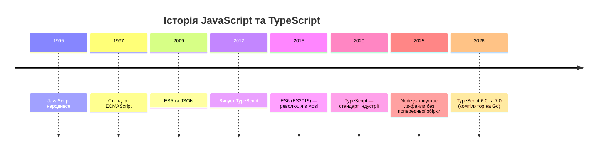
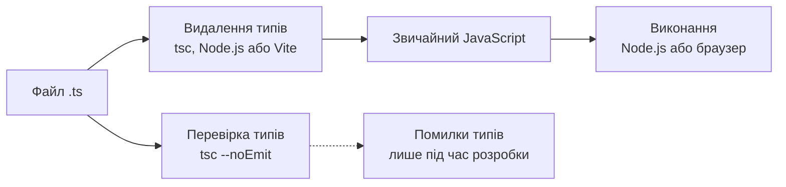
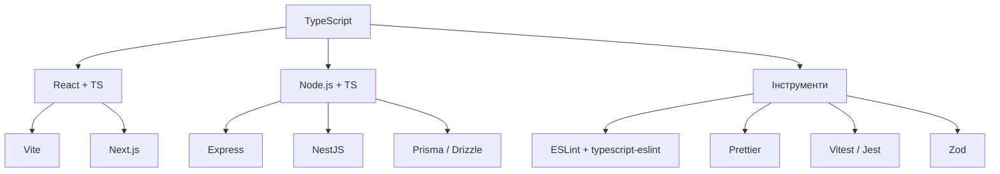

# Лекція 13. TypeScript у веброзробці

## Вступ до TypeScript: від JavaScript до типобезпеки

### Історична перспектива та еволюція JavaScript

JavaScript народився в 1995 році як динамічна, слабко типізована мова для додавання інтерактивності до вебсторінок. Ця гнучкість була водночас перевагою й недоліком. З одного боку, вона дозволяла швидко писати код без явного оголошення типів. З іншого — помилки, які в типізованих мовах виявляються ще до запуску, у JavaScript спливали вже під час виконання, нерідко в користувача.

Поки сценарії були короткими, з цим можна було миритися. Але з розвитком мови та появою великих застосунків (поштових клієнтів, редакторів, соціальних мереж) обмеження динамічної типізації стали очевидними: код важко підтримувати, рефакторинг перетворюється на ручний пошук, а редактор не може надійно підказати, які властивості має об'єкт. У 2012 році Microsoft представила TypeScript як відповідь на ці проблеми, зберігши при цьому всю потужність і гнучкість JavaScript.



Ця лекція продовжує розмову, розпочату в лекціях 01 та 02: там ви писали сучасний JavaScript (ES6+, асинхронність, модулі) й серверну частину на Node.js та Express. Тепер ми додаємо до цього «шар гарантій» — систему типів, яка перевіряє узгодженість програми ще до її запуску. У лекції 14 ми підключимо до цього шару лінтер, форматер і автоматичні перевірки, а в лекції 15 — конвеєр безперервної інтеграції, який запускатиме перевірку типів на кожну зміну.

### Філософія TypeScript: безпека через типи

TypeScript базується на простій ідеї: типи роблять код надійнішим і зрозумілішим. Це не просто анотації, додані до JavaScript, а ціла екосистема, де типи виявляють помилки на етапі розробки, слугують живою документацією та дають редактору змогу пропонувати точні підказки й виконувати безпечний рефакторинг.

Ключова особливість TypeScript — він є **надмножиною JavaScript**: будь-який коректний JavaScript-код є коректним TypeScript-кодом. Тому TypeScript можна впроваджувати поступово, додаючи типи там, де це найкорисніше, і не переписуючи проєкт за один раз.

### Як працює TypeScript: структурна типізація та стирання типів

Щоб користуватися TypeScript усвідомлено, потрібно розуміти дві його фундаментальні властивості.

**Типи існують лише під час розробки.** Браузер і Node.js не знають, що таке `interface` чи `: number`. Перед виконанням анотації типів видаляються (це називають **стиранням типів**, type erasure), а в результаті лишається звичайний JavaScript. Це означає, що TypeScript не захищає від некоректних даних, які надійшли під час виконання (наприклад, від API), — для цього потрібна окрема валідація, про яку ми поговоримо в розділі про типізацію API.

**Типізація структурна.** TypeScript порівнює типи за формою, а не за іменем. Якщо об'єкт має всі потрібні властивості, він підходить, навіть якщо ніколи не оголошувався як екземпляр конкретного інтерфейсу.

```typescript
interface Point {
    x: number;
    y: number;
}

function distance(p: Point): number {
    return Math.hypot(p.x, p.y);
}

// Підходить: форма збігається, інтерфейс Point не згадується
const cursor = { x: 3, y: 4, label: "курсор" };
distance(cursor); // 5
```



Звідси випливає важливий практичний висновок: **перевірка типів і запуск коду — це два окремі процеси**. Сучасні інструменти (Vite, Node.js, tsx) лише видаляють типи й швидко запускають код, а перевірку виконує окремо `tsc` — у редакторі, у хуку перед комітом і в конвеєрі безперервної інтеграції.

### Стан екосистеми у 2026 році

Остання пара років принесла в TypeScript більше змін, ніж попередні п'ять, тому варто зафіксувати поточну картину.

- **TypeScript 6.0** (березень 2026) — «перехідний» випуск, останній на базі коду, написаного мовою JavaScript. Він змінив типові значення компілятора: режим `strict` тепер увімкнено за замовчуванням, `module` за замовчуванням дорівнює `esnext`, `types` за замовчуванням порожній, а `rootDir` — це каталог, де лежить `tsconfig.json`. Низку застарілих параметрів позначено як deprecated.
- **TypeScript 7.0** (середина 2026) — перший випуск із нативним компілятором, переписаним на Go. За даними розробників, повна збірка прискорюється приблизно у 8–12 разів. 7.0 перетворює попередження 6.0 на помилки. Стабільного програмного API в 7.0 ще немає (його обіцяно у 7.1), тому інструменти, які використовують компілятор як бібліотеку (зокрема typescript-eslint), поки що працюють на TypeScript 6.x. У курсі ми використовуємо **TypeScript 6.x як основну версію**, а 7.0 розглядаємо як швидший `tsc`: проєкт, який чисто збирається на 6.0, мігрує на 7.0 майже без змін.
- **Node.js** (з версій 22.18 та 24.12 стабільно) запускає `.ts`-файли напряму, видаляючи типи («type stripping»), без жодної попередньої збірки.

### Проблеми, які вирішує TypeScript

Розглянемо конкретні проблеми JavaScript, які TypeScript вирішує системно.

**Проблема динамічної типізації.** У JavaScript змінна може містити значення будь-якого типу, і цей тип може змінюватися під час виконання. Це призводить до помилок, які важко виявити до запуску програми.

```javascript
// JavaScript: помилка виявиться тільки під час виконання
function calculatePrice(price, quantity) {
    return price * quantity;
}

const total = calculatePrice("100", "5"); // 500 — і це випадковість: "100" * "5" коерціюється в числа
const label = "100" + 5;                  // "1005" замість 105
```

TypeScript дозволяє виявити таку помилку на етапі розробки.

```typescript
// TypeScript: помилка виявиться ще в редакторі
function calculatePrice(price: number, quantity: number): number {
    return price * quantity;
}

const total = calculatePrice("100", "5"); // Помилка: рядок не можна передати як number
```

**Проблема відсутності автодоповнення.** У чистому JavaScript редактор не може надійно визначити, які властивості має об'єкт, тож помилки в назвах (`user.fistName` замість `user.firstName`) знаходяться пізно.

**Проблема рефакторингу.** Зміна сигнатури функції або структури об'єкта у великому проєкті на JavaScript вимагає ретельного пошуку всіх місць використання. TypeScript автоматично показує всі місця, де потрібні зміни.

**Проблема документації.** Коментарі можуть застаріти й не відповідати коду, а типи — частина коду і завжди актуальні.

## TypeScript основи та налаштування

### Три способи запускати TypeScript

Раніше TypeScript-проєкт без компіляції в JavaScript запустити було неможливо. Сьогодні є три способи, і вибір залежить від того, де виконується код.

| Спосіб | Що робить | Перевірка типів | Коли використовувати |
|--------|-----------|-----------------|----------------------|
| `tsc` | Перевіряє типи й генерує JavaScript у `dist/` | Так | Збірка серверної частини для розгортання, бібліотеки |
| `node файл.ts` | Node.js видаляє типи й виконує код | Ні | Розробка, скрипти, невеликі сервіси |
| Vite (`vite`, `vite build`) | Видаляє типи, збирає застосунок | Ні | Клієнтська частина (React) |
| `tsx` | Видаляє типи; підтримує `enum`, шляхи тощо | Ні | Коли Node.js без прапорців не вистачає |

Висновок у всіх випадках один: окрім запуску, потрібна **окрема команда перевірки типів** — `tsc --noEmit`. Її підключають до скриптів `package.json`, до хука перед комітом і до CI.

Режим «видалення типів» у Node.js має важливе обмеження: він підтримує лише **стирані** (erasable) конструкції — анотації, інтерфейси, псевдоніми типів, `import type`. Усе, що потребує генерації JavaScript-коду, — `enum`, `namespace` із кодом, параметри-властивості конструктора (`constructor(private x: number)`) — не працює. Саме тому компілятор має прапорець `erasableSyntaxOnly`, який забороняє такі конструкції на етапі перевірки. Це більш ніж технічна деталь: сучасна практика — писати TypeScript так, щоб типи можна було просто «стерти».

### Встановлення та конфігурація проєкту

TypeScript встановлюють як залежність розробки окремо для кожного проєкту, щоб усі члени команди працювали з однаковою версією.

```bash
# Ініціалізація нового проєкту
npm init -y

# Встановлення TypeScript і типів для Node.js
npm install --save-dev typescript @types/node

# Створення конфігураційного файлу
npx tsc --init
```

Файл `tsconfig.json` — центральний елемент конфігурації. Він визначає параметри компілятора, множину файлів проєкту та поведінку перевірки. Нижче — типова конфігурація серверної частини на Node.js (ES-модулі, запуск без попередньої збірки під час розробки):

```json
{
  "compilerOptions": {
    "target": "es2023",
    "module": "nodenext",
    "rootDir": "./src",
    "outDir": "./dist",
    "types": ["node"],
    "strict": true,
    "noUncheckedIndexedAccess": true,
    "verbatimModuleSyntax": true,
    "erasableSyntaxOnly": true,
    "rewriteRelativeImportExtensions": true,
    "skipLibCheck": true,
    "sourceMap": true
  },
  "include": ["src"]
}
```

Розглянемо найважливіші параметри.

**target** визначає, до якої версії ECMAScript компілюватиметься код. Для Node.js 24 та сучасних браузерів достатньо `es2022`–`es2025`; у TypeScript 6.0 типовим значенням є ES2025.

**module** визначає систему модулів. Для Node.js використовують `nodenext` (він наслідує правила самого Node.js: ES-модулі за наявності `"type": "module"` у `package.json`), для клієнтської частини — `esnext` разом із `moduleResolution: "bundler"`. Починаючи з 6.0 `esnext` є типовим значенням.

**strict** вмикає всі суворі перевірки (`strictNullChecks`, `noImplicitAny`, `strictFunctionTypes` та ін.). Для нових проєктів він обов'язковий, а в TypeScript 6.0 тепер увімкнений за замовчуванням. Це важливо запам'ятати для міграції: старі проєкти, які не вказували `strict` явно, після оновлення побачать нові помилки, і щоб тимчасово повернути стару поведінку, потрібно **явно** написати `"strict": false`.

**noUncheckedIndexedAccess** робить доступ за індексом (`arr[0]`, `record[key]`) типом `T | undefined`, що чесно відображає реальність: елемента може не бути.

**verbatimModuleSyntax** вимагає явно позначати імпорти лише типів (`import type { User } from ...`). Це узгоджується зі стиранням типів: інструмент точно знає, що можна видалити.

**erasableSyntaxOnly** забороняє конструкції, які не можна просто стерти (`enum`, параметри-властивості конструктора, `namespace` із кодом).

**rewriteRelativeImportExtensions** дозволяє в коді писати імпорт із розширенням `.ts` (`import { x } from "./x.ts"`, як того вимагає Node.js при запуску `.ts`-файлів), а під час збірки автоматично перетворює його на `.js`.

**types** у TypeScript 6.0 за замовчуванням порожній, тому глобальні типи Node.js (`process`, `Buffer`) потрібно підключати явно: `"types": ["node"]`.

**sourceMap** генерує карти джерел, щоб налагоджувати TypeScript-код навіть після компіляції.

У `package.json` проєкту на ES-модулях це виглядає так:

```json
{
  "type": "module",
  "scripts": {
    "dev": "node --watch src/index.ts",
    "typecheck": "tsc --noEmit",
    "build": "tsc",
    "start": "node dist/index.js"
  }
}
```

Для клієнтської частини (Vite) конфігурація інша: збірку виконує Vite, тому `tsc` лише перевіряє типи.

```json
{
  "compilerOptions": {
    "target": "es2023",
    "lib": ["ES2023", "DOM", "DOM.Iterable"],
    "module": "esnext",
    "moduleResolution": "bundler",
    "jsx": "react-jsx",
    "noEmit": true,
    "allowImportingTsExtensions": true,
    "verbatimModuleSyntax": true,
    "strict": true,
    "noUncheckedIndexedAccess": true,
    "skipLibCheck": true
  },
  "include": ["src"]
}
```

> **Примітка.** У TypeScript 6.0 застаріли, а в 7.0 вилучені деякі давні параметри — зокрема `moduleResolution: "node"` (він же `node10`), `target: "es5"` та `baseUrl`. Якщо ви бачите їх у старих підручниках чи проєктах, їх слід замінити сучасними аналогами.

### Базові типи та їх використання

TypeScript надає набір примітивних типів, що відповідають типам JavaScript, а також додаткові типи для точнішого моделювання даних.

```typescript
// Примітивні типи (зазвичай анотація не потрібна — тип виводиться)
let isDone: boolean = false;
let decimal: number = 6;
let hexadecimal: number = 0xf00d;
let bigNumber: bigint = 100n;

let color: string = "синій";
let fullName: string = `Іван Петренко`;
let age: number = 30;
let sentence: string = `Привіт, мене звати ${fullName}. Мені ${age} років.`;

// Масиви можна оголошувати двома способами
let list: number[] = [1, 2, 3];
let genericList: Array<number> = [1, 2, 3];

// Кортежі описують масиви з фіксованою кількістю елементів
let tuple: [string, number];
tuple = ["привіт", 10]; // Правильно
// tuple = [10, "привіт"]; // Помилка

// Void — для функцій без значення, що повертається
function logMessage(message: string): void {
    console.log(message);
}

// Never — для функцій, які ніколи не повертають керування
function throwError(message: string): never {
    throw new Error(message);
}

// Null та undefined мають власні типи
let u: undefined = undefined;
let n: null = null;
```

**Enum і сучасна альтернатива.** Класичний `enum` у TypeScript існує, але він генерує JavaScript-код, тому не працює з прапорцем `erasableSyntaxOnly` і режимом «видалення типів» у Node.js.

```typescript
// Класичний enum — працює, але не є «стираним»
enum Color {
    Red = 1,
    Green = 2,
    Blue = 4
}
let c: Color = Color.Green;

// Сучасна альтернатива: звичайний об'єкт + as const + тип-об'єднання
const Role = {
    Admin: "admin",
    User: "user",
    Moderator: "moderator",
} as const;

type Role = (typeof Role)[keyof typeof Role]; // "admin" | "user" | "moderator"

const r: Role = Role.Admin;   // використання як значення
function canEdit(role: Role) { /* ... */ } // використання як тип
```

Прийом `as const` робить усі властивості об'єкта «буквальними» й незмінними, а вираз `(typeof Role)[keyof typeof Role]` витягує з об'єкта об'єднання його значень. Так одне оголошення дає і значення для коду, і тип.

**Any і Unknown.** Тип `any` повністю вимикає перевірку типів, тому небезпечний: помилка знову відкладається на час виконання.

```typescript
let notSure: any = 4;
notSure = "може бути рядком";
notSure.toFixed(); // Компілюється, але впаде під час виконання

// Unknown — безпечна альтернатива: потрібна перевірка перед використанням
let uncertain: unknown = 4;
// uncertain.toFixed(); // Помилка: тип невідомий

if (typeof uncertain === "number") {
    uncertain.toFixed(); // Правильно після звуження типу
}
```

Правило: **коли тип невідомий, використовуйте `unknown`, а не `any`**. У режимі `strict` типом змінної в `catch (error)` теж є `unknown`, тому перед зверненням до `error.message` потрібно перевірити `error instanceof Error`.

### Літеральні типи, `as const` та `satisfies`

TypeScript дозволяє використовувати як типи не лише `string` чи `number`, а й конкретні значення. Це — фундамент багатьох практичних прийомів.

```typescript
type HttpMethod = "GET" | "POST" | "PUT" | "DELETE";

function request(method: HttpMethod, url: string): void { /* ... */ }

request("GET", "/api/users");
// request("PATCH", "/api/users"); // Помилка: "PATCH" не входить в HttpMethod
```

Оператор `satisfies` перевіряє, що значення відповідає типу, **не розширюючи** його тип до загального. Це зручно для конфігурацій:

```typescript
type RouteConfig = Record<string, { path: string; auth: boolean }>;

const routes = {
    home: { path: "/", auth: false },
    profile: { path: "/profile", auth: true },
} satisfies RouteConfig;

routes.profile.path;  // тип "string"; ключі відомі: home | profile
// routes.settings;   // Помилка: такого ключа немає (з анотацією RouteConfig помилки не було б)
```

### Звуження типів та дискримінантні об'єднання

Тип-об'єднання (`A | B`) корисний лише тоді, коли код вміє з'ясувати, який саме варіант перед ним. Цей процес називається **звуженням типів** (narrowing). Редактор відстежує перевірки `typeof`, `instanceof`, `in` та порівняння, і всередині гілки тип стає точнішим.

Найпотужніший прийом — **дискримінантні об'єднання** (discriminated unions): кожен варіант має спільне поле-мітку з літеральним типом.

```typescript
type LoadState =
    | { status: "idle" }
    | { status: "loading" }
    | { status: "success"; data: string[] }
    | { status: "error"; message: string };

function render(state: LoadState): string {
    switch (state.status) {
        case "idle":
            return "Очікування";
        case "loading":
            return "Завантаження…";
        case "success":
            return `Отримано ${state.data.length} елементів`; // data доступне лише тут
        case "error":
            return `Помилка: ${state.message}`;
        default: {
            // Перевірка вичерпності: якщо додати новий варіант і забути обробити,
            // присвоєння never викличе помилку компіляції
            const unreachable: never = state;
            return unreachable;
        }
    }
}
```

Така модель замінює набір окремих змінних `isLoading`, `error`, `data`, які можуть опинитися в суперечливому стані (наприклад, одночасно «завантажується» і «помилка»). Ми скористаємося нею і на серверній частині, і в React.

### Інтерфейси та типи: моделювання складних структур

Інтерфейси та псевдоніми типів описують форму об'єктів і створюють контракти для структур даних у програмі.

```typescript
// Інтерфейс описує структуру об'єкта
interface User {
    id: number;
    username: string;
    email: string;
    firstName?: string;        // Необов'язкова властивість
    lastName?: string;
    readonly createdAt: Date;  // Лише для читання
}

const user: User = {
    id: 1,
    username: "ivan.petrenko",
    email: "ivan@example.com",
    createdAt: new Date()
};

// user.createdAt = new Date(); // Помилка: властивість лише для читання

// Розширення інтерфейсів
interface AdminUser extends User {
    role: "admin" | "superadmin";
    permissions: string[];
}

const admin: AdminUser = {
    id: 2,
    username: "admin",
    email: "admin@example.com",
    createdAt: new Date(),
    role: "admin",
    permissions: ["read", "write", "delete"]
};

// Псевдоніми типів (type aliases) — альтернативний спосіб опису
type Point = {
    x: number;
    y: number;
};

// Об'єднання (union) — значення може бути одним з кількох типів
type StringOrNumber = string | number;

function printValue(value: StringOrNumber): void {
    console.log(value);
}

// Перетин (intersection) комбінує кілька типів
type Timestamped = {
    createdAt: Date;
    updatedAt: Date;
};

type NamedEntity = {
    name: string;
};

type TimestampedEntity = NamedEntity & Timestamped;

const entity: TimestampedEntity = {
    name: "Документ",
    createdAt: new Date(),
    updatedAt: new Date()
};
```

### Різниця між interface та type

Інтерфейси та псевдоніми типів мають багато спільного, але існують відмінності, що впливають на вибір.

```typescript
// Інтерфейси можна доповнювати в кількох місцях (declaration merging)
interface Window {
    customProperty: string;
}

interface Window {
    anotherProperty: number;
}

// Тепер Window має обидві властивості

// Псевдоніми типів так робити не дозволяють
type MyType = {
    prop1: string;
};

// type MyType = { prop2: number }; // Помилка: дублікат ідентифікатора

// Псевдоніми можуть описувати примітиви, об'єднання, кортежі
type ID = string | number;
type Coordinate = [number, number];

// Інтерфейси зручні для об'єктно-орієнтованого коду
interface Shape {
    area(): number;
}

class Circle implements Shape {
    // Параметр-властивість (constructor(private radius)) не працює з erasableSyntaxOnly,
    // тому властивість оголошується явно
    private radius: number;

    constructor(radius: number) {
        this.radius = radius;
    }

    area(): number {
        return Math.PI * this.radius ** 2;
    }
}
```

Практичне правило, яке підтримує більшість команд: **`interface` — для опису форми об'єктів і контрактів класів** (його можна розширювати й доповнювати), **`type` — для об'єднань, перетинів, кортежів і похідних типів**. Головне — послідовність у межах проєкту.

### Функції у TypeScript

TypeScript додає потужну типізацію функцій, що дозволяє точно описувати їхні сигнатури.

```typescript
// Типізація параметрів та значення, що повертається
function add(a: number, b: number): number {
    return a + b;
}

// Необов'язкові параметри
function buildName(firstName: string, lastName?: string): string {
    if (lastName) {
        return `${firstName} ${lastName}`;
    }
    return firstName;
}

// Параметри за замовчуванням (тип виводиться з початкового значення)
function greet(name: string, greeting = "Привіт"): string {
    return `${greeting}, ${name}!`;
}

// Rest-параметри
function sum(...numbers: number[]): number {
    return numbers.reduce((total, num) => total + num, 0);
}

// Тип функції
type MathOperation = (a: number, b: number) => number;

const multiply: MathOperation = (a, b) => a * b;
const divide: MathOperation = (a, b) => a / b;

// Функція з властивостями
type DescribableFunction = {
    description: string;
    (someArg: number): boolean;
};

function doSomething(fn: DescribableFunction): void {
    console.log(fn.description + " повернула " + fn(6));
}

// Перевантаження функцій
function processValue(value: string): string;
function processValue(value: number): number;
function processValue(value: string | number): string | number {
    if (typeof value === "string") {
        return value.toUpperCase();
    }
    return value * 2;
}

const strResult = processValue("hello"); // string
const numResult = processValue(42);      // number
```

## Типізація у Node.js проєктах

### Налаштування TypeScript для Node.js

Серверна частина на Node.js має специфічні вимоги: система модулів, цільова версія ECMAScript та типи Node.js API. Конфігурацію `tsconfig.json` для неї ми вже навели вище; тут розглянемо, як вона працює в повсякденній роботі.

У режимі `module: "nodenext"` TypeScript наслідує правила самого Node.js. Для імпорту власних файлів потрібне розширення, яке реально існуватиме під час виконання:

```typescript
// src/index.ts
import express from "express";
import type { Request, Response } from "express";
import { env } from "./config/env.ts";
import { userRouter } from "./routes/user.routes.ts";

const app = express();
app.use(express.json());
app.use("/api/users", userRouter);

app.listen(env.PORT, () => {
    console.log(`Сервер запущено на порту ${env.PORT}`);
});
```

Запуск під час розробки — `npm run dev` (`node --watch src/index.ts`), а перевірка типів — `npm run typecheck`. Для виробничої збірки `tsc` генерує JavaScript у `dist/`, змінюючи `.ts` на `.js` в імпортах (завдяки `rewriteRelativeImportExtensions`).

Окрема, але важлива тема — **типізація змінних середовища**. `process.env` має тип `string | undefined` для кожного ключа, і помилку конфігурації легко пропустити. Надійне рішення — розібрати й перевірити його один раз під час запуску.

```typescript
// src/config/env.ts
import { z } from "zod";

const EnvSchema = z.object({
    NODE_ENV: z.enum(["development", "test", "production"]).default("development"),
    PORT: z.coerce.number().int().positive().default(3000),
    DATABASE_URL: z.url(),
    JWT_SECRET: z.string().min(32),
});

// Якщо чогось бракує — застосунок упаде одразу з зрозумілою помилкою
export const env = EnvSchema.parse(process.env);
```

Тепер `env.PORT` має тип `number`, а `env.DATABASE_URL` — `string`; кожна змінна гарантовано присутня й коректна. Цей прийом ми ще використаємо в лекції 15, говорячи про керування середовищами.

### Типізація Express застосунків

Express — найпоширеніший фреймворк серверної частини на Node.js. У лекції 02 ми працювали з Express 5; пакет типів `@types/express` версії 5 відповідає йому. TypeScript робить роботу з Express безпечнішою: перевіряються запити, відповіді та проміжні обробники (middleware).

```typescript
import express from "express";
import type { Request, Response } from "express";

const app = express();

// Типізація базового обробника
app.get("/api/users", (req: Request, res: Response) => {
    res.json({ users: [] });
});

// Типізація параметрів маршруту
interface UserParams {
    userId: string;
}

app.get("/api/users/:userId", (req: Request<UserParams>, res: Response) => {
    const userId = Number.parseInt(req.params.userId, 10);
    res.json({ userId });
});
```

Тип `Request` приймає чотири узагальнені параметри: `Request<Params, ResBody, ReqBody, Query>`. Першим іде тип параметрів маршруту, третім — тіло запиту, четвертим — рядок запиту.

```typescript
// Тіло запиту
interface CreateUserBody {
    email: string;
    password: string;
    firstName: string;
}

app.post(
    "/api/users",
    (req: Request<Record<string, string>, unknown, CreateUserBody>, res: Response) => {
        const { email, firstName } = req.body;
        res.status(201).json({ email, firstName });
    },
);

// Query-параметри (в URL вони завжди рядки)
interface SearchQuery {
    q?: string;
    page?: string;
}

app.get(
    "/api/search",
    (req: Request<Record<string, string>, unknown, unknown, SearchQuery>, res: Response) => {
        const { q, page = "1" } = req.query;
        res.json({ query: q, page: Number.parseInt(page, 10) });
    },
);
```

Тут є критично важливе застереження: **такі анотації — це обіцянка, а не гарантія**. TypeScript вірить, що `req.body` справді має форму `CreateUserBody`, але клієнт може надіслати будь-що. Ми повернемося до цього в наступному розділі, а в лекції 05 ви вже бачили, чому вхідним даним не можна довіряти.

Окремий момент Express 5: обробники можуть бути асинхронними, і відхилений проміс автоматично передається в обробник помилок. Тож асинхронний обробник типізують як звичайно:

```typescript
app.get("/api/users/:userId", async (req: Request<UserParams>, res: Response): Promise<void> => {
    const user = await userService.findById(Number(req.params.userId));
    if (!user) {
        res.status(404).json({ error: "Користувача не знайдено" });
        return;
    }
    res.json(user);
});
```

### Розширення типу Request: об'єднання оголошень

Типова задача — проміжний обробник автентифікації записує дані користувача в `req.user`, і подальші обробники хочуть мати до них типізований доступ. Інтуїтивне рішення — створити власний інтерфейс `AuthRequest extends Request` і анотувати ним параметри обробників. Воно здається логічним, але **не працює надійно**: за увімкненого `strict` функція, що очікує `AuthRequest`, не приймається там, де Express очікує звичайний `RequestHandler`.

Правильний підхід — **доповнити (merge) глобальний тип** `Express.Request`:

```typescript
// src/types/express.d.ts
import type { UserRole } from "./user.types.ts";

declare global {
    namespace Express {
        interface Request {
            user?: {
                id: number;
                email: string;
                role: UserRole;
            };
        }
    }
}

export {};
```

Після цього `req.user` доступне у всіх обробниках, а проміжний обробник пишеться без нестандартних типів:

```typescript
// src/middleware/auth.middleware.ts
import type { RequestHandler } from "express";
import jwt from "jsonwebtoken";
import { z } from "zod";
import { env } from "../config/env.ts";

const TokenPayload = z.object({
    sub: z.string(),
    email: z.email(),
    role: z.enum(["admin", "user", "moderator"]),
});

export const authMiddleware: RequestHandler = (req, res, next) => {
    const header = req.headers.authorization;
    const token = header?.startsWith("Bearer ") ? header.slice(7) : undefined;

    if (!token) {
        res.status(401).json({ error: "Потрібна автентифікація" });
        return;
    }

    try {
        // Явно вказуємо дозволений алгоритм і перевіряємо форму payload
        const payload = TokenPayload.parse(
            jwt.verify(token, env.JWT_SECRET, { algorithms: ["HS256"] }),
        );
        req.user = { id: Number(payload.sub), email: payload.email, role: payload.role };
        next();
    } catch {
        res.status(401).json({ error: "Недійсний токен" });
    }
};
```

Зверніть увагу: розшифрований токен (`jwt.verify` повертає `string | JwtPayload`) ми не «приводимо» до потрібного типу, а перевіряємо схемою Zod. Вже тут проявляється головний принцип цієї лекції: на межі між «зовнішнім світом» і вашою програмою дані потрібно **перевіряти**, а не лише описувати.

### Валідація на межі: тип із схеми

Замість ручного опису `interface CreateUserBody` і окремої валідації (де типи й правила можуть розійтися) сучасний підхід — описати **схему один раз** і отримати з неї і перевірку, і тип.

```typescript
import { z } from "zod";

const CreateUserSchema = z.object({
    email: z.email(),
    password: z.string().min(15),
    firstName: z.string().min(1),
    lastName: z.string().min(1),
});

// Тип виводиться зі схеми — розбіжності між ними неможливі
type CreateUserBody = z.infer<typeof CreateUserSchema>;

app.post("/api/users", (req, res) => {
    const parsed = CreateUserSchema.safeParse(req.body);

    if (!parsed.success) {
        res.status(400).json({ errors: z.flattenError(parsed.error).fieldErrors });
        return;
    }

    const body: CreateUserBody = parsed.data; // тут дані гарантовано коректні
    res.status(201).json({ email: body.email });
});
```

Мінімальна довжина пароля 15 символів — не випадкове число; чому саме так, ми розберемо в лекції 16. Для тих, хто працював з Joi у лекції 05: Zod виконує ту ж роль, але додатково «віддає» тип TypeScript, тому його вибір для TypeScript-проєктів природний.

### Організація типів у великих проєктах

У великих проєктах типи потрібно організувати так, щоб їх було легко знайти, повторно використовувати й підтримувати. Типова структура — тримати доменні типи поряд із відповідною функціональністю або в каталозі `types/`.

```typescript
// src/types/user.types.ts
export const UserRole = {
    Admin: "admin",
    User: "user",
    Moderator: "moderator",
} as const;

export type UserRole = (typeof UserRole)[keyof typeof UserRole];

export interface User {
    id: number;
    email: string;
    firstName: string;
    lastName: string;
    role: UserRole;
    createdAt: Date;
    updatedAt: Date;
}

// Похідні типи — з вбудованих допоміжних, а не копіюванням
export type CreateUserDTO = Omit<User, "id" | "createdAt" | "updatedAt"> & { password: string };
export type UpdateUserDTO = Partial<Pick<User, "firstName" | "lastName" | "email">>;
export type UserResponse = Pick<User, "id" | "email" | "firstName" | "lastName" | "role">;
```

```typescript
// src/types/api.types.ts
export interface PaginatedResponse<T> {
    items: T[];
    total: number;
    page: number;
    limit: number;
    totalPages: number;
}

export interface ApiError {
    code: string;
    message: string;
    details?: Record<string, string[]>;
}
```

```typescript
// src/services/user.service.ts
import type { User, CreateUserDTO, UpdateUserDTO } from "../types/user.types.ts";
import type { PaginatedResponse } from "../types/api.types.ts";

export class UserService {
    async create(data: CreateUserDTO): Promise<User> {
        // Логіка створення користувача
        throw new Error("Не реалізовано");
    }

    async findById(id: number): Promise<User | null> {
        // Повертаємо null, якщо користувача не знайдено, — тип змушує це обробити
        return null;
    }

    async list(page: number, limit: number): Promise<PaginatedResponse<User>> {
        return { items: [], total: 0, page, limit, totalPages: 0 };
    }

    async update(id: number, data: UpdateUserDTO): Promise<User> {
        throw new Error("Не реалізовано");
    }
}
```

Зверніть увагу на два рішення. По-перше, сервіс повертає `User | null`, а не «обгортку» з полем `success`: відсутність користувача — звичайний результат, і тип змушує його обробити. По-друге, типи для запиту, відповіді й оновлення **виводяться** з `User`: змінивши `User`, ви автоматично змінюєте всі похідні.

Типи, спільні для клієнтської та серверної частини, можна виносити в окремий пакет у монорепозиторії або генерувати з опису API (наприклад, з OpenAPI-специфікації за допомогою `openapi-typescript`, або отримувати «наскрізно» через tRPC, про який йшлося в лекції 01). Так розбіжності між клієнтом і сервером стають помилкою компіляції.

### Типізація роботи з базами даних

При роботі з базами даних типізація забезпечує відповідність між моделями даних і структурою бази. Бібліотеки сучасного покоління генерують типи зі схеми самі.

У лабораторних роботах курсу використовується Prisma (версія 7), тому покажемо її. У Prisma 7 клієнт генерується в ваш проєкт, URL підключення задається в окремому файлі `prisma.config.ts`, а сам клієнт працює через драйвер-адаптер.

```prisma
// prisma/schema.prisma
generator client {
  provider = "prisma-client"
  output   = "../src/generated/prisma"
}

datasource db {
  provider = "postgresql"
}

model User {
  id        Int      @id @default(autoincrement())
  email     String   @unique
  firstName String
  lastName  String
  posts     Post[]
  createdAt DateTime @default(now())
}

model Post {
  id       Int    @id @default(autoincrement())
  title    String
  authorId Int
  author   User   @relation(fields: [authorId], references: [id])
}
```

```typescript
// prisma.config.ts
import { defineConfig, env } from "prisma/config";

export default defineConfig({
    schema: "prisma/schema.prisma",
    datasource: { url: env("DATABASE_URL") },
});
```

```typescript
// src/db.ts
import { PrismaPg } from "@prisma/adapter-pg";
import { PrismaClient } from "./generated/prisma/client.ts";
import { env } from "./config/env.ts";

const adapter = new PrismaPg({ connectionString: env.DATABASE_URL });
export const prisma = new PrismaClient({ adapter });
```

```typescript
import type { Prisma, User } from "./generated/prisma/client.ts";
import { prisma } from "./db.ts";

// Тип результату залежить від запиту й виводиться автоматично
async function getUserWithPosts(userId: number) {
    return prisma.user.findUnique({
        where: { id: userId },
        include: { posts: true },
    });
}

// Явний тип для такого результату можна отримати з допоміжного типу Prisma
type UserWithPosts = Prisma.UserGetPayload<{ include: { posts: true } }>;

// Часткова вибірка — тип містить лише вибрані поля
async function getUserEmails() {
    return prisma.user.findMany({ select: { id: true, email: true } });
}

// Тип для створення запису — з готового типу моделі
type CreateUserInput = Omit<User, "id" | "createdAt">;

async function createUser(data: CreateUserInput): Promise<User> {
    return prisma.user.create({ data });
}
```

Якщо ви використовуєте Sequelize 6 (як у лекції 04), типізація модельного класу виглядає інакше — через допоміжні типи `InferAttributes` та `InferCreationAttributes`:

```typescript
import { Model } from "sequelize";
import type { CreationOptional, InferAttributes, InferCreationAttributes } from "sequelize";

class User extends Model<InferAttributes<User>, InferCreationAttributes<User>> {
    declare id: CreationOptional<number>;
    declare email: string;
    declare firstName: string;
}
```

Ключове слово `declare` оголошує лише тип поля і не генерує JavaScript-коду, тому сумісне з режимом стирання типів.

## React з TypeScript: патерни та найкращі практики

### Налаштування React проєкту з TypeScript

Інструмент Create React App офіційно більше не підтримується, тому клієнтську частину створюють за допомогою Vite (шаблон `react-ts`) або фреймворка на кшталт Next.js.

```bash
# Створення нового проєкту з Vite (Vite 8, шаблон React + TypeScript)
npm create vite@latest my-app -- --template react-ts

# Або з Next.js (TypeScript увімкнено за замовчуванням)
npx create-next-app@latest my-app
```

### Типізація функціональних компонентів

Раніше компоненти зазвичай описували як `const Button: FC<ButtonProps> = ...`. Сьогодні рекомендується **звичайна функція із типізованими пропсами**: тип `FC` не додає користі, а раніше ще й неявно додавав `children`. Проте найзручніший спосіб описати компонент-обгортку над нативним елементом — успадкувати його власні атрибути.

```tsx
import type { ComponentProps, ReactNode } from "react";

// Варіант 1: пропси описані повністю вручну
interface BadgeProps {
    children: ReactNode;
    tone?: "info" | "warning" | "danger";
}

export function Badge({ children, tone = "info" }: BadgeProps) {
    return <span className={`badge badge-${tone}`}>{children}</span>;
}

// Варіант 2: усі атрибути <button> + власні
type ButtonProps = ComponentProps<"button"> & {
    variant?: "primary" | "secondary" | "danger";
};

export function Button({ variant = "primary", className, ...rest }: ButtonProps) {
    return <button className={`btn btn-${variant} ${className ?? ""}`} {...rest} />;
}
```

У варіанті 2 компонент автоматично приймає `onClick`, `disabled`, `type`, `children` і будь-які інші атрибути кнопки, а також `ref`: у React 19 `ref` передається як звичайний проп, тому обгортка `forwardRef` більше не потрібна.

### Типізація хуків

Хуки React отримують потужну типізацію, що робить роботу зі станом та ефектами безпечнішою.

```tsx
import { useState, useRef } from "react";

function Counter() {
    // Явна типізація потрібна, коли початкове значення не відображає всіх варіантів
    const [count, setCount] = useState<number>(0);
    const [user, setUser] = useState<User | null>(null);

    // Тип виводиться з початкового значення
    const [text, setText] = useState("");          // string
    const [isLoading, setIsLoading] = useState(false); // boolean

    // useRef для DOM-елемента: у React 19 аргумент обов'язковий
    const inputRef = useRef<HTMLInputElement>(null);

    const handleFocus = () => {
        inputRef.current?.focus();
    };

    return <button onClick={handleFocus}>{count}</button>;
}
```

**Стан із кількох станів — через дискримінантне об'єднання.** Замість трьох окремих `useState` (`loading`, `error`, `user`), які можуть опинитися в суперечливому поєднанні, описуємо один стан:

```tsx
import { useEffect, useState } from "react";

type UserState =
    | { status: "loading" }
    | { status: "error"; error: Error }
    | { status: "success"; user: User };

function UserProfile({ userId }: { userId: number }) {
    const [state, setState] = useState<UserState>({ status: "loading" });

    useEffect(() => {
        const controller = new AbortController();
        setState({ status: "loading" });

        fetchUser(userId, controller.signal)
            .then((user) => setState({ status: "success", user }))
            .catch((error: unknown) => {
                if (controller.signal.aborted) return; // запит скасовано — не оновлюємо стан
                setState({
                    status: "error",
                    error: error instanceof Error ? error : new Error(String(error)),
                });
            });

        // Прибирання: скасовуємо запит, якщо компонент зник або змінився userId
        return () => controller.abort();
    }, [userId]);

    switch (state.status) {
        case "loading":
            return <div>Завантаження...</div>;
        case "error":
            return <div>Помилка: {state.error.message}</div>;
        case "success":
            return <div>{state.user.firstName} {state.user.lastName}</div>;
    }
}
```

Скасування через `AbortController` надійніше, ніж прапорець `cancelled`, який використовували раніше: запит справді припиняється, а не лише ігнорується. Для завантаження даних у виробничому коді зазвичай застосовують бібліотеку TanStack Query, яка бере на себе кешування, повтори та скасування; її ми розглядали в курсі окремо, а типізація там працює так само: `useQuery` виводить тип даних із функції запиту.

**Складніший стан — `useReducer`.** Дії також описують дискримінантним об'єднанням, і редуктор стає вичерпно перевіреним:

```tsx
import { useReducer } from "react";

type CartAction =
    | { type: "add"; productId: number }
    | { type: "remove"; productId: number }
    | { type: "clear" };

type CartState = { items: number[] };

function cartReducer(state: CartState, action: CartAction): CartState {
    switch (action.type) {
        case "add":
            return { items: [...state.items, action.productId] };
        case "remove":
            return { items: state.items.filter((id) => id !== action.productId) };
        case "clear":
            return { items: [] };
    }
}

function Cart() {
    const [state, dispatch] = useReducer(cartReducer, { items: [] });
    // dispatch({ type: "add" }); // Помилка: бракує productId
    return <button onClick={() => dispatch({ type: "clear" })}>{state.items.length}</button>;
}
```

**Мемоізація.** Раніше типові приклади рясніли `useMemo` та `useCallback` із типами (`useMemo<number[]>(...)`). Сьогодні ситуація інша: **React Compiler 1.0** (стабільний, увімкнений за замовчуванням у нових проєктах Next.js) автоматично мемоізує компоненти під час збірки. Тому ручні `useMemo`/`useCallback` потрібні лише в окремих випадках (стабільність посилання для зовнішніх бібліотек); типізуються вони так само, як і раніше, виводячи тип із функції, що повертається.

### Типізація подій

Події React мають специфічні типи, що забезпечують типобезпеку при обробці взаємодій користувача. Найпростіший шлях — дозволити TypeScript вивести тип зі вбудованого оброблювача:

```tsx
import type { ChangeEvent, FormEvent, KeyboardEvent, MouseEvent } from "react";

function EventHandlers() {
    // Обробка кліків
    const handleClick = (e: MouseEvent<HTMLButtonElement>) => {
        console.log("Кнопку натиснуто:", e.currentTarget.value);
    };

    // Обробка зміни поля вводу
    const handleChange = (e: ChangeEvent<HTMLInputElement>) => {
        console.log("Значення:", e.target.value);
    };

    // Обробка відправлення форми
    const handleSubmit = (e: FormEvent<HTMLFormElement>) => {
        e.preventDefault();
        const formData = new FormData(e.currentTarget);
        console.log("Форма:", Object.fromEntries(formData));
    };

    // Обробка натискання клавіш
    const handleKeyDown = (e: KeyboardEvent<HTMLInputElement>) => {
        if (e.key === "Enter") {
            console.log("Enter");
        }
    };

    return (
        <form onSubmit={handleSubmit}>
            <input onChange={handleChange} onKeyDown={handleKeyDown} />
            <button onClick={handleClick}>Надіслати</button>
        </form>
    );
}
```

React 19 додає ще один спосіб обробки форм — **дії форми** (form actions) і хук `useActionState`, який повертає стан, функцію-дію та прапорець очікування. Типізація така:

```tsx
import { useActionState } from "react";

type FormState = { error: string | null };

function LoginForm() {
    const [state, formAction, isPending] = useActionState(
        async (_previous: FormState, formData: FormData): Promise<FormState> => {
            const email = formData.get("email");
            if (typeof email !== "string" || email === "") {
                return { error: "Вкажіть електронну пошту" };
            }
            // ... відправлення на сервер
            return { error: null };
        },
        { error: null },
    );

    return (
        <form action={formAction}>
            <input name="email" type="email" />
            <button disabled={isPending}>Увійти</button>
            {state.error && <p role="alert">{state.error}</p>}
        </form>
    );
}
```

Зауважте перевірку `typeof email !== "string"`: `formData.get` повертає `FormDataEntryValue | null` (рядок, файл або `null`), і без звуження типу працювати з цим значенням неможливо.

### Контекст з TypeScript

Context API у поєднанні з TypeScript потребує ретельної типізації, щоб споживачі контексту не змушені були перевіряти значення на `undefined` скрізь, де його використовують. Стандартний прийом — створити контекст зі значенням `null` і скористатися спеціальним хуком, який гарантує наявність провайдера. У React 19 сам контекст використовується як провайдер, а значення можна прочитати хуком `use`.

```tsx
import { createContext, use, useState } from "react";
import type { ReactNode } from "react";

interface AuthUser {
    id: number;
    email: string;
    firstName: string;
    lastName: string;
    role: UserRole;
}

interface AuthContextType {
    user: AuthUser | null;
    isAuthenticated: boolean;
    login: (email: string, password: string) => Promise<void>;
    logout: () => void;
    updateUser: (updates: Partial<AuthUser>) => void;
}

// Контекст створюється з null — значення за відсутності провайдера
const AuthContext = createContext<AuthContextType | null>(null);

export function AuthProvider({ children }: { children: ReactNode }) {
    const [user, setUser] = useState<AuthUser | null>(null);

    const login = async (email: string, password: string): Promise<void> => {
        const response = await fetch("/api/auth/login", {
            method: "POST",
            headers: { "Content-Type": "application/json" },
            body: JSON.stringify({ email, password }),
        });

        if (!response.ok) {
            throw new Error("Не вдалося увійти");
        }

        // У виробничому коді відповідь перевіряють схемою (див. розділ про API)
        setUser((await response.json()) as AuthUser);
    };

    const value: AuthContextType = {
        user,
        isAuthenticated: user !== null,
        login,
        logout: () => setUser(null),
        updateUser: (updates) => setUser((prev) => (prev ? { ...prev, ...updates } : prev)),
    };

    // React 19: контекст сам є провайдером (не потрібно AuthContext.Provider)
    return <AuthContext value={value}>{children}</AuthContext>;
}

// Хук гарантує, що поза провайдером помилка виникне одразу й зрозуміло
export function useAuth(): AuthContextType {
    const context = use(AuthContext);

    if (context === null) {
        throw new Error("useAuth потрібно викликати всередині AuthProvider");
    }

    return context;
}
```

Завдяки цьому хуку споживач отримує тип `AuthContextType` без `| null`, а забутий `AuthProvider` виявляється під час першого ж відтворення компонента.

## Узагальнені типи та допоміжні типи (generics та utility types)

### Розуміння узагальнених типів

Узагальнені типи (generics) дозволяють створювати функції, класи та інтерфейси, які працюють з різними типами даних, зберігаючи типобезпеку. Вони відповідають на запитання: «як написати одну реалізацію, що не втрачає інформацію про тип?». Параметр типу `T` — це «змінна для типу», значення якої визначається під час виклику.

```typescript
// Базова узагальнена функція
function identity<T>(arg: T): T {
    return arg;
}

const numberIdentity = identity<number>(42);     // number
const stringIdentity = identity<string>("hello"); // string
const autoInferred = identity(true);              // boolean (тип виведено автоматично)

// Обмеження параметра типу
interface Lengthwise {
    length: number;
}

function logLength<T extends Lengthwise>(arg: T): T {
    console.log(arg.length);
    return arg;
}

logLength("hello");                  // Працює: рядки мають length
logLength([1, 2, 3]);                // Працює: масиви мають length
logLength({ length: 10, value: 3 }); // Працює: об'єкт має length
// logLength(42);                    // Помилка: number не має властивості length

// Кілька параметрів типу
function pair<K, V>(key: K, value: V): [K, V] {
    return [key, value];
}

const stringNumberPair = pair<string, number>("age", 25);
const autoInferredPair = pair("name", "Ivan"); // [string, string]

// Узагальнені класи
class DataStore<T> {
    private items: T[] = [];

    add(item: T): void {
        this.items.push(item);
    }

    get(index: number): T | undefined {
        return this.items[index];
    }

    getAll(): T[] {
        return [...this.items];
    }

    remove(index: number): T | undefined {
        return this.items.splice(index, 1)[0];
    }

    filter(predicate: (item: T) => boolean): T[] {
        return this.items.filter(predicate);
    }
}

const numberStore = new DataStore<number>();
numberStore.add(1);
numberStore.add(2);

const userStore = new DataStore<User>();

// Узагальнені інтерфейси
interface PaginatedData<T> {
    items: T[];
    total: number;
    page: number;
    pageSize: number;
}

async function fetchUsers(): Promise<PaginatedData<User>> {
    const response = await fetch("/api/users");
    const data: unknown = await response.json();
    // У реальному коді тут — перевірка схемою (див. нижче)
    return data as PaginatedData<User>;
}
```

### Оператори типів: keyof, typeof, індексований доступ

Перш ніж перейти до допоміжних типів, варто знати три оператори, з яких вони побудовані.

```typescript
interface User {
    id: number;
    email: string;
    age: number;
}

type UserKeys = keyof User;        // "id" | "email" | "age"
type EmailType = User["email"];    // string  (індексований доступ)
type AnyUserValue = User[keyof User]; // string | number

const defaults = { retries: 3, timeout: 1000 };
type Defaults = typeof defaults;   // { retries: number; timeout: number }
```

Оператор `keyof` дає об'єднання назв властивостей, `User["email"]` — тип конкретної властивості, а `typeof` поза типовою позицією перетворює значення на тип.

### Вбудовані допоміжні типи (utility types)

TypeScript надає набір допоміжних типів, що перетворюють уже існуючі. Це спосіб уникнути дублювання: замість копіювання `User` для створення, оновлення й публічного відображення ви виводите потрібні форми з одного джерела.

```typescript
interface User {
    id: number;
    email: string;
    firstName: string;
    lastName: string;
    age: number;
    role: string;
}

// Partial — робить усі властивості необов'язковими
type PartialUser = Partial<User>;

function updateUser(id: number, updates: Partial<User>): void {
    // Можна передати лише ті поля, які потрібно оновити
}

// Required — робить усі властивості обов'язковими
type RequiredUser = Required<PartialUser>;

// Readonly — робить усі властивості лише для читання
type ReadonlyUser = Readonly<User>;

const user: ReadonlyUser = {
    id: 1, email: "user@example.com", firstName: "Ivan",
    lastName: "Petrenko", age: 25, role: "user",
};
// user.email = "new@example.com"; // Помилка

// Pick — вибирає підмножину властивостей
type UserPreview = Pick<User, "id" | "email" | "firstName" | "lastName">;

// Omit — виключає властивості
type UserWithoutId = Omit<User, "id">;
type PublicUser = Omit<User, "email" | "age">;

// Record — об'єкт із заданими ключами й типом значень
type UserRoles = "admin" | "user" | "moderator";
type RolePermissions = Record<UserRoles, string[]>;

const permissions: RolePermissions = {
    admin: ["read", "write", "delete"],
    user: ["read"],
    moderator: ["read", "write"],
};

// Exclude — прибирає типи з об'єднання
type AllRoles = "admin" | "user" | "moderator" | "guest";
type AuthenticatedRoles = Exclude<AllRoles, "guest">; // "admin" | "user" | "moderator"

// Extract — залишає лише ті типи, що входять в обидва об'єднання
type AdminOrModerator = Extract<AllRoles, "admin" | "moderator">;

// NonNullable — прибирає null та undefined
type MaybeString = string | null | undefined;
type DefiniteString = NonNullable<MaybeString>; // string

// ReturnType та Parameters — типи результату й параметрів функції
function createUser() {
    return { id: 1, email: "user@example.com" };
}
type CreatedUser = ReturnType<typeof createUser>; // { id: number; email: string }

function updateProfile(userId: number, data: Partial<User>): void {}
type UpdateProfileParams = Parameters<typeof updateProfile>; // [number, Partial<User>]

// Awaited — тип, який повертає await (розгортає Promise)
type Resolved = Awaited<Promise<Promise<string>>>; // string

// Комбінування допоміжних типів
type CreateUserDTO = Omit<User, "id">;
type UpdateUserDTO = Partial<CreateUserDTO>;
type UserResponse = Readonly<Pick<User, "id" | "email" | "firstName" | "lastName">>;
```

### Створення власних допоміжних типів

Власні допоміжні типи будуються з двох механізмів: **відображених типів** (mapped types), що перебирають ключі, та **умовних типів** (conditional types), що вибирають результат залежно від умови.

```typescript
// DeepPartial — рекурсивно робить усі властивості необов'язковими
type DeepPartial<T> = {
    [P in keyof T]?: T[P] extends object ? DeepPartial<T[P]> : T[P];
};

interface ComplexUser {
    id: number;
    profile: {
        firstName: string;
        address: { street: string; city: string };
    };
}

type PartialComplexUser = DeepPartial<ComplexUser>;
// Усі вкладені властивості також стають необов'язковими

// Nullable — додає null до типу
type Nullable<T> = T | null;

// DeepReadonly — рекурсивно робить властивості readonly
type DeepReadonly<T> = {
    readonly [P in keyof T]: T[P] extends object ? DeepReadonly<T[P]> : T[P];
};

// ValueOf — об'єднання типів значень об'єкта
type ValueOf<T> = T[keyof T];

// Умовний тип з infer: витягти тип елемента масиву
type ElementOf<T> = T extends readonly (infer U)[] ? U : never;
type N = ElementOf<number[]>; // number

// Функція з обмеженням параметра типу: ключ має існувати в об'єкті
function pluck<T, K extends keyof T>(items: T[], key: K): T[K][] {
    return items.map((item) => item[key]);
}

const users: User[] = [
    { id: 1, email: "u1@example.com", firstName: "Ivan", lastName: "Petrenko", age: 25, role: "user" },
    { id: 2, email: "u2@example.com", firstName: "Olena", lastName: "Shevchenko", age: 30, role: "admin" },
];

const emails = pluck(users, "email"); // string[]
const ages = pluck(users, "age");     // number[]
// const invalid = pluck(users, "invalid"); // Помилка компіляції
```

## Типізація API responses

### Типобезпечні клієнти API

При роботі з API типи на клієнтській та серверній частинах мають узгоджуватися. Але є принципова проблема, про яку ми вже згадували: **`response.json()` повертає `any`**, тобто TypeScript не знає, що насправді прийшло. Якщо написати `return response.json()` у функції, що обіцяє `Promise<User>`, компілятор промовчить, а помилка проявиться десь далеко від джерела.

Рішення — трактувати відповідь як `unknown` і перевіряти її. Також замість структури `{ success: boolean; data?: T; error?: E }`, де `data` й `error` можуть бути одночасно чи жодного, краще використовувати дискримінантне об'єднання («результат»):

```typescript
import { z } from "zod";

interface ApiError {
    code: string;
    message: string;
}

// Результат: або успіх із даними, або помилка — одночасно нічого іншого
type Result<T, E = ApiError> =
    | { ok: true; data: T }
    | { ok: false; error: E };

// Параметр-властивість `constructor(private baseUrl)` несумісний з erasableSyntaxOnly,
// тому поле оголошуємо явно
class ApiClient {
    private baseUrl: string;

    constructor(baseUrl = "/api") {
        this.baseUrl = baseUrl;
    }

    // Схема визначає і перевірку, і тип результату
    async get<S extends z.ZodType>(path: string, schema: S): Promise<Result<z.infer<S>>> {
        return this.request(path, schema, { method: "GET" });
    }

    async post<S extends z.ZodType>(
        path: string,
        body: unknown,
        schema: S,
    ): Promise<Result<z.infer<S>>> {
        return this.request(path, schema, { method: "POST", body: JSON.stringify(body) });
    }

    private async request<S extends z.ZodType>(
        path: string,
        schema: S,
        init: RequestInit,
    ): Promise<Result<z.infer<S>>> {
        try {
            const response = await fetch(`${this.baseUrl}${path}`, {
                ...init,
                // Власні заголовки доповнюють, а не затирають передані користувачем
                headers: { "Content-Type": "application/json", ...init.headers },
            });

            const body: unknown = await response.json().catch(() => null);

            if (!response.ok) {
                return {
                    ok: false,
                    error: { code: `HTTP_${response.status}`, message: response.statusText },
                };
            }

            const parsed = schema.safeParse(body);
            if (!parsed.success) {
                return {
                    ok: false,
                    error: { code: "INVALID_RESPONSE", message: z.prettifyError(parsed.error) },
                };
            }

            return { ok: true, data: parsed.data };
        } catch (error) {
            return {
                ok: false,
                error: {
                    code: "NETWORK_ERROR",
                    message: error instanceof Error ? error.message : "Невідома помилка",
                },
            };
        }
    }
}
```

У початковому варіанті цього клієнта була прихована помилка: параметри `...options` розгорталися після `headers` і повністю затирали заголовок `Content-Type`. Тепер порядок інший, і власні заголовки лише доповнюються.

Схеми для сутностей визначаються поряд із типами. Для повторюваних «обгорток» корисна узагальнена функція, що створює схему за схемою елемента:

```typescript
const UserSchema = z.object({
    id: z.number(),
    email: z.email(),
    firstName: z.string(),
    lastName: z.string(),
    age: z.number().min(0).max(150),
    role: z.enum(["admin", "user", "moderator"]),
});

type User = z.infer<typeof UserSchema>;

// Узагальнена схема пагінованої відповіді
const paginated = <T extends z.ZodType>(item: T) =>
    z.object({
        items: z.array(item),
        total: z.number(),
        page: z.number(),
        pageSize: z.number(),
    });

const UserPageSchema = paginated(UserSchema);
type UserPage = z.infer<typeof UserPageSchema>;
```

Типізований клієнт для користувачів і його використання:

```typescript
class UserApi {
    private client: ApiClient;

    constructor(client: ApiClient) {
        this.client = client;
    }

    getUsers(page = 1, pageSize = 10) {
        return this.client.get(`/users?page=${page}&pageSize=${pageSize}`, UserPageSchema);
    }

    getUserById(id: number) {
        return this.client.get(`/users/${id}`, UserSchema);
    }
}

async function loadUserData() {
    const userApi = new UserApi(new ApiClient());
    const result = await userApi.getUserById(1);

    if (result.ok) {
        // Тут TypeScript знає, що result.data має тип User
        console.log(`${result.data.firstName} ${result.data.lastName}`);
    } else {
        // А тут — що є result.error
        console.error(result.error.message);
    }
}
```

Перевага «результату» над виключеннями — **компілятор змушує обробити обидва варіанти**: звернутися до `result.data` без перевірки `result.ok` неможливо.

### Перевірка даних під час виконання: type guards і Zod

TypeScript не перевіряє типи під час виконання, тому дані із зовнішніх джерел потрібно перевіряти. Є два шляхи.

**Користувацькі type guards** — функції, що повертають `value is T` і «навчають» компілятор звужувати тип. Вони підходять для простих перевірок і для випадків, коли додаткова бібліотека небажана:

```typescript
function isRecord(value: unknown): value is Record<string, unknown> {
    return typeof value === "object" && value !== null;
}

function isUser(value: unknown): value is User {
    return (
        isRecord(value) &&
        typeof value.id === "number" &&
        typeof value.email === "string" &&
        typeof value.firstName === "string" &&
        typeof value.lastName === "string"
    );
}

async function fetchUserSafely(id: number): Promise<User | null> {
    const response = await fetch(`/api/users/${id}`);
    const data: unknown = await response.json();

    return isUser(data) ? data : null; // у гілці true компілятор знає, що це User
}
```

Недолік ручних guards — їх легко «розсинхронізувати» з типом: додали поле до `User`, а в `isUser` забули. Тому для складних структур вигідніше **схема Zod**, з якої тип виводиться автоматично, як показано вище. У Zod 4 для перевірки без винятків використовують `safeParse`, а для читабельного повідомлення про помилку — `z.prettifyError`; список окремих проблем лежить у `error.issues`.

```typescript
async function fetchUserWithValidation(id: number): Promise<User | null> {
    const response = await fetch(`/api/users/${id}`);
    const data: unknown = await response.json();

    const parsed = UserSchema.safeParse(data);
    if (!parsed.success) {
        console.error("Некоректна відповідь API:", z.prettifyError(parsed.error));
        return null;
    }

    return parsed.data;
}
```

> **Примітка щодо версії.** У Zod 4 формати рядків винесено у функції верхнього рівня: `z.email()`, `z.url()`, `z.uuid()`. Старий запис `z.string().email()` ще працює, але позначений застарілим. Також властивість `error.errors` із Zod 3 замінено на `error.issues`.

## Migration стратегії: від JavaScript до TypeScript

### Поступове впровадження TypeScript

Міграція великого JavaScript-проєкту може здаватися складною, але правильна стратегія робить процес керованим. Головний принцип — **не переписувати все одразу, а дозволити двом мовам співіснувати** й поступово підсилювати перевірки.

```json
{
  "compilerOptions": {
    "target": "es2023",
    "module": "nodenext",
    "allowJs": true,
    "checkJs": false,
    "strict": false,
    "noImplicitAny": false,
    "skipLibCheck": true,
    "noEmit": true
  },
  "include": ["src"]
}
```

Зверніть увагу: `"strict": false` тут записано **явно**. Оскільки з TypeScript 6.0 строгий режим увімкнено за замовчуванням, без цього рядка стара кодова база одразу видасть хвилю помилок. Ця хвиля сама по собі — частина міграції, але вона не повинна заблокувати команду.

Стратегія міграції складається з п'яти кроків.

**Крок 1.** Встановіть TypeScript і налаштуйте конфігурацію з `allowJs: true`. Файли `.js` і `.ts` тоді співіснують в одному проєкті. Додайте скрипт `typecheck` у `package.json` і запускайте його в CI з самого початку, навіть якщо він поки пропускає багато.

**Крок 2.** Додайте типи «знизу вгору»: спершу модулі без залежностей (утиліти, константи, моделі), потім сервіси, потім обробники й компоненти. Перейменовуйте файли з `.js` на `.ts` поступово. Для файлів, які ще не готові, можна використовувати коментар `// @ts-check` у JavaScript-файлі та анотації типів у форматі JSDoc — це дає частину переваг без зміни розширення.

**Крок 3.** Збільшуйте строгість по одному параметру: спершу `noImplicitAny`, потім `strictNullChecks`, далі решту прапорців, і лише після цього — загальний `strict: true`. Кожен крок — окремий невеликий запит на злиття (pull request).

**Крок 4.** Додайте типи для зовнішніх бібліотек: пакети `@types/*` з репозиторію DefinitelyTyped або власні файли оголошень. Багато сучасних бібліотек уже постачають типи самі.

**Крок 5.** Рефакторинг під можливості TypeScript: дискримінантні об'єднання замість наборів прапорців, `unknown` замість `any`, схеми Zod на межах системи.

Корисні поради для комфортної міграції: використовуйте `// @ts-expect-error` замість `// @ts-ignore` (перший сам повідомить, коли помилка зникне, і коментар можна прибрати); налаштуйте правило `no-explicit-any` у лінтері на рівень «попередження», а не «помилка», щоб не зупиняти роботу; використовуйте ШІ-асистентів для механічного додавання типів, але перевіряйте результат — вони охоче вставляють `any` там, де потрібна точність.

### Практичний приклад міграції

```javascript
// До міграції (JavaScript)
// user.service.js
class UserService {
    constructor(apiClient) {
        this.apiClient = apiClient;
    }

    async getUser(id) {
        const response = await this.apiClient.get(`/users/${id}`);
        return response.data;
    }

    async createUser(userData) {
        const response = await this.apiClient.post("/users", userData);
        return response.data;
    }
}
```

```typescript
// Після міграції (TypeScript)
// user.service.ts
import type { ApiClient } from "./api-client.ts";
import { UserSchema } from "./schemas.ts";
import type { User, CreateUserBody } from "./types.ts";

export class UserService {
    private apiClient: ApiClient;

    constructor(apiClient: ApiClient) {
        this.apiClient = apiClient;
    }

    async getUser(id: number): Promise<User> {
        const result = await this.apiClient.get(`/users/${id}`, UserSchema);
        if (!result.ok) {
            throw new Error(`Не вдалося отримати користувача: ${result.error.message}`);
        }
        return result.data;
    }

    async createUser(userData: CreateUserBody): Promise<User> {
        const result = await this.apiClient.post("/users", userData, UserSchema);
        if (!result.ok) {
            throw new Error(`Не вдалося створити користувача: ${result.error.message}`);
        }
        return result.data;
    }
}
```

### Робота з бібліотеками без типів

Якщо бібліотека не постачає типів і для неї немає `@types/*`, можна написати власний файл оголошень. Намагайтеся не використовувати `any` навіть тут: `unknown` змусить користувача перевірити результат.

```typescript
// types/legacy-library.d.ts
declare module "legacy-library" {
    export interface Config {
        apiKey: string;
        endpoint: string;
    }

    export function initialize(config: Config): void;
    export function fetchData(id: string): Promise<unknown>;
}

// Використання
import { initialize, fetchData } from "legacy-library";

initialize({ apiKey: "key", endpoint: "https://api.example.com" });
const data: unknown = await fetchData("42"); // перед використанням — звузити тип
```

## Висновки та найкращі практики

### Ключові принципи роботи з TypeScript

TypeScript не просто додає типи до JavaScript — він змінює підхід до розробки, роблячи код надійнішим і підтримуванішим. Розуміння основних принципів допомагає писати якісніший код і уникати типових помилок.

**Не вимикайте строгість.** `strict` у нових проєктах обов'язковий (з TypeScript 6.0 він і так увімкнений за замовчуванням). Це може здаватися складним спочатку, але значно зменшує кількість помилок під час виконання.

**Віддавайте перевагу виведенню типів.** Не додавайте анотацій там, де тип очевидний з контексту: код стає чистішим. Анотуйте явно межі модулів — параметри й результати експортованих функцій.

**Використовуйте `interface` для об'єктів, `type` для об'єднань і похідних типів.** Для наборів констант замість `enum` застосовуйте `as const` та тип-об'єднання.

**Перевіряйте дані на межах системи.** `unknown` + схема Zod (або type guard) — для відповідей API, тіла запитів, змінних середовища, вмісту сховищ. Типи самі по собі не захищають від некоректних даних.

**Моделюйте стани дискримінантними об'єднаннями.** Це усуває «неможливі» комбінації та робить обробку вичерпною.

**Уникайте `any`.** Він вимикає перевірку, а разом з нею — всю користь TypeScript. Використовуйте `unknown`, а де треба — узагальнені типи.

**Виводьте типи, а не копіюйте їх.** Допоміжні типи (`Pick`, `Omit`, `Partial`) та `z.infer` гарантують, що зміна в одному місці відобразиться скрізь.

**Пишіть «стираний» TypeScript.** Прапорець `erasableSyntaxOnly` і режим видалення типів у Node.js роблять код переносним між інструментами.

**Документуйте складні типи** коментарями, особливо узагальнені з обмеженнями, щоб інші розробники розуміли їхній намір.

### TypeScript у командній розробці

У команді TypeScript слугує живою документацією й допомагає підтримувати консистентність коду.

**Автоматизуйте перевірку.** Типи перевіряються командою `tsc --noEmit` у редакторі, у хуку перед комітом і в конвеєрі безперервної інтеграції; лінтер із підтримкою TypeScript (ESLint 10 + typescript-eslint) доповнює її правилами якості. Налаштуванню цих інструментів присвячено лекцію 14.

**Рецензуйте типи, а не лише логіку.** Погано типізований TypeScript-код (з `any` і приведеннями `as`) може бути гіршим за JavaScript, бо створює хибне відчуття безпеки.

**Навчайте нових членів команди.** TypeScript має крутішу криву навчання, ніж JavaScript. Виділяйте час на пояснення правил проєкту.

**Підтримуйте типи актуальними.** При зміні API чи структур даних оновлюйте типи негайно — а ще краще, генеруйте їх зі схеми API.

### TypeScript екосистема



### Майбутнє TypeScript у веброзробці

TypeScript продовжує еволюціонувати, і напрямок цієї еволюції дає змогу сформулювати три висновки.

По-перше, **швидкість інструментів зростає на порядок**: нативний компілятор TypeScript 7.0 робить перевірку великих проєктів майже миттєвою. По-друге, **межа між «TypeScript» і «JavaScript» розмивається**: Node.js, Deno та Bun запускають `.ts` без збірки, і існує пропозиція стандарту ECMAScript щодо вбудованих анотацій типів, які середовище виконання просто ігнорувало б. По-третє, **типи стають критично важливими для роботи зі ШІ-асистентами**: чим точніше описаний контракт, тим надійніше згенерований код проходить автоматичну перевірку — ми ще повернемося до цього в лекції 16.

Знання TypeScript стало стандартом для професійних веброзробників, особливо у великих проєктах і командах. Інвестиція часу в його вивчення окупається через зменшення кількості помилок, покращення підтримуваності коду та підвищення продуктивності розробки.
