# Лекція 14 Архітектурні патерни та інструменти сучасної розробки

## Вступ: навіщо потрібні архітектура та інструменти

У попередніх лекціях ми вивчали окремі технології: серверну частину на Node.js та Express, роботу з базами даних, автентифікацію, React і TypeScript. Кожна з них відповідає на запитання «як це зробити?». Ця лекція відповідає на інше запитання: **«як зробити так, щоб проєкт можна було розвивати роками і разом з командою?»**

Відповідь складається з двох частин, які на перший погляд належать до різних світів, але мають спільну мету — зробити зміни в коді дешевими та безпечними.

**Архітектурні патерни** — це перевірені способи організації коду. Вони визначають, де живе бізнес-логіка, хто з ким розмовляє та що можна змінити, не зламавши решту. Без них проєкт перетворюється на «клубок», у якому кожна правка тягне за собою несподівані наслідки.

**Інструменти розробки** — це автоматизація, що тримає якість коду на потрібному рівні без зусиль волі: система контролю версій, лінтер, форматер, хуки перед комітом, збирач, контейнери. Архітектура домовляється про правила, а інструменти їх **примусово виконують**.

Лекція має дві частини. У першій половині ми розглянемо патерни: MVC та його похідні, шарову й чисту архітектуру, впровадження залежностей, патерни «Репозиторій» і «Сервіс», обробку помилок та логування. У другій — інструменти: Git і командну роботу, ESLint і Prettier, хуки Husky, збирач Vite та Docker для локальної розробки. Типізація з лекції 13 стане тут «клеєм»: більшість прикладів написано на TypeScript, а перевірка типів — один з автоматичних кроків конвеєра. Продовженням стане лекція 15, де той самий набір перевірок запуститься в конвеєрі безперервної інтеграції, а застосунок буде розгорнуто у виробничому середовищі.

---

## Що таке архітектурний патерн

### Визначення

**Архітектурний патерн** — це загальне, перевірене практикою рішення типової проблеми організації системи. Він не є готовим кодом, який можна скопіювати: це «карта» того, на які компоненти поділити програму, за що відповідає кожен і в який бік можуть бути залежності.

Не плутайте архітектурні патерни з шаблонами проєктування (design patterns, на кшталт «Одинак» чи «Фабрика»). Шаблони проєктування розв'язують локальні задачі всередині класу чи модуля, а архітектурні патерни визначають структуру застосунку загалом. Проте в житті вони переплітаються: патерни «Репозиторій» і «Сервіс», які ми розглянемо нижче, лежать на межі цих двох рівнів.

### Чому архітектура важлива

Без продуманої структури проєкт стикається з трьома проблемами, які наростають як сніжна куля.

**Технічний борг.** Швидкі рішення накопичуються, і кожна нова функція будується на хиткому фундаменті. Спочатку це непомітно, потім кожна правка займає в рази більше часу, ніж писання нового коду.

**Проблеми масштабування.** Коли логіка розмазана по обробниках запитів і компонентах, додати нову можливість без переписування існуючого коду неможливо.

**Труднощі підтримки.** Новий член команди витрачає тижні, щоб зрозуміти, «де що лежить», а виправлення помилки в одному місці породжує дві нові в іншому.

Правильна архітектура дає протилежні властивості: чітке розділення відповідальності, зручне тестування окремих частин, можливість паралельної роботи кількох розробників і гнучкість при зміні вимог.

Важливе застереження, яке варто запам'ятати з самого початку: **архітектура — це не мета, а засіб**. Невеликому проєктові з трьома таблицями не потрібні п'ять шарів абстракцій. Починайте просто і ускладнюйте тоді, коли біль від відсутності структури стане відчутним. Помилка «передчасної архітектури» (over-engineering) не менш небезпечна за відсутність архітектури.

### Еволюція архітектурних підходів у вебі

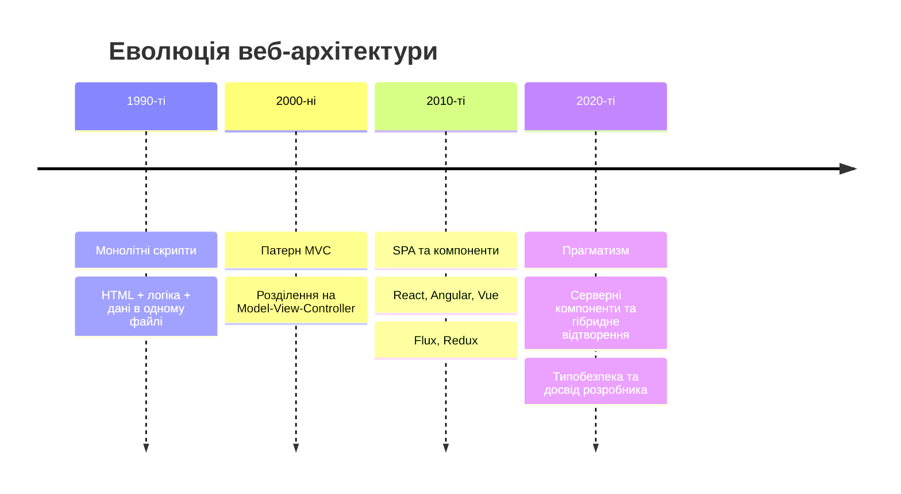

У 1990-х типовий вебзастосунок був одним PHP- чи Perl-файлом, де HTML, запити до бази й бізнес-правила перемішувалися. У 2000-х фреймворки (Ruby on Rails, Django, Spring) закріпили патерн MVC. У 2010-х логіка переїхала до браузера: застосунки на одній сторінці (SPA) на React, Angular і Vue та однонапрямлений потік даних Flux/Redux. 2020-ті принесли прагматизм: серверні компоненти React і Next.js знову повертають частину відтворення на сервер, TypeScript став стандартом, а межа між «клієнтською» і «серверною» частинами стає гнучкішою. Принципи ж, про які йтиметься нижче, лишаються незмінними: розділяти відповідальність і спрямовувати залежності в правильний бік.

## Патерни MVC, MVP та MVVM

Три патерни цього розділу розв'язують одну проблему — **відокремити дані та правила від їх відображення**, — але розставляють акценти по-різному.

### Model-View-Controller (MVC)

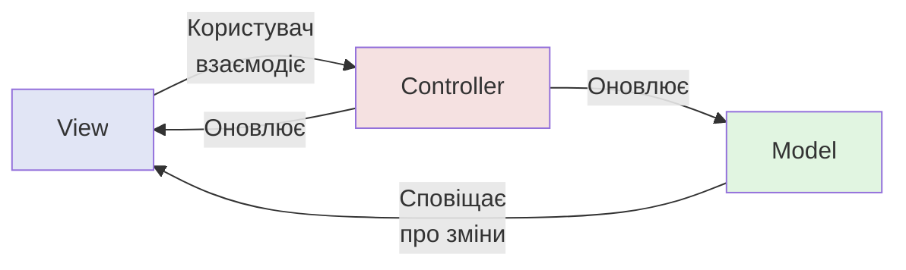

MVC з'явився у 1970-х для графічних інтерфейсів, а у вебі став основою серверних фреймворків. Ви вже зустрічалися з ним у лекціях про Express: маршрут і його обробник — це контролер, модель Sequelize чи Prisma — модель, а шаблон або JSON-відповідь — представлення.

#### Компоненти MVC

**Model (модель)** містить дані, правила їх валідації та бізнес-логіку, а також знає, як зберігатися в базі. Вона нічого не знає про HTTP чи інтерфейс.

**View (представлення)** відповідає за відображення даних: HTML-шаблон, JSON-відповідь, React-компонент. Вона не повинна містити бізнес-правил.

**Controller (контролер)** приймає вхідну подію (запит чи клік), перевіряє вхідні дані, викликає потрібні операції над моделлю та обирає, яке представлення повернути. Контролер має бути «тонким»: якщо в ньому з'являється складна логіка, її варто винести в окремий шар (див. далі «Сервіс»).

```typescript
// Контролер у стилі MVC на Express: тонкий, без бізнес-логіки
import type { RequestHandler } from "express";
import { UserService } from "../services/user.service.ts";

export const getUser: RequestHandler<{ id: string }> = async (req, res) => {
    const user = await userService.findById(Number(req.params.id));
    if (!user) {
        res.status(404).json({ error: "Користувача не знайдено" });
        return;
    }
    res.json(user); // «представлення» — це JSON-відповідь
};
```

Типова проблема MVC — «товсті контролери» і «товсті моделі», у які з часом потрапляє все підряд. Саме тому на практиці до трьох компонентів додають шар сервісів і репозиторіїв.

### Model-View-Presenter (MVP)

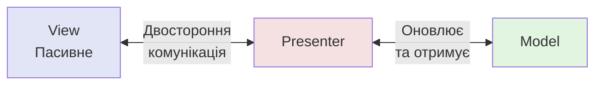

У MVP представлення стає **пасивним**: воно лише показує те, що наказав презентер, і передає йому події користувача. Уся логіка презентації зосереджена в презентері. Перевага — максимальна ізоляція інтерфейсу: презентер можна тестувати з підставним (mock) представленням, а саме представлення легко замінити. MVP історично популярний у Android-розробці та Windows Forms, у сучасному вебі зустрічається рідше.

### Model-View-ViewModel (MVVM)

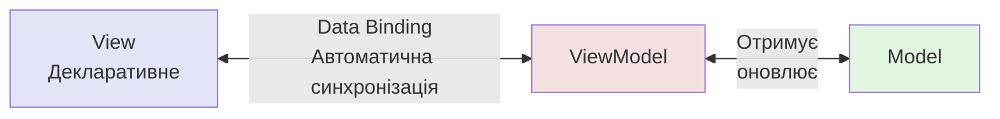

У MVVM між представленням і моделлю стоїть **ViewModel** — стан інтерфейсу в готовому для відображення вигляді. Представлення декларативно «прив'язане» (data binding) до цього стану й оновлюється автоматично, коли стан змінюється. Користувацькі дії інкапсулюються в командах.

Саме так працюють Vue та Angular. React не є «чистим» MVVM, але його модель мислення дуже схожа: компонент — це функція від стану, а власний хук (`useCart`, `useUserForm`) відіграє роль ViewModel, відокремлюючи логіку від розмітки.

```tsx
// Хук як ViewModel: стан і дії окремо від розмітки
function useCounter(initial = 0) {
    const [count, setCount] = useState(initial);
    return {
        count,
        isEven: count % 2 === 0,            // похідний стан «у готовому вигляді»
        increment: () => setCount((c) => c + 1),
        reset: () => setCount(initial),
    };
}

function Counter() {
    const { count, isEven, increment, reset } = useCounter();
    return (
        <div>
            <p>{count} ({isEven ? "парне" : "непарне"})</p>
            <button onClick={increment}>+1</button>
            <button onClick={reset}>Скинути</button>
        </div>
    );
}
```

### Порівняння MVC, MVP та MVVM

| Аспект | MVC | MVP | MVVM |
|--------|-----|-----|------|
| **Представлення** | Активне | Пасивне | Декларативне |
| **Зв'язування** | Ручне | Через презентер | Автоматичне |
| **Тестованість** | Середня | Висока | Висока |
| **Складність** | Низька | Середня | Висока |
| **Де зустрічається** | Серверні фреймворки (Express, Rails, Django) | Складні інтерфейси, мобільна розробка | Реактивні фреймворки (Vue, Angular), хуки React |

Вибір залежить від вимог проєкту, фреймворку та команди. На практиці вебзастосунок часто поєднує підходи: серверна частина організована за MVC (точніше — за шарами, про які далі), а клієнтська — за компонентно-реактивною моделлю, близькою до MVVM.

## Шарова архітектура застосунку

Перш ніж говорити про чисту архітектуру, розглянемо найпоширеніший на практиці спосіб структурувати серверну частину — **шари**. Кожен шар має одну відповідальність і спілкується лише з сусіднім.

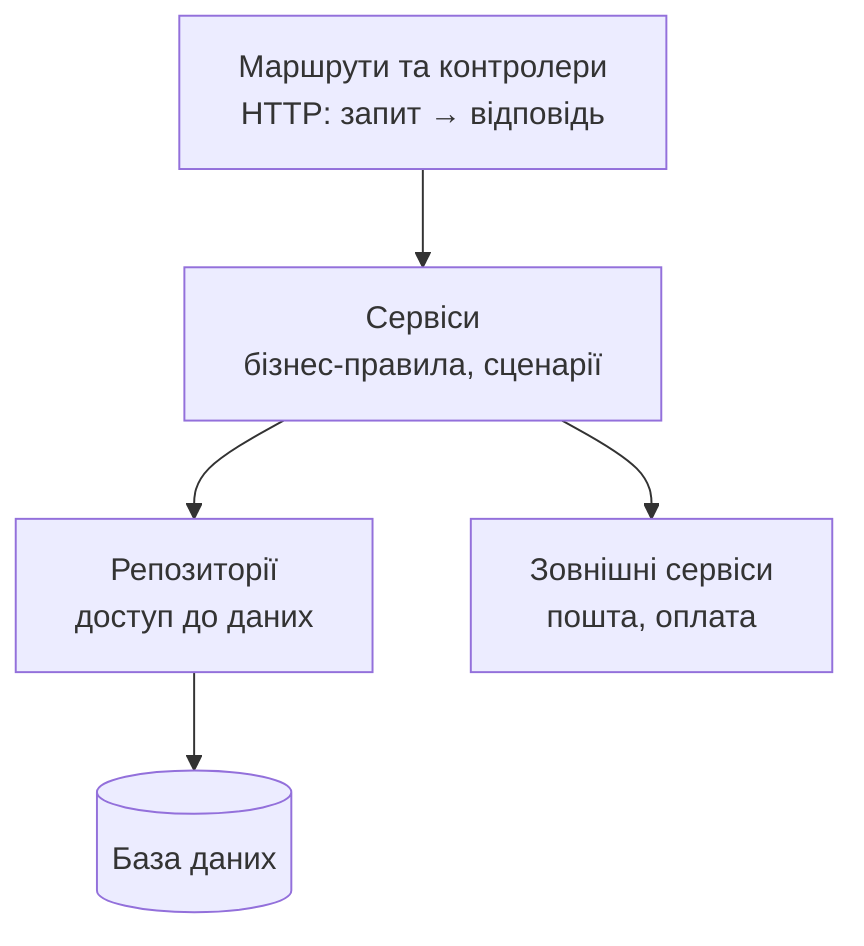

- **Контролер** розуміє HTTP: читає параметри й тіло, перевіряє їх (схемою Zod з лекції 13), викликає сервіс і формує відповідь з потрібним кодом статусу.
- **Сервіс** містить бізнес-правила й не знає про HTTP: він приймає звичайні дані й повертає звичайні дані або кидає доменну помилку.
- **Репозиторій** ховає деталі збереження (SQL, ORM) за простим інтерфейсом.

Типова структура каталогів:

```text
src/
├── config/          # конфігурація та змінні середовища
├── routes/          # маршрути
├── controllers/     # обробники HTTP
├── services/        # бізнес-логіка
├── repositories/    # доступ до даних
├── errors/          # доменні помилки
├── middleware/      # проміжні обробники
├── types/           # спільні типи
└── index.ts
```

Альтернативу цьому «технічному» групуванню складає групування **за функціональністю** (feature-based): каталог `users/` з власними контролером, сервісом і репозиторієм, поряд `orders/`, `products/`. Для великих проєктів воно зручніше: усе, що стосується одного поняття, лежить поруч, а зв'язки між функціями стають явними. Обидва підходи припустимі, головне — послідовність.

## Принципи чистої архітектури (Clean Architecture)

### Концепція

Чиста архітектура, запропонована Робертом Мартіном (Uncle Bob), розвиває ідею шарів і додає до неї одне жорстке правило. Бізнес-правила розташовуються в центрі, а все інше — база даних, веб-фреймворк, інтерфейс — це «деталі» на периферії.

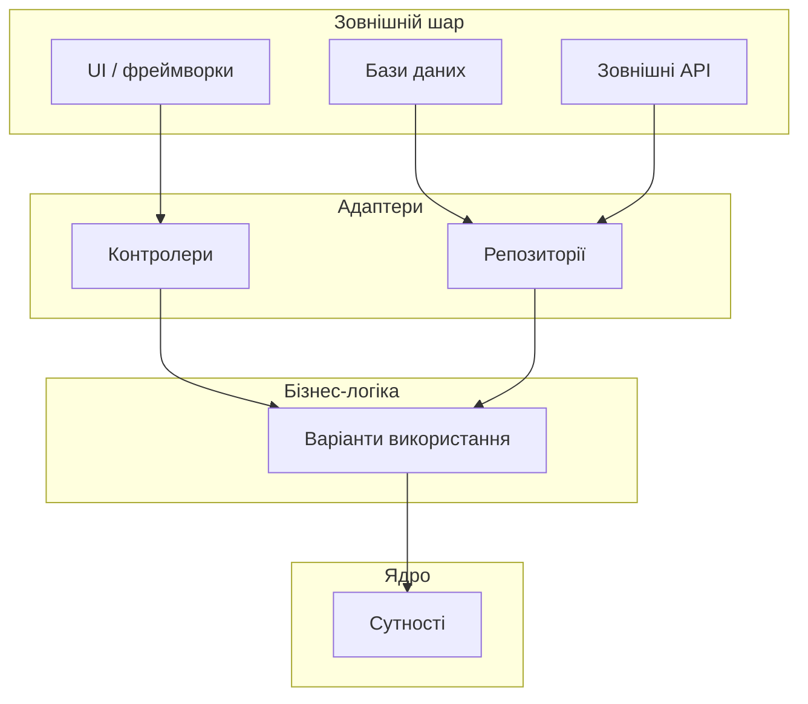

### Правило залежностей

Головне правило: **залежності спрямовані лише всередину**. Внутрішні шари нічого не знають про зовнішні: сутність не імпортує Express, а варіант використання не імпортує Prisma. Якщо внутрішньому шару потрібно щось із зовнішнього світу (наприклад, зберегти користувача), він визначає **інтерфейс**, а зовнішній шар його реалізує. Так залежність «розвертається» (принцип інверсії залежностей, літера D в SOLID).

Це дає чотири види незалежності:

- **Від фреймворків** — фреймворк є інструментом, а не архітектурою;
- **Від інтерфейсу** — веб-інтерфейс можна замінити на консольний чи API, не торкаючись правил;
- **Від бази даних** — СУБД можна змінити без впливу на логіку;
- **Від зовнішніх сервісів** — бізнес-правила не залежать від того, хто надсилає листи чи приймає платежі.

Практичний результат — тестованість (бізнес-логіку перевіряють без бази й сервера) і довговічність (технології змінюються швидше, ніж предметна область).

### Шари чистої архітектури

**Сутності (Entities)** — критичні бізнес-правила підприємства, які не залежать від застосунку: наприклад, «замовлення не може бути оплачене двічі». Їх можна використовувати в різних застосунках.

**Варіанти використання (Use Cases)** — бізнес-логіка конкретного застосунку, сценарії: «оформити замовлення», «зареєструвати користувача». Вони оркеструють потік даних до сутностей і від них.

**Адаптери (Interface Adapters)** — перетворюють дані між форматами сутностей і зовнішнього світу: контролери, презентери, реалізації репозиторіїв.

**Фреймворки та драйвери (Frameworks & Drivers)** — зовнішні інструменти: база даних, веб-фреймворк, інтерфейс.

### Скільки чистої архітектури потрібно

Повна чиста архітектура з окремими шарами для кожної операції доречна в складних доменах із довгим життям. Для навчального проєкту чи невеликого сервісу достатньо спрощеної версії: шарова структура з **інтерфейсами для залежностей, які варто підмінювати** (база, пошта, оплата). Саме цим інструментам — впровадженню залежностей та репозиторіям — присвячено наступні розділи.

## Впровадження залежностей (Dependency Injection)

### Концепція

**Впровадження залежностей** (Dependency Injection, DI) — це підхід, за якого об'єкт не створює свої залежності сам, а **отримує їх ззовні**. Це практична реалізація правила залежностей: клас сервісу залежить від абстракції («щось, що вміє зберігати користувачів»), а не від конкретної бази.

Погано — жорстка залежність:

```typescript
class UserService {
    private database = new PostgresDatabase();   // сервіс сам обирає реалізацію
    private emailService = new SmtpEmailService();
    // Як перевірити його без реальної бази й пошти?
}
```

Добре — залежності передаються ззовні й описані інтерфейсами:

```typescript
interface UserRepository {
    findByEmail(email: string): Promise<User | null>;
    create(data: CreateUserData): Promise<User>;
}

interface EmailSender {
    send(to: string, subject: string, body: string): Promise<void>;
}

class UserService {
    private users: UserRepository;
    private mailer: EmailSender;

    constructor(users: UserRepository, mailer: EmailSender) {
        this.users = users;
        this.mailer = mailer;
    }

    async register(data: CreateUserData): Promise<User> {
        if (await this.users.findByEmail(data.email)) {
            throw new ConflictError("Користувач з такою поштою вже існує");
        }
        const user = await this.users.create(data);
        await this.mailer.send(user.email, "Вітаємо!", "Ваш обліковий запис створено");
        return user;
    }
}
```

> Зверніть увагу: поля оголошено явно, а не через `constructor(private users: ...)`. Параметри-властивості конструктора не є «стираними» конструкціями, і Node.js у режимі видалення типів їх не запускає (лекція 13).

### Способи впровадження залежностей

**Через конструктор (constructor injection)** — найпоширеніший спосіб. Усі обов'язкові залежності видно в сигнатурі, а об'єкт після створення завжди повністю готовий до роботи.

**Через властивості (property injection)** — залежність присвоюється після створення. Підходить для необов'язкових залежностей, але допускає «напівготовий» об'єкт.

**Через параметри методу (method injection)** — залежність передається в конкретний виклик, коли потрібна лише там.

**Контейнер впровадження залежностей** автоматизує створення об'єктів і підстановку залежностей (NestJS, InversifyJS, tsyringe). Для невеликих проєктів він зайвий: достатньо одного місця, де все збирається вручну.

### «Корінь композиції»

Усі залежності зручно збирати в одному місці на старті застосунку — так званому **корені композиції** (composition root). Решта коду про вибір реалізацій нічого не знає.

```typescript
// src/container.ts — єдине місце, де обираються конкретні реалізації
import { prisma } from "./db.ts";
import { PrismaUserRepository } from "./repositories/prisma-user.repository.ts";
import { SmtpEmailSender } from "./infrastructure/smtp-email-sender.ts";
import { UserService } from "./services/user.service.ts";
import { createUserController } from "./controllers/user.controller.ts";

const userRepository = new PrismaUserRepository(prisma);
const mailer = new SmtpEmailSender();
const userService = new UserService(userRepository, mailer);

export const userController = createUserController(userService);
```

### Переваги впровадження залежностей

**Тестованість.** Реальні залежності легко замінити простими підставками:

```typescript
import { describe, it, expect } from "vitest";

describe("UserService", () => {
    it("не дозволяє зареєструвати користувача з наявною поштою", async () => {
        const users: UserRepository = {
            findByEmail: async () => ({ id: 1, email: "a@b.ua" } as User),
            create: async () => { throw new Error("не мало викликатися"); },
        };
        const mailer: EmailSender = { send: async () => {} };
        const service = new UserService(users, mailer);

        await expect(service.register({ email: "a@b.ua" } as CreateUserData))
            .rejects.toThrow("вже існує");
    });
});
```

Для тестів тут використано Vitest — тестувальник, який працює з Vite і TypeScript «з коробки» (у лабораторних можна зустріти й Jest).

**Модульність** — слабка зв'язаність компонентів. **Конфігурованість** — поведінка змінюється підміною реалізацій (у розробці — пошта в консоль, у виробництві — справжній SMTP). **Повторне використання** — компоненти не прив'язані до конкретного контексту.

## Патерни «Репозиторій» та «Сервіс»

### Патерн «Репозиторій» (Repository)

**Репозиторій** інкапсулює доступ до даних і надає коду абстрактний інтерфейс колекції: «знайти», «додати», «видалити». Решта застосунку не знає, чи за ним SQL, MongoDB або масив у пам'яті.

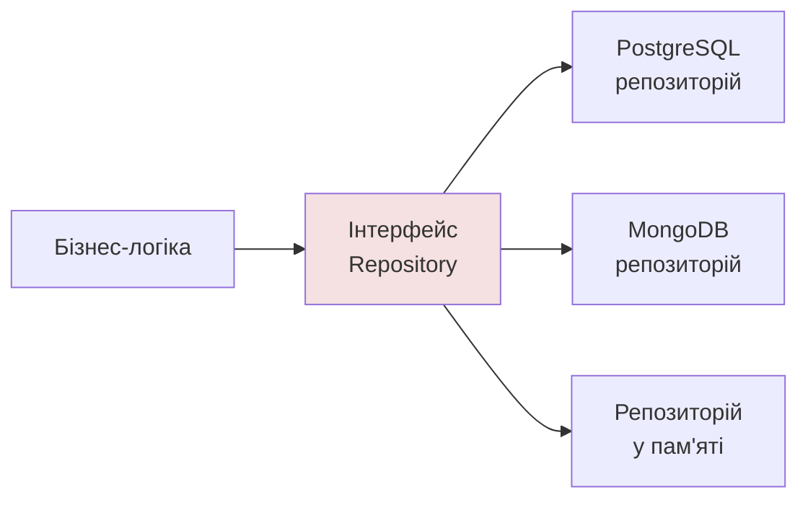

Ось реалізація на Prisma та версія для тестів:

```typescript
// Реалізація для виробництва
import type { PrismaClient } from "../generated/prisma/client.ts";

export class PrismaUserRepository implements UserRepository {
    private prisma: PrismaClient;

    constructor(prisma: PrismaClient) {
        this.prisma = prisma;
    }

    findByEmail(email: string) {
        return this.prisma.user.findUnique({ where: { email } });
    }

    create(data: CreateUserData) {
        return this.prisma.user.create({ data });
    }
}

// Реалізація в пам'яті — для швидких тестів без бази
export class InMemoryUserRepository implements UserRepository {
    private items: User[] = [];

    async findByEmail(email: string) {
        return this.items.find((u) => u.email === email) ?? null;
    }

    async create(data: CreateUserData) {
        const user = { id: this.items.length + 1, ...data } as User;
        this.items.push(user);
        return user;
    }
}
```

**Переваги:** приховує деталі зберігання, дозволяє замінити джерело даних, спрощує тестування. **Застереження:** ORM на кшталт Prisma вже є значною абстракцією над базою. Не обгортайте його репозиторієм автоматично — робіть це тоді, коли справді потрібні підміна в тестах чи ізоляція від ORM.

### Патерн «Сервіс» (Service)

**Сервіс** — це місце для бізнес-логіки, що виходить за межі однієї сутності. Він координує кілька репозиторіїв і зовнішніх систем та застосовує бізнес-правила. Коли використовувати:

- операція зачіпає кілька репозиторіїв;
- складні правила стосуються кількох сутностей;
- інтегруються зовнішні сервіси (пошта, платіжна система);
- потрібна транзакційність;
- валідація вимагає перевірки різних джерел.

```typescript
class OrderService {
    private orders: OrderRepository;
    private products: ProductRepository;
    private payment: PaymentGateway;

    constructor(orders: OrderRepository, products: ProductRepository, payment: PaymentGateway) {
        this.orders = orders;
        this.products = products;
        this.payment = payment;
    }

    async checkout(userId: number, items: CartItem[]): Promise<Order> {
        const products = await this.products.findByIds(items.map((i) => i.productId));

        for (const item of items) {
            const product = products.find((p) => p.id === item.productId);
            if (!product) throw new NotFoundError(`Товар ${item.productId} не знайдено`);
            if (product.stock < item.quantity) {
                throw new ValidationError(`Недостатньо товару «${product.name}» на складі`);
            }
        }

        const total = items.reduce((sum, item) => {
            const product = products.find((p) => p.id === item.productId)!;
            return sum + product.price * item.quantity;
        }, 0);

        await this.payment.charge(userId, total);
        return this.orders.create({ userId, items, total });
    }
}
```

> У реальному магазині перевірка залишку, оплата й створення замовлення мають виконуватися в **одній транзакції** (або з компенсувальними діями), інакше при збої ми отримаємо списані кошти без замовлення. Це типова відповідальність сервісного шару.

### Репозиторій та сервіс: розподіл відповідальності

| | Репозиторій | Сервіс |
|---|---|---|
| **Відповідає за** | Доступ до даних однієї сутності | Бізнес-правила та координацію |
| **Операції** | CRUD, запити, фільтрація | Сценарії: оформити замовлення, зареєструватися |
| **Не повинен містити** | Бізнес-логіку | Знання про SQL чи HTTP |
| **Використовує** | ORM / драйвер бази | Репозиторії та зовнішні сервіси |

## Обробка помилок

### Типи помилок

Перш ніж обробляти помилки, їх потрібно розрізняти.

**Операційні помилки** — очікувані ситуації, які трапляються в справному застосунку: користувача не знайдено, дані не пройшли валідацію, база тимчасово недоступна. Їх треба обробляти коректно й повідомляти клієнта.

**Програмні помилки** — баги: звернення до властивості `undefined`, неправильний виклик функції. Їх не «обробляють», а виправляють; у відповіді клієнту вони не повинні розкривати подробиць.

### Власні класи помилок

Відповідність між помилкою й кодом статусу HTTP зручно закласти в самих помилках:

```typescript
// src/errors/app-errors.ts
export class AppError extends Error {
    readonly statusCode: number;
    readonly code: string;

    constructor(message: string, statusCode: number, code: string, options?: ErrorOptions) {
        super(message, options); // options.cause зберігає початкову причину
        this.name = new.target.name;
        this.statusCode = statusCode;
        this.code = code;
    }
}

export class ValidationError extends AppError {
    constructor(message: string, options?: ErrorOptions) {
        super(message, 400, "VALIDATION_ERROR", options);
    }
}
export class UnauthorizedError extends AppError {
    constructor(message = "Потрібна автентифікація", options?: ErrorOptions) {
        super(message, 401, "UNAUTHORIZED", options);
    }
}
export class NotFoundError extends AppError {
    constructor(message = "Ресурс не знайдено", options?: ErrorOptions) {
        super(message, 404, "NOT_FOUND", options);
    }
}
export class ConflictError extends AppError {
    constructor(message: string, options?: ErrorOptions) {
        super(message, 409, "CONFLICT", options);
    }
}
```

Параметр `cause` (стандарт ES2022) дозволяє «загорнути» низькорівневу помилку, не втрачаючи її: `throw new NotFoundError("…", { cause: err })`.

### Централізована обробка на серверній частині

Замість `try/catch` у кожному обробнику визначаємо **єдиний обробник помилок**. Починаючи з Express 5, відхилені проміси в асинхронних обробниках потрапляють сюди автоматично — обгортка `asyncHandler`, обов'язкова в Express 4, більше не потрібна.

```typescript
// src/middleware/error-handler.ts
import type { ErrorRequestHandler } from "express";
import { AppError } from "../errors/app-errors.ts";
import { logger } from "../logger.ts";

export const errorHandler: ErrorRequestHandler = (err, req, res, _next) => {
    if (err instanceof AppError) {
        // Очікувана операційна помилка
        logger.warn({ err, requestId: req.id }, "Операційна помилка");
        res.status(err.statusCode).json({ error: { code: err.code, message: err.message } });
        return;
    }

    // Програмна помилка: детально логуємо, клієнту — загальне повідомлення
    logger.error({ err, requestId: req.id }, "Необроблена помилка");
    res.status(500).json({ error: { code: "INTERNAL_ERROR", message: "Внутрішня помилка сервера" } });
};

// Підключається після всіх маршрутів:
// app.use(errorHandler);
```

Два принципи, на які варто звернути увагу. Перший: клієнт ніколи не бачить стек викликів і внутрішніх повідомлень у виробничому середовищі — це витік інформації (повернемося до цього в лекції 16, де помилка за номером A10 в OWASP Top 10:2025 саме про неправильну обробку виняткових ситуацій). Другий: на рівні процесу варто перехоплювати `unhandledRejection` та `uncaughtException`, залогувати подію й **завершити процес**, довірившись менеджеру процесів чи оркестратору, який його перезапустить: після непередбаченої помилки стан застосунку може бути пошкоджений.

### Обробка помилок у React: межі помилок

Помилка під час відтворення компонента без захисту «знищує» все дерево — користувач бачить порожню сторінку. **Межа помилок** (Error Boundary) перехоплює помилки у піддереві й показує запасний інтерфейс. Це застосування принципу плавної деградації: збій одного віджета не повинен руйнувати весь застосунок.

Межі помилок досі реалізуються лише класовими компонентами, тому на практиці користуються бібліотекою `react-error-boundary`:

```tsx
import { ErrorBoundary } from "react-error-boundary";
import type { FallbackProps } from "react-error-boundary";

function ErrorFallback({ error, resetErrorBoundary }: FallbackProps) {
    return (
        <div role="alert">
            <p>Щось пішло не так.</p>
            <button onClick={resetErrorBoundary}>Спробувати знову</button>
        </div>
    );
}

function App() {
    return (
        <ErrorBoundary
            FallbackComponent={ErrorFallback}
            onError={(error, info) => reportError(error, info.componentStack)}
        >
            <MainContent />
        </ErrorBoundary>
    );
}
```

Межі помилок **не перехоплюють** помилки в обробниках подій, асинхронному коді та на сервері — для них потрібен звичайний `try/catch`. У React 19 з'явилися глобальні хуки на рівні кореня застосунку, за допомогою яких зручно централізовано надсилати помилки в систему моніторингу:

```tsx
import { createRoot } from "react-dom/client";

createRoot(document.getElementById("root")!, {
    onCaughtError: (error, info) => reportError(error, info.componentStack),   // перехопила межа помилок
    onUncaughtError: (error, info) => reportError(error, info.componentStack), // ніхто не перехопив
    onRecoverableError: (error) => console.warn("Відновлена помилка", error),
}).render(<App />);
```

Також у Next.js для цього існують спеціальні файли `error.tsx` та `global-error.tsx`, які автоматично створюють межі помилок для сегментів маршрутизації.

## Логування та налагодження

### Навіщо потрібне логування

Коли застосунок працює у виробництві, ви не можете «зазирнути всередину» через налагоджувач. Журнали подій (логи) — це ваші очі. Але `console.log` для цього не годиться: немає рівнів, структури, контексту, і результат важко аналізувати.

### Рівні логування

| Рівень | Призначення |
|--------|-------------|
| **fatal / error** | Помилки, що вимагають уваги |
| **warn** | Попередження про потенційні проблеми |
| **info** | Нормальні події: запуск, створення користувача |
| **debug** | Деталі для розробки |
| **trace** | Дуже докладна інформація |

У виробництві зазвичай вмикають `info` і вище, під час розробки — `debug`.

### Структуроване логування

Журнал у вигляді вільного тексту важко фільтрувати. **Структуроване логування** записує кожну подію як JSON-об'єкт із полями, за якими можна шукати й агрегувати. Для Node.js стандартом де-факто є бібліотека **pino** — швидка й орієнтована на JSON.

```typescript
// src/logger.ts
import pino from "pino";
import { env } from "./config/env.ts";

export const logger = pino({
    level: env.NODE_ENV === "production" ? "info" : "debug",
    // Ніколи не логуйте секрети: pino може автоматично маскувати вказані поля
    redact: ["req.headers.authorization", "req.headers.cookie", "*.password", "*.token"],
});

logger.info({ userId: 42, action: "user.created" }, "Користувача створено");
// {"level":30,"time":...,"userId":42,"action":"user.created","msg":"Користувача створено"}
```

Правило, яке треба вивчити напам'ять: **у журнали не потрапляють паролі, токени, номери карток та інші персональні дані**. Це вимога не лише здорового глузду, а й законодавства про захист даних. Журнали безпеки ми розглянемо в лекції 16 (категорія A09 в OWASP Top 10:2025).

### Контекст запиту: ідентифікатор і AsyncLocalStorage

У робочому застосунку десятки запитів обробляються одночасно, і їхні записи в журналі перемішуються. Щоб відновити «нитку» одного запиту, кожному присвоюють унікальний ідентифікатор (request ID / trace ID) і додають його до кожного запису. Щоб не передавати ідентифікатор через параметри кожної функції, Node.js має `AsyncLocalStorage` — сховище, прив'язане до ланцюжка асинхронних викликів:

```typescript
// src/middleware/request-context.ts
import { AsyncLocalStorage } from "node:async_hooks";
import { randomUUID } from "node:crypto";
import type { RequestHandler } from "express";
import { logger } from "../logger.ts";

const storage = new AsyncLocalStorage<{ requestId: string }>();

export const requestContext: RequestHandler = (req, res, next) => {
    const requestId = req.header("x-request-id") ?? randomUUID();
    res.setHeader("x-request-id", requestId);
    storage.run({ requestId }, next);
};

// Логер, що автоматично додає requestId до кожного запису
export const log = () => logger.child({ requestId: storage.getStore()?.requestId });
```

Для розподілених систем цю ідею стандартизує **OpenTelemetry** — відкритий стандарт збору трасувань, метрик і журналів, який підтримують усі великі системи спостережуваності. Ми повернемося до нього в лекції 15.

### Налагодження та моніторинг

Налагодження на розробці виконують за допомогою вбудованого налагоджувача VS Code (точки зупину, перегляд змінних) і режиму `node --inspect`. Для відтворення проблем користувачів у виробництві застосовують спеціалізовані сервіси: **Sentry** (збір помилок з клієнтської та серверної частин), хмарні платформи спостережуваності на кшталт Grafana або Datadog (метрики й трасування), інструменти відтворення сесій. Ключ до ефективного налагодження — вимірювання: час виконання ключових операцій, використання пам'яті та помилки в розрізі версій застосунку.

## Найкращі практики архітектури

**Обирайте архітектуру за вимогами, а не за модою.** Починайте просто. Мікросервіси, «чиста» архітектура та шаблони CQRS доречні тоді, коли їх вимагає складність, а не тому, що про них пишуть у блогах. Чимало успішних продуктів роками живуть як добре структурований **модульний моноліт**.

**Документуйте рішення.** Короткий запис «ми обрали X, бо Y, відкинули Z» (ADR — architecture decision record) у каталозі `docs/adr` економить місяці суперечок через рік.

**Автоматизуйте перевірку архітектури.** Правила на кшталт «шар контролерів не імпортує репозиторії напряму» можна перевіряти автоматично лінтером (див. розділ про ESLint нижче) — тоді вони не залежать від уважності рецензента.

**Тестуйте на всіх рівнях.** Швидкі модульні тести для сервісів (завдяки DI), інтеграційні для репозиторіїв (проти справжньої бази, наприклад у контейнері), кілька наскрізних для ключових сценаріїв.

**Дотримуйтеся SOLID як орієнтира, а не догми:** єдина відповідальність, відкритість для розширення, підстановка Лісков, розділення інтерфейсів, інверсія залежностей.

**Еволюціонуйте.** Архітектура змінюється разом із проєктом; рефакторинг — це нормальна практика, а не ознака помилки.

**Забезпечте розуміння в команді.** Найкраща архітектура безкорисна, якщо її розуміє лише автор.

### Ключові висновки щодо архітектури

- MVC, MVP і MVVM — різні відповіді на одне питання; вибір залежить від фреймворку й контексту.
- Чиста архітектура — це правило напряму залежностей: бізнес-логіка не залежить від деталей.
- Впровадження залежностей робить це правило практичним і дає тестованість.
- «Репозиторій» ховає зберігання, «сервіс» збирає бізнес-сценарії; контролер залишається тонким.
- Помилки поділяються на операційні й програмні; обробляються централізовано; клієнту не розкривають внутрішніх подробиць.
- Структуровані журнали з контекстом запиту — основа налагодження у виробництві.

> **Найкращий код — той, який легко читати, розуміти та змінювати.** Патерни — це інструменти, а не догми. Не ускладнюйте код заради патернів.

---

## Сучасна екосистема інструментів розробки

### Еволюція інструментів

Колись набір розробника складався з текстового редактора, браузера та FTP-клієнта для вивантаження файлів на сервер. Зі зростанням складності проєктів для кожного етапу з'явилися спеціалізовані інструменти, і сьогодні типовий проєкт використовує їх десятки. Ключові категорії:

- **Система контролю версій** (Git) відстежує зміни, дозволяє працювати командою та повертатися до будь-якого стану проєкту.
- **Інструменти якості коду** — лінтери, форматери, перевірка типів — автоматично знаходять потенційні помилки й забезпечують єдиний стиль.
- **Автоматизація** запускає перевірки й тести на кожну зміну (хуки Git, безперервна інтеграція).
- **Збирання та аналіз** (Vite) перетворюють вихідний код на оптимізований застосунок.
- **Контейнеризація** (Docker) гарантує однакове середовище для всієї команди та спрощує розгортання.

### Філософія: автоматизуйте дисципліну

Сучасний підхід можна звести до чотирьох принципів. **Автоматизація рутини** звільняє розробників для творчої роботи. **Раннє виявлення проблем** — помилка, знайдена в редакторі, коштує секунди, у конвеєрі — хвилини, у виробництві — години й репутацію. **Єдині стандарти** виключають суперечки про стиль із рецензій. **Швидкий зворотний зв'язок** тримає цикл розробки коротким.

Інструменти мають допомагати, а не заважати: працювати швидко, видавати зрозумілі повідомлення й вимагати мінімум налаштувань. Якщо перевірка триває хвилинами, розробники почнуть її обходити, і вся система втратить сенс.

Для узгодженості ми будемо дотримуватися «багаторівневого захисту якості»: перший рівень — редактор (миттєві підказки), другий — хук перед комітом (перевірка змінених файлів), третій — конвеєр безперервної інтеграції (повна перевірка, яку неможливо обійти). Саме ця послідовність визначає порядок розділів нижче.

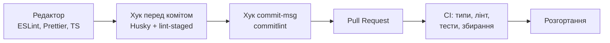

## Git та командна робота

### Фундаментальні концепції

Git — розподілена система контролю версій. «Розподілена» означає, що кожен розробник має **повну копію** історії проєкту, і більшість операцій виконується локально й миттєво. Основні поняття:

- **Репозиторій** — проєкт разом з усією історією змін.
- **Коміт** — знімок стану проєкту з автором, часом і описом; кожен коміт посилається на попередній, утворюючи ланцюжок.
- **Гілка** — рухомий вказівник на коміт, що дозволяє вести паралельні лінії розробки.
- **Індекс** (staging area) — проміжна область, у якій ви формуєте наступний коміт.
- **Віддалений репозиторій** (remote) — копія на сервері (GitHub, GitLab), через яку команда обмінюється змінами.

Файли в Git перебувають в одному з трьох станів: **змінені** (у робочій директорії), **підготовлені** (в індексі), **закомічені** (в історії).

### Базові операції

```bash
# Початкове налаштування (один раз на комп'ютері)
git config --global user.name "Ім'я Прізвище"
git config --global user.email "you@example.com"
git config --global init.defaultBranch main

# Ініціалізація та клонування
git init
git clone https://github.com/user/repo.git

# Щоденний цикл
git status                      # що змінилося
git add src/components/User.tsx # додати в індекс (або git add -p — вибірково)
git commit -m "feat: додати форму входу"
git log --oneline --graph       # історія

# Обмін зі сервером
git push origin main
git pull --rebase               # отримати зміни, не створюючи зайвих merge-комітів
git remote -v
```

Сучасна основна гілка за замовчуванням має назву **`main`** (раніше — `master`); налаштування `init.defaultBranch` задає її для нових репозиторіїв.

### Якісні повідомлення комітів: Conventional Commits

Історія комітів — це документація проєкту. Повідомлення на кшталт «fix» чи «зміни» нічого не пояснюють, а добре повідомлення відповідає на запитання «що і навіщо змінилося». Індустрія широко застосовує специфікацію **Conventional Commits**:

```text
<тип>(<область>): <короткий опис>

[необов'язкове тіло: чому змінено, що було раніше]

[необов'язковий підвал: BREAKING CHANGE, посилання на задачі]
```

Основні типи: `feat` (нова функція), `fix` (виправлення), `docs`, `style` (форматування), `refactor`, `perf`, `test`, `build`, `ci`, `chore`.

```text
# Хороший коміт
feat(auth): додати двофакторну автентифікацію

Користувач може ввімкнути TOTP у налаштуваннях профілю.
Закриває #123

# Поганий коміт
виправив баг
```

Додаткова вигода від такого формату — автоматичне генерування журналу змін і визначення номера версії за правилами семантичного версіонування (інструменти semantic-release, release-please). Ми скористаємося ними в лекції 15.

Правила хорошого коміту: **один коміт — одна логічна зміна**; опис пишуть у наказовому способі й зазвичай коротше за 72 символи; кожен коміт має залишати проєкт у працездатному стані.

### Робота з гілками

```bash
# Створення гілки та перехід на неї (сучасна команда switch)
git switch -c feature/user-profile

# Перемикання, перегляд, видалення
git switch main
git branch -a
git branch -d feature/user-profile

# Об'єднання
git merge feature/user-profile

# Перебазування: перенести свої коміти поверх свіжої main
git switch feature/user-profile
git rebase main
```

Команди `git switch` (перемикання гілок) і `git restore` (відновлення файлів) з'явилися у Git 2.23, щоб розділити два різні призначення старої команди `git checkout`. У нових матеріалах рекомендується користуватися саме ними.

**Merge чи rebase?** Обидва способи об'єднують роботу, але по-різному. `merge` зберігає справжню історію та створює «злитий» коміт, `rebase` переписує ваші коміти, ніби ви почали роботу з актуальної `main`, і дає лінійну історію. Золоте правило: **не перебазовуйте коміти, які вже опубліковані і на яких можуть базуватися інші розробники** — перебазування змінює їхні ідентифікатори. Для власної гілки перед відправкою пул-реквесту `rebase` цілком доречний. Стратегії злиття пул-реквесту на GitHub: звичайний merge-коміт, «squash and merge» (усі коміти гілки стають одним) і «rebase and merge».

### Стратегії роботи з гілками

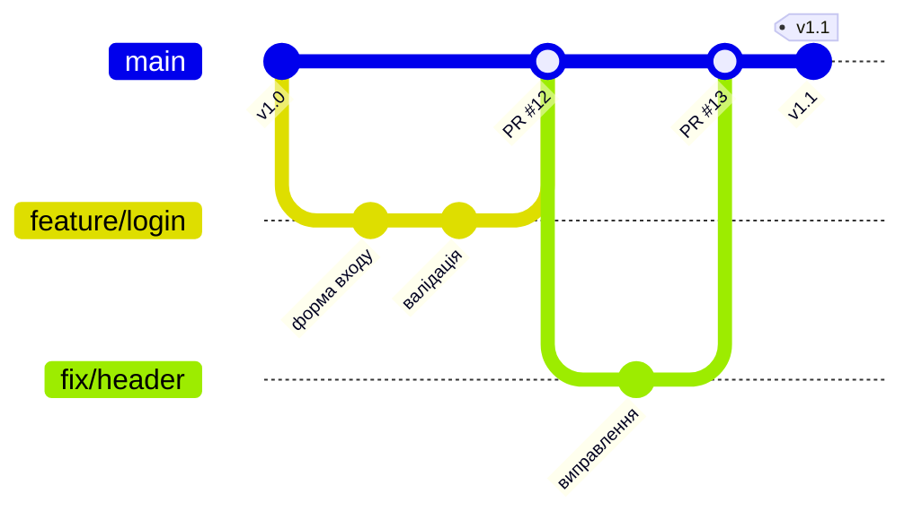

**Git Flow** — розгалужена модель із довгоіснуючими гілками `main`, `develop`, а також `feature/*`, `release/*`, `hotfix/*`. Вона створювалася для проєктів із плановими релізами «коробкових» продуктів. Для вебзастосунків, які можна розгортати кілька разів на день, вона надмірно складна, і навіть її автор зазначав це у своїх примітках до моделі.

**GitHub Flow** — проста модель: `main` завжди готова до розгортання; для кожної задачі створюється коротка гілка, відкривається пул-реквест, після рецензії та успішних перевірок гілка зливається в `main`, і зміни розгортаються.

**Розробка на основі магістралі (trunk-based development)** — розвиток ідеї GitHub Flow: гілки живуть години, а не дні, зміни інтегруються в `main` кілька разів на день, а незавершені функції ховаються за **перемикачами функцій** (feature flags). Саме цей підхід, за даними досліджень DORA (лекція 15), притаманний командам із найвищою швидкістю та стабільністю поставки.

| Модель | Тривалість гілок | Підходить для | Складність |
|--------|------------------|---------------|-----------|
| Git Flow | Дні–тижні | Продукти з плановими релізами, підтримка кількох версій | Висока |
| GitHub Flow | Години–дні | Більшість вебзастосунків | Низька |
| Trunk-based | Години | Команди з міцною автоматизацією тестів | Низька, але вимагає дисципліни |

Для навчальних проєктів і лабораторних робіт найкраще підходить GitHub Flow.

### Розв'язання конфліктів

Конфлікт виникає, коли дві гілки змінили одне й те саме місце файлу. Git не може обрати сам і просить людину.

```bash
git merge feature/user-profile
# CONFLICT (content): Merge conflict in src/components/User.tsx

git status   # показує файли з конфліктами (both modified)
```

У файлі з'являються маркери:

```text
<<<<<<< HEAD
const title = "Профіль користувача";
=======
const title = "Мій профіль";
>>>>>>> feature/user-profile
```

Потрібно вручну залишити потрібний варіант (або поєднати обидва), прибрати маркери, а потім:

```bash
git add src/components/User.tsx
git commit              # завершити злиття (для rebase — git rebase --continue)

# Якщо щось пішло не так — скасувати
git merge --abort
```

Редактор VS Code показує конфлікти з кнопками «Прийняти поточну / вхідну зміну», а для складних випадків є інструмент `git mergetool`. Найкраще лікування конфліктів — **профілактика**: короткі гілки, часте підтягування змін із `main` і невеликі зміни.

### Просунуті техніки

```bash
# Інтерактивне перебазування: почистити історію перед PR
git rebase -i HEAD~3
# pick — залишити; reword — змінити повідомлення; squash/fixup — злити з попереднім; drop — прибрати

# Перенести окремий коміт в іншу гілку
git cherry-pick abc1234

# Тимчасово відкласти незавершену роботу
git stash push -m "чернетка форми"
git stash list
git stash pop

# Відновлення: reflog зберігає історію всіх переміщень вказівників
git reflog
git switch -c recovered abc1234    # відновити «втрачену» гілку чи коміт

# Скасування змін
git restore src/App.tsx            # скасувати непідготовлені зміни у файлі
git restore --staged src/App.tsx   # прибрати файл з індексу
git revert abc1234                 # новий коміт, що скасовує вказаний (безпечно для спільних гілок)

# Пошук коміту, що вніс помилку, бінарним пошуком
git bisect start
git bisect bad            # поточний стан зламаний
git bisect good v1.0      # цей тег був робочим
```

Також варто знати про `git worktree` (кілька робочих директорій з одного репозиторію — зручно для паралельної роботи над двома задачами) і про **підписані коміти** (SSH- або GPG-підпис підтверджує авторство; GitHub позначає такі коміти як «Verified»). Підписи стають дедалі важливішими у контексті безпеки ланцюга постачання (лекція 16).

### Командна співпраця через пул-реквести

Пул-реквест (Pull Request, PR) — це запит на злиття гілки, у межах якого відбувається рецензія коду та автоматичні перевірки. Гарний PR — **малий** (бажано до кількох сотень рядків), має зрозумілий опис і проходить усі автоматичні перевірки до того, як хтось витратить час на його перегляд.

Шаблон опису PR зберігають у репозиторії (`.github/pull_request_template.md`), щоб він підставлявся автоматично:

```markdown
## Опис змін
Коротко: що і навіщо змінено.

## Тип змін
- [ ] Нова функція
- [ ] Виправлення помилки
- [ ] Рефакторинг
- [ ] Документація

## Пов'язані задачі
Закриває #123

## Як перевірити
1. Запустити `npm run dev`
2. Відкрити сторінку профілю

## Чек-лист
- [ ] Код проходить `npm run typecheck` і `npm run lint`
- [ ] Додано або оновлено тести
- [ ] Оновлено документацію
```

**Рецензія коду** (code review) — не пошук винних, а спільна відповідальність за якість. Рецензент перевіряє архітектурні рішення (чи вони узгоджуються з тим, що ми розглянули в першій частині лекції), безпеку, читабельність і тести; дрібниці стилю мають відловлювати автоматичні інструменти, а не люди. Корисна практика — **захист гілки `main`**: у налаштуваннях репозиторію вимагають проходження перевірок і хоча б одне схвалення перед злиттям. Нарешті, сьогодні код дедалі частіше рецензують ШІ-асистенти; їхні зауваження слід розглядати як підказки, а не як вирок, а відповідальність за злиття завжди залишається за людиною.

Для роботи з GitHub із командного рядка є офіційний інструмент `gh`: `gh pr create`, `gh pr checkout 42`, `gh pr checks`.

## ESLint та Prettier: автоматизація якості коду

### Лінтер і форматер: різні завдання

Ці два інструменти часто плутають, тому розрізняйте їх одразу.

**Лінтер (ESLint)** виконує **статичний аналіз**: знаходить потенційні помилки (невикористані змінні, недосяжний код, пропущений `await`), небезпечні конструкції та порушення правил команди. Він відповідає на запитання «чи правильно цей код?».

**Форматер (Prettier)** лише **переставляє пробіли, переноси та лапки** за єдиними правилами, не змінюючи логіки. Він відповідає на запитання «як цей код виглядає?».

Прийнята сьогодні робота: Prettier відповідає за стиль, ESLint — за якість, і вони не втручаються в сферу один одного.

### ESLint 10: плоска конфігурація

Версія 10 (лютий 2026) завершила перехід, що тривав кілька років: **підтримується лише «плоска» конфігурація (flat config)**, що зберігається у файлі `eslint.config.js` (або `.mjs`, `.ts`). Старі формати `.eslintrc.*` і файл `.eslintignore` повністю вилучені. Якщо ви зустрічаєте їх у старому підручнику або проєкті, їх потрібно мігрувати. Підтримка ESLint 9 завершилася в серпні 2026 року.

```bash
# Встановлення ESLint і підтримки TypeScript
npm install --save-dev eslint @eslint/js typescript-eslint globals

# Або майстер, що створить конфігурацію інтерактивно
npm init @eslint/config@latest
```

Приклад `eslint.config.js` для проєкту на TypeScript:

```javascript
// eslint.config.js
import js from "@eslint/js";
import globals from "globals";
import tseslint from "typescript-eslint";
import { defineConfig, globalIgnores } from "eslint/config";

export default defineConfig(
    globalIgnores(["dist", "coverage", "src/generated"]),

    js.configs.recommended,
    tseslint.configs.recommended,

    {
        languageOptions: {
            globals: { ...globals.node },
        },
        rules: {
            "no-console": ["warn", { allow: ["warn", "error"] }],
            "prefer-const": "error",
            eqeqeq: ["error", "always"],
            "@typescript-eslint/no-explicit-any": "warn",
            "@typescript-eslint/consistent-type-imports": "error",
        },
    },
);
```

Розглянемо структуру. **Конфігурація — це масив об'єктів**, кожен з яких може обмежуватися певними файлами (`files`), мати власні налаштування мови (`languageOptions`) та правила (`rules`). Пізніші об'єкти перекривають ранні. Функція `defineConfig` з модуля `eslint/config` надає підказки типів і спрощує поєднання наборів; `globalIgnores` замінює колишній `.eslintignore`.

Правила мають три рівні суворості: `"off"` (вимкнено), `"warn"` (попередження, не блокує) і `"error"` (помилка, блокує перевірку).

Для проєкту на React додається плагін хуків і правила, специфічні для React-коду:

```javascript
import reactHooks from "eslint-plugin-react-hooks";
import reactRefresh from "eslint-plugin-react-refresh";

export default defineConfig(
    // ...базова конфігурація, як вище
    {
        files: ["**/*.{ts,tsx}"],
        languageOptions: { globals: { ...globals.browser } },
        plugins: { "react-hooks": reactHooks, "react-refresh": reactRefresh },
        rules: {
            ...reactHooks.configs.recommended.rules,
            "react-refresh/only-export-components": ["warn", { allowConstantExport: true }],
        },
    },
);
```

> **Про версії плагінів.** Не всі плагіни одночасно оновилися до ESLint 10, тому під час встановлення звертайте увагу на попередження про сумісність (peer dependencies) і документацію плагіна. Шаблон Vite `react-ts` постачається із робочою конфігурацією — це хороша відправна точка.

#### Лінтинг з урахуванням типів

Пакет typescript-eslint уміє використовувати інформацію про типи, що дозволяє знаходити помилки, недоступні звичайному аналізу, наприклад «забутий `await`» (`no-floating-promises`) або небезпечне використання `any`:

```javascript
export default defineConfig(
    js.configs.recommended,
    tseslint.configs.recommendedTypeChecked,
    {
        languageOptions: {
            parserOptions: {
                projectService: true,                 // автоматично знаходить tsconfig.json
                tsconfigRootDir: import.meta.dirname,
            },
        },
    },
);
```

Ціна — повільніший запуск, бо лінтер будує повну модель типів проєкту. Зауважте також: typescript-eslint залежить від програмного API компілятора TypeScript, якого в нативній версії 7.0 ще немає, тому ESLint працює поряд із TypeScript **6.x** (лекція 13). Швидкий `tsc` 7.0 можна використовувати паралельно лише для перевірки типів.

#### Корисні правила та їх логіка

| Правило | Що ловить |
|---------|-----------|
| `no-unused-vars` / `@typescript-eslint/no-unused-vars` | Невикористані змінні — часто сліди недописаного коду |
| `eqeqeq` | `==` замість `===`, що призводить до неочікуваних приведень типів |
| `prefer-const` | `let` для змінних, які ніколи не перепризначаються |
| `@typescript-eslint/no-floating-promises` | Проміс, про який «забули» (без `await` чи `catch`) |
| `@typescript-eslint/no-explicit-any` | Явне використання `any` |
| `react-hooks/rules-of-hooks` | Хуки, викликані в умовах чи циклах |
| `react-hooks/exhaustive-deps` | Неповний список залежностей в `useEffect` |

Також можна підключити готові набори правил (наприклад, `eslint-config-airbnb`, `neostandard`), але дедалі більше команд обирають мінімальну базу `recommended` плюс кілька власних правил.

#### Запуск

```bash
npx eslint .              # перевірити весь проєкт
npx eslint src/App.tsx    # окремий файл
npx eslint . --fix        # автоматично виправити те, що можна
```

У ESLint 10 прапорець `--ext` вилучено: які файли перевіряти, визначає конфігурація (`files`), а не командний рядок.

### Prettier: автоматичне форматування

```bash
npm install --save-dev prettier eslint-config-prettier
```

Конфігурація `.prettierrc` — мінімальна, адже Prettier свідомо має мало налаштувань:

```json
{
  "semi": true,
  "singleQuote": false,
  "trailingComma": "all",
  "printWidth": 100,
  "tabWidth": 2
}
```

Файл `.prettierignore` працює подібно до `.gitignore`:

```text
dist
coverage
node_modules
package-lock.json
```

```bash
npx prettier --write .    # відформатувати все
npx prettier --check .    # лише перевірити (для CI)
```

### Спільна робота ESLint та Prettier

Щоб інструменти не «сварилися» через правила форматування, додайте `eslint-config-prettier` останнім у конфігурації: він вимикає всі правила ESLint, що конфліктують з Prettier.

```javascript
import prettier from "eslint-config-prettier";

export default defineConfig(
    js.configs.recommended,
    tseslint.configs.recommended,
    prettier,       // завжди останнім
);
```

Не запускайте Prettier *всередині* ESLint (як це робив застарілий плагін `eslint-plugin-prettier`): це сповільнює перевірку й перетворює косметичні відмінності на помилки лінтера. Нехай кожен інструмент працює окремо.

Для порівняння: в екосистемі з'явилися й швидші інструменти на мові Rust — **Biome** (лінтер і форматер в одному) та **Oxlint** (лінтер). Вони працюють на порядок швидше, але мають меншу кількість правил і плагінів. Тож стандартом залишається зв'язка ESLint + Prettier; про альтернативи варто знати й оцінювати їх для великих кодових баз.

### Інтеграція з редактором

Справжня користь від лінтера та форматера — у миттєвому зворотному зв'язку під час набору коду. У VS Code встановіть розширення **ESLint** і **Prettier – Code formatter**, а в робочій області збережіть спільні налаштування в `.vscode/settings.json` (цей файл потрапляє в репозиторій, щоб уся команда мала однакову поведінку):

```json
{
  "editor.formatOnSave": true,
  "editor.defaultFormatter": "esbenp.prettier-vscode",
  "editor.codeActionsOnSave": {
    "source.fixAll.eslint": "explicit"
  },
  "typescript.tsdk": "node_modules/typescript/lib"
}
```

Останній рядок змушує редактор використовувати саме ту версію TypeScript, що вказана в проєкті, а не вбудовану. Рекомендовані розширення для команди можна перелічити у файлі `.vscode/extensions.json`, тоді VS Code запропонує їх встановити під час відкриття проєкту.

## Git hooks: Husky та lint-staged

### Концепція хуків Git

**Хуки Git** — це скрипти, які Git запускає автоматично в певні моменти: до створення коміту (`pre-commit`), після написання повідомлення (`commit-msg`), перед відправкою на сервер (`pre-push`). Вони дозволяють зупинити коміт чи відправку, якщо перевірки не пройдено.

Проблема стандартних хуків у тому, що вони лежать у каталозі `.git/hooks`, який **не потрапляє до репозиторію**, тож поділитися ними з командою неможливо. **Husky** розв'язує це: хуки зберігаються у проєкті (`.husky/`) і підключаються автоматично після `npm install`.

### Husky 9

```bash
npm install --save-dev husky
npx husky init
```

Команда `husky init` додає до `package.json` скрипт `"prepare": "husky"` (його виконує npm після встановлення залежностей, і саме він налаштовує Git) та створює приклад хука `.husky/pre-commit`. У Husky 9 хук — це **звичайний shell-скрипт без службових рядків**; вмістом `.husky/pre-commit` може бути лише одна команда:

```bash
npx lint-staged
```

Старі інструкції радили додавати рядки `#!/usr/bin/env sh` та `. "$(dirname -- "$0")/_/husky.sh"` — у Husky 9 вони не потрібні й позначені застарілими, не копіюйте їх зі старих статей.

### lint-staged: перевірка лише змінених файлів

Запускати лінтер на всьому проєкті при кожному коміті довго, і розробники швидко почнуть використовувати `--no-verify`. **lint-staged** запускає команди тільки для файлів, що потрапили в індекс.

```bash
npm install --save-dev lint-staged
```

```json
{
  "lint-staged": {
    "*.{ts,tsx,js,jsx}": ["eslint --fix", "prettier --write"],
    "*.{json,md,css,yml}": ["prettier --write"]
  }
}
```

Порядок команд суттєвий: спочатку ESLint виправляє те, що може, потім Prettier форматує результат. lint-staged автоматично додає виправлені файли назад в індекс. Вона також створює резервну копію стану репозиторію й відновлює його, якщо перевірка завершилася помилкою, тому зміни не губляться.

**Важливе обмеження:** lint-staged передає командам список **файлів**, тому перевірка типів `tsc --noEmit` у ньому не працює правильно (вона аналізує проєкт цілком). Її додають окремим рядком у хук:

```bash
# .husky/pre-commit
npx lint-staged
npm run typecheck
```

Однак зберігайте хук швидким: якщо `typecheck` у вашому проєкті триває довго, перенесіть його в `pre-push` або лише в CI. З появою нативного TypeScript 7.0 така перевірка стає досить швидкою, щоб запускати її перед кожним комітом навіть у великих проєктах.

### commitlint: контроль повідомлень комітів

Щоб формат Conventional Commits не залишався лише побажанням, його перевіряє **commitlint** у хуку `commit-msg`.

```bash
npm install --save-dev @commitlint/cli @commitlint/config-conventional
```

```javascript
// commitlint.config.js
export default {
    extends: ["@commitlint/config-conventional"],
    rules: {
        "subject-case": [0],           // дозволити кирилицю й довільний регістр
        "header-max-length": [2, "always", 100],
    },
};
```

```bash
# .husky/commit-msg
npx --no -- commitlint --edit $1
```

Тепер коміт `git commit -m "виправив баг"` буде відхилено з поясненням (`type may not be empty`), а `git commit -m "fix(auth): виправити перевірку токена"` пройде.

### Хуки — не заміна CI

Запам'ятайте принципову річ: **хуки на комп'ютері розробника можна обійти** (`git commit --no-verify`) або вони можуть бути не встановлені. Тому вони — зручність, що економить час, а не бар'єр безпеки. Надійний бар'єр створює конвеєр безперервної інтеграції на сервері, який виконує ті самі перевірки й блокує злиття, якщо вони не пройдені (лекція 15).

## Vite: збирання та аналіз застосунку

### Навіщо потрібен збирач

Код, який ми пишемо (TypeScript, JSX, модулі, сучасні конструкції), браузер напряму не виконає або виконає неефективно. **Збирач (bundler)** вирішує кілька завдань: перетворює TypeScript і JSX на JavaScript, об'єднує сотні модулів у невелику кількість файлів, видаляє невикористаний код (tree shaking), мінімізує розмір, додає хеші до імен файлів для кешування й обслуговує сервер розробки з миттєвим оновленням.

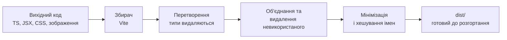

Історично розробники використовували Webpack, потім Parcel і Rollup. Сьогодні для нових проєктів клієнтської частини стандартом є **Vite**. Його ідея: під час розробки віддавати браузеру модулі напряму (ES-модулі), збираючи лише те, що запитується, тому сервер стартує миттєво, а оновлення модулів на льоту (HMR) працює за мілісекунди.

### Vite 8 і перехід на Rolldown

Vite 8 (2026) — найзначніше оновлення з часів виходу: замість двох різних збирачів (esbuild — для розробки, Rollup — для виробничої збірки) тепер єдиний інструмент **Rolldown**, написаний на мові Rust і сумісний з Rollup, а перетворення коду виконує Oxc. Практичні наслідки:

- виробнича збірка прискорилася в рази (повідомляється про прискорення до 10–30 разів на великих проєктах);
- поведінка під час розробки і збірки стала однаковою, що усунуло клас помилок «працює в dev, ламається в production»;
- більша частина існуючих конфігурацій працює без змін, але налаштування, які раніше належали Rollup, перейменовано (`rollupOptions` → `rolldownOptions`), а деякі форми запису вилучено.

Створення проєкту та команди:

```bash
npm create vite@latest my-app -- --template react-ts
cd my-app
npm install

npm run dev       # сервер розробки
npm run build     # виробнича збірка в dist/
npm run preview   # локальний перегляд збірки
```

Мінімальна конфігурація:

```typescript
// vite.config.ts
import { defineConfig } from "vite";
import react from "@vitejs/plugin-react";

export default defineConfig({
    plugins: [react()],
    server: {
        port: 5173,
        proxy: {
            // Перенаправлення запитів до API на серверну частину під час розробки
            "/api": "http://localhost:3000",
        },
    },
    build: {
        sourcemap: true,
    },
});
```

Налаштування `proxy` корисне саме на розробці: браузер вважає, що клієнтська й серверна частини живуть на одній адресі, тож не потрібні складні налаштування CORS.

> **Змінні середовища у Vite.** У клієнтський код потрапляють лише змінні з префіксом `VITE_` (`import.meta.env.VITE_API_URL`). Вони **вбудовуються в збірку й видимі кожному користувачу**, тому секрети (ключі API, паролі) в них зберігати категорично не можна.

### Аналіз розміру збірки

Розмір JavaScript безпосередньо впливає на швидкість завантаження, особливо на мобільних пристроях, тому його потрібно **вимірювати, а не вгадувати**. Візуалізатори збірки показують у вигляді карти, які модулі й бібліотеки займають найбільше місця.

```bash
npm install --save-dev rollup-plugin-visualizer
```

```typescript
import { visualizer } from "rollup-plugin-visualizer";

export default defineConfig({
    plugins: [
        react(),
        // Звіт створюється лише коли ANALYZE=true
        process.env.ANALYZE && visualizer({ filename: "dist/stats.html", gzipSize: true, open: true }),
    ],
});
```

```bash
ANALYZE=true npm run build
```

> Оскільки Vite 8 працює на Rolldown, уточніть сумісність плагіна з вашою версією (існують також спеціалізовані плагіни для Rolldown); принцип роботи від цього не змінюється.

На що дивитися у звіті: великі бібліотеки, що використовуються лише в одному місці, дублікати однієї бібліотеки в різних версіях, цілі пакунки, імпортовані заради однієї функції. Типові способи зменшення:

- **Заміна важких бібліотек легшими**: `moment` (десятки кілобайтів) → `date-fns` (з імпортом окремих функцій) або вбудований API `Intl` та Temporal (лекція 16).
- **Імпорт лише потрібного**: `import { debounce } from "lodash-es"`, а не весь `lodash`.
- **Розділення коду та відкладене завантаження** — тема лекції 15, де ми розглянемо `React.lazy`, `manualChunks`-подібні налаштування Vite 8 і бюджети продуктивності.

Перевірити, скільки «важить» бібліотека до її встановлення, можна на сайті bundlephobia.com.

## Docker для локальної розробки

### Концепція контейнеризації

Класична проблема: «у мене працює», а у колеги — ні, бо різні версії Node.js, бази даних, системні бібліотеки. **Контейнер** упаковує застосунок разом з усім його оточенням в ізольований, відтворюваний пакет. На відміну від віртуальної машини, контейнер не містить власної операційної системи, а використовує ядро хоста, тому запускається за секунди й займає мало ресурсів.

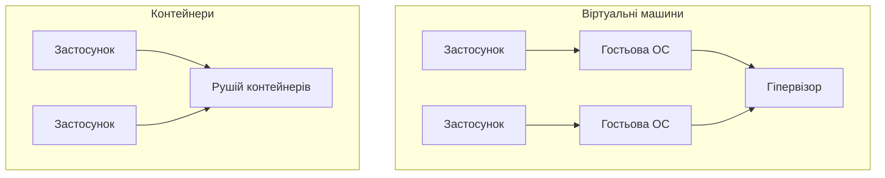

Ключові поняття: **образ** (image) — незмінний шаблон з файлами й залежностями; **контейнер** — запущений екземпляр образу; **Dockerfile** — інструкція побудови образу; **реєстр** — сховище образів (Docker Hub, GitHub Container Registry); **том** (volume) — збереження даних поза життєвим циклом контейнера.

У цій лекції ми розглядаємо Docker як засіб **локальної розробки**: підняти базу даних і допоміжні сервіси однією командою. Виробничі образи, їх безпека й розгортання — тема лекції 15.

### Dockerfile для середовища розробки

```dockerfile
# Dockerfile.dev
FROM node:24-alpine

WORKDIR /app

# Спочатку лише маніфести залежностей — шар кешується, поки вони не змінилися
COPY package*.json ./
RUN npm ci

COPY . .

EXPOSE 3000
CMD ["npm", "run", "dev"]
```

Порядок інструкцій принципово важливий для швидкості: Docker кешує кожен шар і перебудовує лише ті, що змінилися, та всі наступні. Тому рідко змінювані кроки (встановлення залежностей) ставлять **перед** часто змінюваними (копіювання коду). Використовуйте поточну LTS-версію Node.js (на момент написання — 24; Node.js 26 стане LTS у жовтні 2026 року) і фіксуйте основну версію в образі.

Файл `.dockerignore` не дозволяє потрапити в образ зайвому — і секретам:

```text
node_modules
dist
.git
.env
*.log
coverage
```

### Docker Compose: кілька сервісів разом

Реальний застосунок складається з кількох частин: серверна частина, база даних, кеш. **Docker Compose** описує їх в одному файлі й запускає разом. У сучасному форматі файл називається `compose.yaml`, а верхнього поля `version:` більше немає: воно застаріло й ігнорується.

```yaml
# compose.yaml
services:
  api:
    build:
      context: .
      dockerfile: Dockerfile.dev
    ports:
      - "3000:3000"
    environment:
      DATABASE_URL: postgres://app:app@db:5432/app
    depends_on:
      db:
        condition: service_healthy
    develop:
      watch:
        - action: sync
          path: ./src
          target: /app/src
        - action: rebuild
          path: package.json

  db:
    image: postgres:18-alpine
    environment:
      POSTGRES_USER: app
      POSTGRES_PASSWORD: app
      POSTGRES_DB: app
    ports:
      - "5432:5432"
    volumes:
      - pgdata:/var/lib/postgresql
    healthcheck:
      test: ["CMD-SHELL", "pg_isready -U app"]
      interval: 5s
      timeout: 3s
      retries: 10

volumes:
  pgdata:
```

Кілька пояснень. Сервіси бачать один одного **за іменами**: з `api` базу видно як хост `db`. `healthcheck` разом з `depends_on.condition: service_healthy` гарантує, що серверна частина стартує лише після готовності бази. Секція `develop.watch` — сучасна альтернатива монтуванню томів: Compose синхронізує зміни коду в контейнер, а при зміні `package.json` перебудовує образ. Пароль `app` годиться лише для локальної розробки; у виробництві секрети так не зберігають (лекції 15 та 16).

Основні команди (команда `docker compose` без дефісу замінила старий окремий інструмент `docker-compose`):

```bash
docker compose up              # запустити всі сервіси
docker compose up -d --build   # у фоні, з перебудовою образів
docker compose watch           # запуск з синхронізацією змін коду
docker compose logs -f api     # слідкувати за журналом сервісу
docker compose exec api sh     # командний рядок усередині контейнера
docker compose down            # зупинити
docker compose down -v         # зупинити й видалити томи (дані бази будуть втрачені!)
```

Практична порада для курсу: типова схема — **база даних у контейнері, а серверна й клієнтська частини запущені локально** (`npm run dev`), що дає найшвидший цикл налагодження; весь застосунок у Compose запускають для перевірки «як у виробництві».

## Налаштування VS Code для продуктивності

Редактор — найчастіше використовуваний інструмент розробника, і його налаштування окупається щодня. VS Code залишається найпоширенішим редактором, а навколо нього розвиваються й ШІ-асистенти для написання коду (про них — у лекції 16).

**Обов'язкові розширення для проєкту:** ESLint, Prettier, а також «Error Lens» (показує помилки прямо в рядку), «GitLens» (авторство рядків та історія), Docker, Thunder Client або REST Client (перевірка API), «Pretty TypeScript Errors» (читабельні помилки типів). Для React корисні підказки імпортів та фрагменти (snippets) компонентів.

**Спільні налаштування проєкту** зберігайте в `.vscode/` у репозиторії, щоб уся команда мала однакову поведінку: `settings.json` (форматування при збереженні, показано вище), `extensions.json` (рекомендовані розширення) та `launch.json` (конфігурація налагодження).

```json
{
  "version": "0.2.0",
  "configurations": [
    {
      "name": "Налагодження серверної частини",
      "type": "node",
      "request": "launch",
      "runtimeArgs": ["--inspect", "--watch", "src/index.ts"],
      "cwd": "${workspaceFolder}",
      "console": "integratedTerminal"
    }
  ]
}
```

Така конфігурація запускає Node.js у режимі налагодження, і точки зупину в `.ts`-файлах працюють без додаткової збірки.

**Фрагменти (snippets)** прискорюють написання шаблонного коду. Приклад власного фрагмента для React-компонента (`Файл → Налаштування → Налаштувати фрагменти користувача`):

```json
{
  "React-компонент": {
    "prefix": "rfc",
    "body": [
      "interface ${1:Name}Props {",
      "    $2",
      "}",
      "",
      "export function ${1:Name}({ $3 }: ${1:Name}Props) {",
      "    return (",
      "        <div>$0</div>",
      "    );",
      "}"
    ]
  }
}
```

Нарешті, вивчіть гарячі клавіші: багаторядкове виділення (`Alt+Click`), виділення наступного входження (`Ctrl+D`), перейменування символу в усьому проєкті (`F2`), швидкі виправлення (`Ctrl+.`), перехід до визначення (`F12`), палітра команд (`Ctrl+Shift+P`). Щоденна економія — десятки хвилин.

## Висновки та найкращі практики

### Інтеграція інструментів у єдиний процес

Окремі інструменти цінні, але справжня сила — у їх поєднанні в єдиний «конвеєр якості». Усе, що можна автоматизувати, має бути автоматизовано, і кожен рівень ловить помилки, що пройшли попередній:

1. **Редактор** — підказки, форматування при збереженні, підсвічування помилок типів;
2. **pre-commit** — `lint-staged` (ESLint + Prettier для змінених файлів) і, за можливості, перевірка типів;
3. **commit-msg** — перевірка формату повідомлення;
4. **CI на сервері** — повна перевірка типів, лінтер, тести та збирання; результат блокує злиття PR.

Скрипти в `package.json` — єдина «мова» команди для всіх цих кроків:

```json
{
  "scripts": {
    "dev": "vite",
    "build": "tsc --noEmit && vite build",
    "typecheck": "tsc --noEmit",
    "lint": "eslint .",
    "format": "prettier --write .",
    "format:check": "prettier --check .",
    "test": "vitest run",
    "check": "npm run typecheck && npm run lint && npm run format:check && npm run test",
    "prepare": "husky"
  }
}
```

Скрипт `check` запускає ті самі перевірки, що й конвеєр, тож розробник може переконатися в успіху ще до відправки змін.

### Баланс між якістю та продуктивністю

Занадто суворі правила й повільні перевірки шкодять не менше, ніж їх відсутність: розробники починають їх обходити. Ознаки здорового процесу: перевірки перед комітом виконуються за секунди; правила узгоджені командою, а не нав'язані одним ентузіастом; нові правила вводяться спочатку як попередження (`warn`), а тоді стають помилками; в разі помилкових спрацьовувань правило налаштовують чи вимикають, замість того щоб привчати всіх до `--no-verify`.

### Командні стандарти

Зафіксуйте домовленості письмово: файл `CONTRIBUTING.md` (як запустити проєкт, правила комітів і гілок), `README.md`, шаблон PR, `.editorconfig` та спільні налаштування редактора. Для нових членів команди це скорочує час входу з тижнів до днів. Те саме стосується й ШІ-асистентів: файл `AGENTS.md` у корені репозиторію (відкритий формат, який читають більшість агентів для програмування) описує їм команди збирання, правила стилю та обмеження — докладніше в лекції 16.

### Безперервна інтеграція: перший погляд

Щоб побачити, як усе зв'язується, наведемо мінімальний робочий процес GitHub Actions, що перевіряє кожен пул-реквест. Докладно CI/CD ми розберемо в лекції 15.

```yaml
# .github/workflows/ci.yml
name: CI

on:
  pull_request:
  push:
    branches: [main]

permissions:
  contents: read

jobs:
  check:
    runs-on: ubuntu-latest
    steps:
      - uses: actions/checkout@v6
      - uses: actions/setup-node@v6
        with:
          node-version: 24
          cache: npm
      - run: npm ci
      - run: npm run check
      - run: npm run build
```

Зверніть увагу на три деталі: `permissions: contents: read` обмежує права токена мінімально необхідними (принцип найменших привілеїв); `npm ci` встановлює залежності точно за `package-lock.json`, на відміну від `npm install`; а версії дій позначено мажорними тегами (у виробництві безпечніше фіксувати їх повним хешем коміту — докладно в лекції 16).

### Ключові висновки лекції

Архітектура визначає **правила гри**: де розташована логіка, у який бік спрямовано залежності, як обробляються помилки. Інструменти **змушують ці правила виконувати** без залежності від людської уважності. Разом вони забезпечують проєкту довге й здорове життя. Пам'ятайте про дві поради, які варто винести з лекції:

1. **Починайте просто.** Шарова структура, інтерфейси для зовнішніх залежностей, централізована обробка помилок і базовий набір автоматичних перевірок дають 90% користі при мінімальній складності.
2. **Автоматизуйте дисципліну, а не покладайтеся на неї.** Якщо правило можна перевірити машиною — нехай його перевіряє машина, а рецензенти зосередяться на сутності змін.

У наступній лекції ми продовжимо цей шлях: подивимося, як зробити застосунок **швидким** (продуктивність та оптимізація), а потім — як **доставити його до користувачів** безпечно й надійно (DevOps).

### Тенденції розвитку інструментів

Світ інструментів змінюється швидко: ще кілька років тому типовими були Webpack, `.eslintrc` і Create React App, а сьогодні — Vite на Rolldown, плоска конфігурація ESLint і нативний компілятор TypeScript. Тенденція очевидна: **інструменти стають швидшими (їх переписують на Rust і Go), простішими в налаштуванні та тісніше інтегруються з ШІ-асистентами**. Тому важливо вивчати не окремі команди, а принципи: чому існують лінтер, форматер, збирач і контейнер — і тоді перехід на нове покоління інструментів не вимагатиме перенавчання.
