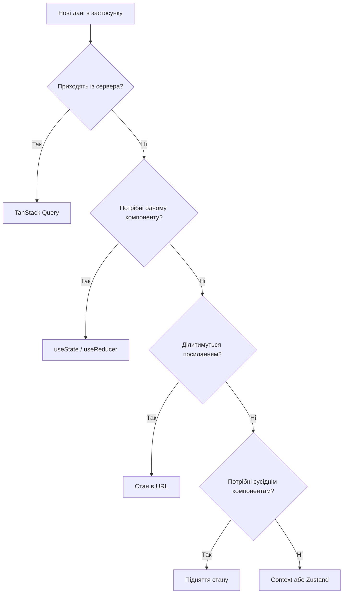
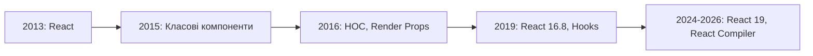
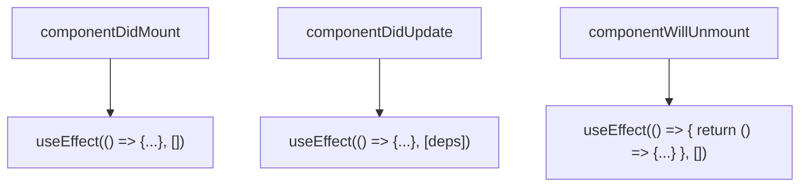
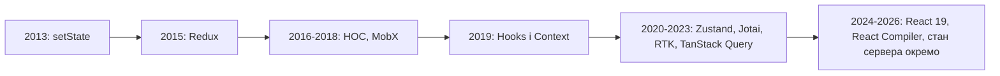
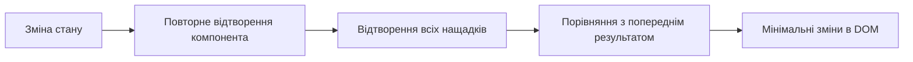

# Управління станом у React (хуки, локальний і глобальний стан)

## План лекції

1. Стан як центральна проблема інтерфейсу
2. Вступ до React Hooks
3. useState: локальний стан
4. useEffect: синхронізація та побічні ефекти
5. Власні хуки
6. useReducer: складні переходи стану
7. Context API: спільний стан
8. Стан сервера та TanStack Query
9. Глобальний клієнтський стан: Zustand, Redux Toolkit
10. Збереження стану
11. Продуктивність і React Compiler
12. Тестування та найкращі практики


## Стан інтерфейсу

### UI = функція від стану

**Стан** — дані, що змінюються з часом і впливають на вигляд сторінки

- Props рухаються зверху вниз і не змінюються компонентом
- Стан компонент «пам'ятає» між відтвореннями
- Зміна стану → нове відтворення

💡 Головне питання: **де зберігати цей стан і хто його змінює?**


## Види стану

### Різні види — різні місця

| Вид стану | Приклад | Де зберігати |
|-----------|---------|--------------|
| Локальний стан інтерфейсу | Модальне вікно, вкладка | `useState`, `useReducer` |
| Стан форми | Поля, помилки | `useState`, `useReducer` |
| Спільний для сусідів | Вибраний елемент | Підняття стану |
| Стан в URL | Фільтри, сторінка | Параметри маршруту (лекція 09) |
| Стан сервера | Список товарів | TanStack Query |
| Глобальний клієнтський | Тема, кошик | Context, Zustand, Redux Toolkit |
| Збережений | Налаштування | `localStorage`, IndexedDB |


## Де зберігати новий стан?



**Золоте правило:** стан живе якомога ближче до місця використання


## Вступ до React Hooks

### Що таке Hooks?

**Hooks** — функції, що дають функціональним компонентам стан та побічні ефекти

**До Hooks (до 2019):**
- Стан лише в класових компонентах
- `this`, прив'язка методів
- HOC і Render Props → «пекло обгорток»

**Після Hooks:**
- ✅ Стан у функціональних компонентах
- ✅ Повторне використання логіки через власні хуки
- ✅ Менше шаблонного коду


## Історія Hooks



**Три проблеми, які розв'язали хуки:**
- Повторне використання логіки зі станом
- Великі компоненти зі змішаною логікою
- Класи заплутують людей і машини


## Правила хуків

### ⚠️ Критично важливі

**1. Викликайте хуки лише на верхньому рівні** — React зіставляє хуки за порядком викликів

```javascript
// ❌ НЕПРАВИЛЬНО
if (userId) {
    const [user, setUser] = useState(null);
}

// ✅ ПРАВИЛЬНО
const [user, setUser] = useState(null);
if (!userId) return <div>Користувача не вибрано</div>;
```

**2. Викликайте хуки лише з компонентів і власних хуків**

💡 Виняток: `use` (React 19) можна викликати в умовах

🛠️ `eslint-plugin-react-hooks` — з першого дня


## Огляд хуків

| Хук / API | Призначення |
|-----------|-------------|
| `useState` | Локальний стан |
| `useEffect` | Синхронізація із зовнішніми системами |
| `useEffectEvent` (19.2) | Подія всередині ефекту |
| `useReducer` | Складні переходи стану |
| `useContext` / `use` (19) | Читання контексту |
| `useSyncExternalStore` | Підписка на зовнішнє джерело |
| `useMemo`, `useCallback` | Ручна мемоїзація |
| `useTransition`, `useDeferredValue` | Пріоритет оновлень |
| `useActionState`, `useOptimistic` (19) | Форми та оптимістичні оновлення |


## useState: основи

```javascript
import { useState } from 'react';

function Counter() {
    // [поточне значення, функція оновлення]
    const [count, setCount] = useState(0);

    return (
        <div>
            <h2>Лічильник: {count}</h2>
            <button onClick={() => setCount(count + 1)}>+1</button>
        </div>
    );
}
```

- Початкове значення — лише під час першого відтворення
- Виклик `setCount` **не змінює** `count` негайно — він планує нове відтворення
- `count++` не спрацює: React про зміну не дізнається


## useState: типи даних

```javascript
// Примітиви
const [name, setName] = useState('');
const [isActive, setIsActive] = useState(false);

// Об'єкти та масиви
const [user, setUser] = useState({ name: '', email: '' });
const [skills, setSkills] = useState(['JavaScript', 'React']);
```

💡 Незалежні значення → окремі `useState`

💡 Значення, що завжди змінюються разом (`x` і `y`) → один об'єкт


## Оновлення стану

### Значення чи функція?

```javascript
// ❌ +1, а не +3: усі виклики бачать той самий count
setCount(count + 1);
setCount(count + 1);
setCount(count + 1);

// ✅ +3: кожен виклик отримує результат попереднього
setCount(prev => prev + 1);
setCount(prev => prev + 1);
setCount(prev => prev + 1);
```

**Правило:** нове значення залежить від попереднього → **функціональна форма**

💡 `crypto.randomUUID()` для id замість `Date.now()`


## Незмінність (immutability)

React порівнює стан **за посиланням**

```javascript
// ❌ Мутація: React не виявить зміну
profile.personal.name = newName;
setProfile(profile);

// ✅ Новий об'єкт на кожному рівні
setProfile(prev => ({
    ...prev,
    personal: { ...prev.personal, name: newName }
}));
```

| Операція | ❌ Мутація | ✅ Новий масив |
|----------|-----------|---------------|
| Додати | `push` | `[...arr, item]` |
| Видалити | `splice` | `filter` |
| Замінити | `arr[i] = x` | `map` |
| Відсортувати | `sort` | `toSorted` |

🛠️ Глибока вкладеність → сплощення стану або **Immer**


## Ледача ініціалізація

```javascript
// ❌ Викликається при кожному відтворенні
const [data, setData] = useState(processLargeDataset(input));

// ✅ Викликається один раз
const [data, setData] = useState(() => processLargeDataset(input));

// Типовий приклад
const [prefs, setPrefs] = useState(() => {
    const saved = localStorage.getItem('userPreferences');
    return saved ? JSON.parse(saved) : defaultPreferences;
});
```


## Не зберігайте обчислюване

```javascript
// ❌ Дублювання: треба синхронізувати вручну
const [fullName, setFullName] = useState('');
useEffect(() => {
    setFullName(`${firstName} ${lastName}`);
}, [firstName, lastName]);

// ✅ Обчислюємо під час відтворення
const fullName = `${firstName} ${lastName}`;
```

**Принцип:** мінімальний набір першоджерел, решта — похідні


## Підняття стану

Два компоненти потребують одного значення → стан у **найближчому спільному предку**

```javascript
function TemperaturePanel() {
    const [celsius, setCelsius] = useState(20);

    return (
        <>
            <CelsiusInput value={celsius} onChange={setCelsius} />
            <FahrenheitDisplay celsius={celsius} />
        </>
    );
}
```

Найпростіший спосіб ділитися станом — до Context переходьте, коли props проходять надто глибоко


## useEffect: синхронізація

### Що таке побічний ефект?

Операція, що виходить за межі компонента:
- 🌐 Запити до API
- 📡 Підписки на події
- ⏰ Таймери
- 🎯 Робота з DOM

**Ефект = синхронізація із зовнішньою системою**, а не «код після відтворення»

Відтворення має бути **чистим**: однакові props і стан → однакова розмітка


## useEffect: завантаження даних

```javascript
useEffect(() => {
    const controller = new AbortController();

    async function fetchUser() {
        try {
            const res = await fetch(`/api/users/${userId}`, {
                signal: controller.signal
            });
            if (!res.ok) throw new Error(`Помилка ${res.status}`);
            setUser(await res.json());
        } catch (err) {
            if (err.name !== 'AbortError') setError(err.message);
        }
    }

    fetchUser();
    return () => controller.abort(); // скасувати застарілий запит
}, [userId]);
```

- `response.ok` — `fetch` не вважає 404/500 помилкою
- `AbortController` розв'язує **гонку запитів**


## Масив залежностей

```javascript
// Після КОЖНОГО відтворення
useEffect(() => { /* ... */ });

// ОДИН РАЗ після монтування
useEffect(() => { /* ... */ }, []);

// При зміні count
useEffect(() => { document.title = `Лічильник: ${count}`; }, [count]);
```

**Правила:**
- Включайте **все**, що ефект читає
- Лінтер знаходить пропущені залежності
- Об'єкти й функції створюються заново → залежіть від примітивів (`user.id`)


## Очищення (cleanup)

```javascript
useEffect(() => {
    const connection = chatAPI.connect(roomId);
    connection.on('message', msg => setMessages(prev => [...prev, msg]));

    return () => connection.disconnect(); // очищення
}, [roomId]);
```

**Cleanup викликається:**
- Перед наступним запуском ефекту
- Перед розмонтуванням

Типові випадки: таймери, `addEventListener`, підписки, з'єднання


## Строгий режим

### Подвійний запуск ефектів у розробці

`<StrictMode>`: запуск → очищення → повторний запуск

- Перевіряє, що очищення справді повертає систему у вихідний стан
- Відбувається **лише в розробці**
- Дублюються запити чи з'єднання → **немає або неправильне очищення**

❌ Не боріться з подвійним запуском прапорцями — виправляйте очищення


## Життєвий цикл через useEffect



💡 Зіставлення приблизне. Клас мислить **моментами життя**, ефект — **синхронізацією** з поточними props


## Коли ефект не потрібен

- **Перетворення даних для відображення** → обчислюйте під час відтворення
- **Реакція на дію користувача** → обробник події, а не ефект
- **Скидання стану при зміні props** → атрибут `key`: `<Profile key={userId} />`
- **Завантаження даних** → TanStack Query (див. далі)


## useEffectEvent (React 19.2)

Прочитати найсвіжіше значення, **не перезапускаючи** ефект

```javascript
import { useEffect, useEffectEvent } from 'react';

function ChatRoom({ roomId, theme }) {
    const onConnected = useEffectEvent(() => {
        showNotification('Підключено!', theme); // завжди актуальна тема
    });

    useEffect(() => {
        const connection = createConnection(roomId);
        connection.on('connected', () => onConnected());
        connection.connect();
        return () => connection.disconnect();
    }, [roomId]); // theme не потрібна
}
```

Викликається лише з ефектів


## Власні хуки

### Повторне використання логіки

Функція з префіксом `use`, що викликає інші хуки

- Кожен виклик → **власна копія стану**
- Хук поділяє **логіку**, а не дані
- Префікс `use` потрібен лінтеру

```javascript
function UserList() {
    const { data: users, loading, error } = useFetch('/api/users');

    if (loading) return <div>Завантаження...</div>;
    if (error) return <div>Помилка: {error}</div>;
    return <ul>{users.map(u => <li key={u.id}>{u.name}</li>)}</ul>;
}
```

⚠️ `useFetch` — навчальна модель: немає кешу, повторів, об'єднання запитів


## useLocalStorage

```javascript
function useLocalStorage(key, initialValue) {
    const [value, setValue] = useState(() => {
        try {
            const saved = localStorage.getItem(key);
            return saved !== null ? JSON.parse(saved) : initialValue;
        } catch {
            return initialValue;
        }
    });

    useEffect(() => {
        try {
            localStorage.setItem(key, JSON.stringify(value));
        } catch (error) {
            console.error('Не вдалося зберегти:', error);
        }
    }, [key, value]);

    return [value, setValue];
}
```

`try/catch`: приватний режим, пошкоджений JSON


## useDebounce

```javascript
function useDebounce(value, delay) {
    const [debounced, setDebounced] = useState(value);

    useEffect(() => {
        const timer = setTimeout(() => setDebounced(value), delay);
        return () => clearTimeout(timer);
    }, [value, delay]);

    return debounced;
}

const debouncedSearch = useDebounce(searchTerm, 500);
// Порожній запит не надсилаємо
{debouncedSearch && <SearchResults query={debouncedSearch} />}
```

💡 `encodeURIComponent` для параметрів запиту


## useSyncExternalStore

### Підписка на зовнішні джерела

```javascript
function useMediaQuery(query) {
    return useSyncExternalStore(
        (callback) => {
            const media = window.matchMedia(query);
            media.addEventListener('change', callback);
            return () => media.removeEventListener('change', callback);
        },
        () => window.matchMedia(query).matches, // поточне значення
        () => false                              // для сервера
    );
}
```

На ньому побудовані Zustand, Redux, TanStack Query

💡 Готові хуки — `usehooks-ts`


## useReducer: коли використовувати

**Reducer** — чиста функція: `(стан, дія) → новий стан`

Компонент каже «сталася подія Y», reducer вирішує, як змінюється стан

**Використовуйте, коли:**
- Складна структура стану
- Багато способів його змінити
- Одна подія змінює кілька полів узгоджено
- Логіку треба тестувати окремо

💡 Лічильник чи перемикач → `useState`


## useReducer: кошик

```javascript
function cartReducer(state, action) {
    switch (action.type) {
        case 'ADD_ITEM': {
            const existing = state.items.find(i => i.id === action.payload.id);
            if (existing) {
                return {
                    ...state,
                    items: state.items.map(i =>
                        i.id === existing.id ? { ...i, quantity: i.quantity + 1 } : i
                    )
                };
            }
            return {
                ...state,
                items: [...state.items, { ...action.payload, quantity: 1 }]
            };
        }
        case 'REMOVE_ITEM':
            return { ...state, items: state.items.filter(i => i.id !== action.payload) };
        case 'CLEAR_CART':
            return { ...state, items: [] };
        default:
            return state;
    }
}
```

⚠️ `case` із оголошеннями → фігурні дужки


## useReducer: підсумки

```javascript
const [cart, dispatch] = useReducer(cartReducer, initialCart);

// Підсумки обчислюємо, а не зберігаємо
const subtotal = cart.items.reduce((sum, i) => sum + i.price * i.quantity, 0);
const total = subtotal * (1 - cart.discount);

<button onClick={() => dispatch({ type: 'REMOVE_ITEM', payload: item.id })}>
    Видалити
</button>
```

💡 Гроші зберігайте в копійках (цілі числа)


## useReducer: форма

```javascript
function formReducer(state, action) {
    switch (action.type) {
        case 'SET_FIELD':
            return { ...state, values: { ...state.values, [action.field]: action.value } };
        case 'SUBMIT_START':
            return { ...state, isSubmitting: true, submitError: null };
        case 'SUBMIT_SUCCESS':
            return { ...state, isSubmitting: false, submitSuccess: true };
        case 'SUBMIT_FAILURE':
            return { ...state, isSubmitting: false, submitError: action.error };
        default:
            return state;
    }
}
```

Один `dispatch` → узгоджений стан, без «проміжних» комбінацій


## useReducer: список із фільтрами

```javascript
case 'FILTERS_CHANGED':
    return {
        ...state,
        filters: { ...state.filters, ...action.payload },
        page: 1 // нові фільтри → перша сторінка
    };
case 'SORT_CHANGED':
    return { ...state, sort: action.payload, page: 1 };
case 'PAGE_CHANGED':
    return { ...state, page: action.payload };
```

- Умова скидання сторінки записана **в одному місці**
- У reducer **немає** даних, `loading`, `error` — це стан сервера
- Назви дій — події, що відбулися (`FILTERS_CHANGED`)


## Context API: проблема

### Prop drilling

```javascript
<Layout user={user} theme={theme}>
    <Dashboard user={user} theme={theme}>
        <UserProfile user={user} theme={theme} />
    </Dashboard>
</Layout>
```

❌ Багатослівний код
❌ Проміжні компоненти прив'язані до чужих даних
❌ Розмите джерело істини


## Context API: рішення

```javascript
const ThemeContext = createContext(null);

export function ThemeProvider({ children }) {
    const [theme, setTheme] = useState('light');
    const toggleTheme = () => setTheme(p => (p === 'light' ? 'dark' : 'light'));

    // React 19: контекст — це компонент
    return (
        <ThemeContext value={{ theme, toggleTheme }}>
            {children}
        </ThemeContext>
    );
}

export function useTheme() {
    const context = useContext(ThemeContext);
    if (!context) throw new Error('useTheme потрібно викликати всередині ThemeProvider');
    return context;
}
```

💡 `<Context.Provider>` — старий запис, ще працює


## use(): читання контексту

```javascript
import { use } from 'react';

function Panel({ isOpen }) {
    if (!isOpen) return null;

    const { theme } = use(ThemeContext); // допустимо після умови
    return <div className={`panel-${theme}`}>...</div>;
}
```

- `use` читає контекст і (у React 19) проміси
- На відміну від `useContext`, можна викликати в умовах і циклах


## Кілька контекстів

```javascript
<UserProvider>
    <ThemeProvider>
        <NotificationProvider>
            <Routes>{/* маршрути */}</Routes>
        </NotificationProvider>
    </ThemeProvider>
</UserProvider>

// Згортання піраміди
function ComposeProviders({ providers, children }) {
    return providers.reduceRight(
        (child, Provider) => <Provider>{child}</Provider>,
        children
    );
}
```

Різні за природою дані → **окремі контексти**


## Context: оптимізація

⚠️ Змінилося `value` → відтворюються **усі** споживачі

```javascript
// ❌ Нове посилання при кожному відтворенні провайдера
<AppContext value={{ user, setUser, settings, setSettings }}>

// ✅ 1. Стабілізація через useMemo
const value = useMemo(
    () => ({ user, setUser, settings, setSettings }),
    [user, settings]
);

// ✅ 2. Розділення за частотою змін
<UserStateContext value={user}>
    <UserDispatchContext value={setUser}>{children}</UserDispatchContext>
</UserStateContext>
```

✅ 3. Розділення за відповідальністю · ✅ 4. Селектори (Zustand)

💡 React Compiler мемоїзує `value`, але розділення контекстів — архітектурне рішення


## Context + useReducer

```javascript
export function CartProvider({ children }) {
    const [state, dispatch] = useReducer(cartReducer, initialCart);

    const value = useMemo(() => {
        const subtotal = state.items.reduce((s, i) => s + i.price * i.quantity, 0);
        return {
            items: state.items,
            subtotal,
            total: subtotal * (1 - state.discount),
            addItem: (item) => dispatch({ type: 'ADD_ITEM', payload: item }),
            removeItem: (id) => dispatch({ type: 'REMOVE_ITEM', payload: id }),
            clearCart: () => dispatch({ type: 'CLEAR_CART' })
        };
    }, [state]);

    return <CartContext value={value}>{children}</CartContext>;
}
```

Компоненти бачать лише `useCart()` — реалізацію можна замінити


## Провайдер автентифікації

```javascript
useEffect(() => {
    const controller = new AbortController();
    fetch('/api/auth/me', { credentials: 'include', signal: controller.signal })
        .then(res => (res.ok ? res.json() : null))
        .then(setUser)
        .catch(() => setUser(null))
        .finally(() => setLoading(false)); // loading потрібен маршрутам
    return () => controller.abort();
}, []);
```

🔒 Токен **не** в `localStorage`

- Сервер ставить cookie з `HttpOnly`, `Secure`, `SameSite`
- `credentials: 'include'`
- XSS не прочитає `HttpOnly`-cookie (лекція 05)


## Коли Context не підходить

- Значення змінюється **дуже часто** (курсор, таймер, анімація)
- Стан великий, а різні компоненти читають **різні частини**
- Потрібні devtools, проміжні шари, збереження стану

→ зовнішні сховища (далі)

Але спочатку — принципово інший вид стану


## Стан сервера та клієнта

| Властивість | Стан клієнта | Стан сервера |
|-------------|--------------|--------------|
| Власник | Застосунок | Сервер і БД |
| Доступ | Синхронний | Асинхронний |
| Актуальність | Завжди актуальний | Може застаріти |
| Спільність | Лише цей застосунок | Змінюється іншими |

Дані сервера — це **кеш** чужого стану

**Завдання:** скасування запитів, дедуплікація, повтори, оновлення при поверненні на вкладку, інвалідація кешу

→ клієнтський стан: Context / Zustand; **стан сервера: TanStack Query**


## TanStack Query: читання

```javascript
const queryClient = new QueryClient();

<QueryClientProvider client={queryClient}>
    <App />
</QueryClientProvider>

function TodoList() {
    const { data: todos, isPending, error } = useQuery({
        queryKey: ['todos'],
        queryFn: fetchTodos
    });

    if (isPending) return <p>Завантаження...</p>;
    if (error) return <p>Помилка: {error.message}</p>;
    return <ul>{todos.map(t => <li key={t.id}>{t.text}</li>)}</ul>;
}
```

- Однаковий `queryKey` → один запит, спільні дані з кешу
- `['users', userId]` — окремий запис кешу; зміна `userId` → автоматичний запит
- v5: лише форма з об'єктом параметрів


## TanStack Query: зміни

```javascript
const queryClient = useQueryClient();

const mutation = useMutation({
    mutationFn: (text) => createTodo(text),
    onSuccess: () => {
        queryClient.invalidateQueries({ queryKey: ['todos'] }); // перезавантажити
    }
});

<button onClick={() => mutation.mutate('Нове завдання')} disabled={mutation.isPending}>
    Додати
</button>
```

Кеш, повтори, оптимістичні оновлення, devtools — «з коробки»

💡 Фільтри списку: reducer зберігає **вибір**, TanStack Query — **дані**: `queryKey: ['products', state.filters, state.page]`


## Еволюція глобального стану



**Тренд:** від складних рішень до простих

⚠️ Recoil (Meta) більше не розвивається → Jotai


## Zustand: створення сховища

```javascript
import { create } from 'zustand';

const useCounterStore = create((set) => ({
    count: 0,
    increment: () => set((state) => ({ count: state.count + 1 })),
    reset: () => set({ count: 0 })
}));

function Counter() {
    const count = useCounterStore((state) => state.count);
    const increment = useCounterStore((state) => state.increment);
    return <button onClick={increment}>{count}</button>;
}
```

- Без провайдера
- Селектори: відтворення лише при зміні підписаної частини
- `set` — поверхневе злиття
- Поточна версія — **v5** (React 18+)


## Zustand v5: селектори та useShallow

⚠️ Селектор повертає **новий об'єкт** → нескінченний цикл (`Maximum update depth exceeded`)

```javascript
import { useShallow } from 'zustand/shallow';

// ❌ Новий об'єкт при кожному виклику
const { filter, setFilter } = useTodoStore(s => ({ filter: s.filter, setFilter: s.setFilter }));

// ✅ useShallow порівнює вміст
const { filter, setFilter } = useTodoStore(
    useShallow(s => ({ filter: s.filter, setFilter: s.setFilter }))
);
```

❌ `useTodoStore()` без селектора — підписка на все сховище
❌ Методи-обчислювачі (`getFilteredTodos`) у сховищі — компонент не знає, що оновитися
✅ Похідні значення — в компоненті або власному хуку


## Zustand: middleware

```javascript
const useSettingsStore = create(
    persist(
        (set) => ({
            theme: 'light',
            setTheme: (theme) => set({ theme })
        }),
        {
            name: 'settings-storage',
            partialize: (state) => ({ theme: state.theme }) // лише дані
        }
    )
);

// Комбінування: devtools зовні, persist всередині
create(devtools(persist(creator, { name: 'app' }), { name: 'AppStore' }));
```

- `devtools` — дії в Redux DevTools
- `immer` — «мутація» чернетки
- v5: `persist` не записує початковий стан до першої зміни
- 🔒 Токени в `persist` не зберігаємо
- `version` + `migrate` при зміні структури


## Redux Toolkit

```javascript
const counterSlice = createSlice({
    name: 'counter',
    initialState: { value: 0 },
    reducers: {
        incremented: (state) => { state.value += 1; }, // Immer
        reset: (state) => { state.value = 0; }
    }
});

export const store = configureStore({
    reducer: { counter: counterSlice.reducer }
});

const value = useSelector((state) => state.counter.value);
const dispatch = useDispatch();
```

- RTK 2.x + React-Redux 9
- Великі командні проєкти, суворі конвенції, time-travel debugging
- Для більшості навчальних проєктів — надлишковий


## Jotai: атомарна модель

```javascript
const countAtom = atom(0);
const doubledAtom = atom((get) => get(countAtom) * 2); // похідний атом

const [count, setCount] = useAtom(countAtom);
const doubled = useAtomValue(doubledAtom);
```

- Стан розбито на незалежні **атоми**
- Компонент підписується лише на використані атоми


## Порівняння рішень

| | Context API | Zustand | Redux Toolkit |
|---|-------------|---------|---------------|
| **Складність** | Низька | Дуже низька | Середня |
| **Шаблонний код** | Середній | Мінімальний | Середній |
| **Оновлення споживачів** | Усі споживачі | Лише підписані | Лише підписані |
| **Devtools** | Немає | Middleware | Вбудовані |
| **Залежність** | Вбудований | Дуже мала | Більша |
| **Масштаб** | Малі й середні | Середні й великі | Великі |

**Вибір:** малі — локальний стан · середні — Context + `useReducer` / Zustand · великі — Zustand / RTK

Дані сервера — **завжди** TanStack Query


## Збереження стану

| Сховище | Обсяг | Операції | Застосування |
|---------|-------|----------|--------------|
| URL | Малий | Синхронні | Фільтри, сторінка — стан, яким діляться |
| `sessionStorage` | ~5 МБ | Синхронні | Дані вкладки |
| `localStorage` | ~5 МБ | Синхронні | Налаштування, чернетки |
| IndexedDB | Сотні МБ | Асинхронні | Офлайн, великі кеші |
| Cookie `HttpOnly` | Малий | Керує сервер | Сеанс автентифікації |

⚠️ `localStorage`: лише рядки, синхронний, доступний будь-якому скрипту сторінки


## Синхронізація між вкладками

```javascript
useEffect(() => {
    const handleStorage = (e) => {
        if (e.storageArea === localStorage && e.key === key && e.newValue !== null) {
            setValue(JSON.parse(e.newValue));
        }
    };

    window.addEventListener('storage', handleStorage);
    return () => window.removeEventListener('storage', handleStorage);
}, [key, setValue]);
```

- Подія `storage` — у всіх вкладках, **крім** тієї, де сталася зміна
- Без запису у сховище: `BroadcastChannel`


## IndexedDB

**Коли `localStorage` не вистачає:**
- 💾 Сотні МБ
- ⚡ Асинхронні операції
- 🗂️ Структуровані дані та індекси

```javascript
request.onupgradeneeded = () => {
    db.createObjectStore(storeName);
};
```

Сире API громіздке → обгортки `idb`, `Dexie`

Підходить для офлайн-режиму й великих кешів


## Продуктивність: як React відтворює



- За замовчуванням відтворюються **й нащадки**
- Для більшості застосунків це не проблема
- Проблеми: великі списки, важкі обчислення, надто часті відтворення


## React Compiler

**Інструмент часу збирання** — автоматична мемоїзація

- Стабільна версія **1.0** (жовтень 2025)
- Для нових проєктів — вмикати з початку
- Найкраще з React 19; React 17–18 → `react-compiler-runtime`
- Спирається на «Правила React» — лінт-правила в `eslint-plugin-react-hooks`

```javascript
// Тепер: пишемо просто, компілятор мемоїзує сам
function ProductList({ products, filters, onAdd }) {
    const visible = products.filter(p => p.category === filters.category);
    return visible.map(p => <ProductCard key={p.id} product={p} onAdd={onAdd} />);
}
```

💡 Наявні `useMemo`/`useCallback` масово не видаляйте — вони працюють; `"use no memo"` виключає компонент


## useMemo: мемоїзація обчислень

```javascript
const visibleProducts = useMemo(() => {
    return products
        .filter(p => p.category === filters.category)
        .filter(p => p.price <= filters.maxPrice)
        .sort((a, b) => b.price - a.price);
}, [products, filters]);

const statistics = useMemo(() => {
    if (visibleProducts.length === 0) return null; // захист від NaN
    const prices = visibleProducts.map(p => p.price);
    return { avgPrice: prices.reduce((s, p) => s + p, 0) / prices.length };
}, [visibleProducts]);
```

Тепер — **точний контроль**, а не повсякденний інструмент


## useCallback і React.memo

```javascript
const ProductCard = memo(function ProductCard({ product, onAddToCart }) {
    return <button onClick={() => onAddToCart(product)}>{product.name}</button>;
});

function ProductList({ products }) {
    const [cart, setCart] = useState([]);

    // Стабільне посилання: memo справді працює
    const handleAddToCart = useCallback((product) => {
        setCart(prev => [...prev, product]);
    }, []);

    return products.map(p => (
        <ProductCard key={p.id} product={p} onAddToCart={handleAddToCart} />
    ));
}
```

`useCallback` сам по собі нічого не прискорює — він працює **в парі з `memo`**

⚠️ Власне порівняння `memo` — крайній засіб


## Коли оптимізація не потрібна

```javascript
// ❌ Простий компонент
function SimpleButton({ text, onClick }) {
    return <button onClick={onClick}>{text}</button>;
}

// ❌ Оновлюється щосекунди — memo не допоможе
function Clock() { /* setInterval */ }

// ❌ Дрібне обчислення
const age = new Date().getFullYear() - birthYear;
```

**Потрібно:** важкі обчислення, великі списки, дорогі рядки таблиць

⚠️ Тисячі рядків → **віртуалізація** (`TanStack Virtual`, `react-window`)

**Спочатку виміряйте — React DevTools Profiler**


## useDeferredValue та useTransition

```javascript
const [query, setQuery] = useState('');
const deferredQuery = useDeferredValue(query); // «відстає» під час вводу

const results = items.filter(i => i.name.includes(deferredQuery));
```

- Поле введення лишається чутливим, важка частина відтворюється пізніше
- `useTransition`: `startTransition(() => setTab('reports'))` + `isPending` для індикатора


## Тестування логіки стану

- **Reducer, селектори** — чисті функції, тестуються без React
- `node:test` (лекція 02) або Vitest
- Хуки й Context — React Testing Library: `renderHook` + `wrapper` із провайдером
- Zustand — скидайте стан між тестами (глобальний об'єкт)

```javascript
test('ADD_ITEM збільшує кількість, якщо товар уже є', () => {
    let state = cartReducer(initialCart, { type: 'ADD_ITEM', payload: item });
    state = cartReducer(state, { type: 'ADD_ITEM', payload: item });
    assert.equal(state.items[0].quantity, 2);
});
```


## Найкращі практики

### Хуки та стан

1. ✅ Дотримуйтесь правил хуків, `eslint-plugin-react-hooks`
2. ✅ Починайте з локального стану
3. ✅ Не зберігайте обчислюване
4. ✅ Не мутуйте стан
5. ✅ Чесні залежності та очищення ефектів
6. ✅ Логіка — у власних хуках; доступ до Context — через власний хук


## Найкращі практики

### Архітектура та безпека

1. 🏗️ **Розділяйте стан сервера й клієнта**: API → TanStack Query
2. 🏗️ Розділяйте контексти за відповідальністю
3. 🏗️ Вузькі підписки: `useShallow` у Zustand v5
4. 🔒 Токени — не в `localStorage` (`HttpOnly`-cookie)
5. 🔒 Те, чим діляться посиланням, — в URL


## Найкращі практики

### Продуктивність

1. ⚡ Вимірюйте перед оптимізацією
2. ⚡ Вмикайте React Compiler у нових проєктах
3. ⚡ `useMemo`/`useCallback`/`memo` — для точного контролю
4. ⚡ Тестуйте логіку стану окремо від компонентів


## Типові помилки

### Чого уникати

❌ Усе — у глобальному стані
❌ Дані API в `useState` чи глобальному сховищі
❌ Мутація стану
❌ `useEffect` для обчислення похідних значень
❌ Ефект без очищення
❌ Новий об'єкт у `value` контексту
❌ Селектор Zustand, що створює новий об'єкт, без `useShallow`
❌ Токен у `localStorage`
