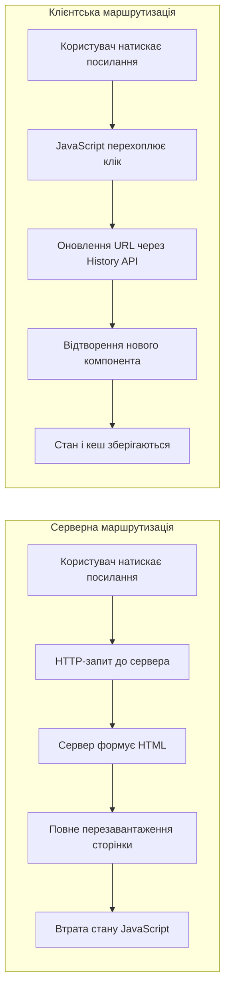
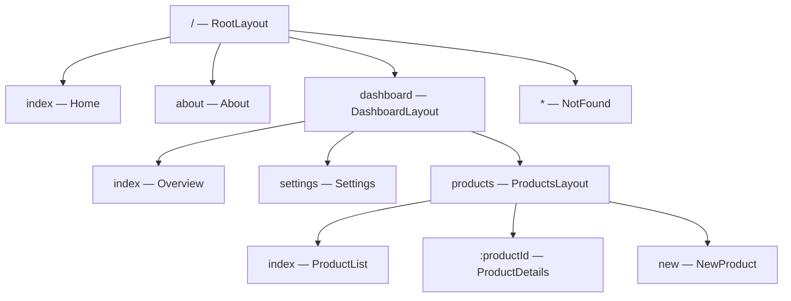
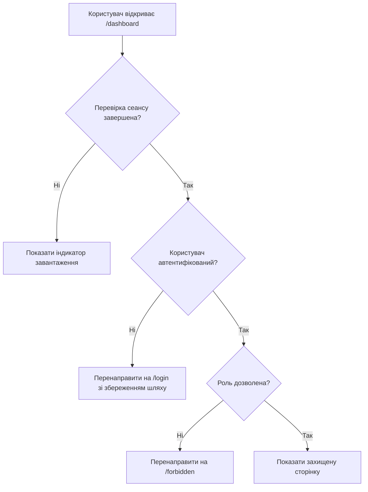
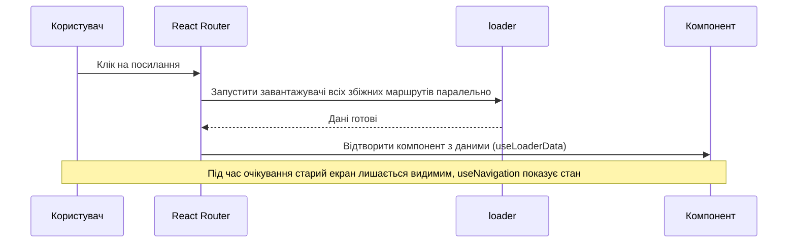

# Маршрутизація та навігація (React Router)

## План лекції

1. Вступ до клієнтської маршрутизації
2. Основи React Router
3. Динамічні маршрути та параметри
4. Вкладені маршрути та макети
5. Захищені маршрути та автентифікація
6. Програмна навігація
7. Режим даних: завантажувачі та дії
8. Ледаче завантаження та продуктивність
9. Режим фреймворку
10. Розгортання та тестування
11. Найкращі практики


## Навіщо застосунку маршрути

### Адреса — частина стану

URL дозволяє:
- 🔗 Надіслати посилання на конкретний екран
- ⭐ Додати сторінку в закладки
- ◀️ Повернутися кнопкою «Назад»
- 🔄 Оновити сторінку, не втративши місце

**Маршрутизація** — зіставлення адреси з тим, що відображається на екрані

Що користувач має вміти запам'ятати чи передати → **в URL**, а не в `useState`


## Серверна й клієнтська маршрутизація




## Переваги та ціна

**Переваги клієнтської маршрутизації:**
- ⚡ Швидкість — без завантаження нового документа
- ✨ Плавність — шапка й меню не відтворюються заново
- 💾 Стан, форми й кеш переживають навігацію
- 🎯 Відчуття нативного застосунку

**Ціна:**
- Історія переходів, сторінка «не знайдено»
- Керування фокусом і прокручуванням
- Налаштування сервера для прямих переходів за адресою
- Складніша індексація пошуковиками


## Основні поняття

- **URL як частина стану** — адреса відображає, що бачить користувач
- **History API** — `pushState` додає запис, `replaceState` замінює; подія `popstate` — «Назад»/«Вперед»
- **Декларативний опис** — відповідність шляхів і компонентів
- **Вкладені маршрути** — ієрархія адреси = ієрархія інтерфейсу


## Історія React Router

| Версія | Рік | Ключові зміни |
|--------|-----|---------------|
| v1–v3 | 2014–2016 | Статична конфігурація |
| v4 | 2017 | Маршрути як компоненти |
| v5 | 2019 | Hooks API |
| v6 | 2021 | Вкладені маршрути, `Outlet`, відносні шляхи |
| v6.4 | 2022 | Маршрутизатори даних: `loader`, `action` |
| **v7** | **2024** | **Об'єднання з Remix, єдиний пакет `react-router`, три режими** |

**Актуальна гілка — 7.x** (мінімум React 18)


## Три режими React Router

| Режим | Як визначаються маршрути | Що додає | Коли обирати |
|-------|--------------------------|----------|--------------|
| **Декларативний** | JSX: `<BrowserRouter>`, `<Routes>`, `<Route>` | Зіставлення URL, навігація, параметри | Простий SPA, навчання |
| **Режим даних** | Об'єкти в `createBrowserRouter` | `loader`, `action`, форми, межі помилок | SPA із завантаженням даних на переході |
| **Режим фреймворку** | `routes.ts` + плагін Vite | Серверне відтворення, типи, розбиття коду | Повноцінні застосунки, SEO |

Режими **додають** можливості один одному, ядро спільне


## Встановлення

```bash
npm create vite@latest my-app -- --template react
cd my-app

npm install react-router
```

⚠️ Не `react-router-dom` — у v7 усе в **`react-router`**


## Базова структура

```javascript
// src/main.jsx
import { BrowserRouter } from 'react-router';

createRoot(document.getElementById('root')).render(
    <StrictMode>
        <BrowserRouter>
            <App />
        </BrowserRouter>
    </StrictMode>
);

// src/App.jsx
import { Routes, Route } from 'react-router';

<Routes>
    <Route path="/" element={<Home />} />
    <Route path="/about" element={<About />} />
    <Route path="/contact" element={<Contact />} />
</Routes>
```

- `BrowserRouter` — стежить за історією
- `Routes` — вибирає найкращий збіг
- `Route` — шлях + елемент


## Міграція з v6

```bash
npm install react-router-dom@6   # останній v6: застереження про зміни
npm install react-router@latest  # перехід на v7
npm uninstall react-router-dom
```

```javascript
// Було
import { Link, useLocation } from 'react-router-dom';
// Стало
import { Link, useLocation } from 'react-router';

// Виняток: режим даних
import { RouterProvider } from 'react-router/dom';
```

Зазвичай — **масова заміна імпортів**, логіка не змінюється


## BrowserRouter та HashRouter

**BrowserRouter** — `https://example.com/about`

✅ Чисті URL · ✅ Краща індексація · ❌ Потрібна конфігурація сервера

**HashRouter** — `https://example.com/#/about`

✅ Без налаштування сервера · ❌ Менш охайні адреси · ❌ Складніша аналітика

**MemoryRouter** — історія в пам'яті: тести, вбудовані віджети

💡 Підкаталог (GitHub Pages): `<BrowserRouter basename="/my-app">` + `base` у Vite


## Routes та Route

```javascript
<Routes>
    <Route path="/" element={<Home />} />
    <Route path="/about" element={<About />} />

    {/* Динамічний сегмент */}
    <Route path="/users/:userId" element={<UserProfile />} />

    {/* Необов'язковий сегмент */}
    <Route path="/:lang?/pricing" element={<Pricing />} />

    {/* Решта: сторінка «не знайдено» */}
    <Route path="*" element={<NotFound />} />
</Routes>
```

- **Ранжування:** статичні сегменти > динамічні > `*` — порядок не важливий
- `/users/new` виграє у `/users/:userId`
- `*` (splat) → `useParams()['*']`


## Link

### Навігація без перезавантаження

```javascript
import { Link } from 'react-router';

<Link to="/about">Про нас</Link>
<Link to="/profile" state={{ from: 'navigation' }}>Профіль</Link>

{/* Відносні шляхи */}
<Link to="settings">Налаштування</Link>
<Link to="..">На рівень вище</Link>
```

- Відтворює справжній `<a>`: нова вкладка, доступність
- Відносний шлях рахується від **маршруту**, а не від URL
- `relative="path"` — відлік за сегментами адреси


## NavLink

```javascript
import { NavLink } from 'react-router';

<NavLink
    to="/"
    end
    className={({ isActive }) => (isActive ? 'nav-link active' : 'nav-link')}
>
    Головна
</NavLink>

<NavLink
    to="/dashboard"
    className={({ isActive, isPending }) =>
        isPending ? 'pending' : isActive ? 'active' : ''
    }
>
    Панель керування
</NavLink>
```

⚠️ Без **`end`** `NavLink to="/"` активний для **будь-якої** адреси

`end` — для кореня й розділів із вкладеними сторінками


## Що несе адреса

| Що | Інструмент | Приклад |
|----|-----------|---------|
| **Ресурс** | Параметри шляху, `useParams` | `/users/42` |
| **Подання** | Параметри запиту, `useSearchParams` | `?sort=price&page=2` |
| **Тимчасові дані** | Стан розташування, `useLocation` | `state={{ from }}` |


## Параметри шляху: useParams

```javascript
// <Route path="/users/:userId" element={<UserProfile />} />
function UserProfile() {
    const { userId } = useParams();

    const { data: user, isPending, error } = useQuery({
        queryKey: ['users', userId],
        queryFn: async ({ signal }) => {
            const res = await fetch(`/api/users/${userId}`, { signal });
            if (res.status === 404) throw new Error('Користувача не знайдено');
            if (!res.ok) throw new Error(`Помилка ${res.status}`);
            return res.json();
        }
    });

    if (isPending) return <p>Завантаження...</p>;
    if (error) return <p>{error.message}</p>;
    return <h1>{user.name}</h1>;
}
```

`queryKey` із `userId` → автоматичне завантаження й скасування застарілого запиту


## Валідація параметрів

⚠️ Усі параметри шляху — **рядки**; користувач може набрати що завгодно

```javascript
const { productId } = useParams();
const id = Number(productId);

if (!Number.isInteger(id) || id <= 0) {
    return <NotFound message="Некоректний ідентифікатор товару" />;
}
```

- `Number('abc')` → `NaN`; `Number('4.5')` → `4.5`
- UUID і слаги — регулярним виразом
- Остаточна валідація — на сервері


## Параметри запиту: useSearchParams

```javascript
const [searchParams, setSearchParams] = useSearchParams();

const category = searchParams.get('category') ?? 'all';
const page = Math.max(1, Number.parseInt(searchParams.get('page') ?? '1', 10) || 1);

function updateParams(changes) {
    setSearchParams((prev) => {
        const next = new URLSearchParams(prev);
        for (const [key, value] of Object.entries(changes)) {
            if (value === null || value === '') next.delete(key);
            else next.set(key, value);
        }
        return next;
    });
}

// Зміна фільтра → перша сторінка
updateParams({ category: e.target.value, page: null });
```

- ❌ `setSearchParams({ sortBy })` стирає інші параметри
- Значення за замовчуванням — під час читання
- `parseInt` завжди з основою `10`


## Параметри запиту: розширено

```javascript
// Пошук за вводом: не засмічуємо історію
setSearchParams({ q: value }, { replace: true });

// Кілька значень одного параметра
const tags = searchParams.getAll('tag'); // ['react', 'javascript']

setSearchParams((prev) => {
    const next = new URLSearchParams(prev);
    next.append('tag', tag);
    return next;
});
```

💡 URL — джерело істини для фільтрів списку: адреса + `useQuery`, без окремого reducer


## Стан розташування: useLocation

```javascript
const location = useLocation();

location.pathname; // "/users/123"
location.search;   // "?sort=name&page=2"
location.hash;     // "#section-3"
location.state;    // { from: '/products' } або null
location.key;      // ключ запису в історії

// Аналітика
useEffect(() => {
    trackPageView(pathname + search);
}, [pathname, search]);
```

⚠️ При прямому вході `location.state === null` — **код має працювати без нього**

```javascript
const backTo = location.state?.from ?? '/products';
```


## Вкладені маршрути

### Структура = ієрархія інтерфейсу



Батьківський маршрут — **спільна оболонка**, дочірні — змінний вміст


## Outlet

```javascript
function RootLayout() {
    return (
        <div className="layout">
            <header>
                <nav>
                    <NavLink to="/" end>Головна</NavLink>
                    <NavLink to="/about">Про нас</NavLink>
                </nav>
            </header>

            <main>
                <Outlet /> {/* дочірній маршрут тут */}
            </main>

            <footer>© {new Date().getFullYear()} Мій застосунок</footer>
        </div>
    );
}
```

- Шляхи дочірніх — відносно батьківського: `path="about"` → `/about`
- Перехід між дочірніми **не відтворює** макет заново


## Індексні маршрути

```javascript
<Route path="dashboard" element={<DashboardLayout />}>
    {/* /dashboard → DashboardLayout + Overview */}
    <Route index element={<Overview />} />

    {/* /dashboard/settings → DashboardLayout + Settings */}
    <Route path="settings" element={<Settings />} />
</Route>
```

Без `index` адреса `/dashboard` — макет з порожньою областю


## Безшляхові макети та префікси

```javascript
<Routes>
    {/* Макет без path: адреси не змінюються */}
    <Route element={<PublicLayout />}>
        <Route path="/" element={<Home />} />
        <Route path="/login" element={<LoginPage />} />
    </Route>

    {/* Група під спільною перевіркою */}
    <Route element={<RequireAuth />}>
        <Route path="/dashboard" element={<DashboardLayout />}>
            <Route index element={<Overview />} />
        </Route>
    </Route>

    {/* Префікс: path без element */}
    <Route path="docs">
        <Route index element={<DocsHome />} />
        <Route path=":slug" element={<DocPage />} />
    </Route>
</Routes>
```

Одна обгортка закриває ціле піддерево — неможливо забути перевірку


## Передавання даних через Outlet

```javascript
function DashboardLayout() {
    const [notifications, setNotifications] = useState([]);

    return (
        <div className="dashboard">
            <Sidebar count={notifications.length} />
            <Outlet context={{ notifications, setNotifications }} />
        </div>
    );
}

function Overview() {
    const { notifications } = useOutletContext();
    return <p>Нових сповіщень: {notifications.length}</p>;
}
```

- Для даних одного піддерева
- Глобальний стан → Context / Zustand (лекція 08)
- Дані сервера → TanStack Query


## Захищені маршрути

### ⚠️ Це не захист даних

- Увесь код застосунку — у браузері, його можна обійти
- Клієнтський охоронець — **зручність для користувача**
- Справжній захист — **сервер перевіряє кожен запит до API** (лекція 05)




## Охоронець RequireAuth

```javascript
export function RequireAuth() {
    const { user, loading } = useAuth(); // з лекції 08
    const location = useLocation();

    // Сеанс ще перевіряється — нічого не вирішуємо
    if (loading) return <LoadingSpinner />;

    if (!user) {
        return <Navigate to="/login" state={{ from: location }} replace />;
    }

    return <Outlet />;
}

<Route path="/login" element={<LoginPage />} />
<Route element={<RequireAuth />}>
    <Route path="/dashboard" element={<Dashboard />} />
    <Route path="/profile" element={<Profile />} />
</Route>
```

- Без `loading` після оновлення сторінки користувача **викине на вхід**
- `replace` — «Назад» не створює цикл


## Повернення після входу

```javascript
function LoginPage() {
    const { user, login } = useAuth();
    const navigate = useNavigate();
    const location = useLocation();

    const origin = location.state?.from;
    const target = origin ? origin.pathname + origin.search + origin.hash : '/dashboard';

    if (user) return <Navigate to={target} replace />;

    async function handleSubmit(event) {
        event.preventDefault(); // без цього — перезавантаження сторінки
        const form = new FormData(event.currentTarget);
        try {
            await login({ email: form.get('email'), password: form.get('password') });
            navigate(target, { replace: true });
        } catch (err) {
            setError(err.message);
        }
    }
    // ...
}
```

- Шлях повертаємо **разом із параметрами запиту**
- Помилка — в елементі з `role="alert"`


## Захист за ролями

```javascript
export function RequireAuth({ roles }) {
    const { user, loading } = useAuth();
    const location = useLocation();

    if (loading) return <LoadingSpinner />;
    if (!user) return <Navigate to="/login" state={{ from: location }} replace />;
    if (roles && !roles.includes(user.role)) return <Navigate to="/forbidden" replace />;

    return <Outlet />;
}

<Route element={<RequireAuth roles={['admin']} />}>
    <Route path="/admin" element={<AdminPanel />} />
</Route>

<Route element={<RequireAuth roles={['moderator', 'admin']} />}>
    <Route path="/moderate" element={<ModerationPanel />} />
</Route>
```

| Ситуація | Код | Куди |
|----------|-----|------|
| Не автентифікований | 401 | `/login` |
| Немає прав | 403 | `/forbidden` |


## useNavigate

```javascript
const navigate = useNavigate();

async function handleSave(event) {
    event.preventDefault();
    const saved = await saveProduct(new FormData(event.currentTarget));

    navigate(`/products/${saved.id}`, {
        state: { message: 'Товар збережено' }
    });
}

<button type="button" onClick={() => navigate(-1)}>Скасувати</button>
```

- Викликайте в **обробниках подій і ефектах**, не під час відтворення
- `navigate(-1)` — назад по **історії**, не обов'язково сторінка застосунку; знаєте ціль — вкажіть шлях
- Відносні шляхи — від маршруту: `navigate('..')`


## Push чи replace

```javascript
// push (за замовчуванням): «Назад» повертає на попередню сторінку
navigate('/dashboard');

// replace: поточний запис замінюється
navigate('/', { replace: true });
```

**Використовуйте `replace`:**
- Після входу чи виходу
- Після завершення багатокрокового процесу
- Для перенаправлень
- Для частих оновлень адреси (пошук за вводом)

💡 Що користувач очікує побачити після «Назад»?


## Багатокрокова форма

### Адреса — єдине джерело істини

```javascript
// <Route path="/form/:step" element={<Wizard />} />
function Wizard() {
    const { step } = useParams();
    const navigate = useNavigate();
    const current = Number(step);

    if (![1, 2, 3].includes(current)) {
        return <Navigate to="/form/1" replace />;
    }

    function goNext() {
        if (current < 3) navigate(`/form/${current + 1}`);
        else navigate('/success', { replace: true });
    }
    // ...
}
```

- ❌ Номер кроку і в `useState`, і в URL → розбіжність
- «Назад» і «Вперед» працюють природно
- Дані форми — в Context / Zustand, не в компоненті кроку


## Navigate

### Декларативне перенаправлення

```javascript
function Dashboard() {
    const { user } = useAuth();

    if (!user) return <Navigate to="/login" replace />;
    if (!user.emailVerified) return <Navigate to="/verify-email" replace />;

    return <h1>Панель керування</h1>;
}

// У таблиці маршрутів
<Route path="/old-dashboard" element={<Navigate to="/dashboard" replace />} />
```

- Перехід відбувається в ефекті → можна повертати з компонента
- Постійне перенаправлення (301) старих адрес — **на сервері**


## Режим даних: проблема

### «Водоспад» запитів

Декларативний режим: макет → сторінка → вкладений компонент, **кожен** запускає запит після відтворення

Режим даних: `loader` запускається **на переході**, паралельно для всіх вкладених маршрутів




## createBrowserRouter

```javascript
export const router = createBrowserRouter([
    {
        path: '/',
        Component: RootLayout,
        ErrorBoundary: RootError,
        children: [
            { index: true, Component: Home },
            {
                path: 'products',
                Component: ProductsLayout,
                children: [
                    { index: true, loader: productsLoader, Component: ProductList },
                    { path: ':productId', loader: productLoader, Component: ProductDetails },
                    { path: 'new', action: createProductAction, Component: NewProduct }
                ]
            },
            { path: '*', Component: NotFound }
        ]
    }
]);

// main.jsx
import { RouterProvider } from 'react-router/dom';
createRoot(root).render(<RouterProvider router={router} />);
```

Та сама ієрархія, інший запис: `Outlet`, `NavLink`, `useParams` — без змін


## loader

```javascript
export async function productLoader({ params, request }) {
    const response = await fetch(`/api/products/${params.productId}`, {
        signal: request.signal // скасування при переході кудись інде
    });

    if (response.status === 404) throw new Response('Товар не знайдено', { status: 404 });
    if (!response.ok) throw new Response('Помилка сервера', { status: response.status });

    return response.json();
}

function ProductDetails() {
    const product = useLoaderData(); // без loading і error у компоненті
    return <h1>{product.name}</h1>;
}
```


## Межі помилок

```javascript
function RootError() {
    const error = useRouteError();

    if (isRouteErrorResponse(error)) {
        return (
            <div role="alert">
                <h1>{error.status}</h1>
                <p>{error.data}</p>
                <Link to="/">На головну</Link>
            </div>
        );
    }

    return <div role="alert"><h1>Щось пішло не так</h1></div>;
}
```

- Працюють ієрархічно: помилка сторінки — у найближчій межі
- Шапка й меню лишаються працездатними


## Form та action

```javascript
export async function createProductAction({ request }) {
    const formData = await request.formData();
    const name = String(formData.get('name') ?? '').trim();

    if (name.length < 2) {
        return { errors: { name: 'Назва має містити щонайменше 2 символи' } };
    }

    const res = await fetch('/api/products', { method: 'POST', /* ... */ });
    if (!res.ok) throw new Response('Не вдалося створити товар', { status: res.status });

    const product = await res.json();
    return redirect(`/products/${product.id}`);
}

function NewProduct() {
    const actionData = useActionData();
    const isSubmitting = useNavigation().state === 'submitting';

    return (
        <Form method="post">
            <input name="name" required />
            {actionData?.errors?.name && <p role="alert">{actionData.errors.name}</p>}
            <button disabled={isSubmitting}>Створити</button>
        </Form>
    );
}
```

Після дії завантажувачі **викликаються повторно** · `useNavigation`: `idle` / `loading` / `submitting` · `useFetcher` — без зміни адреси


## Режим даних + TanStack Query

```javascript
export const productQuery = (id) =>
    queryOptions({
        queryKey: ['products', id],
        queryFn: ({ signal }) => fetchProduct(id, { signal })
    });

// Завантажувач розігріває кеш
export const productLoader = (queryClient) => async ({ params }) => {
    await queryClient.ensureQueryData(productQuery(params.productId));
    return null;
};

// Компонент читає з кешу
const { data: product } = useQuery(productQuery(productId));
```

- Завантажувач — без «водоспаду»
- Кеш — миттєві повторні переходи
- Для малих застосунків достатньо чогось одного


## Ледаче завантаження

### Розбиття коду за маршрутами

```javascript
const Reports = lazy(() => import('./pages/Reports.jsx'));
const AdminPanel = lazy(() => import('./pages/AdminPanel.jsx'));

function RootLayout() {
    return (
        <main>
            {/* Одна межа очікування для всіх ледачих сторінок */}
            <Suspense fallback={<LoadingSpinner />}>
                <Outlet />
            </Suspense>
        </main>
    );
}
```

**Режим даних:**

```javascript
{ path: 'reports', lazy: () => import('./routes/reports.jsx') }
// модуль експортує Component і loader
```


## Прокручування й фокус

```javascript
function RootLayout() {
    const { pathname } = useLocation();
    const mainRef = useRef(null);

    useEffect(() => {
        window.scrollTo(0, 0);      // нова сторінка починається зверху
        mainRef.current?.focus();   // фокус на вміст для екранних програм
    }, [pathname]);

    return (
        <>
            <Header />
            <main ref={mainRef} tabIndex={-1}>
                <Outlet />
            </main>
        </>
    );
}
```

- Режим даних: `<ScrollRestoration />`
- Оновлюйте `document.title` — у React 19 достатньо елемента `<title>` у компоненті сторінки


## Режим фреймворку

```bash
npx create-react-router@latest my-framework-app
```

```typescript
// app/routes.ts
export default [
    index('routes/home.tsx'),
    route('about', 'routes/about.tsx'),
    layout('routes/dashboard-layout.tsx', [
        route('dashboard', 'routes/dashboard.tsx'),
        route('products/:productId', 'routes/product.tsx')
    ])
] satisfies RouteConfig;
```

- Серверне відтворення, попереднє формування, розбиття коду
- Типобезпечні `params` і `loaderData`
- Наступник Remix; Next.js виводить маршрути зі структури папок, React Router — з `routes.ts`
- Може збирати й звичайний SPA (SSR вимкнено)


## Розгортання: резервний перехід

### Проблема

Оновлення на `/products/42` → `GET /products/42` → файлу немає → **404**

**Рішення:** сервер віддає `index.html` для всіх адрес застосунку

**Nginx:**
```nginx
location / {
    try_files $uri $uri/ /index.html;
}
```

**Express 5** (ES-модулі):
```javascript
const distDir = path.join(import.meta.dirname, 'dist');

app.use('/api', apiRouter);                // API — до резервного переходу
app.use(express.static(distDir));
app.get('/{*splat}', (req, res) => {       // у Express 5 символ має ім'я
    res.sendFile(path.join(distDir, 'index.html'));
});
```

⚠️ Не `app.get('*')` · не `__dirname` · Vite збирає в `dist`, не `build`


## Розгортання: нюанси

- Dev-сервер Vite резервний перехід робить сам — проблема проявляється **після розгортання**
- Сервер віддає 200 і на неіснуючі адреси → для SEO: режим фреймворку або знання списку маршрутів
- Статичні хостинги (GitHub Pages): `HashRouter` або копія `index.html` як `404.html`
- Підкаталог: `basename` + `base` у Vite


## Тестування маршрутів

```javascript
test('показує профіль користувача за параметром адреси', () => {
    render(
        <MemoryRouter initialEntries={['/users/42']}>
            <Routes>
                <Route path="/users/:userId" element={<UserBadge />} />
            </Routes>
        </MemoryRouter>
    );

    expect(screen.getByText('Користувач 42')).toBeInTheDocument();
});
```

- Режим даних: `createMemoryRouter` — перевіряє й `loader`, `action`
- Захищені маршрути: `AuthProvider` з користувачем / без / у стані завантаження


## Найкращі практики

### Організація маршрутів

1. ✅ Починайте з декларативного режиму; режим даних — для `loader` і `action`
2. ✅ Імпортуйте все з `react-router`
3. ✅ `Link`/`NavLink` замість `<a>`; `end` для кореня й розділів
4. ✅ Ієрархія: макети, `Outlet`, індексні й безшляхові маршрути
5. ✅ Сторінка 404 через `path="*"`
6. ✅ Розбиття коду: `lazy` + `Suspense`


## Найкращі практики

### Параметри, дані й навігація

1. ✅ Перевіряйте параметри шляху
2. ✅ Стан, яким діляться, — у URL; оновлюйте параметри, не втрачаючи інших
3. ✅ Дані сервера — TanStack Query або `loader`, не `useEffect`
4. ✅ `location.state` — лише для тимчасових даних
5. ✅ `push` чи `replace` — свідомо
6. ✅ Прокручування, фокус і заголовок після переходу


## Найкращі практики

### Безпека

1. 🔒 Клієнтські охоронці — зручність, **не захист**: авторизація на сервері
2. 🔒 Обробляйте стан завантаження сеансу
3. 🔒 Розрізняйте 401 (вхід) і 403 (немає прав)
4. 🔒 Повертайте користувача туди, куди він ішов
5. 🔒 Токени — не в `localStorage` (`HttpOnly`-cookie)
6. 🔒 Резервний перехід: API-маршрути — до нього


## Типові помилки

### Чого уникати

❌ `<a href>` замість `<Link>`

```javascript
// НЕПРАВИЛЬНО
<a href="/about">Про нас</a>
// ПРАВИЛЬНО
<Link to="/about">Про нас</Link>
```

❌ `NavLink to="/"` без `end`
❌ `setSearchParams({ ... })`, що стирає інші параметри
❌ Форма входу без `event.preventDefault()`
❌ Охоронець без обробки `loading`
❌ Номер кроку і в `useState`, і в URL
❌ `app.get('*')` в Express 5
❌ Імпорт з `react-router-dom` у новому проєкті
