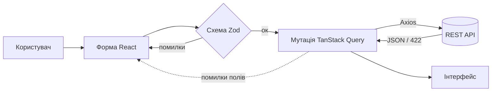
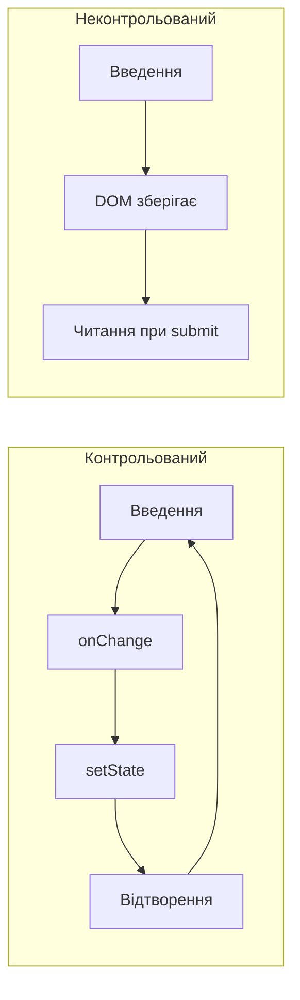
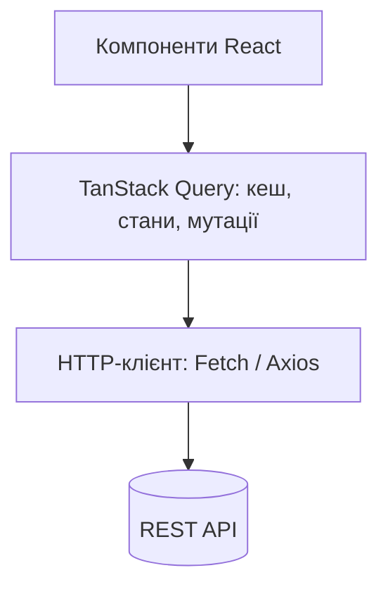
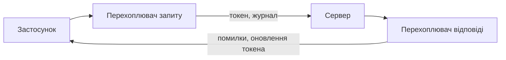
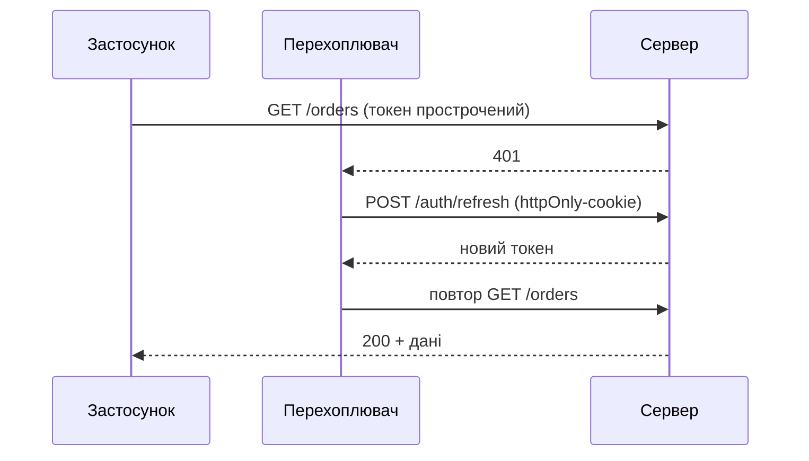
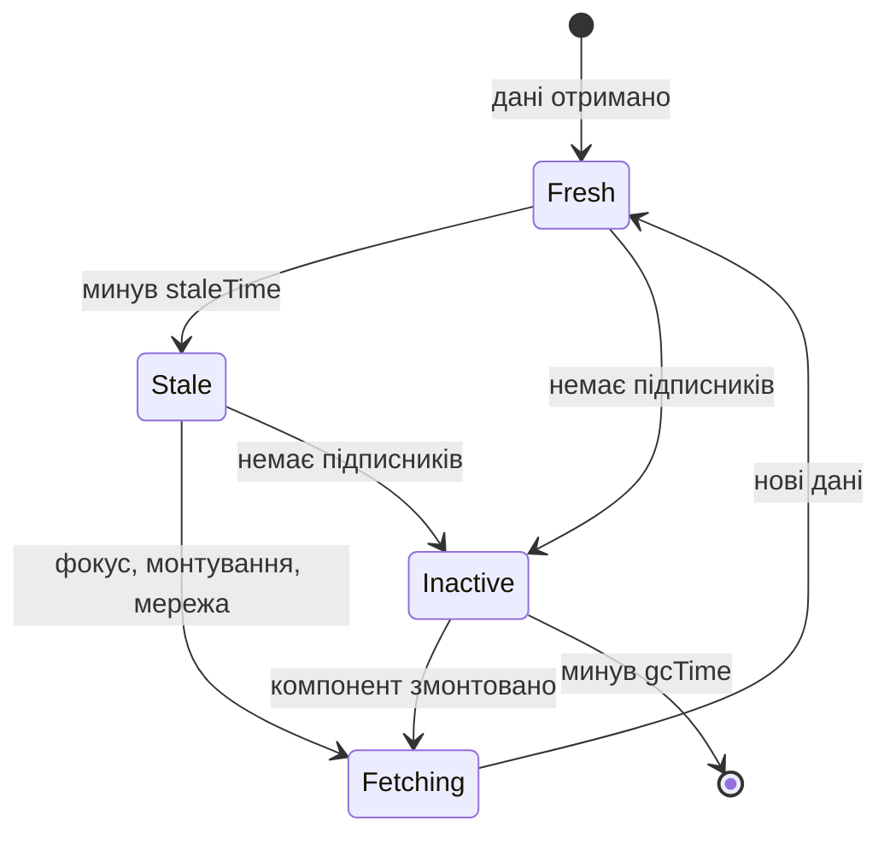
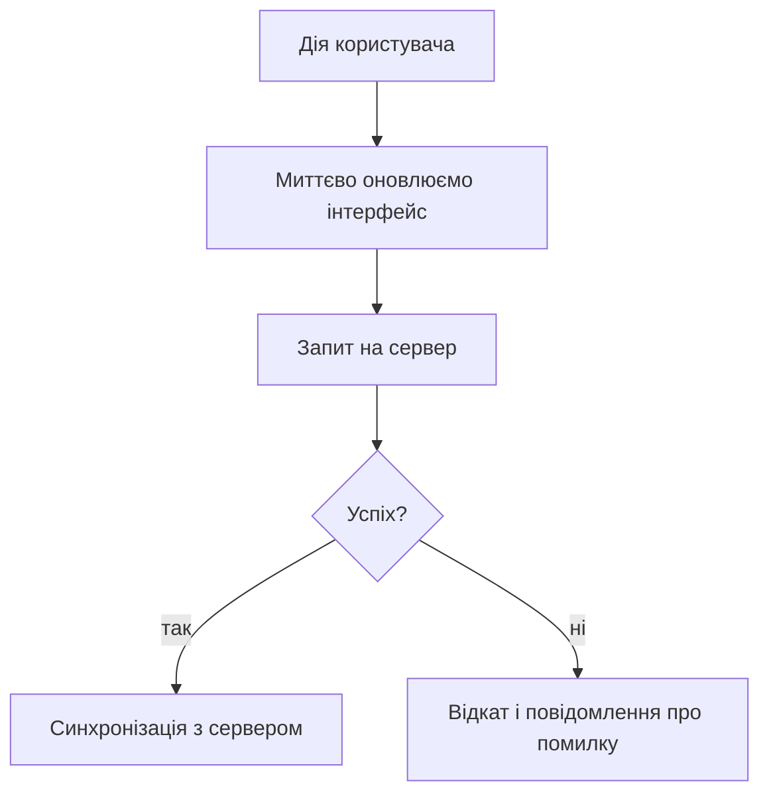

# Форми, валідація та інтеграція із серверною частиною

---

## План лекції

**Частина 1. Форми**
- Контрольовані й неконтрольовані компоненти
- React Hook Form
- Валідація схемами Zod
- Власні поля введення, файли
- UX-патерни, нативні форми React 19

**Частина 2. Взаємодія із сервером**
- HTTP-клієнт: Fetch та Axios
- Перехоплювачі, обробка помилок
- Стани завантаження, кешування
- TanStack Query, оптимістичні оновлення
- Форма + мутація + помилки сервера

---

## Шлях даних: від форми до сервера



---

## Виклики роботи з формами

- Зберігання значень полів
- Валідація: коли і як показувати помилки
- Відправлення та блокування повторних натискань
- Обробка відповіді сервера
- Доступність для всіх користувачів

**Ключове питання:** хто володіє значенням поля — React чи DOM?

---

## Контрольований компонент

**Значення поля повністю керується станом React**

```javascript
function ControlledForm() {
    const [email, setEmail] = useState('');

    return (
        <input
            type="email"
            value={email}
            onChange={(e) => setEmail(e.target.value)}
        />
    );
}
```

**Переваги:** повний контроль, валідація «на льоту», складна логіка

**Недоліки:** більше коду, повторне відтворення при кожному символі

---

## Неконтрольований компонент

**Значення зберігається в DOM; читаємо через `ref` або `FormData`**

```javascript
function UncontrolledForm() {
    const handleSubmit = (e) => {
        e.preventDefault();
        const data = Object.fromEntries(new FormData(e.currentTarget));
        console.log(data);
    };

    return (
        <form onSubmit={handleSubmit}>
            <input name="email" type="email" />
            <button type="submit">Відправити</button>
        </form>
    );
}
```

**Переваги:** менше коду, краща швидкодія, єдиний варіант для `<input type="file">`

---

## Контрольовані vs неконтрольовані



| Критерій | Контрольований | Неконтрольований |
|---|---|---|
| Де значення | Стан React | DOM |
| Валідація «на льоту» | Природна | Складніша |
| Відтворення при вводі | Щоразу | Немає |
| Файли | Неможливо | Так |

---

## React Hook Form: чому саме він

- 🚀 Мінімум повторних відтворень
- 📦 Невеликий розмір, без залежностей
- ✅ Вбудовані правила + схеми через resolvers
- 🎯 Зручний API, підтримка TypeScript
- 💪 Вкладені об'єкти, динамічні масиви

```bash
npm install react-hook-form
```

---

## React Hook Form: основний API

| Елемент | Призначення |
|---|---|
| `register` | Підключає поле до форми |
| `handleSubmit` | Валідація + виклик обробника |
| `formState` | `errors`, `isSubmitting`, `isDirty`... |
| `watch` / `useWatch` | Спостереження за значеннями |
| `setValue`, `reset` | Зміна значень, скидання |
| `trigger` | Ручний запуск валідації |
| `setError` | Ручне додавання помилок (від сервера) |
| `control` | Для `Controller`, `useFieldArray` |

**Режими валідації `mode`:** `onSubmit` · `onBlur` · `onChange` · `onTouched` · `all`

---

## React Hook Form: базове використання

```javascript
import { useForm } from 'react-hook-form';

function RegistrationForm() {
    const {
        register,
        handleSubmit,
        formState: { errors, isSubmitting }
    } = useForm();

    return (
        <form onSubmit={handleSubmit(onSubmit)} noValidate>
            <input
                aria-invalid={!!errors.email}
                {...register('email', {
                    required: "Email обов'язковий"
                })}
            />
            {errors.email && (
                <span role="alert">{errors.email.message}</span>
            )}

            <button disabled={isSubmitting}>Зареєструватися</button>
        </form>
    );
}
```

---

## React Hook Form: динамічні поля

```javascript
const { fields, append, remove } = useFieldArray({
    control,
    name: 'teamMembers'
});

return (
    <>
        {fields.map((field, index) => (
            <div key={field.id}>
                <input {...register(`teamMembers.${index}.name`)} />
                <button type="button" onClick={() => remove(index)}>
                    Видалити
                </button>
            </div>
        ))}
        <button type="button" onClick={() => append({ name: '' })}>
            Додати учасника
        </button>
    </>
);
```

**Правило:** `key={field.id}`, а не індекс

---

## Zod: схема замість розсипаних правил

**Навіщо:**
- Правила окремо від розмітки
- Повторне використання, перевірки кількох полів
- Типи TypeScript виводяться зі схеми
- Одна схема — для клієнта й сервера (Express)

```bash
npm install zod @hookform/resolvers
```

**Zod 4:** `z.email()` замість `z.string().email()`, єдиний параметр `error` для повідомлень

---

## Zod: базова схема

```javascript
import { z } from 'zod';

const schema = z.object({
    username: z.string()
        .min(3, 'Мінімум 3 символи')
        .max(20, 'Максимум 20 символів'),

    email: z.email('Некоректний email').toLowerCase(),

    password: z.string()
        .min(8, 'Мінімум 8 символів')
        .regex(/[A-Z]/, 'Потрібна велика літера'),

    confirmPassword: z.string(),

    age: z.number({ error: 'Вкажіть вік числом' })
        .int()
        .min(18, 'Вік від 18 років')
}).refine(d => d.password === d.confirmPassword, {
    error: 'Паролі не збігаються',
    path: ['confirmPassword']
});
```

---

## Zod + React Hook Form

```javascript
import { zodResolver } from '@hookform/resolvers/zod';

const { register, handleSubmit, formState: { errors } } = useForm({
    resolver: zodResolver(schema)
});

const onSubmit = (data) => {
    // Дані вже перевірені та перетворені схемою
};
```

```typescript
// TypeScript: тип виводиться зі схеми
type FormData = z.infer<typeof schema>;
```

**Нюанс:** для `type="number"` потрібен `register('age', { valueAsNumber: true })`

---

## Складні схеми Zod

```javascript
const projectSchema = z.object({
    title: z.string().min(1),
    budget: z.object({
        amount: z.number().positive(),
        currency: z.enum(['UAH', 'USD', 'EUR'])
    }),
    tags: z.array(z.string()).min(1).max(5),
    startDate: z.iso.date()
});

// Різні набори полів залежно від значення
const deliverySchema = z.discriminatedUnion('method', [
    z.object({
        method: z.literal('pickup'),
        pickupPoint: z.string().min(1)
    }),
    z.object({
        method: z.literal('courier'),
        address: z.string().min(5)
    })
]);
```

**Пам'ятайте:** валідація на клієнті ≠ валідація на сервері

---

## Власне поле введення

**Принципи:** інкапсуляція, доступність, `ref` як властивість (React 19)

```javascript
function Input({ label, error, id, ref, ...props }) {
    const generatedId = useId();
    const inputId = id ?? generatedId;
    const errorId = `${inputId}-error`;

    return (
        <div>
            <label htmlFor={inputId}>{label}</label>
            <input
                ref={ref}
                id={inputId}
                aria-invalid={Boolean(error)}
                aria-describedby={error ? errorId : undefined}
                {...props}
            />
            {error && <span id={errorId} role="alert">{error}</span>}
        </div>
    );
}
```

---

## Поле пароля з індикатором

```javascript
function PasswordInput({ showStrength, onChange, ref, ...props }) {
    const [strength, setStrength] = useState(0);
    const [visible, setVisible] = useState(false);

    const handleChange = (e) => {
        setStrength(calculateStrength(e.target.value));
        onChange?.(e); // передаємо подію в register
    };

    return (
        <div>
            <input
                ref={ref}
                type={visible ? 'text' : 'password'}
                onChange={handleChange}
                {...props}
            />
            <button
                type="button"
                aria-label={visible ? 'Сховати пароль' : 'Показати пароль'}
                onClick={() => setVisible(v => !v)}
            >
                {visible ? '🙈' : '👁️'}
            </button>
            {showStrength && <StrengthBar strength={strength} />}
        </div>
    );
}
```

---

## Controller: чужі компоненти у формі

```javascript
<Controller
    name="country"
    control={control}
    rules={{ required: 'Оберіть країну' }}
    render={({ field, fieldState }) => (
        <SearchableSelect
            options={countries}
            value={field.value}
            onChange={field.onChange}
            error={fieldState.error?.message}
        />
    )}
/>
```

- Для полів без нативного `<input>`: вибір дати, редактор, списки з пошуком
- Складні списки — готові компоненти (`Combobox`, лекція 11)

---

## Завантаження файлів

```javascript
const files = watch('avatar');

useEffect(() => {
    const file = files?.[0];
    if (!file) return setPreview(null);

    const url = URL.createObjectURL(file);
    setPreview(url);
    return () => URL.revokeObjectURL(url);
}, [files]);

<input
    type="file"
    accept="image/jpeg,image/png"
    {...register('avatar', {
        validate: {
            fileSize: f => f[0]?.size <= 5 * 1024 * 1024 || 'Максимум 5 МБ'
        }
    })}
/>
```

**Сервер обов'язково перевіряє тип і розмір повторно**

---

## Перетягування файлів

```javascript
import { useDropzone } from 'react-dropzone';

const { getRootProps, getInputProps, isDragActive } = useDropzone({
    accept: { 'image/*': ['.jpeg', '.jpg', '.png'] },
    maxSize: 5 * 1024 * 1024,
    onDrop: (acceptedFiles) => { /* ... */ }
});

return (
    <div {...getRootProps()} className={isDragActive ? 'active' : ''}>
        <input {...getInputProps()} />
        <p>Перетягніть файли або клацніть для вибору</p>
    </div>
);
```

---

## UX: коли показувати помилку

- `onSubmit` — надто пізно в довгих формах
- `onChange` — дратує, поки людина ще вводить
- **`onTouched` / `onBlur`** — після виходу з поля, далі — «на льоту»

```javascript
const { register, formState: { errors, isValidating, touchedFields } } =
    useForm({ mode: 'onTouched' });

<input {...register('username', {
    validate: async (v) =>
        (await isUsernameAvailable(v)) || "Це ім'я вже зайняте"
})} />

{isValidating && <span>Перевірка доступності...</span>}
{touchedFields.username && !errors.username && <span>✓ Вільно</span>}
```

---

## Багатокрокові форми

```javascript
const stepFields = {
    1: ['firstName', 'lastName', 'email'],
    2: ['address', 'city'],
    3: ['deliveryMethod']
};

const nextStep = async () => {
    const isValid = await trigger(stepFields[step]);
    if (isValid) setStep(s => s + 1);
};
```

- Один `useForm` на всю форму
- Значення не губляться при переході «Назад»
- ⚠️ Платіжні дані — лише через поля платіжного провайдера

---

## Автозбереження чернетки

```javascript
useEffect(() => {
    let timer;
    const sub = watch((values) => {
        clearTimeout(timer);
        timer = setTimeout(() => {
            localStorage.setItem('draft', JSON.stringify(values));
        }, 1000);
    });
    return () => { clearTimeout(timer); sub.unsubscribe(); };
}, [watch]);
```

- Початкове значення форми — зі збереженої чернетки
- Не зберігати паролі й чутливі дані

---

## React 19: нативні форми

```javascript
async function subscribeAction(prevState, formData) {
    const email = formData.get('email');
    const res = await fetch('/api/subscribe', {
        method: 'POST',
        body: JSON.stringify({ email })
    });
    return { ok: res.ok };
}

function SubmitButton() {
    const { pending } = useFormStatus();
    return <button disabled={pending}>Підписатися</button>;
}

function SubscribeForm() {
    const [state, formAction] = useActionState(subscribeAction, { ok: false });
    return (
        <form action={formAction}>
            <input name="email" type="email" />
            <SubmitButton />
        </form>
    );
}
```

**Простим формам — Actions; складним — React Hook Form + Zod**

---

## Доступність форм

- `<label htmlFor>` для кожного поля
- `aria-invalid` та `aria-describedby` для помилок
- `role="alert"` для повідомлень про помилки
- Навігація клавіатурою, видимий фокус
- Семантичні елементи: `fieldset`, `legend`

```javascript
<input
    id="email"
    aria-invalid={!!errors.email}
    aria-describedby={errors.email ? 'email-error' : undefined}
/>
{errors.email && (
    <span id="email-error" role="alert">{errors.email.message}</span>
)}
```

---

## Частина 2. Взаємодія із сервером: три рівні



| Інструмент | Рівень | Призначення |
|---|---|---|
| Fetch API | Транспорт | Нативний API браузера |
| Axios | Транспорт | Екземпляри, перехоплювачі, винятки на помилки |
| TanStack Query | Дані | Кеш, синхронізація, мутації |

---

## Fetch API: пастка

```javascript
async function fetchJson(url, options = {}) {
    const response = await fetch(url, {
        ...options,
        headers: { 'Content-Type': 'application/json', ...options.headers },
        signal: options.signal ?? AbortSignal.timeout(10_000)
    });

    // Fetch НЕ кидає виняток на 404/500!
    if (!response.ok) {
        throw new Error(`HTTP ${response.status}`);
    }

    return response.json();
}
```

**Проміс відхиляється лише при мережевому збої**

---

## Axios: коли доречний

- Екземпляри з базовою конфігурацією
- Перехоплювачі запитів і відповідей
- Автоматичний виняток на статуси поза 2xx
- Прогрес відправлення файлів
- Підтримка скасування й тайм-аутів

**Для малих проєктів Fetch + обгортка — достатньо**

```javascript
import axios from 'axios';

export const api = axios.create({
    baseURL: import.meta.env.VITE_API_URL,
    timeout: 10_000
});

const { data } = await api.get('/users');
await api.post('/users', userData);
```

---

## API-шар: функції доступу

```javascript
export const usersApi = {
    getAll: async () => (await api.get('/users')).data,
    getById: async (id) => (await api.get(`/users/${id}`)).data,
    create: async (data) => (await api.post('/users', data)).data,
    update: async (id, data) => (await api.put(`/users/${id}`, data)).data,
    remove: async (id) => { await api.delete(`/users/${id}`); }
};

// Параметри, скасування, прогрес
api.get('/users/search', { params: { q, limit: 20 }, signal });
api.post('/upload', formData, {
    onUploadProgress: (e) => setProgress(e.loaded / e.total)
});
```

**Помилки обробляємо централізовано, без `try/catch` у кожній функції**

---

## Перехоплювачі: концепція



**Наскрізні завдання в одному місці:**
- Авторизація
- Журналювання, вимірювання часу
- Перетворення помилок
- Оновлення токена

---

## Перехоплювач запитів

```javascript
// Токен — у пам'яті модуля, а не в localStorage
let accessToken = null;
export const setAccessToken = (token) => { accessToken = token; };

api.interceptors.request.use((config) => {
    if (accessToken) {
        config.headers.Authorization = `Bearer ${accessToken}`;
    }
    config.metadata = { startTime: performance.now() };
    return config;
});

api.interceptors.response.use((response) => {
    if (import.meta.env.DEV) {
        const ms = Math.round(performance.now() - response.config.metadata.startTime);
        console.log(`[API] ${response.config.url} ${ms} мс`);
    }
    return response;
});
```

---

## Автоматичне оновлення токена



---

## Оновлення токена: код

```javascript
let refreshPromise = null;

api.interceptors.response.use(
    (response) => response,
    async (error) => {
        const original = error.config;

        if (error.response?.status === 401 && !original._retry) {
            original._retry = true;

            // Усі одночасні запити чекають один спільний проміс
            refreshPromise ??= refreshAccessToken()
                .finally(() => { refreshPromise = null; });

            const token = await refreshPromise;
            setAccessToken(token);
            original.headers.Authorization = `Bearer ${token}`;
            return api(original);
        }

        return Promise.reject(error);
    }
);
```

---

## Типізовані помилки

```javascript
class ApiError extends Error {
    constructor(message, status, data) {
        super(message);
        this.name = 'ApiError';
        this.status = status;
        this.data = data;
    }
}

class NetworkError extends Error { /* ... */ }

class ValidationError extends ApiError {
    constructor(message, errors) {
        super(message, 422, errors);
        this.name = 'ValidationError';
        this.errors = errors; // { поле: 'повідомлення' }
    }
}
```

---

## Перетворення помилок

```javascript
api.interceptors.response.use(
    (response) => response,
    (error) => {
        if (!axios.isAxiosError(error) || axios.isCancel(error)) {
            return Promise.reject(error);
        }

        if (error.response) {
            const { status, data } = error.response;
            if (status === 422) {
                return Promise.reject(
                    new ValidationError('Помилка валідації', data.errors ?? {})
                );
            }
            return Promise.reject(new ApiError(data?.message, status, data));
        }

        return Promise.reject(new NetworkError('Немає відповіді від сервера'));
    }
);
```

**Порядок реєстрації має значення**; повідомлення для користувача формує інтерфейс

---

## Коди відповідей та реакція інтерфейсу

| Код | Реакція |
|---|---|
| 400 | Повідомлення біля форми |
| 401 | Оновити токен або на сторінку входу |
| 403 | Повідомити про відсутність доступу |
| 404 | Сторінка або повідомлення «не знайдено» |
| 409 | Пояснити конфлікт |
| 422 | Помилки біля полів форми |
| 429 | Попросити зачекати |
| 5xx | Загальне повідомлення, повторити |

---

## Чотири стани запиту

- ⏳ Завантаження
- ❌ Помилка
- 📭 Порожній результат
- ✅ Дані є

```javascript
useEffect(() => {
    const controller = new AbortController();

    api.get('/users', { signal: controller.signal })
        .then(r => setUsers(r.data))
        .catch(err => { if (!axios.isCancel(err)) setError(err); })
        .finally(() => setIsLoading(false));

    return () => controller.abort();
}, []);
```

**Проблеми вручну:** гонитва запитів, дублювання, Strict Mode

---

## Скелетні заглушки

**Замість спінера — «скелет» майбутнього вмісту**

```javascript
function SkeletonCard() {
    return (
        <div className="skeleton-card" aria-hidden="true">
            <div className="skeleton skeleton-avatar" />
            <div className="skeleton skeleton-title" />
            <div className="skeleton skeleton-text" />
        </div>
    );
}

{isLoading
    ? Array.from({ length: 5 }, (_, i) => <SkeletonCard key={i} />)
    : users.map(u => <UserCard key={u.id} user={u} />)}
```

---

## Простий кеш у пам'яті

```javascript
class APICache {
    constructor(ttl = 5 * 60 * 1000) {
        this.cache = new Map();
        this.ttl = ttl;
    }

    get(key) {
        const cached = this.cache.get(key);
        if (!cached) return null;
        if (Date.now() - cached.timestamp > this.ttl) {
            this.cache.delete(key);
            return null;
        }
        return cached.data;
    }

    set(key, data) {
        this.cache.set(key, { data, timestamp: Date.now() });
    }
}
```

**Відкриті питання:** дублювання запитів, інвалідація, застарілі дані

---

## TanStack Query: чому

**Серверний стан ≠ локальний стан інтерфейсу**

- Дані належать серверу й можуть змінитися без нас
- Асинхронне завантаження
- Спільне використання багатьма компонентами

**Бібліотека бере на себе:** кеш, повторні спроби, фонове оновлення, скасування, синхронізацію

```bash
npm install @tanstack/react-query
```

**Версія 5:** `gcTime` (було `cacheTime`), `isPending` (було `isLoading`), лише об'єктний синтаксис

---

## Підключення

```javascript
const queryClient = new QueryClient({
    queryCache: new QueryCache({
        onError: (error, query) => {
            if (query.state.data !== undefined) {
                toast.error(getErrorMessage(error));
            }
        }
    }),
    defaultOptions: {
        queries: { staleTime: 60_000 }
    }
});

<QueryClientProvider client={queryClient}>
    <App />
    <ReactQueryDevtools initialIsOpen={false} />
</QueryClientProvider>
```

---

## useQuery

```javascript
const { data: users, isPending, isError, error, refetch } = useQuery({
    queryKey: ['users'],
    queryFn: usersApi.getAll
});

if (isPending) return <p>Завантаження...</p>;
if (isError) return <ErrorMessage error={error} onRetry={refetch} />;

return <UserListView users={users} />;
```

- **`queryKey`** — ідентифікатор даних у кеші
- **`queryFn`** — функція, що повертає проміс
- **`isPending`** — даних ще немає; **`isFetching`** — запит триває

---

## Свіжі й застарілі дані



| Параметр | За замовчуванням | Зміст |
|---|---|---|
| `staleTime` | 0 | Скільки дані вважаються свіжими |
| `gcTime` | 5 хв | Скільки живе неактивний запис |

---

## Ключі й параметри запитів в одному місці

```javascript
export const usersQueries = {
    list: () => queryOptions({
        queryKey: ['users'],
        queryFn: usersApi.getAll
    }),
    detail: (id) => queryOptions({
        queryKey: ['users', id],
        queryFn: ({ signal }) =>
            api.get(`/users/${id}`, { signal }).then(r => r.data)
    })
};

useQuery(usersQueries.list());
useQuery(usersQueries.detail(5));
```

**Ключі ієрархічні:** інвалідація `['users']` зачіпає й `['users', 5]`

---

## Мутації та інвалідація кешу

```javascript
function useCreateUser() {
    const queryClient = useQueryClient();

    return useMutation({
        mutationFn: usersApi.create,
        onSuccess: () => {
            queryClient.invalidateQueries({ queryKey: ['users'] });
            toast.success('Користувача створено');
        }
    });
}

const createUser = useCreateUser();
createUser.mutate({ name: 'Іван' });
// createUser.isPending, createUser.isError ...
```

**За замовчуванням — інвалідація;** `setQueryData` — лише при необхідності

---

## Залежні та паралельні запити

```javascript
// Залежний: пости чекають на користувача
const { data: user } = useQuery(usersQueries.detail(userId));
const { data: posts } = useQuery({
    queryKey: ['posts', { userId }],
    queryFn: () => fetchUserPosts(userId),
    enabled: !!user
});

// Паралельні: стартують одночасно
const users = useQuery({ queryKey: ['users'], queryFn: fetchUsers });
const posts2 = useQuery({ queryKey: ['posts'], queryFn: fetchPosts });
const stats = useQuery({ queryKey: ['stats'], queryFn: fetchStats });
```

**Паралельно:** ≈ 1 с. **Послідовно:** ≈ 3 с (при трьох запитах по 1 с)

---

## Пагінація

```javascript
const [page, setPage] = useState(1);

const { data, isPending, isPlaceholderData } = useQuery({
    queryKey: ['users', { page }],
    queryFn: () => fetchUsers(page),
    placeholderData: keepPreviousData
});

<UserList users={data?.users} />
<Pagination
    currentPage={page}
    totalPages={data?.totalPages}
    onPageChange={setPage}
/>
```

`keepPreviousData` показує попередню сторінку, поки завантажується нова

---

## Нескінченне прокручування

```javascript
const { data, fetchNextPage, hasNextPage, isFetchingNextPage } =
    useInfiniteQuery({
        queryKey: ['users', 'infinite'],
        queryFn: ({ pageParam }) => fetchUsers(pageParam),
        initialPageParam: 1,
        getNextPageParam: (lastPage) => lastPage.nextPage
    });

{data?.pages.map(p => p.users.map(u => <UserCard key={u.id} user={u} />))}

{hasNextPage && (
    <button onClick={() => fetchNextPage()} disabled={isFetchingNextPage}>
        Показати більше
    </button>
)}
```

---

## Попереднє завантаження

```javascript
const queryClient = useQueryClient();

const prefetchUser = (userId) => {
    queryClient.prefetchQuery({
        ...usersQueries.detail(userId),
        staleTime: 60_000
    });
};

<li onMouseEnter={() => prefetchUser(user.id)}>
    <Link to={`/users/${user.id}`}>{user.name}</Link>
</li>
```

Дані вже в кеші до моменту натискання

---

## Оптимістичні оновлення



**Доречно:** низький ризик помилки (позначка, «вподобайка»)

**Не доречно:** оплата, видалення важливих даних

---

## Оптимістичне оновлення: код

```javascript
useMutation({
    mutationFn: ({ id, completed }) =>
        api.patch(`/todos/${id}`, { completed }),

    onMutate: async ({ id, completed }) => {
        await queryClient.cancelQueries({ queryKey: ['todos'] });
        const previous = queryClient.getQueryData(['todos']);

        queryClient.setQueryData(['todos'], (old = []) =>
            old.map(t => t.id === id ? { ...t, completed } : t)
        );
        return { previous };
    },

    onError: (_err, _vars, context) => {
        queryClient.setQueryData(['todos'], context.previous);
    },

    onSettled: () => {
        queryClient.invalidateQueries({ queryKey: ['todos'] });
    }
});
```

---

## Простіші оптимістичні варіанти

**Показати, не змінюючи кеш** (`variables` + `isPending`):

```javascript
{todos.map(t => <li key={t.id}>{t.title}</li>)}

{addTodo.isPending && (
    <li style={{ opacity: 0.5 }}>{addTodo.variables}</li>
)}
```

**React 19:** хук `useOptimistic` — тимчасовий стан поверх справжнього, зручний із `<form action>`

---

## Разом: форма + мутація + помилки сервера

```javascript
const { register, handleSubmit, setError, formState: { errors } } =
    useForm({ resolver: zodResolver(registerSchema) });

const registerUser = useMutation({ mutationFn: authApi.register });

const onSubmit = async (values) => {
    try {
        await registerUser.mutateAsync(values);
        navigate('/dashboard');
    } catch (error) {
        if (error instanceof ValidationError) {
            Object.entries(error.errors).forEach(([field, message]) =>
                setError(field, { type: 'server', message })
            );
        } else {
            setError('root.serverError', { message: getErrorMessage(error) });
        }
    }
};
```

---

## Безпека взаємодії

- Токен доступу — **у пам'яті**, refresh-токен — в **httpOnly-cookie**
- «Шифрування токена в `localStorage`» не допомагає: ключ теж у коді
- Cookie → `SameSite`, `Secure`, захист від CSRF, CORS із `credentials`
- Лише HTTPS
- Не зберігати паролі та персональні дані в чернетках і журналах
- Клієнтські перевірки не замінюють серверних

> Докладно: лекція 05

---

## Найкращі практики

**Форми:**
- Складні форми — React Hook Form + Zod; прості — Actions React 19
- Помилки — після виходу з поля, з `aria`-атрибутами

**Взаємодія з сервером:**
- Транспорт — Fetch/Axios, дані — TanStack Query
- Авторизація й помилки — у перехоплювачах
- Не дублювати серверні дані в `useState`

**Продуктивність і UX:**
- Паралельні запити, кеш, попереднє завантаження
- Скелетні заглушки, оптимістичні оновлення для безпечних дій

---

## Питання для самоперевірки

1. Чим контрольований компонент відрізняється від неконтрольованого?
2. Навіщо потрібен `Controller`?
3. Що змінилося в Zod 4 порівняно з Zod 3?
4. Чому клієнтська валідація не замінює серверну?
5. Яка пастка в поведінці `fetch` при статусі 404?
6. Навіщо потрібні перехоплювачі? Як уникнути кількох паралельних оновлень токена?
7. Де безпечніше зберігати токени й чому?
8. Різниця між `staleTime` і `gcTime`?
9. Коли застосовувати оптимістичне оновлення?
10. Як повернути помилки сервера в поля форми?

---

## Корисні ресурси

**Документація:**
- [React Hook Form](https://react-hook-form.com/)
- [Zod](https://zod.dev/)
- [Axios](https://axios-http.com/docs/intro)
- [TanStack Query](https://tanstack.com/query/latest)
- [React: форми та дії](https://react.dev/reference/react-dom/components/form)

**Статті:**
- [Sign-in form best practices (web.dev)](https://web.dev/articles/sign-in-form-best-practices)

**Інструменти й альтернативи:**
- [React Dropzone](https://react-dropzone.js.org/)
- [React Query Devtools](https://tanstack.com/query/latest/docs/framework/react/devtools)
- [Valibot](https://valibot.dev/) — легша альтернатива Zod
- [SWR](https://swr.vercel.app/) — альтернатива TanStack Query
