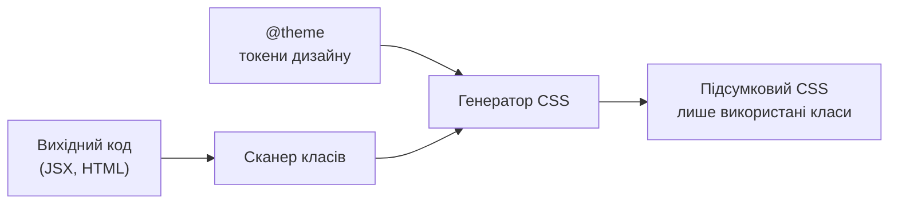

# Tailwind CSS та сучасна стилізація

---

## План лекції

- Підхід utility-first
- Встановлення та система дизайну (Tailwind 4)
- Адаптивний дизайн
- Налаштування через `@theme`
- Компонентний підхід
- Темна та світла теми
- Headless UI

---

## Еволюція підходів до CSS

**Традиційний CSS:**
```css
.card {
    max-width: 28rem;
    padding: 1.5rem;
    background: white;
    border-radius: 0.5rem;
}
```

**BEM:** `.card__title`, `.card__button--primary`

**CSS Modules / CSS-in-JS:** стилі локалізовано в компоненті

**Utility-first (Tailwind):**
```html
<div class="max-w-md p-6 bg-white rounded-lg">
```

---

## Що таке utility-first?

**Ідея:** комбінувати готові утилітарні класи замість власних стилів

**Переваги:**
- ⚡ Швидкість розробки
- 🎯 Передбачуваність
- 🗑️ Немає мертвого коду
- 🎨 Дизайн-система з коробки
- 📱 Адаптивність без `@media`

**Недоліки:**
- Довгі списки класів у розмітці
- Потрібен час, щоб запам'ятати класи
- Повторювані набори → виносити в компоненти

---

## Порівняння підходів

**Традиційний CSS:**
```css
.button {
    padding: 0.75rem 1.5rem;
    background-color: #3b82f6;
    color: white;
    border-radius: 0.375rem;
}
```

**Tailwind:**
```html
<button class="px-6 py-3 bg-blue-500 text-white rounded-md">
    Натисни мене
</button>
```

**Результат однаковий, але Tailwind:**
- не потребує перемикання між файлами
- не потребує вигадування назв класів
- видалив компонент — видалив і стилі

---

## Встановлення (Tailwind 4 + Vite)

```bash
npm install tailwindcss @tailwindcss/vite
```

```javascript
// vite.config.js
import tailwindcss from '@tailwindcss/vite';

export default defineConfig({
    plugins: [react(), tailwindcss()]
});
```

```css
/* src/index.css */
@import "tailwindcss";
```

**Без:** `postcss`, `autoprefixer`, `tailwind.config.js`, масиву `content`

---

## Як формується CSS



```jsx
// ❌ Динамічний клас не буде знайдено
<div className={`bg-${color}-500`} />

// ✅ Повні назви класів
const colors = { blue: 'bg-blue-500', red: 'bg-red-500' };
<div className={colors[color]} />
```

**Браузери:** Safari 16.4+, Chrome 111+, Firefox 128+

---

## Система відступів

**Шкала:** `--spacing: 0.25rem`, 1 одиниця = 4px

```jsx
<div className="m-4">Margin з усіх боків (16px)</div>
<div className="mx-4">Горизонтальний (16px)</div>
<div className="mt-4">Зверху (16px)</div>

<div className="p-6">Padding (24px)</div>
<div className="px-6 py-4">24px / 16px</div>

<div className="-mt-4">Від'ємний margin</div>

<div className="space-y-4">
    <div>Елемент 1</div>
    <div>Елемент 2</div>
</div>

<div className="size-12" /> {/* ширина = висота = 48px */}
```

---

## Система кольорів

**Градації від 50 до 950, простір `oklch`**

```jsx
<p className="text-gray-900">Темно-сірий</p>
<p className="text-blue-500">Синій</p>

<div className="bg-white">Білий фон</div>
<div className="bg-gray-100">Світло-сірий фон</div>

<div className="border border-gray-300">Сіра рамка</div>

{/* Прозорість: через «/» */}
<div className="bg-blue-500/50">Напівпрозорий</div>
<p className="text-gray-900/75">Напівпрозорий текст</p>
```

⚠️ **Tailwind 4:** немає `bg-opacity-*`; колір рамки за замовчуванням — колір тексту, тож указуйте його явно

---

## Типографіка

```jsx
<h1 className="text-4xl">Великий заголовок (36px)</h1>
<p className="text-base">Звичайний текст (16px)</p>
<small className="text-sm">Малий текст (14px)</small>

<p className="font-light">Легкий (300)</p>
<p className="font-bold">Жирний (700)</p>

<p className="leading-tight">Щільний інтервал</p>
<p className="leading-relaxed">Вільний інтервал</p>

<p className="text-center">По центру</p>
<p className="text-right">Праворуч</p>
<p className="uppercase">Великі літери</p>

<h2 className="text-balance">Збалансований заголовок</h2>
```

---

## Flexbox

```jsx
<div className="flex items-center justify-between">
    <div>Лівий</div>
    <div>Правий</div>
</div>

<div className="flex flex-col">Вертикально</div>

{/* justify-*: start · center · end · between · around */}
<div className="flex justify-center">По центру</div>

{/* items-*: start · center · end · stretch */}
<div className="flex items-end">Внизу</div>

<div className="flex-1">Займає вільний простір</div>

<div className="flex gap-4">Проміжок 16px</div>
```

---

## Grid

```jsx
<div className="grid grid-cols-3 gap-4">
    <div>Колонка 1</div>
    <div>Колонка 2</div>
    <div>Колонка 3</div>
</div>

<div className="grid grid-cols-4 gap-4">
    <div className="col-span-2">Займає 2 колонки</div>
    <div>3</div>
    <div>4</div>
</div>

{/* Довільні значення у квадратних дужках */}
<div className="grid grid-cols-[200px_auto_200px] gap-4">
    <div>200px</div>
    <div>Гнучка</div>
    <div>200px</div>
</div>
```

---

## Стани й модифікатори

```jsx
<button className="
    bg-blue-500 text-white
    hover:bg-blue-600
    active:bg-blue-700
    focus-visible:ring-2
    disabled:opacity-50 disabled:cursor-not-allowed
">
    Зберегти
</button>

<label className="group flex gap-2">
    <input type="checkbox" className="peer sr-only" />
    <span className="size-5 border peer-checked:bg-blue-500
                     group-hover:border-blue-400" />
    Запам'ятати мене
</label>
```

- `group` / `peer` — реакція на стан сусіднього елемента
- `hover:` — лише на пристроях, що підтримують наведення

---

## Адаптивний дизайн: mobile-first

| Префікс | Від | Пристрій |
|---|---|---|
| — | 0 | Телефони |
| `sm:` | 640px | Великі телефони |
| `md:` | 768px | Планшети |
| `lg:` | 1024px | Ноутбуки |
| `xl:` | 1280px | Монітори |
| `2xl:` | 1536px | Великі монітори |

```jsx
<div className="w-full md:w-1/2 lg:w-1/3 p-4 md:p-6 lg:p-8">
    Адаптивний вміст
</div>
```

**`md:` = «від 768px і більше».** Діапазони: `max-md:`, `md:max-lg:`

---

## Адаптивна навігація

```jsx
function Navigation() {
    const [isOpen, setIsOpen] = useState(false);

    return (
        <nav className="bg-white shadow-lg">
            <div className="max-w-7xl mx-auto px-4">
                {/* Меню — лише на великих екранах */}
                <div className="hidden md:flex md:space-x-4">
                    <Link to="/">Головна</Link>
                    <Link to="/about">Про нас</Link>
                </div>

                {/* Кнопка — лише на малих екранах */}
                <button
                    className="md:hidden"
                    aria-expanded={isOpen}
                    aria-label="Меню"
                    onClick={() => setIsOpen(!isOpen)}
                >
                    ☰
                </button>
            </div>

            {isOpen && (
                <div className="md:hidden">
                    <Link to="/">Головна</Link>
                    <Link to="/about">Про нас</Link>
                </div>
            )}
        </nav>
    );
}
```

---

## Адаптивна сітка

```jsx
<div className="
    grid
    grid-cols-1
    sm:grid-cols-2
    md:grid-cols-3
    lg:grid-cols-4
    gap-4
">
    <div className="bg-white p-6 rounded-lg shadow">Картка 1</div>
    <div className="bg-white p-6 rounded-lg shadow">Картка 2</div>
    <div className="bg-white p-6 rounded-lg shadow">Картка 3</div>
    <div className="bg-white p-6 rounded-lg shadow">Картка 4</div>
</div>
```

---

## Контейнерні запити

**Компонент реагує на ширину контейнера, а не екрана**

```jsx
<div className="@container">
    <div className="flex flex-col gap-2 @md:flex-row @md:items-center">
        
        <div>
            <h3 className="font-bold">Заголовок</h3>
            <p>Вигляд залежить від ширини контейнера</p>
        </div>
    </div>
</div>
```

- Вбудовано в Tailwind 4: `@container`, `@sm:`, `@md:`, `@lg:`
- Одна картка однаково доречна в основній колонці й у бічній панелі

---

## Налаштування: директива @theme

```css
@import "tailwindcss";

@theme {
    --color-primary-50: #f0f9ff;
    --color-primary-500: #0ea5e9;
    --color-primary-900: #0c4a6e;

    --font-heading: "Poppins", sans-serif;
    --breakpoint-3xl: 1920px;
    --shadow-card: 0 4px 6px rgb(0 0 0 / 0.1);
    --radius-card: 1.5rem;

    --animate-fade-in: fade-in 0.5s ease-in-out;
    @keyframes fade-in {
        0% { opacity: 0; }
        100% { opacity: 1; }
    }
}
```

Кожна змінна → токен дизайну → утилітарні класи **і** змінна CSS `var(--color-primary-500)`

---

## @theme: простори імен

| Змінна | Створює |
|---|---|
| `--color-*` | `bg-*`, `text-*`, `border-*` |
| `--font-*` | `font-*` |
| `--breakpoint-*` | Префікси `3xl:` |
| `--shadow-*` | `shadow-*` |
| `--radius-*` | `rounded-*` |
| `--animate-*` | `animate-*` |
| `--spacing` | Уся шкала відступів |

`--color-*: initial;` — скинути стандартну палітру

---

## Використання власних значень

```jsx
<div className="bg-primary-50 text-primary-900">
    Власні кольори
</div>

<h1 className="font-heading text-3xl xs:text-4xl 3xl:text-6xl">
    Власний шрифт і точки зміни макета
</h1>

<div className="shadow-card hover:shadow-card-hover rounded-card">
    Власні тіні й заокруглення
</div>

<div className="animate-fade-in">
    Власна анімація
</div>
```

---

## Власні утиліти: @utility

```css
@utility scrollbar-hide {
    -ms-overflow-style: none;
    scrollbar-width: none;

    &::-webkit-scrollbar {
        display: none;
    }
}

@utility tab-4 {
    tab-size: 4;
}
```

```jsx
<div className="overflow-auto scrollbar-hide md:tab-4">...</div>
```

- Автоматично підтримують `hover:`, `md:`, `dark:`
- Градієнтний текст без власного CSS:
  `bg-linear-to-r from-blue-500 to-violet-500 bg-clip-text text-transparent`

---

## @apply: помірно

```css
@layer components {
    .btn-primary {
        @apply px-6 py-3 bg-blue-500 text-white rounded-md font-semibold;
        @apply hover:bg-blue-600 active:bg-blue-700;
        @apply transition-colors duration-200;
    }
}
```

**Краще компонент React, ніж `@apply`:**
- не треба вигадувати назви
- стилі лишаються поряд із розміткою

**`@apply` — для вмісту, що згенерував сторонній код** (Markdown, редактор)

---

## Tailwind 3 → Tailwind 4

| Версія 3 | Версія 4 |
|---|---|
| `@tailwind base/components/utilities` | `@import "tailwindcss"` |
| `tailwind.config.js` | `@theme` у CSS |
| Масив `content` | Автоматичне знаходження |
| `postcss` + `autoprefixer` | `@tailwindcss/vite` |
| `@layer utilities` | `@utility` |
| `bg-opacity-50` | `bg-blue-500/50` |
| `shadow-sm` → `shadow` | `shadow-xs` → `shadow-sm` |
| `outline-none` | `outline-hidden` |
| `bg-gradient-to-r` | `bg-linear-to-r` |
| `darkMode: 'class'` | `@custom-variant dark` |

`npx @tailwindcss/upgrade` — автоматична міграція

---

## Компонентний підхід: функція cn

```bash
npm install clsx tailwind-merge
```

```javascript
import { clsx } from 'clsx';
import { twMerge } from 'tailwind-merge';

export function cn(...inputs) {
    return twMerge(clsx(inputs));
}
```

- `clsx` — умовні класи
- `tailwind-merge` — вирішує конфлікти (`px-6` + `px-2` → `px-2`)

---

## Компонент Button

```jsx
const variants = {
    primary: 'bg-blue-500 text-white hover:bg-blue-600',
    secondary: 'bg-gray-200 text-gray-900 hover:bg-gray-300',
    danger: 'bg-red-500 text-white hover:bg-red-600'
};

const sizes = {
    sm: 'px-3 py-1.5 text-sm',
    md: 'px-6 py-3 text-base',
    lg: 'px-8 py-4 text-lg'
};

function Button({ variant = 'primary', size = 'md', className, ...props }) {
    return (
        <button
            className={cn(
                'font-semibold rounded-md transition-colors',
                'disabled:opacity-50 disabled:cursor-not-allowed',
                variants[variant],
                sizes[size],
                className
            )}
            {...props}
        />
    );
}
```

Для багатьох варіантів — `class-variance-authority` (`cva`), основа shadcn/ui

---

## Компонент Card

```jsx
function Card({ title, description, image, hoverable = true }) {
    return (
        <div className={cn(
            'bg-white rounded-lg shadow-md overflow-hidden',
            hoverable && 'hover:shadow-xl transition-shadow'
        )}>
            {image && (
                
            )}

            <div className="p-6">
                <h3 className="text-xl font-bold mb-2">{title}</h3>
                <p className="text-gray-600">{description}</p>
            </div>
        </div>
    );
}
```

---

## Компонент Input

```jsx
function Input({ label, error, id, className, ref, ...props }) {
    const generatedId = useId();
    const inputId = id ?? generatedId;

    return (
        <div className="w-full">
            <label htmlFor={inputId} className="block text-sm font-medium mb-2">
                {label}
            </label>

            <input
                ref={ref}
                id={inputId}
                aria-invalid={Boolean(error)}
                className={cn(
                    'w-full px-4 py-2 rounded-md border border-gray-300',
                    'focus:outline-hidden focus:ring-2 focus:ring-blue-500',
                    'aria-invalid:border-red-500',
                    className
                )}
                {...props}
            />

            {error && <p role="alert" className="mt-1 text-sm text-red-600">{error}</p>}
        </div>
    );
}
```

---

## Скелетні заглушки

```jsx
function SkeletonCard() {
    return (
        <div className="animate-pulse rounded-lg bg-white p-6 shadow-md"
             aria-hidden="true">
            <div className="size-12 rounded-full bg-gray-200" />
            <div className="mt-4 h-4 w-3/4 rounded bg-gray-200" />
            <div className="mt-2 h-4 w-1/2 rounded bg-gray-200" />
        </div>
    );
}
```

Один клас `animate-pulse` замість окремого CSS (порівняйте з лекцією 10)

---

## Темна тема: налаштування

**За замовчуванням:** `dark:` залежить від системної теми (`prefers-color-scheme`)

**Перемикач у застосунку — клас `dark` на `<html>`:**

```css
@import "tailwindcss";

@custom-variant dark (&:where(.dark, .dark *));
```

```jsx
export function ThemeProvider({ children }) {
    const [theme, setTheme] = useState(getInitialTheme);

    useEffect(() => {
        document.documentElement.classList.toggle('dark', theme === 'dark');
        localStorage.setItem('theme', theme);
    }, [theme]);

    return (
        <ThemeContext value={{ theme, setTheme }}>
            {children}
        </ThemeContext>
    );
}
```

---

## Темна тема: початкове значення

```jsx
function getInitialTheme() {
    const saved = localStorage.getItem('theme');
    if (saved === 'light' || saved === 'dark') return saved;

    return window.matchMedia('(prefers-color-scheme: dark)').matches
        ? 'dark'
        : 'light';
}
```

**Без «миготіння»:** вбудований скрипт у `index.html` ставить клас `dark` ще до завантаження React

```html
<script>
  const t = localStorage.getItem('theme');
  if (t === 'dark' || (!t && matchMedia('(prefers-color-scheme: dark)').matches))
    document.documentElement.classList.add('dark');
</script>
```

---

## Темна тема: стилізація

```jsx
<div className="
    bg-white dark:bg-gray-800
    text-gray-900 dark:text-gray-100
    border border-gray-200 dark:border-gray-700
">
    <h2 className="text-gray-900 dark:text-white">Заголовок</h2>
    <p className="text-gray-600 dark:text-gray-300">Опис</p>
    <button className="
        bg-blue-500 dark:bg-blue-600
        hover:bg-blue-600 dark:hover:bg-blue-700
    ">
        Кнопка
    </button>
</div>
```

**Масштабований варіант — семантичні токени:** `--color-surface`, `--color-text` перевизначаються для `.dark`; у розмітці — `bg-surface text-text`

---

## Перемикач теми

```jsx
function ThemeToggle() {
    const { theme, toggleTheme } = useTheme();

    return (
        <button
            onClick={toggleTheme}
            className="
                p-2 rounded-lg
                bg-gray-200 dark:bg-gray-700
                text-gray-800 dark:text-gray-200
                hover:bg-gray-300 dark:hover:bg-gray-600
                transition-colors
            "
            aria-label={theme === 'light'
                ? 'Увімкнути темну тему'
                : 'Увімкнути світлу тему'}
        >
            {theme === 'light' ? '🌙' : '☀️'}
        </button>
    );
}
```

---

## Headless UI

**Що це?**
- Компоненти **без стилів**, але з поведінкою та доступністю
- Керування фокусом, клавіатура, ARIA, екранні читачі
- Вигляд задаєте класами Tailwind

```bash
npm install @headlessui/react
```

**Версія 2:** `DialogPanel`, `MenuButton` (не `Dialog.Panel`, `Menu.Button`); анімація — `transition` + `data-closed:`

**Компоненти:** Dialog · Menu · Listbox · Combobox · Tabs · Disclosure

**Альтернативи:** Radix UI, React Aria

---

## Dialog (модальне вікно)

```jsx
import { Dialog, DialogBackdrop, DialogPanel, DialogTitle }
    from '@headlessui/react';

function Modal({ isOpen, onClose }) {
    return (
        <Dialog open={isOpen} onClose={onClose} className="relative z-50">
            <DialogBackdrop
                transition
                className="fixed inset-0 bg-black/25
                           duration-300 data-closed:opacity-0"
            />

            <div className="fixed inset-0 flex items-center justify-center p-4">
                <DialogPanel
                    transition
                    className="bg-white rounded-2xl p-6 duration-300
                               data-closed:scale-95 data-closed:opacity-0"
                >
                    <DialogTitle className="text-lg font-bold">
                        Заголовок
                    </DialogTitle>
                    <p>Вміст модального вікна</p>
                    <button onClick={onClose}>Закрити</button>
                </DialogPanel>
            </div>
        </Dialog>
    );
}
```

---

## Menu (випадне меню)

```jsx
import { Menu, MenuButton, MenuItem, MenuItems } from '@headlessui/react';

function Dropdown() {
    return (
        <Menu>
            <MenuButton className="px-4 py-2 bg-blue-500 text-white rounded">
                Опції
            </MenuButton>

            <MenuItems
                transition
                anchor="bottom end"
                className="bg-white shadow-lg rounded p-1
                           data-closed:scale-95 data-closed:opacity-0"
            >
                <MenuItem>
                    <button className="w-full px-4 py-2 text-left
                                       data-focus:bg-blue-500 data-focus:text-white">
                        Редагувати
                    </button>
                </MenuItem>
                <MenuItem>
                    <button className="w-full px-4 py-2 text-left
                                       data-focus:bg-red-500 data-focus:text-white">
                        Видалити
                    </button>
                </MenuItem>
            </MenuItems>
        </Menu>
    );
}
```

Стан «у фокусі» — атрибут `data-focus`, модифікатор `data-focus:`

---

## Combobox: список із пошуком

```jsx
<Combobox value={value} onChange={onChange} onClose={() => setQuery('')}>
    <ComboboxInput
        aria-label="Країна"
        displayValue={(c) => c?.label ?? ''}
        onChange={(e) => setQuery(e.target.value)}
        className="w-full rounded-md border border-gray-300 px-4 py-2"
    />

    <ComboboxOptions anchor="bottom"
        className="w-(--input-width) bg-white shadow-lg empty:invisible">
        {filtered.map(c => (
            <ComboboxOption key={c.value} value={c}
                className="px-3 py-2 data-focus:bg-blue-500 data-focus:text-white">
                {c.label}
            </ComboboxOption>
        ))}
    </ComboboxOptions>
</Combobox>
```

Готова поведінка замість навчального `SearchableSelect` з лекції 10

---

## Переваги Tailwind CSS

**Продуктивність:**
- ⚡ Швидка розробка
- 🔄 Легкий рефакторинг
- 🎯 Немає конфліктів імен

**Якість коду:**
- 📦 CSS містить лише використані класи
- 🎨 Консистентний дизайн (єдина шкала значень)
- 🧩 Компоненти замість розрізнених класів

**Команда:**
- 👥 Простіше входження нових розробників
- 📖 Розмітка описує вигляд сама
- 🔧 Менше суперечок про стилі на рев'ю

---

## Інструменти розробника

- **Tailwind CSS IntelliSense** — розширення VS Code: автодоповнення, підказки
- **prettier-plugin-tailwindcss** — єдиний порядок класів
- **Tailwind Play** — онлайн-пісочниця

```bash
npm install -D prettier prettier-plugin-tailwindcss
```

**Нова збірка на Rust:** швидші повні й інкрементальні збірки (вимірюйте на своєму проєкті)

---

## Альтернативи та обмеження

| Підхід | Коли доречний |
|---|---|
| CSS Modules | Локальні стилі, звичний CSS |
| CSS-in-JS (styled-components, Emotion) | Динамічні стилі; витрати виконання |
| Власна система на змінних CSS | Жорсткі вимоги дизайн-системи |
| **Tailwind CSS** | Швидкість, консистентність, компоненти |

**Коли Tailwind не підходить:**
- дуже специфічний дизайн поза шкалою значень
- команда не приймає utility-first
- потрібні старі браузери (лишайтеся на v3.4)

**У тестах не перевіряйте класи Tailwind** (лекція 12)

---

## Найкращі практики

**Використання:**
- Приймайте utility-first повністю
- Інкапсулюйте повторення в React-компонентах, `cn` — для об'єднання класів
- `@apply` — лише у виняткових випадках

**Організація:**
- Кольори, шрифти, точки зміни — у `@theme`
- Mobile-first: спершу мобільний вигляд
- Не складайте назви класів динамічно

**Доступність:**
- `focus-visible:`, `aria-*`, семантичні елементи
- Складні компоненти — Headless UI / Radix UI / React Aria

**Версії:** перевіряйте, для якої версії Tailwind написано приклад

---

## Питання для самоперевірки

1. У чому суть utility-first підходу, які його переваги й недоліки?
2. Як працює адаптивний дизайн у Tailwind? Що таке «mobile-first»?
3. Яку роль відіграє `@theme` і чим він замінив `tailwind.config.js`?
4. Чому `bg-${color}-500` не працює?
5. Навіщо потрібна функція `cn`?
6. Коли доречний `@apply`, а коли краще компонент?
7. Як налаштувати перемикання темної теми у версії 4?
8. Що таке Headless UI і навіщо він потрібен?
9. Як Tailwind формує розмір підсумкового CSS?
10. Що змінилося в Tailwind 4 порівняно з 3?

---

## Корисні ресурси

**Документація:**
- [Tailwind CSS](https://tailwindcss.com/docs)
- [Посібник з оновлення до v4](https://tailwindcss.com/docs/upgrade-guide)
- [Headless UI](https://headlessui.com/)

**Інструменти:**
- [Tailwind Play](https://play.tailwindcss.com/) — онлайн-пісочниця
- [tailwind-merge](https://github.com/dcastil/tailwind-merge)
- [class-variance-authority](https://cva.style/)

**Готові компоненти:**
- [shadcn/ui](https://ui.shadcn.com/)
- [Radix UI](https://www.radix-ui.com/)
- [Tailwind Plus](https://tailwindcss.com/plus) — платні готові блоки від авторів Tailwind
