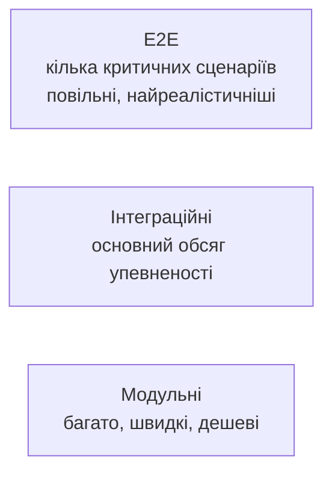
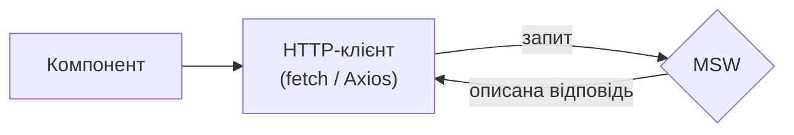
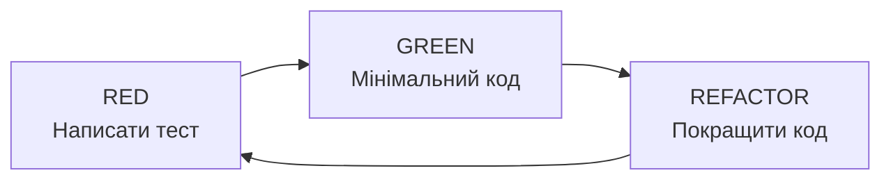

# Тестування React-компонентів

---

## План лекції

- Види тестів, піраміда тестування
- React Testing Library: основи
- Запити та `userEvent`
- Модульні тести компонентів і форм
- Мокування API: `vi.mock` та MSW
- Інтеграційні тести
- E2E-тестування з Playwright
- TDD, покриття, CI

---

## Навіщо тестувати?

- 🐛 Раннє виявлення помилок
- 🔄 Упевненість при рефакторингу
- 📖 Тести — жива документація поведінки
- 🚀 Швидший розвиток у довгостроковій перспективі
- 👥 Безпечніша командна робота

**Особливо важливо для:** форм, запитів до сервера, оплати, автентифікації

---

## Види тестів

| Рівень | Що перевіряє | Інструменти | Швидкість |
|---|---|---|---|
| Модульні | Компонент або функція в ізоляції | Vitest + RTL | Дуже швидкі |
| Інтеграційні | Кілька компонентів, підмінена мережа | Vitest + RTL + MSW | Швидкі |
| E2E | Повний сценарій у браузері | Playwright | Повільні |

---

## Піраміда тестування



- Пропорції залежать від застосунку («трофей тестування» — більше інтеграційних)
- Для застосунку з формами й запитами інтеграційні тести важать найбільше

---

## React Testing Library: філософія

**Ключовий принцип:**
> Чим більше тест схожий на дії користувача, тим більше впевненості він дає

**Тестуйте те, що бачить користувач, а не деталі реалізації**

- ✅ RTL: пошук за ролями, мітками, текстом
- ❌ Enzyme: доступ до стану й методів (не підтримує сучасні React)

**Переваги:**
- Тести стійкі до рефакторингу
- Кращі практики доступності
- Схожість на реальну поведінку користувача

---

## Налаштування середовища

```bash
npm install --save-dev vitest jsdom \
    @testing-library/react @testing-library/dom \
    @testing-library/jest-dom @testing-library/user-event
```

```javascript
// vite.config.js
import { defineConfig } from 'vitest/config';

export default defineConfig({
    plugins: [react()],
    test: {
        globals: true,
        environment: 'jsdom',
        setupFiles: './src/test/setup.js'
    }
});
```

⚠️ `@testing-library/dom` ставиться окремо (peer-залежність RTL 16)

---

## Файл налаштування

```javascript
// src/test/setup.js
import '@testing-library/jest-dom/vitest';
```

**Один рядок:** matchers підключено; при `globals: true` DOM очищується автоматично

**Matchers jest-dom:**
- `toBeInTheDocument()`
- `toHaveValue()`, `toBeChecked()`
- `toBeDisabled()`, `toBeInvalid()`
- `toHaveTextContent()`

```json
"scripts": {
    "test": "vitest",
    "test:run": "vitest run",
    "test:coverage": "vitest run --coverage"
}
```

---

## Перший тест

```jsx
function Button({ onClick, children, disabled = false }) {
    return <button onClick={onClick} disabled={disabled}>{children}</button>;
}
```

```javascript
import { render, screen } from '@testing-library/react';
import userEvent from '@testing-library/user-event';

it('викликає onClick при натисканні', async () => {
    const handleClick = vi.fn();
    const user = userEvent.setup();

    render(<Button onClick={handleClick}>Натисни</Button>);
    await user.click(screen.getByRole('button'));

    expect(handleClick).toHaveBeenCalledTimes(1);
});

it('не реагує, коли кнопку вимкнено', async () => {
    const handleClick = vi.fn();
    const user = userEvent.setup();

    render(<Button onClick={handleClick} disabled>Натисни</Button>);
    await user.click(screen.getByRole('button'));

    expect(handleClick).not.toHaveBeenCalled();
});
```

**Arrange – Act – Assert.** Класи Tailwind не перевіряємо (лекція 11)

---

## Запити: пріоритет

| № | Запит | Коли |
|---|---|---|
| 1 | `getByRole` | Кнопки, поля, заголовки — найкраще для доступності |
| 2 | `getByLabelText` | Поля форм |
| 3 | `getByPlaceholderText` | Немає мітки |
| 4 | `getByText` | Неінтерактивний текст |
| 5 | `getByAltText`, `getByTitle` | Зображення |
| 6 | `getByTestId` | Остання надія |

```javascript
screen.getByRole('button', { name: /надіслати/i });
screen.getByLabelText(/email/i);
```

---

## Варіанти запитів

| Сімейство | Не знайдено | Коли |
|---|---|---|
| `getBy…` | Помилка | Елемент має бути зараз |
| `queryBy…` | `null` | Перевірка відсутності |
| `findBy…` | Чекає, потім помилка | Елемент з'явиться пізніше |

```javascript
const button = screen.getByRole('button');

expect(screen.queryByRole('dialog')).not.toBeInTheDocument();

const heading = await screen.findByRole('heading', { name: /профіль/i });

const items = screen.getAllByRole('listitem');
expect(items).toHaveLength(3);
```

---

## userEvent

**`fireEvent`** — одна низькорівнева подія; **`userEvent`** — послідовність реальних подій

```javascript
import userEvent from '@testing-library/user-event';

it('взаємодія користувача', async () => {
    const user = userEvent.setup();   // ДО render
    render(<LoginForm onSubmit={vi.fn()} />);

    await user.type(screen.getByLabelText(/email/i), 'test@example.com');
    await user.click(screen.getByRole('button', { name: /увійти/i }));

    await user.dblClick(element);
    await user.hover(element);
    await user.keyboard('{Enter}');
    await user.selectOptions(select, 'UA');
    await user.clear(input);
});
```

**Усі методи асинхронні — не забувайте `await`**

---

## Тестування простих компонентів

```jsx
function UserCard({ user }) {
    if (!user) return <div>Користувача не знайдено</div>;

    return (
        <div>
            
            <h2>{user.name}</h2>
            <span>{user.isActive ? 'Активний' : 'Неактивний'}</span>
        </div>
    );
}
```

```javascript
it('показує статус неактивного користувача', () => {
    render(<UserCard user={{ ...mockUser, isActive: false }} />);

    expect(screen.getByText('Неактивний')).toBeInTheDocument();
});

it('показує повідомлення, коли користувача немає', () => {
    render(<UserCard user={null} />);

    expect(screen.getByText('Користувача не знайдено')).toBeInTheDocument();
});
```

---

## Тестування форм

```jsx
function LoginForm({ onSubmit }) {
    // ... стан email, password, errors
    return (
        <form onSubmit={handleSubmit} noValidate>
            <label htmlFor="email">Email</label>
            <input id="email" type="email" aria-invalid={!!errors.email} />
            {errors.email && <span role="alert">{errors.email}</span>}

            <label htmlFor="password">Пароль</label>
            <input id="password" type="password" />

            <button type="submit">Увійти</button>
        </form>
    );
}
```

---

## Тестування форм: введення й відправлення

```javascript
it('відправляє правильні дані', async () => {
    const handleSubmit = vi.fn();
    const user = userEvent.setup();

    render(<LoginForm onSubmit={handleSubmit} />);

    await user.type(screen.getByLabelText(/email/i), 'test@example.com');
    await user.type(screen.getByLabelText(/пароль/i), 'password123');
    await user.click(screen.getByRole('button', { name: /увійти/i }));

    expect(handleSubmit).toHaveBeenCalledWith({
        email: 'test@example.com',
        password: 'password123'
    });
});

it('не відправляє невалідні дані', async () => {
    const handleSubmit = vi.fn();
    const user = userEvent.setup();
    render(<LoginForm onSubmit={handleSubmit} />);

    await user.click(screen.getByRole('button', { name: /увійти/i }));

    expect(handleSubmit).not.toHaveBeenCalled();
});
```

---

## Тестування валідації

```javascript
it('показує помилку при некоректному email', async () => {
    const user = userEvent.setup();
    render(<LoginForm onSubmit={vi.fn()} />);

    await user.type(screen.getByLabelText(/email/i), 'invalid-email');
    await user.click(screen.getByRole('button', { name: /увійти/i }));

    expect(screen.getByText(/некоректний email/i)).toBeInTheDocument();
});

it('позначає поле як недійсне для допоміжних технологій', async () => {
    const user = userEvent.setup();
    render(<LoginForm onSubmit={vi.fn()} />);

    await user.click(screen.getByRole('button', { name: /увійти/i }));

    expect(screen.getByLabelText(/email/i)).toBeInvalid();
    expect(screen.getAllByRole('alert')).toHaveLength(2);
});
```

---

## Стійкість до рефакторингу

**Форма на `useState` → форма на React Hook Form + Zod**

```jsx
const { register, handleSubmit, formState: { errors } } = useForm({
    resolver: zodResolver(loginSchema)
});
```

**Тести не змінюються**, якщо ті самі тексти повідомлень і доступна розмітка

Тест знає лише те, що бачить користувач — а не як компонент влаштований усередині

---

## Мокування: vi.fn()

```javascript
const mockFunction = vi.fn();

mockFunction('arg1', 'arg2');

expect(mockFunction).toHaveBeenCalled();
expect(mockFunction).toHaveBeenCalledTimes(1);
expect(mockFunction).toHaveBeenCalledWith('arg1', 'arg2');

mockFunction.mockReturnValue(42);
mockFunction.mockResolvedValue({ data: 'success' });
mockFunction.mockRejectedValue(new Error('Failed'));
mockFunction.mockImplementation((x, y) => x + y);
```

**Підміна — лише зовнішніх залежностей:** мережа, час, браузерні API

---

## Мокування модулів

```javascript
import * as api from './api';

vi.mock('./api');

describe('UserProfile', () => {
    beforeEach(() => vi.clearAllMocks());

    it('відображає дані користувача', async () => {
        vi.mocked(api.fetchUser).mockResolvedValue({
            id: 1,
            name: 'Іван Петренко'
        });

        render(<UserProfile userId={1} />);

        expect(await screen.findByText('Іван Петренко')).toBeInTheDocument();
        expect(api.fetchUser).toHaveBeenCalledWith(1);
    });
});
```

⚠️ Тест прив'язаний до того, **як** компонент звертається до сервера

---

## MSW: підміна мережі



**Переваги:**
- Мокування на рівні мережі
- Не залежить від `fetch` чи Axios
- Той самий код — для тестів і розробки
- Реалістичніше тестування

```bash
npm install --save-dev msw
```

---

## MSW: обробники

```javascript
// mocks/handlers.js
import { http, HttpResponse } from 'msw';

const API = 'http://localhost:3000/api';

export const handlers = [
    http.get(`${API}/users/:userId`, ({ params }) => {
        return HttpResponse.json({
            id: Number(params.userId),
            name: 'Іван Петренко'
        });
    }),

    http.post(`${API}/users`, async ({ request }) => {
        const data = await request.json();
        return HttpResponse.json({ id: 1, ...data }, { status: 201 });
    })
];
```

⚠️ У Node `fetch` не приймає відносні адреси — у тестах адреса API повна

---

## MSW: налаштування

```javascript
// mocks/server.js
import { setupServer } from 'msw/node';
import { handlers } from './handlers';

export const server = setupServer(...handlers);
```

```javascript
// src/test/setup.js
import '@testing-library/jest-dom/vitest';
import { beforeAll, afterEach, afterAll } from 'vitest';
import { server } from '../mocks/server';

beforeAll(() => server.listen({ onUnhandledRequest: 'error' }));
afterEach(() => server.resetHandlers());
afterAll(() => server.close());
```

**Запит без обробника завершить тест помилкою**

---

## Тестування асинхронних компонентів

```javascript
it('показує завантаження, потім дані', async () => {
    render(<UserProfile userId={1} />);

    expect(screen.getByText(/завантаження/i)).toBeInTheDocument();

    expect(await screen.findByText('Іван Петренко')).toBeInTheDocument();

    expect(screen.queryByText(/завантаження/i)).not.toBeInTheDocument();
});

it('показує помилку, коли сервер відповідає 500', async () => {
    server.use(
        http.get(`${API}/users/:userId`, () => {
            return new HttpResponse(null, { status: 500 });
        })
    );

    render(<UserProfile userId={1} />);

    expect(await screen.findByRole('alert')).toHaveTextContent(/помилка/i);
});
```

---

## findBy та waitFor

```javascript
// Чекаємо появи елемента — findBy
expect(await screen.findByText('Нове ім\'я')).toBeInTheDocument();

// Чекаємо на інші зміни — waitFor
import { waitFor } from '@testing-library/react';

await waitFor(() => {
    expect(api.updateUser).toHaveBeenCalledWith(1, { name: 'Нове ім\'я' });
});
```

- `findBy…` = `getBy…` + `waitFor`: коротше й виразніше
- `waitFor` — для перевірок, що не зводяться до появи елемента
- Не загортайте в `waitFor` кілька дій

---

## TanStack Query та маршрутизація

```jsx
// src/test/renderWithProviders.jsx
export function renderWithProviders(ui, { route = '/' } = {}) {
    const queryClient = new QueryClient({
        defaultOptions: {
            queries: { retry: false },
            mutations: { retry: false }
        }
    });

    return {
        user: userEvent.setup(),
        ...render(
            <QueryClientProvider client={queryClient}>
                <MemoryRouter initialEntries={[route]}>
                    {ui}
                </MemoryRouter>
            </QueryClientProvider>
        )
    };
}
```

- **Новий `QueryClient` для кожного тесту** — кеш не «протікає»
- **`retry: false`** — тест із помилкою не чекає повторних спроб

---

## Фальшиві таймери

```javascript
it('зберігає чернетку через секунду після останньої зміни', async () => {
    vi.useFakeTimers();
    const user = userEvent.setup({ advanceTimers: vi.advanceTimersByTime });

    render(<AutoSaveForm />);
    await user.type(screen.getByPlaceholderText('Заголовок'), 'Привіт');

    expect(localStorage.getItem('formDraft')).toBeNull();

    await vi.advanceTimersByTimeAsync(1000);

    expect(JSON.parse(localStorage.getItem('formDraft')).title).toBe('Привіт');
});
```

Не чекаємо реально — «перемотуємо» годинник. Після тесту: `vi.useRealTimers()`

---

## Інтеграційні тести

**Кілька компонентів — як єдиний сценарій користувача**

```javascript
it('повний цикл: створення, виконання, видалення', async () => {
    const user = userEvent.setup();
    render(<TodoList />);

    // CREATE
    await user.type(screen.getByLabelText(/нове завдання/i), 'Купити молоко');
    await user.click(screen.getByRole('button', { name: /додати/i }));
    expect(screen.getByText('Купити молоко')).toBeInTheDocument();

    // UPDATE: перевіряємо стан, а не CSS-клас
    const checkbox = screen.getByRole('checkbox');
    await user.click(checkbox);
    expect(checkbox).toBeChecked();

    // DELETE
    await user.click(screen.getByRole('button', { name: /видалити/i }));
    expect(screen.queryByText('Купити молоко')).not.toBeInTheDocument();
});
```

---

## Доступність у тестах

- Запити за ролями й мітками вже перевіряють доступність непрямо
- Немає `aria-label` → довелося б брати `getByTestId` → сигнал проблеми
- Автоматичний пошук порушень — рушій **axe** (`vitest-axe`)
- Не замінює ручної перевірки, але ловить очевидні помилки

---

## E2E: Playwright

**Навіщо:** справжній браузер, справжній застосунок — те, чого не бачать jsdom та MSW

**Переваги Playwright:**
- Chromium, Firefox, WebKit
- Автоматичне очікування
- Локатори за ролями й мітками
- Паралельне виконання, «слід» для налагодження

| | Playwright | Cypress |
|---|---|---|
| Модель | Керує браузером ззовні | Усередині браузера |
| Паралельність | Вбудована | Окремо / платно |
| Локатори | Ролі, мітки | Переважно CSS |

```bash
npm init playwright@latest
```

---

## Playwright: конфігурація

```javascript
// playwright.config.js
export default defineConfig({
    testDir: './e2e',
    retries: process.env.CI ? 2 : 0,
    use: {
        baseURL: 'http://localhost:5173',
        trace: 'on-first-retry'
    },
    projects: [
        { name: 'setup', testMatch: /.*\.setup\.js/ },
        {
            name: 'chromium',
            use: {
                ...devices['Desktop Chrome'],
                storageState: 'playwright/.auth/user.json'
            },
            dependencies: ['setup']
        }
    ],
    webServer: {
        command: 'npm run dev',
        url: 'http://localhost:5173',
        reuseExistingServer: !process.env.CI
    }
});
```

**`storageState`:** вхід — один раз, сесія — для всіх тестів

---

## Playwright: перший тест

```javascript
import { test, expect } from '@playwright/test';

test('користувач може увійти', async ({ page }) => {
    await page.goto('/login');

    await page.getByLabel('Email').fill('test@example.com');
    await page.getByLabel('Пароль').fill('password123');
    await page.getByRole('button', { name: 'Увійти' }).click();

    await expect(page).toHaveURL('/dashboard');
    await expect(page.getByText('Вітаємо')).toBeVisible();
});
```

- Локатори за роллю й міткою надійніші за CSS-селектори
- `expect` сам чекає виконання умови — явні паузи не потрібні

---

## Playwright: складні сценарії

```javascript
test('повний цикл роботи із завданнями', async ({ page }) => {
    await page.goto('/todos');
    const input = page.getByPlaceholder('Додати завдання');

    await input.fill('Купити продукти');
    await page.getByRole('button', { name: 'Додати' }).click();
    await expect(page.getByText('Купити продукти')).toBeVisible();

    await input.fill('Прибрати квартиру');
    await input.press('Enter');

    const checkbox = page.getByRole('checkbox', { name: /купити продукти/i });
    await checkbox.check();
    await expect(checkbox).toBeChecked();

    await page.getByRole('button', { name: /видалити "прибрати квартиру"/i }).click();
    await expect(page.getByText('Прибрати квартиру')).not.toBeVisible();
});
```

**Тести незалежні:** кожен створює свої дані (унікальний email — `Date.now()`)

---

## Playwright: API-тестування

```javascript
test('автентифікація через API', async ({ request }) => {
    const response = await request.post(
        'http://localhost:3000/api/auth/login',
        { data: { email: 'test@example.com', password: 'password123' } }
    );

    expect(response.ok()).toBeTruthy();

    const body = await response.json();
    expect(body).toHaveProperty('accessToken');
});
```

**Налагодження:**
- `npx playwright test --ui`
- `npx playwright codegen`
- `npx playwright show-report`

---

## Test-Driven Development (TDD)



**Переваги:**
- Кращий дизайн: спершу — як компонентом користуватимуться
- Повніше покриття
- Тести як документація
- Упевненість під час рефакторингу

**Найкорисніший:** складна логіка, виправлення помилок (тест, що відтворює помилку)

---

## TDD приклад: тести (RED)

```javascript
describe('Counter', () => {
    it('починається з 0', () => {
        render(<Counter />);
        expect(screen.getByText('0')).toBeInTheDocument();
    });

    it('збільшується при кліку', async () => {
        const user = userEvent.setup();
        render(<Counter />);

        await user.click(screen.getByRole('button', { name: /збільшити/i }));
        expect(screen.getByText('1')).toBeInTheDocument();
    });

    it('зменшується при кліку', async () => {
        const user = userEvent.setup();
        render(<Counter />);

        await user.click(screen.getByRole('button', { name: /зменшити/i }));
        expect(screen.getByText('-1')).toBeInTheDocument();
    });
});
```

---

## TDD приклад: реалізація

```jsx
// GREEN: мінімальна реалізація
function Counter() {
    const [count, setCount] = useState(0);

    return (
        <div>
            <p>{count}</p>
            <button onClick={() => setCount(count + 1)}>Збільшити</button>
            <button onClick={() => setCount(count - 1)}>Зменшити</button>
            <button onClick={() => setCount(0)}>Скинути</button>
        </div>
    );
}

// REFACTOR: початкове значення, функціональні оновлення
function Counter({ initialValue = 0 }) {
    const [count, setCount] = useState(initialValue);

    const increment = () => setCount(prev => prev + 1);
    const decrement = () => setCount(prev => prev - 1);
    const reset = () => setCount(initialValue);

    return (/* ... */);
}
```

**Тести з кроку RED проходять без змін**

---

## Покриття тестами

```bash
npm install --save-dev @vitest/coverage-v8
npm run test:coverage
```

```javascript
test: {
    coverage: {
        provider: 'v8',
        include: ['src/**/*.{js,jsx}'],
        exclude: ['src/test/**', 'src/mocks/**'],
        reporter: ['text', 'html']
    }
}
```

| Метрика | Що вимірює |
|---|---|
| Statements | Інструкції |
| Branches | Гілки умов |
| Functions | Функції |
| Lines | Рядки |

**⚠️ Високе покриття ≠ якісні тести.** Покриття — карта білих плям, а не мета

---

## Що тестувати?

**✅ Тестуйте:**
- Критичний функціонал (оплата, реєстрація, вхід)
- Складну бізнес-логіку
- Краєві випадки (порожні списки, `null`)
- Обробку помилок і стани завантаження
- Доступність

**❌ Не тестуйте:**
- Деталі реалізації, класи Tailwind
- Код сторонніх бібліотек
- Тривіальні речі (константи)

---

## Найкращі практики

**Організація:**
- Файл тесту поряд із компонентом
- `describe` для групування, зрозумілі назви
- Arrange–Act–Assert

**Написання:**
- Поведінка, а не реалізація
- `getByRole`, `getByLabelText`; `getByTestId` — у крайньому разі
- Незалежні тести

**Мокування:**
- Лише зовнішні залежності
- MSW для HTTP
- Не підміняйте все підряд

---

## Налагодження тестів

```javascript
// Вивести DOM
screen.debug();

// Вивести окремий елемент
screen.debug(screen.getByRole('button'));

// Підказка для пошуку елемента
screen.logTestingPlaygroundURL();
```

- Помилка запиту `getByRole` містить перелік доступних ролей
- `npx vitest --ui` (пакет `@vitest/ui`)
- Розширення Vitest для VS Code
- Playwright: trace viewer, `--debug`

---

## Тести в CI

```yaml
name: Тести

on: [push, pull_request]

jobs:
  unit:
    runs-on: ubuntu-latest
    steps:
      - uses: actions/checkout@v4
      - uses: actions/setup-node@v4
        with:
          node-version: 24
          cache: npm
      - run: npm ci
      - run: npm run test:coverage

  e2e:
    runs-on: ubuntu-latest
    steps:
      - uses: actions/checkout@v4
      - uses: actions/setup-node@v4
        with: { node-version: 24, cache: npm }
      - run: npm ci
      - run: npx playwright install --with-deps
      - run: npx playwright test
```

Дві паралельні задачі; Node.js 18 уже не підтримується

---

## Питання для самоперевірки

1. Чим відрізняються модульні, інтеграційні й E2E-тести?
2. У чому основний принцип React Testing Library?
3. Який пріоритет запитів і чому?
4. Чим відрізняються `getBy`, `queryBy`, `findBy`?
5. Чому `userEvent` кращий за `fireEvent`?
6. `vi.mock` чи MSW: у чому різниця?
7. Навіщо новий `QueryClient` для кожного тесту?
8. Чому E2E лише для критичних сценаріїв? Що дає `storageState`?
9. Що таке цикл Red–Green–Refactor?
10. Чому високе покриття не гарантує якості?

---

## Корисні ресурси

**Документація:**
- [React Testing Library](https://testing-library.com/docs/react-testing-library/intro/)
- [Vitest](https://vitest.dev/)
- [Playwright](https://playwright.dev/)
- [MSW](https://mswjs.io/)
- [jest-dom](https://github.com/testing-library/jest-dom)

**Практика:**
- [Testing Playground](https://testing-playground.com/)
- [Блог Кента К. Доддса](https://kentcdodds.com/blog)
- [Типові помилки з React Testing Library](https://kentcdodds.com/blog/common-mistakes-with-react-testing-library)

**Інструменти:**
- [Storybook](https://storybook.js.org/) — компоненти в ізоляції та візуальні тести
- [Chromatic](https://www.chromatic.com/) — візуальна регресія
