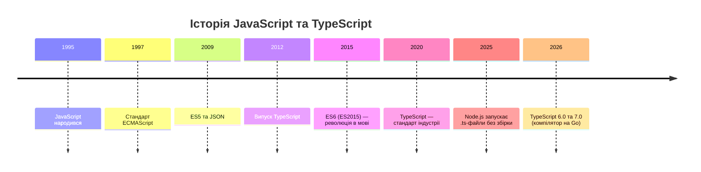
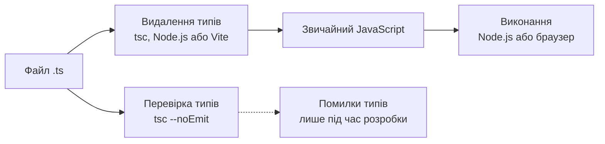
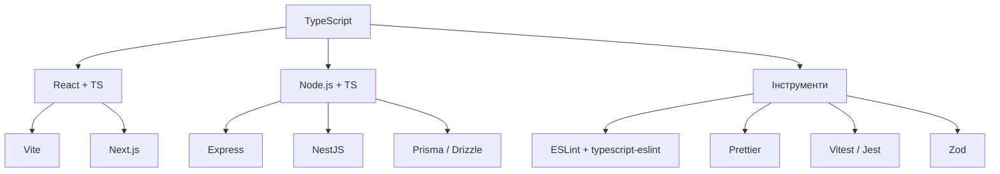

# TypeScript у веброзробці

## Навіщо TypeScript?

### Проблема JavaScript

- Динамічна типізація: помилки виявляються під час виконання, нерідко в користувача
- Редактор не знає, які властивості має об'єкт
- Рефакторинг великого проєкту — ручний пошук
- Коментарі застарівають

### Рішення

**TypeScript** — надмножина JavaScript із системою типів, що перевіряє код **до запуску**

---

## Від JavaScript до TypeScript



---

## Місце в курсі

- Лекції 01–02: сучасний JavaScript, Node.js, Express
- **Лекція 13:** шар гарантій — типи
- Лекція 14: лінтер, форматер, хуки перевіряють код автоматично
- Лекція 15: перевірка типів у конвеєрі CI

---

## Як працює TypeScript

### Дві ключові властивості

**Стирання типів** — типи існують лише під час розробки; браузер і Node.js виконують звичайний JavaScript

**Структурна типізація** — типи порівнюються за формою, а не за іменем

### Наслідок

Типи **не захищають** від некоректних даних під час виконання (API, форми) — потрібна окрема валідація

---

## Стирання типів: схема



**Перевірка типів і запуск — два окремі процеси**

---

## Стан екосистеми у 2026

**TypeScript 6.0** (березень 2026) — «перехідний» випуск

- `strict` увімкнено за замовчуванням
- `module` = `esnext`, `types` порожній
- застарілі параметри позначено deprecated

**TypeScript 7.0** — нативний компілятор на Go

- повна збірка швидша приблизно у 8–12 разів
- стабільного API ще немає (очікується у 7.1) → typescript-eslint працює на 6.x

**Node.js** запускає `.ts` напряму (видалення типів)

---

## Що вирішує TypeScript

### Динамічна типізація

```typescript
function calculatePrice(price: number, quantity: number): number {
    return price * quantity;
}

calculatePrice("100", "5"); // Помилка: рядок не є number
```

### Також

- **Автодоповнення** — точні підказки в редакторі
- **Рефакторинг** — компілятор показує всі місця змін
- **Документація** — типи завжди актуальні

---

## Три способи запуску TypeScript

| Спосіб | Перевірка типів | Коли використовувати |
|--------|-----------------|----------------------|
| `tsc` | Так | Збірка серверної частини, бібліотеки |
| `node файл.ts` | Ні | Розробка, скрипти |
| Vite | Ні | Клієнтська частина (React) |
| `tsx` | Ні | Коли Node.js не вистачає |

**Завжди додавайте окремо:** `tsc --noEmit`

---

## Стирані конструкції

### Node.js видаляє лише «стирані» типи

✅ анотації, `interface`, `type`, `import type`

❌ `enum`, `namespace` із кодом, параметри-властивості конструктора

### Прапорець `erasableSyntaxOnly`

Забороняє нестирані конструкції ще на етапі перевірки

---

## Налаштування: tsconfig для Node.js

```json
{
  "compilerOptions": {
    "target": "es2023",
    "module": "nodenext",
    "rootDir": "./src",
    "outDir": "./dist",
    "types": ["node"],
    "strict": true,
    "noUncheckedIndexedAccess": true,
    "verbatimModuleSyntax": true,
    "erasableSyntaxOnly": true,
    "rewriteRelativeImportExtensions": true
  },
  "include": ["src"]
}
```

---

## Ключові параметри tsconfig

**strict** — усі суворі перевірки (обов'язковий)

**noUncheckedIndexedAccess** — `arr[0]` має тип `T | undefined`

**verbatimModuleSyntax** — явні `import type`

**erasableSyntaxOnly** — лише стирані конструкції

**types** — у 6.0 за замовчуванням порожній: `["node"]`

---

## tsconfig для клієнтської частини

```json
{
  "compilerOptions": {
    "target": "es2023",
    "lib": ["ES2023", "DOM", "DOM.Iterable"],
    "module": "esnext",
    "moduleResolution": "bundler",
    "jsx": "react-jsx",
    "noEmit": true,
    "verbatimModuleSyntax": true,
    "strict": true
  },
  "include": ["src"]
}
```

Збірку виконує Vite, `tsc` лише перевіряє типи

---

## Базові типи

```typescript
let isDone: boolean = false;
let age: number = 30;
let name: string = "Іван";
let list: number[] = [1, 2, 3];
let tuple: [string, number] = ["привіт", 10];

function log(message: string): void { console.log(message); }
function fail(message: string): never { throw new Error(message); }
```

Анотація зазвичай не потрібна — тип **виводиться**

---

## Замість enum: as const

```typescript
const Role = {
    Admin: "admin",
    User: "user",
    Moderator: "moderator",
} as const;

type Role = (typeof Role)[keyof typeof Role];
// "admin" | "user" | "moderator"
```

Одне оголошення — значення для коду **і** тип

---

## any чи unknown?

```typescript
let notSure: any = 4;
notSure.toFixed(); // компілюється, але може впасти

let uncertain: unknown = 4;
if (typeof uncertain === "number") {
    uncertain.toFixed(); // після звуження типу
}
```

**Правило:** невідомий тип → `unknown`, а не `any`

---

## Літеральні типи та satisfies

```typescript
type HttpMethod = "GET" | "POST" | "PUT" | "DELETE";

const routes = {
    home: { path: "/", auth: false },
    profile: { path: "/profile", auth: true },
} satisfies Record<string, { path: string; auth: boolean }>;
```

`satisfies` перевіряє відповідність, **не розширюючи** тип

---

## Звуження типів і дискримінантні об'єднання

```typescript
type LoadState =
    | { status: "idle" }
    | { status: "loading" }
    | { status: "success"; data: string[] }
    | { status: "error"; message: string };

switch (state.status) {
    case "success": return state.data.length;
    case "error":   return state.message;
}
```

Усунення «неможливих» комбінацій `isLoading` + `error`

---

## Інтерфейси та типи

```typescript
interface User {
    id: number;
    email: string;
    firstName?: string;       // необов'язкова
    readonly createdAt: Date; // лише читання
}

interface AdminUser extends User {
    permissions: string[];
}

type StringOrNumber = string | number;          // об'єднання
type TimestampedEntity = Named & Timestamped;   // перетин
```

---

## interface чи type?

- **`interface`** — форма об'єктів і контракти класів; можна доповнювати (declaration merging)
- **`type`** — об'єднання, перетини, кортежі, похідні типи

**Головне — послідовність у межах проєкту**

---

## Функції

```typescript
function buildName(first: string, last?: string): string { /* ... */ }
function greet(name: string, greeting = "Привіт"): string { /* ... */ }
function sum(...numbers: number[]): number { /* ... */ }

type MathOperation = (a: number, b: number) => number;

function process(value: string): string;
function process(value: number): number;
function process(value: string | number) { /* ... */ }
```

---

## TypeScript у Node.js

```typescript
// src/index.ts — імпорти з розширенням .ts
import express from "express";
import { env } from "./config/env.ts";

const app = express();
app.use(express.json());
```

- `npm run dev` → `node --watch src/index.ts`
- `npm run typecheck` → `tsc --noEmit`
- `npm run build` → `tsc` (`.ts` → `.js`)

---

## Змінні середовища з перевіркою

```typescript
import { z } from "zod";

const EnvSchema = z.object({
    NODE_ENV: z.enum(["development", "test", "production"]).default("development"),
    PORT: z.coerce.number().int().positive().default(3000),
    DATABASE_URL: z.url(),
    JWT_SECRET: z.string().min(32),
});

export const env = EnvSchema.parse(process.env);
```

Застосунок падає **одразу** з зрозумілою помилкою

---

## Express і TypeScript

```typescript
interface UserParams { userId: string }

app.get("/api/users/:userId", async (req: Request<UserParams>, res: Response) => {
    const user = await userService.findById(Number(req.params.userId));
    if (!user) { res.status(404).json({ error: "Не знайдено" }); return; }
    res.json(user);
});
```

`Request<Params, ResBody, ReqBody, Query>`

⚠️ Анотації — **обіцянка**, а не гарантія: клієнт може надіслати будь-що

---

## Розширення Request: declaration merging

### ❌ `AuthRequest extends Request`

Конфліктує з `strictFunctionTypes`

### ✅ Доповнення глобального типу

```typescript
declare global {
    namespace Express {
        interface Request {
            user?: { id: number; email: string; role: UserRole };
        }
    }
}
export {};
```

---

## Автентифікація: перевірка payload

```typescript
const TokenPayload = z.object({
    sub: z.string(),
    email: z.email(),
    role: z.enum(["admin", "user", "moderator"]),
});

const payload = TokenPayload.parse(
    jwt.verify(token, env.JWT_SECRET, { algorithms: ["HS256"] }),
);
req.user = { id: Number(payload.sub), email: payload.email, role: payload.role };
```

Токен не «приводимо» до типу — **перевіряємо схемою**

---

## Схема → тип (Zod 4)

```typescript
const CreateUserSchema = z.object({
    email: z.email(),
    password: z.string().min(15),
    firstName: z.string().min(1),
});

type CreateUserBody = z.infer<typeof CreateUserSchema>;

const parsed = CreateUserSchema.safeParse(req.body);
if (!parsed.success) {
    res.status(400).json({ errors: z.flattenError(parsed.error).fieldErrors });
    return;
}
```

Розбіжності між перевіркою й типом **неможливі**

---

## Організація типів

```typescript
export type CreateUserDTO =
    Omit<User, "id" | "createdAt" | "updatedAt"> & { password: string };
export type UpdateUserDTO = Partial<Pick<User, "firstName" | "lastName">>;
export type UserResponse = Pick<User, "id" | "email" | "firstName">;

export interface PaginatedResponse<T> {
    items: T[];
    total: number;
    page: number;
}
```

Типи **виводяться** з одного джерела — не копіюються

---

## Бази даних: Prisma 7

```prisma
generator client {
  provider = "prisma-client"
  output   = "../src/generated/prisma"
}
```

```typescript
// prisma.config.ts: datasource: { url: env("DATABASE_URL") }
const adapter = new PrismaPg({ connectionString: env.DATABASE_URL });
export const prisma = new PrismaClient({ adapter });

type UserWithPosts = Prisma.UserGetPayload<{ include: { posts: true } }>;
```

Sequelize 6: `InferAttributes`, `InferCreationAttributes`, `declare`

---

## React з TypeScript

```bash
npm create vite@latest my-app -- --template react-ts
```

- Create React App більше не підтримується
- Звичайна функція замість `FC`
- `ComponentProps<"button">` — успадкування атрибутів
- У React 19 `ref` — звичайний проп, `forwardRef` не потрібен

```tsx
type ButtonProps = ComponentProps<"button"> & { variant?: "primary" | "danger" };
```

---

## Хуки: стан як об'єднання

```tsx
type UserState =
    | { status: "loading" }
    | { status: "error"; error: Error }
    | { status: "success"; user: User };

const [state, setState] = useState<UserState>({ status: "loading" });

useEffect(() => {
    const controller = new AbortController();
    fetchUser(userId, controller.signal).then(/* ... */);
    return () => controller.abort(); // скасування запиту
}, [userId]);
```

Для даних у виробництві — TanStack Query

---

## useReducer і мемоізація

```tsx
type CartAction =
    | { type: "add"; productId: number }
    | { type: "remove"; productId: number }
    | { type: "clear" };
```

**React Compiler 1.0** мемоізує автоматично — ручні `useMemo`/`useCallback` потрібні лише у виняткових випадках

---

## Події та форми

```tsx
const onChange = (e: ChangeEvent<HTMLInputElement>) => e.target.value;
const onSubmit = (e: FormEvent<HTMLFormElement>) => { e.preventDefault(); };
```

### React 19: дії форми

```tsx
const [state, formAction, isPending] = useActionState(
    async (_prev: FormState, formData: FormData): Promise<FormState> => { /* ... */ },
    { error: null },
);
```

`formData.get()` → `FormDataEntryValue | null` — потрібне звуження

---

## Контекст з TypeScript

```tsx
const AuthContext = createContext<AuthContextType | null>(null);

// React 19: контекст сам є провайдером
<AuthContext value={value}>{children}</AuthContext>

export function useAuth(): AuthContextType {
    const context = use(AuthContext);
    if (context === null) throw new Error("useAuth — лише всередині AuthProvider");
    return context;
}
```

Споживач отримує тип **без** `| null`

---

## Узагальнені типи (generics)

```typescript
function identity<T>(arg: T): T { return arg; }

function logLength<T extends { length: number }>(arg: T): T {
    console.log(arg.length);
    return arg;
}

interface PaginatedData<T> {
    items: T[];
    total: number;
}
```

`T` — «змінна для типу»

---

## Оператори типів

```typescript
type UserKeys = keyof User;           // "id" | "email" | "age"
type EmailType = User["email"];       // string
type Defaults = typeof defaultsObj;   // тип значення
```

Основа всіх допоміжних типів

---

## Вбудовані допоміжні типи

| Тип | Дія |
|-----|-----|
| `Partial<T>` | усі властивості необов'язкові |
| `Required<T>` | усі обов'язкові |
| `Readonly<T>` | лише для читання |
| `Pick<T, K>` / `Omit<T, K>` | вибрати / виключити поля |
| `Record<K, V>` | об'єкт із заданими ключами |
| `Exclude` / `Extract` / `NonNullable` | фільтрація об'єднань |
| `ReturnType` / `Parameters` / `Awaited` | типи функцій і промісів |

---

## Власні допоміжні типи

```typescript
type DeepPartial<T> = {
    [P in keyof T]?: T[P] extends object ? DeepPartial<T[P]> : T[P];
};

type ElementOf<T> = T extends readonly (infer U)[] ? U : never;

function pluck<T, K extends keyof T>(items: T[], key: K): T[K][] {
    return items.map((item) => item[key]);
}
```

**Відображені** та **умовні** типи

---

## Типізація API: проблема

### `response.json()` повертає `any`

```typescript
async function getUser(): Promise<User> {
    const response = await fetch("/api/user");
    return response.json(); // компілятор мовчить!
}
```

### Рішення

`unknown` + **перевірка схемою**

---

## Результат як об'єднання

```typescript
type Result<T, E = ApiError> =
    | { ok: true; data: T }
    | { ok: false; error: E };

const result = await userApi.getUserById(1);
if (result.ok) {
    console.log(result.data.firstName);   // User
} else {
    console.error(result.error.message);  // ApiError
}
```

Компілятор **змушує** обробити обидва варіанти

---

## Типізований клієнт API

```typescript
async get<S extends z.ZodType>(path: string, schema: S): Promise<Result<z.infer<S>>> {
    const response = await fetch(`${this.baseUrl}${path}`, {
        headers: { "Content-Type": "application/json", ...init.headers },
    });
    const body: unknown = await response.json().catch(() => null);
    const parsed = schema.safeParse(body);
    if (!parsed.success) {
        return { ok: false, error: { code: "INVALID_RESPONSE", message: z.prettifyError(parsed.error) } };
    }
    return { ok: true, data: parsed.data };
}
```

---

## Type guards чи Zod?

**Type guard** — `value is T`; для простих перевірок

```typescript
function isUser(value: unknown): value is User { /* ... */ }
```

⚠️ Легко «розсинхронізувати» з типом

**Схема Zod** — тип виводиться автоматично

Zod 4: `z.email()`, `z.url()`, `error.issues`, `z.prettifyError`

---

## Міграція JS → TS

```json
{
  "compilerOptions": {
    "allowJs": true,
    "checkJs": false,
    "strict": false,
    "noEmit": true
  }
}
```

⚠️ З TS 6.0 `strict` увімкнений за замовчуванням — для старого проєкту пишемо `"strict": false` **явно**

---

## П'ять кроків міграції

1. Встановити TypeScript, `allowJs: true`, скрипт `typecheck` у CI
2. Типи «знизу вгору»: утиліти → сервіси → обробники й компоненти
3. Збільшувати строгість по одному параметру
4. Типи для бібліотек (`@types/*`, власні `.d.ts`)
5. Рефакторинг: дискримінантні об'єднання, `unknown`, схеми Zod

`@ts-expect-error` замість `@ts-ignore`

---

## Бібліотеки без типів

```typescript
declare module "legacy-library" {
    export interface Config { apiKey: string; endpoint: string }
    export function initialize(config: Config): void;
    export function fetchData(id: string): Promise<unknown>;
}
```

`unknown` змусить користувача перевірити результат

---

## Екосистема TypeScript



---

## Найкращі практики

- **Не вимикайте строгість** — `strict`
- Віддавайте перевагу **виведенню типів**; анотуйте межі модулів
- `interface` — для об'єктів, `type` — для об'єднань; `as const` замість `enum`
- **Перевіряйте дані на межах**: `unknown` + Zod
- Моделюйте стани **дискримінантними об'єднаннями**
- Уникайте `any`; **виводьте** типи, не копіюйте
- Пишіть «стираний» TypeScript

---

## TypeScript у команді

- **Автоматизуйте:** `tsc --noEmit` в редакторі, хуку й CI (лекції 14–15)
- **Рецензуйте типи**, а не лише логіку
- Навчайте нових членів команди
- Підтримуйте типи актуальними; генеруйте їх зі схеми API

---

## Майбутнє TypeScript

**Швидкість** — нативний компілятор 7.0 робить перевірку майже миттєвою

**Розмивання межі з JavaScript** — `.ts` без збірки; пропозиція вбудованих анотацій типів у ECMAScript

**Типи й ШІ** — точні контракти допомагають автоматично перевіряти згенерований код (лекція 16)

---

## Ключові висновки

- TypeScript — **шар гарантій** над JavaScript; типи стираються
- Перевірка типів і запуск — **окремі кроки**
- Строгий режим, `unknown`, дискримінантні об'єднання
- **Схема Zod** на межі системи — єдине джерело істини для перевірки й типу
- Міграція — поступова
- Далі: лінтер, форматер, хуки та архітектура (лекція 14)
