# Архітектурні патерни та інструменти сучасної розробки

## Про що лекція

### Питання: як розвивати проєкт роками і в команді?

**Архітектурні патерни** — правила гри: де логіка, у який бік залежності

**Інструменти** — автоматично змушують ці правила виконувати

### План

1. Архітектура: MVC/MVP/MVVM, шари, чиста архітектура, DI, репозиторій і сервіс, помилки, логування
2. Інструменти: Git, ESLint + Prettier, Husky, Vite, Docker, VS Code

---

## Що таке архітектурний патерн?

### Визначення

**Архітектурний патерн** — перевірене рішення для організації коду: структура системи, компоненти та їх взаємодії

### Ключові питання

- Як організувати код для масштабованості?
- Як розділити відповідальність?
- Як забезпечити тестованість?
- Як зменшити зв'язаність між модулями?

---

## Чому архітектура важлива?

### Без продуманої архітектури

**Технічний борг** — швидкі рішення накопичуються

**Проблеми масштабування** — нову функцію не додати без переписування

**Труднощі підтримки** — більше часу на розуміння коду, ніж на написання

### З правильною архітектурою

- Чітке розділення відповідальності
- Легке тестування
- Паралельна розробка
- Гнучкість при зміні вимог

⚠️ Архітектура — засіб, а не мета. Починайте просто

---

## Еволюція архітектурних підходів

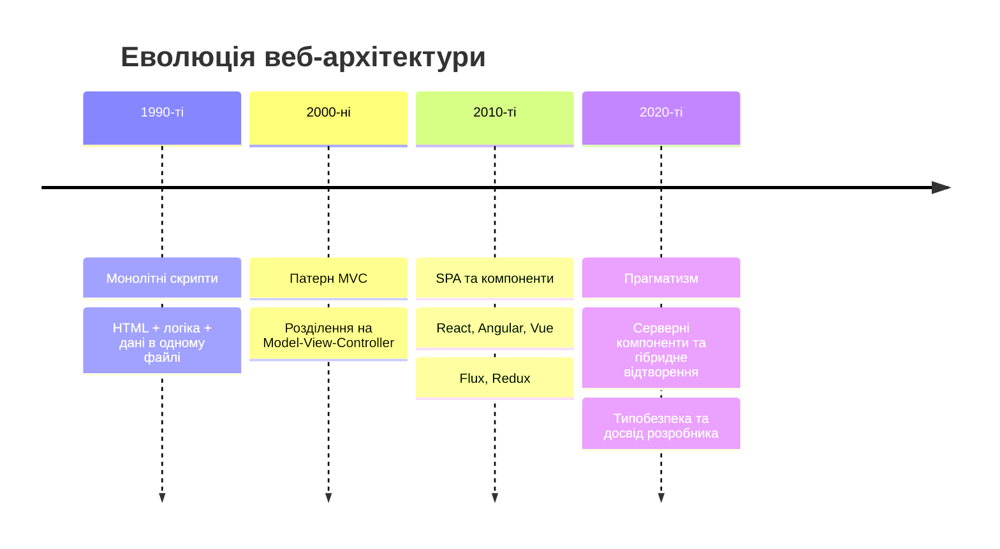

---

## MVC — Model-View-Controller

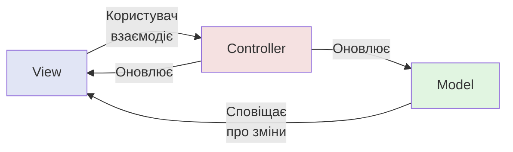

**Model** — дані та бізнес-логіка

**View** — відображення

**Controller** — координація взаємодії

---

## Компоненти MVC

**Model:** структури даних, валідація, бізнес-правила, зберігання

**View:** візуалізація, форми, форматування

**Controller:** обробка подій, перевірка входу, оркестрація операцій

⚠️ «Товсті контролери» — логіку виносимо в сервіси

```typescript
export const getUser: RequestHandler<{ id: string }> = async (req, res) => {
    const user = await userService.findById(Number(req.params.id));
    if (!user) { res.status(404).json({ error: "Не знайдено" }); return; }
    res.json(user);
};
```

---

## MVP — Model-View-Presenter

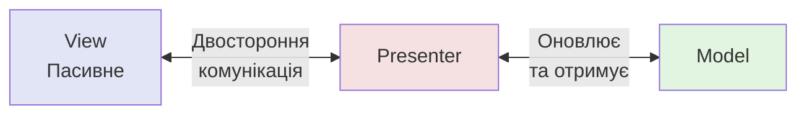

- **View** — пасивне, без логіки
- **Presenter** — уся логіка презентації
- Легке тестування, проста заміна View

---

## MVVM — Model-View-ViewModel

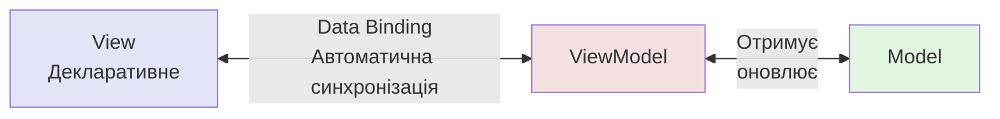

**ViewModel** — стан у готовому вигляді

**Data Binding** — автоматична синхронізація

**Vue, Angular**; у React роль ViewModel відіграє власний хук

---

## Хук як ViewModel

```tsx
function useCounter(initial = 0) {
    const [count, setCount] = useState(initial);
    return {
        count,
        isEven: count % 2 === 0,
        increment: () => setCount((c) => c + 1),
        reset: () => setCount(initial),
    };
}
```

Стан і дії — окремо від розмітки

---

## Порівняння MVC, MVP, MVVM

| Аспект | MVC | MVP | MVVM |
|--------|-----|-----|------|
| **Представлення** | Активне | Пасивне | Декларативне |
| **Зв'язування** | Ручне | Через презентер | Автоматичне |
| **Тестованість** | Середня | Висока | Висока |
| **Складність** | Низька | Середня | Висока |
| **Де зустрічається** | Серверні фреймворки | Складні UI | Реактивні фреймворки, хуки React |

---

## Шарова архітектура

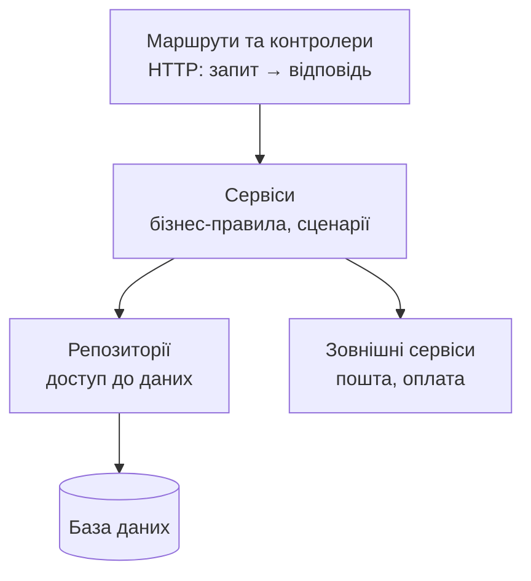

- **Контролер** розуміє HTTP
- **Сервіс** — бізнес-правила, не знає про HTTP
- **Репозиторій** ховає SQL/ORM

---

## Структура каталогів

```text
src/
├── config/        # змінні середовища
├── routes/        # маршрути
├── controllers/   # обробники HTTP
├── services/      # бізнес-логіка
├── repositories/  # доступ до даних
├── errors/        # доменні помилки
├── middleware/    # проміжні обробники
└── types/
```

Альтернатива: групування **за функціональністю** (`users/`, `orders/`)

---

## Clean Architecture

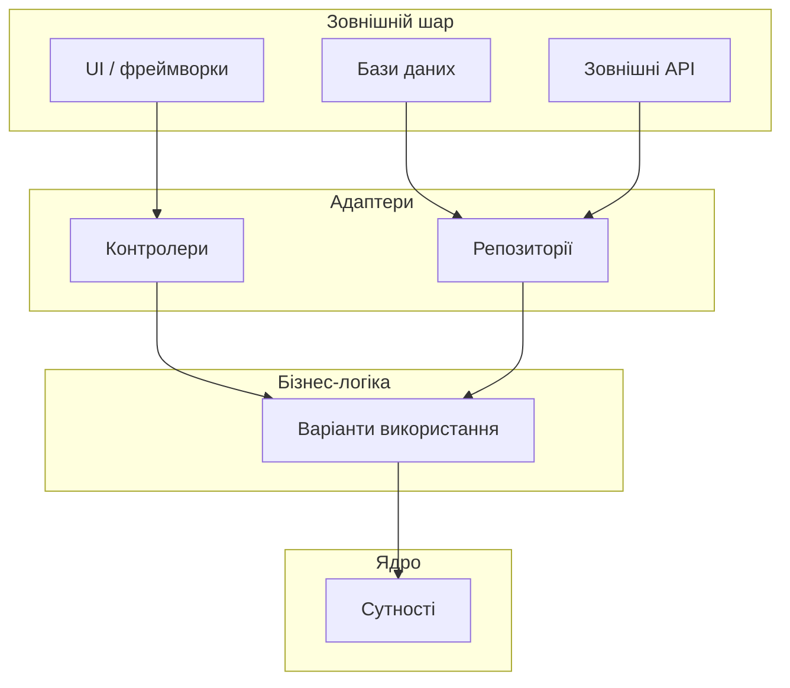

**Залежності спрямовані лише всередину**

---

## Принципи Clean Architecture

### Правило залежностей

Внутрішні шари **не знають** про зовнішні

### Незалежність

**Від фреймворків** — фреймворк це інструмент

**Від інтерфейсу** — легка заміна UI

**Від бази даних** — СУБД можна змінити

**Від зовнішніх сервісів**

### Результат: тестованість і довговічність

---

## Шари Clean Architecture

**Entities** — критичні бізнес-правила підприємства

**Use Cases** — сценарії застосунку: «оформити замовлення»

**Interface Adapters** — контролери, презентери, репозиторії

**Frameworks & Drivers** — БД, UI, веб-фреймворк

💡 Для невеликих проєктів: шари + інтерфейси для залежностей, що підмінюються

---

## Впровадження залежностей (DI)

### Об'єкт не створює залежності, а отримує їх ззовні

```typescript
// ❌ Жорстка залежність
class UserService {
    private database = new PostgresDatabase();
}

// ✅ Залежність передається
class UserService {
    private users: UserRepository;
    private mailer: EmailSender;
    constructor(users: UserRepository, mailer: EmailSender) {
        this.users = users;
        this.mailer = mailer;
    }
}
```

---

## Способи впровадження

**Через конструктор** — найпопулярніший; залежності обов'язкові

**Через властивості** — для необов'язкових

**Через параметри методу** — коли потрібно в одному виклику

**Контейнер DI** — NestJS, InversifyJS, tsyringe (для малих проєктів зайвий)

### «Корінь композиції»

Усі залежності збираються в **одному місці** на старті

---

## Корінь композиції

```typescript
// src/container.ts
const userRepository = new PrismaUserRepository(prisma);
const mailer = new SmtpEmailSender();
const userService = new UserService(userRepository, mailer);

export const userController = createUserController(userService);
```

Решта коду про вибір реалізацій нічого не знає

---

## Переваги DI: тестованість

```typescript
it("не дозволяє зареєструвати користувача з наявною поштою", async () => {
    const users: UserRepository = {
        findByEmail: async () => ({ id: 1, email: "a@b.ua" } as User),
        create: async () => { throw new Error("не мало викликатися"); },
    };
    const service = new UserService(users, { send: async () => {} });

    await expect(service.register({ email: "a@b.ua" } as CreateUserData))
        .rejects.toThrow("вже існує");
});
```

**Модульність, конфігурованість, повторне використання**

---

## Патерн «Репозиторій»

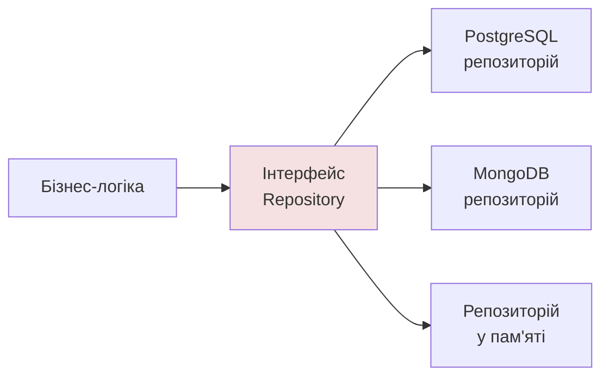

- Приховує деталі зберігання
- Легко замінити джерело даних
- Спрощує тестування

⚠️ Не обгортайте ORM автоматично — лише коли потрібні підміна чи ізоляція

---

## Репозиторій: реалізації

```typescript
export class PrismaUserRepository implements UserRepository {
    private prisma: PrismaClient;
    constructor(prisma: PrismaClient) { this.prisma = prisma; }

    findByEmail(email: string) {
        return this.prisma.user.findUnique({ where: { email } });
    }
}

export class InMemoryUserRepository implements UserRepository {
    private items: User[] = [];
    async findByEmail(email: string) {
        return this.items.find((u) => u.email === email) ?? null;
    }
}
```

---

## Патерн «Сервіс»

### Призначення

Координація операцій між репозиторіями, бізнес-правила

### Коли використовувати

- Операція зачіпає кілька репозиторіїв
- Складні правила кількох сутностей
- Зовнішні сервіси (пошта, оплата)
- Транзакційні операції
- Валідація з різних джерел

---

## Сервіс: приклад

```typescript
class OrderService {
    constructor(orders: OrderRepository, products: ProductRepository,
                payment: PaymentGateway) { /* ... */ }

    async checkout(userId: number, items: CartItem[]): Promise<Order> {
        // 1. перевірити наявність
        // 2. порахувати суму на сервері
        // 3. списати кошти
        // 4. створити замовлення
    }
}
```

⚠️ Усі кроки — в **одній транзакції** (або з компенсаціями)

---

## Репозиторій чи сервіс?

| | Репозиторій | Сервіс |
|---|---|---|
| **Відповідає за** | Доступ до даних сутності | Бізнес-правила, координацію |
| **Операції** | CRUD, запити | Сценарії |
| **Не містить** | Бізнес-логіки | Знань про SQL чи HTTP |
| **Використовує** | ORM / драйвер | Репозиторії, зовнішні сервіси |

---

## Типи помилок

**Операційні** — очікувані: не знайдено, невалідні дані, база тимчасово недоступна → обробляємо коректно

**Програмні** — баги → виправляємо; клієнту деталей не показуємо

### Власні класи помилок

```typescript
export class AppError extends Error {
    constructor(message: string, readonly statusCode: number, readonly code: string) {
        super(message);
    }
}
export class NotFoundError extends AppError { /* 404 */ }
export class ValidationError extends AppError { /* 400 */ }
```

`cause` (ES2022) зберігає початкову причину

---

## Централізована обробка (Express 5)

```typescript
export const errorHandler: ErrorRequestHandler = (err, req, res, _next) => {
    if (err instanceof AppError) {
        logger.warn({ err, requestId: req.id }, "Операційна помилка");
        res.status(err.statusCode).json({ error: { code: err.code, message: err.message } });
        return;
    }
    logger.error({ err, requestId: req.id }, "Необроблена помилка");
    res.status(500).json({ error: { code: "INTERNAL_ERROR", message: "Внутрішня помилка сервера" } });
};
```

- Express 5: відхилені проміси потрапляють сюди **автоматично**
- Клієнт не бачить стеків

---

## Межі помилок у React

```tsx
<ErrorBoundary FallbackComponent={ErrorFallback}
               onError={(error, info) => reportError(error, info.componentStack)}>
    <MainContent />
</ErrorBoundary>
```

- Плавна деградація: один віджет не руйнує застосунок
- Бібліотека `react-error-boundary`
- Не перехоплюють помилки подій і асинхронного коду
- React 19: `onCaughtError`, `onUncaughtError` у `createRoot`
- Next.js: `error.tsx`, `global-error.tsx`

---

## Рівні логування

| Рівень | Призначення |
|--------|-------------|
| **fatal / error** | Помилки, що вимагають уваги |
| **warn** | Потенційні проблеми |
| **info** | Нормальні події |
| **debug** | Деталі для розробки |
| **trace** | Дуже докладна інформація |

Виробництво: `info` і вище

---

## Структуроване логування: pino

```typescript
export const logger = pino({
    level: env.NODE_ENV === "production" ? "info" : "debug",
    redact: ["req.headers.authorization", "req.headers.cookie", "*.password", "*.token"],
});

logger.info({ userId: 42, action: "user.created" }, "Користувача створено");
```

⚠️ **У журнали не потрапляють** паролі, токени, номери карток, персональні дані

---

## Контекст запиту

```typescript
const storage = new AsyncLocalStorage<{ requestId: string }>();

export const requestContext: RequestHandler = (req, res, next) => {
    const requestId = req.header("x-request-id") ?? randomUUID();
    res.setHeader("x-request-id", requestId);
    storage.run({ requestId }, next);
};
```

- Один `requestId` на запит — «нитка» у журналі
- Розподілені системи: **OpenTelemetry** (лекція 15)
- Моніторинг: Sentry, Grafana, Datadog

---

## Найкращі практики архітектури

- Обирайте за **вимогами**, а не за модою; модульний моноліт — нормально
- Документуйте рішення (ADR)
- Автоматизуйте перевірку архітектури лінтером
- Тестуйте на всіх рівнях
- SOLID — орієнтир, не догма
- Еволюціонуйте; забезпечте розуміння в команді

> Найкращий код — той, який легко читати, розуміти та змінювати

---

## Частина II. Інструменти розробки

### Категорії

- Контроль версій — **Git**
- Якість коду — **ESLint, Prettier, TypeScript**
- Автоматизація — **Husky, lint-staged, CI**
- Збирання — **Vite**
- Контейнеризація — **Docker**

### Принципи

Автоматизація рутини · раннє виявлення проблем · єдині стандарти · швидкий зворотний зв'язок

---

## Багаторівневий захист якості

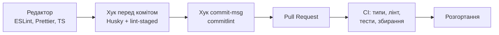

---

## Git: основи

- **Розподілена** система: повна копія історії в кожного
- Репозиторій · коміт · гілка · індекс · віддалений репозиторій

```bash
git config --global init.defaultBranch main
git status
git add -p
git commit -m "feat: додати форму входу"
git log --oneline --graph
git pull --rebase
```

Основна гілка — **`main`**

---

## Conventional Commits

```text
<тип>(<область>): <короткий опис>

[тіло: чому змінено]

[підвал: BREAKING CHANGE, #123]
```

Типи: `feat`, `fix`, `docs`, `style`, `refactor`, `perf`, `test`, `build`, `ci`, `chore`

- Один коміт — одна логічна зміна
- Автоматичний журнал змін і версії

---

## Гілки: switch, restore, merge, rebase

```bash
git switch -c feature/user-profile   # (замість checkout)
git restore src/App.tsx              # скасувати зміни у файлі
git merge feature/user-profile
git rebase main
```

- **merge** зберігає історію, **rebase** робить її лінійною
- ⚠️ Не перебазовуйте коміти, на яких можуть базуватися інші

---

## Стратегії роботи з гілками

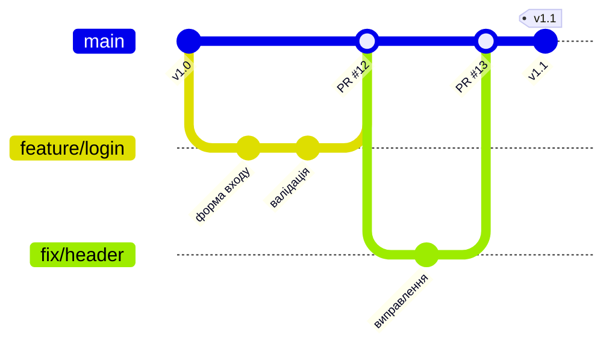

---

## Git Flow, GitHub Flow, trunk-based

| Модель | Гілки живуть | Для чого | Складність |
|--------|--------------|----------|-----------|
| Git Flow | Дні–тижні | Планові релізи, кілька версій | Висока |
| GitHub Flow | Години–дні | Більшість вебзастосунків | Низька |
| Trunk-based | Години | Команди з сильною автоматизацією | Низька, потребує дисципліни |

Навчальні проєкти → **GitHub Flow**

Незавершене ховаємо за **перемикачами функцій**

---

## Конфлікти та просунуті техніки

```text
<<<<<<< HEAD
const title = "Профіль користувача";
=======
const title = "Мій профіль";
>>>>>>> feature/user-profile
```

```bash
git merge --abort          # скасувати
git rebase -i HEAD~3       # почистити історію
git stash push -m "чернетка"
git reflog                 # відновити «втрачене»
git revert abc1234         # безпечне скасування
git bisect start           # пошук коміту з помилкою
```

Профілактика: короткі гілки, часті оновлення з `main`

---

## Pull Request і рецензія

### Гарний PR

- **Малий**; зрозумілий опис (шаблон у репозиторії)
- Проходить автоматичні перевірки до рецензії

### Рецензія

- Архітектура, безпека, читабельність, тести
- Стиль — справа автоматики
- **Захист `main`**: перевірки + схвалення
- ШІ-рецензент — підказка; відповідальність — на людині

`gh pr create`, `gh pr checks`

---

## ESLint і Prettier: різні завдання

**ESLint** — статичний аналіз: чи правильний код?

**Prettier** — форматування: як код виглядає?

Prettier відповідає за стиль, ESLint — за якість

---

## ESLint 10: плоска конфігурація

- Лише **flat config** — `eslint.config.js`
- `.eslintrc.*` та `.eslintignore` **вилучені**
- ESLint 9 — підтримка завершилась у серпні 2026
- Прапорець `--ext` вилучено

```bash
npm install --save-dev eslint @eslint/js typescript-eslint globals
```

---

## eslint.config.js

```javascript
import js from "@eslint/js";
import globals from "globals";
import tseslint from "typescript-eslint";
import { defineConfig, globalIgnores } from "eslint/config";

export default defineConfig(
    globalIgnores(["dist", "coverage", "src/generated"]),
    js.configs.recommended,
    tseslint.configs.recommended,
    {
        languageOptions: { globals: { ...globals.node } },
        rules: {
            "no-console": ["warn", { allow: ["warn", "error"] }],
            eqeqeq: ["error", "always"],
            "@typescript-eslint/consistent-type-imports": "error",
        },
    },
);
```

---

## Лінтинг з урахуванням типів

```javascript
tseslint.configs.recommendedTypeChecked,
{
    languageOptions: {
        parserOptions: {
            projectService: true,
            tsconfigRootDir: import.meta.dirname,
        },
    },
},
```

Ловить `no-floating-promises`, небезпечне `any`

⚠️ typescript-eslint працює з **TypeScript 6.x**

---

## Корисні правила

| Правило | Що ловить |
|---------|-----------|
| `@typescript-eslint/no-unused-vars` | Невикористані змінні |
| `eqeqeq` | `==` замість `===` |
| `prefer-const` | `let` без перепризначення |
| `no-floating-promises` | Забутий `await` |
| `no-explicit-any` | Явний `any` |
| `react-hooks/rules-of-hooks` | Хуки в умовах |
| `react-hooks/exhaustive-deps` | Неповні залежності `useEffect` |

---

## Prettier та їх спільна робота

```json
{ "semi": true, "singleQuote": false, "trailingComma": "all", "printWidth": 100 }
```

```bash
npx prettier --write .
npx prettier --check .   # для CI
```

`eslint-config-prettier` — **останнім** у конфігурації

❌ Не запускайте Prettier всередині ESLint

Швидкі альтернативи: **Biome**, **Oxlint**

---

## Інтеграція з VS Code

```json
{
  "editor.formatOnSave": true,
  "editor.defaultFormatter": "esbenp.prettier-vscode",
  "editor.codeActionsOnSave": { "source.fixAll.eslint": "explicit" },
  "typescript.tsdk": "node_modules/typescript/lib"
}
```

- `.vscode/` — у репозиторії (спільна поведінка команди)
- `extensions.json` — рекомендовані розширення
- Корисні: ESLint, Prettier, Error Lens, GitLens, Docker

---

## Git hooks і Husky 9

**Хуки Git** — скрипти на події: `pre-commit`, `commit-msg`, `pre-push`

Проблема: `.git/hooks` не потрапляє в репозиторій → **Husky**

```bash
npm install --save-dev husky
npx husky init     # додає "prepare": "husky"
```

```bash
# .husky/pre-commit
npx lint-staged
```

У Husky 9 **не потрібні** `#!/usr/bin/env sh` та `husky.sh`

---

## lint-staged

```json
{
  "lint-staged": {
    "*.{ts,tsx,js,jsx}": ["eslint --fix", "prettier --write"],
    "*.{json,md,css,yml}": ["prettier --write"]
  }
}
```

- Перевіряє лише **файли в індексі**
- Порядок: спочатку ESLint, потім Prettier
- `tsc --noEmit` — окремий рядок у хуку (проєкт цілком)

```bash
npx lint-staged
npm run typecheck
```

---

## commitlint

```javascript
// commitlint.config.js
export default {
    extends: ["@commitlint/config-conventional"],
    rules: { "subject-case": [0], "header-max-length": [2, "always", 100] },
};
```

```bash
# .husky/commit-msg
npx --no -- commitlint --edit $1
```

✗ `виправив баг` → `type may not be empty`

✓ `fix(auth): виправити перевірку токена`

---

## Хуки — не заміна CI

- Хуки можна обійти: `git commit --no-verify`
- Вони — зручність, а не бар'єр безпеки
- **Надійний бар'єр** — CI на сервері: ті самі перевірки + блокування злиття (лекція 15)

---

## Навіщо потрібен збирач

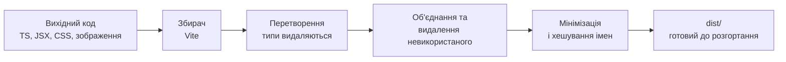

Dev: ES-модулі напряму · миттєвий старт · HMR

---

## Vite 8 і Rolldown

- Один збирач замість двох (esbuild + Rollup): **Rolldown** (Rust) + Oxc
- Виробнича збірка швидша в рази
- Однакова поведінка dev і production
- `rollupOptions` → **`rolldownOptions`**

```bash
npm create vite@latest my-app -- --template react-ts
npm run dev | build | preview
```

---

## Конфігурація Vite

```typescript
export default defineConfig({
    plugins: [react()],
    server: {
        port: 5173,
        proxy: { "/api": "http://localhost:3000" },
    },
    build: { sourcemap: true },
});
```

⚠️ До клієнта потрапляють лише змінні `VITE_*` — вони **видимі всім**. Секретів там бути не може

---

## Аналіз розміру збірки

```bash
ANALYZE=true npm run build   # dist/stats.html
```

Шукаємо:

- найбільші блоки
- дублікати бібліотек
- рідко потрібний код в основному файлі

Способи зменшення: легші бібліотеки, імпорт лише потрібного, розділення коду (лекція 15)

---

## Docker для локальної розробки

**Контейнер** — застосунок разом з оточенням в ізольованому відтворюваному пакеті

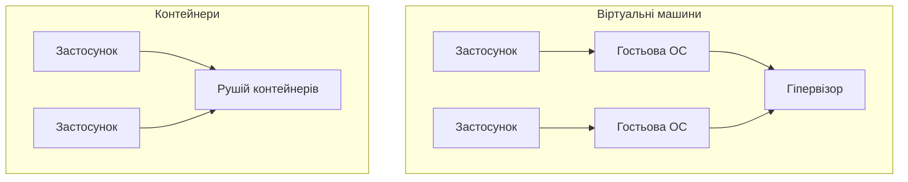

Образ · контейнер · Dockerfile · реєстр · том

---

## Dockerfile для розробки

```dockerfile
FROM node:24-alpine
WORKDIR /app

COPY package*.json ./
RUN npm ci

COPY . .
EXPOSE 3000
CMD ["npm", "run", "dev"]
```

- Рідко змінюване — **перед** часто змінюваним (кеш шарів)
- `.dockerignore`: `node_modules`, `.git`, `.env`

---

## Docker Compose

```yaml
# compose.yaml  (без поля version)
services:
  api:
    build: { context: ., dockerfile: Dockerfile.dev }
    ports: ["3000:3000"]
    environment:
      DATABASE_URL: postgres://app:app@db:5432/app
    depends_on:
      db: { condition: service_healthy }
    develop:
      watch:
        - { action: sync, path: ./src, target: /app/src }
  db:
    image: postgres:18-alpine
    healthcheck:
      test: ["CMD-SHELL", "pg_isready -U app"]
```

---

## Команди Compose

```bash
docker compose up -d --build
docker compose watch
docker compose logs -f api
docker compose exec api sh
docker compose down        # зупинити
docker compose down -v     # + видалити дані!
```

💡 Практика: **БД у контейнері**, серверна й клієнтська частини — локально

---

## VS Code: продуктивність

- **Розширення:** ESLint, Prettier, Error Lens, GitLens, Docker
- **Спільні налаштування:** `settings.json`, `extensions.json`, `launch.json`
- **Налагодження** Node.js з точками зупину в `.ts`
- **Фрагменти (snippets)** для шаблонного коду
- **Гарячі клавіші:** `Ctrl+D`, `F2`, `Ctrl+.`, `F12`, `Ctrl+Shift+P`

---

## Скрипти — єдина «мова» команди

```json
{
  "scripts": {
    "dev": "vite",
    "build": "tsc --noEmit && vite build",
    "typecheck": "tsc --noEmit",
    "lint": "eslint .",
    "format:check": "prettier --check .",
    "test": "vitest run",
    "check": "npm run typecheck && npm run lint && npm run format:check && npm run test",
    "prepare": "husky"
  }
}
```

`npm run check` = те, що робить CI

---

## CI: перший погляд

```yaml
name: CI
on: { pull_request: , push: { branches: [main] } }
permissions: { contents: read }
jobs:
  check:
    runs-on: ubuntu-latest
    steps:
      - uses: actions/checkout@v6
      - uses: actions/setup-node@v6
        with: { node-version: 24, cache: npm }
      - run: npm ci
      - run: npm run check
      - run: npm run build
```

`npm ci`, найменші права, повний CI — у лекції 15

---

## Баланс якості й швидкості

- Перевірки перед комітом — **за секунди**
- Правила узгоджені командою
- Нові правила: спочатку `warn`, потім `error`
- Не привчайте всіх до `--no-verify`
- Зафіксуйте домовленості: `CONTRIBUTING.md`, `.editorconfig`, шаблон PR, `AGENTS.md`

---

## Ключові висновки

- Архітектура визначає **правила гри**; інструменти змушують їх виконувати
- MVC/MVP/MVVM → шари → правило залежностей Clean Architecture
- DI + репозиторій + сервіс = тестованість
- Операційні й програмні помилки; централізована обробка; структуровані журнали
- Git (GitHub Flow, Conventional Commits) → ESLint 10 + Prettier → Husky 9 → Vite 8 → Docker Compose
- **Починайте просто. Автоматизуйте дисципліну.**
- Далі: продуктивність і DevOps (лекція 15)
