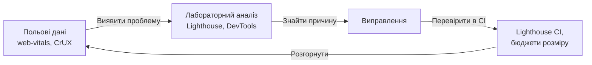
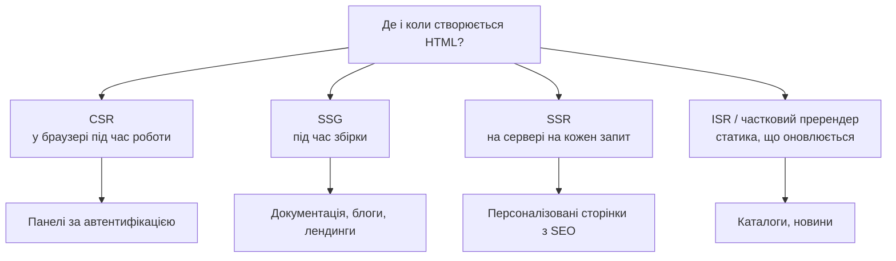
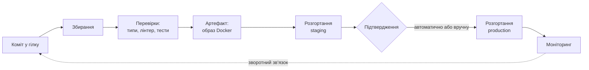
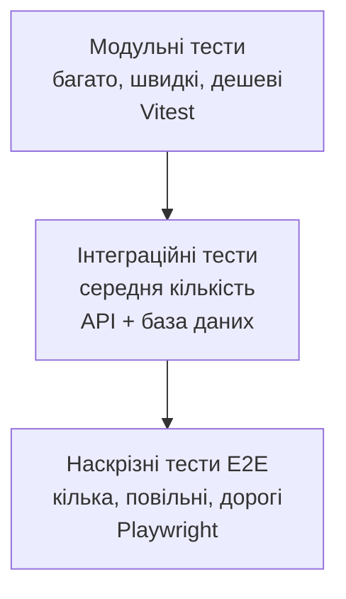

# Продуктивність, оптимізація та DevOps

## Про що лекція

### Від «працює» до «працює швидко і надійно»

**Частина I — продуктивність:** метрики, розмір збірки, розділення коду, кешування, відтворення, моніторинг, SEO, PWA

**Частина II — DevOps:** CI/CD, образи Docker, середовища й секрети, міграції, резервні копії, моніторинг і сповіщення

### Зв'язок з іншими лекціями

Лекція 14 → перевірки якості запускаються в **CI**
Лекція 16 → безпека ланцюга постачання

---

## Чому продуктивність має значення

- Довше завантаження → більше відмов і нижча конверсія
- Core Web Vitals — сигнал ранжування в пошуку
- Типовий користувач: **середній телефон і мобільна мережа**
- Тестуйте з **обмеженням мережі та процесора**

---

## Core Web Vitals

| Метрика | Що вимірює | Добре | Погано |
|---------|-----------|-------|--------|
| **LCP** | Швидкість завантаження | ≤ 2,5 с | > 4 с |
| **INP** | Чутливість до взаємодій | ≤ 200 мс | > 500 мс |
| **CLS** | Візуальна стабільність | ≤ 0,1 | > 0,25 |

75-й процентиль реальних відвідувань

⚠️ **INP замінив FID** (2024). `onFID` — застаріло

Допоміжні: TTFB, FCP, TBT

---

## Лабораторні та польові дані

**Лабораторні:** Lighthouse, DevTools — відтворювані, для налагодження

**Польові (RUM):** CrUX, `web-vitals` — справжня картина



---

## Проблема великих збірок

- JS — найдорожчий ресурс: **завантажити, розібрати, виконати**
- Б'є по LCP та INP
- «Розпухання»: важкі бібліотеки, дублікати, код рідких сторінок
- Ліки — **вимірювання** і дисципліна

---

## Аналіз і бюджет розміру

```bash
ANALYZE=true npm run build   # карта dist/stats.html
```

Шукаємо: найбільші блоки · дублікати · рідко потрібні пакунки

### Бюджет у CI

```javascript
const LIMIT_KB = 200; // gzip, на файл
for (const file of readdirSync("dist/assets").filter((f) => f.endsWith(".js"))) {
    const size = gzipSync(readFileSync(join("dist/assets", file))).length / 1024;
    if (size > LIMIT_KB) { console.error(`❌ ${file}: ${size.toFixed(1)} КБ`); failed = true; }
}
```

---

## Tree shaking

- Видалення експортів, які ніхто не використовує
- Працює лише з **ES-модулями** (не CommonJS)

```javascript
import { debounce } from "lodash-es";   // ✅
// import _ from "lodash";               // ❌ весь пакет
```

- `"sideEffects": false` у `package.json` власних бібліотек
- Обережно з «бочковими» файлами `index.ts`

---

## Динамічні імпорти

```typescript
async function exportToPdf(data: ReportData) {
    const { generatePdf } = await import("./pdf-generator");
    return generatePdf(data);
}
```

`import()` → окремий **chunk**, завантажується лише за потреби

Основа розділення за маршрутами й компонентами

---

## Оптимізація залежностей

| Було | Стало |
|------|-------|
| `moment` | `date-fns`, `dayjs`, `Intl`, Temporal |
| `lodash` | `lodash-es`, `structuredClone`, `Object.groupBy` |
| `axios` | вбудований `fetch` |
| `uuid` | `crypto.randomUUID()` |
| Іконки пакетом | Імпорт окремих |

Питання: чи потрібен? чи є вбудований API? чи є легша альтернатива?

Інструменти: bundlephobia, `knip`

---

## Групи розбиття у Vite 8

```typescript
build: {
    rolldownOptions: {
        output: {
            codeSplitting: {
                groups: [
                    { name: "react-vendor",
                      test: /node_modules[\\/](react|react-dom|react-router)[\\/]/,
                      priority: 20 },
                    { name: "vendor", test: /node_modules/, priority: 10 },
                ],
            },
        },
    },
},
```

Мета — довготривале кешування. ⚠️ Звіряйтеся з документацією Rolldown; перевіряйте результат візуалізатором

---

## Розділення за маршрутами

```tsx
// ✅ lazy — на верхньому рівні модуля, не всередині компонента
const Dashboard = lazy(() => import("./pages/Dashboard"));
const Settings = lazy(() => import("./pages/Settings"));

<Suspense fallback={<PageLoader />}>
    <Dashboard />
</Suspense>
```

React Router 7: `lazy` у самому маршруті

Next.js: розділення за сторінками — **автоматично**

---

## Розділення за компонентами

```tsx
const HeavyChart = lazy(() => import("./HeavyChart"));

{showChart && (
    <Suspense fallback={<div style={{ height: 320 }} />}>
        <HeavyChart />
    </Suspense>
)}
```

Заглушка **резервує місце** → без стрибків CLS

Кандидат: великий · не потрібен одразу · може не відкритись

---

## Попереднє завантаження

```tsx
const loadDashboard = () => import("./pages/Dashboard");
const Dashboard = lazy(loadDashboard);

<Link to="/dashboard" onMouseEnter={loadDashboard} onFocus={loadDashboard}>
```

```html
<link rel="preload" href="/fonts/inter.woff2" as="font" crossorigin />
<link rel="modulepreload" href="/assets/vendor.js" />
<link rel="prefetch" href="/assets/dashboard.js" />
<link rel="preconnect" href="https://api.example.com" />
```

---

## Speculation Rules API

```html
<script type="speculationrules">
{
  "prerender": [
    { "where": { "href_matches": "/products/*" }, "eagerness": "moderate" }
  ],
  "prefetch": [{ "urls": ["/cart", "/checkout"] }]
}
</script>
```

- Chromium; у інших браузерах просто ігнорується
- Перехід здається миттєвим
- Витрачає трафік — використовуйте обережно

---

## Помилки відкладеного завантаження

```tsx
<ErrorBoundary FallbackComponent={LazyErrorFallback}>
    <Suspense fallback={<PageLoader />}>
        <Dashboard />
    </Suspense>
</ErrorBoundary>
```

```typescript
const Dashboard = lazy(() => retryImport(() => import("./pages/Dashboard")));

// Нове розгортання, а вкладка стара
window.addEventListener("vite:preloadError", () => window.location.reload());
```

Повторюємо **`import()`**, а не `lazy`; з затримкою

---

## Рівні кешування


---

## Кешування HTTP

**Файли з хешем — «назавжди», HTML — ні**

| Ресурс | Cache-Control |
|--------|---------------|
| `/assets/*.js, *.css` (з хешем) | `public, max-age=31536000, immutable` |
| `index.html` | `no-cache` (перевіряти ETag) |
| API з персональними даними | `private, no-store` |
| Публічні дані API | `public, max-age=60, stale-while-revalidate=300` |

❌ HTML з `no-store` — кожен візит завантажує сторінку повністю

---

## Service Worker: стратегії

| Стратегія | Як працює | Для чого |
|-----------|-----------|----------|
| **Cache First** | Кеш → мережа | Статика з хешами, шрифти |
| **Network First** | Мережа → кеш | Дані, що часто змінюються |
| **Stale While Revalidate** | З кешу + оновити у фоні | Аватари, некритичне |
| **Network Only** | Лише мережа | Платежі |

Вручну не пишемо — **Workbox** / `vite-plugin-pwa`

---

## Кеш даних: TanStack Query v5

```tsx
const { data, isPending, error } = useQuery({
    queryKey: ["user", userId],
    queryFn: () => api.getUser(userId),
    staleTime: 5 * 60 * 1000,
    gcTime: 30 * 60 * 1000,
});
```

- `gcTime` (було `cacheTime`), `isPending` (було `isLoading`)
- `prefetchQuery` при наведенні
- Дедуплікація запитів

---

## Мемоізація: React Compiler 1.0

```typescript
react({ babel: { plugins: [["babel-plugin-react-compiler", {}]] } })
```

- Автоматично мемоізує компоненти й хуки
- Пишіть **просто й ідіоматично**
- Ручні `useMemo`/`useCallback` — лише коли профілювання підтвердило потребу

---

## Сховища браузера

| Сховище | Обсяг | Операції | Для чого |
|---------|-------|----------|----------|
| `localStorage` | ~5 МБ | Синхронні | Налаштування: тема, мова |
| `sessionStorage` | ~5 МБ | Синхронні | Дані вкладки |
| **IndexedDB** | Великий | Асинхронні | Офлайн-дані, файли |
| Cache API | Залежить | Асинхронні | HTTP-відповіді (Service Worker) |

⚠️ Секретів у `localStorage` — **ніколи**. Читання/запис — у `try/catch`

---

## INP: довгі завдання

- Завдання > 50 мс блокує головний потік
- Розбивайте роботу: `scheduler.yield()`
- Пріоритети в React: `useTransition`, `useDeferredValue`
- Важке — у **Web Worker** (Comlink)

```tsx
const deferredQuery = useDeferredValue(query);
<ResultsList items={items} query={deferredQuery} />
```

---

## Віртуалізація списків

```tsx
import { List, type RowComponentProps } from "react-window";

<List
    rowComponent={Row}
    rowCount={products.length}
    rowHeight={48}
    rowProps={{ items: products }}
    style={{ height: 480 }}
/>
```

- react-window **2.x** (`FixedSizeList` — версія 1)
- Змінна висота: `@tanstack/react-virtual`
- CSS: `content-visibility: auto`

---

## Зображення та шрифти

```html


```

- AVIF/WebP · `srcset` · **завжди `width`/`height`**
- LCP-зображення: `fetchpriority="high"`, **не** `lazy`
- Шрифти: WOFF2, підмножини, `font-display: swap`, `preload`

---

## Стабільність макета (CLS)

Причини стрибків:

- зображення й відео без розмірів
- динамічно вставлений вміст
- шрифти, що змінюють розмір тексту

Лікування — **резервувати місце**: `width`/`height`, `aspect-ratio`, `min-height`, скелетони

---

## Моніторинг: web-vitals 5

```typescript
import { onCLS, onINP, onLCP, onTTFB, type Metric } from "web-vitals";

function send(metric: Metric) {
    const body = JSON.stringify({ name: metric.name, value: metric.value,
                                  rating: metric.rating, page: location.pathname });
    if (!navigator.sendBeacon("/api/vitals", body)) {
        fetch("/api/vitals", { method: "POST", body, keepalive: true });
    }
}
onLCP(send); onINP(send); onCLS(send); onTTFB(send);
```

Збірка `web-vitals/attribution` — який елемент / взаємодія

---

## Власні метрики та Profiler

```typescript
performance.mark("search-start");
renderResults(await searchProducts(query));
performance.mark("search-end");
performance.measure("search-duration", "search-start", "search-end");
```

```typescript
new PerformanceObserver((list) => { /* довгі завдання */ })
    .observe({ type: "longtask", buffered: true });
```

**React Profiler** — профілюйте *перед* оптимізацією

---

## Lighthouse CI

```json
"assert": {
  "assertions": {
    "largest-contentful-paint": ["error", { "maxNumericValue": 2500 }],
    "cumulative-layout-shift": ["error", { "maxNumericValue": 0.1 }],
    "total-blocking-time": ["warn", { "maxNumericValue": 300 }]
  }
}
```

- Лабораторні вимірювання нестабільні → `numberOfRuns: 3`
- INP у лабораторії не вимірюється → TBT як наближення

---

## SEO для SPA

### Проблема

CSR віддає майже порожній HTML

- Google виконує JS, але пізніше й менш надійно
- Роботи соцмереж і багато ШІ-краулерів **не виконують JS**

### Рішення для публічних сторінок

Готовий HTML: **SSG** або **SSR**

---

## Стратегії відтворення



---

## CSR, SSG, SSR, ISR

| Підхід | HTML створюється | Плюси | Мінуси |
|--------|------------------|-------|--------|
| **CSR** | У браузері | Просто, дешево | Повільний перший показ, SEO |
| **SSG** | Під час збірки | Найшвидше | Дані застарівають |
| **SSR** | На кожен запит | Актуально, SEO | Навантаження, TTFB |
| **ISR / PPR** | Статика + оновлення | Баланс | Складніше кешування |

**Next.js 16:** Cache Components, Turbopack. У Next.js 15+ `params` — **проміс** (`await`)

---

## Метадані та структуровані дані

React 19: `<title>`, `<meta>`, `<link>` **переносяться в `<head>`** — `react-helmet-async` не потрібен

```tsx
<title>{article.title} — Блог курсу</title>
<meta name="description" content={article.summary} />
<link rel="canonical" href={`https://example.com/blog/${article.slug}`} />
```

**JSON-LD** (schema.org) — розширені результати пошуку

```tsx
const json = JSON.stringify(data).replace(/</g, "\\u003c"); // захист від XSS
```

---

## sitemap.xml та robots.txt

```text
User-agent: *
Allow: /
Disallow: /admin/
Sitemap: https://example.com/sitemap.xml
```

⚠️ `robots.txt` — **прохання, а не захист**. «Секретні» адреси туди не вносимо

---

## PWA: основи

**Прогресивний вебзастосунок** — сайт, що працює як нативний

1. **HTTPS**
2. **Маніфест** вебзастосунку
3. **Service Worker**

Плюси: один код, без магазинів, миттєві оновлення

Мінуси: нерівна підтримка (особливо iOS), менше можливостей

---

## Маніфест

```json
{
  "name": "Електронний журнал",
  "short_name": "Журнал",
  "start_url": "/",
  "display": "standalone",
  "theme_color": "#1d4ed8",
  "icons": [
    { "src": "/icons/icon-512.png", "sizes": "512x512", "type": "image/png", "purpose": "any" },
    { "src": "/icons/maskable-512.png", "sizes": "512x512", "type": "image/png", "purpose": "maskable" }
  ]
}
```

`any` і `maskable` — **окремі записи**, не `"any maskable"`

---

## vite-plugin-pwa

```typescript
VitePWA({
    registerType: "prompt",            // оновлення — за згодою користувача
    manifest: false,
    workbox: {
        globPatterns: ["**/*.{js,css,html,svg,png,woff2}"],
        navigateFallback: "/index.html",
        runtimeCaching: [
            { urlPattern: ({ url }) => url.pathname.startsWith("/api/products"),
              handler: "StaleWhileRevalidate" },
            { urlPattern: ({ request }) => request.destination === "image",
              handler: "CacheFirst" },
        ],
    },
})
```

⚠️ Не кешуйте персональні відповіді; не кешуйте POST

---

## Встановлення й офлайн-дані

- `beforeinstallprompt` — лише Chromium; показуємо власну кнопку **у зручний момент**
- Офлайн-режим — це ще й **дані**: черга змін в IndexedDB → відправка після `online`
- Конфлікти: «остання зміна перемагає» чи об'єднання

```typescript
window.addEventListener("online", () => void flushPendingChanges());
```

---

## Підсумок частини I

**Цикл:** виміряти → знайти причину → виправити → закріпити бюджетом у CI

Найбільший ефект:

1. Менше JavaScript
2. Правильне кешування
3. Оптимізовані зображення й шрифти
4. Вільний головний потік (INP)
5. Серверне відтворення публічних сторінок

---

## Частина II. DevOps: навіщо?

### Проблема

Dev хоче змінювати швидко, Ops — стабільно → «стіна» між командами

### DevOps

Культура й практики: **спільна відповідальність** і автоматизація шляху **від коду до користувача**

**Швидкість і стабільність не суперечать одна одній** (DORA)

---

## Принципи DevOps

- **Співпраця** й спільна відповідальність
- **Автоматизація** рутини
- **Безперервне вдосконалення**, розбір без звинувачень
- **Вимірюваність**
- **Інфраструктура як код** (Terraform / OpenTofu, Docker, YAML)

---

## Показники DORA

| Показник | Вимірює | Напрямок |
|----------|---------|----------|
| Частота розгортань | Як часто зміни в production | Швидкість |
| Час від коміту до production | Lead time | Швидкість |
| Частка невдалих змін | Скільки розгортань → збій | Стабільність |
| Час відновлення | Скільки триває усунення | Стабільність |
| Частота повторних доробок | Непередбачені виправлення | Стабільність |

2025: **ШІ підсилює** наявну якість процесів

---

## CI/CD



**CI** — часті зміни + автоматична перевірка

**Continuous Delivery** — готово до розгортання · **Continuous Deployment** — розгортається саме

---

## GitHub Actions: CI

```yaml
on: { pull_request: , push: { branches: [main] } }
permissions: { contents: read }
concurrency:
  group: ci-${{ github.workflow }}-${{ github.ref }}
  cancel-in-progress: true

jobs:
  check:
    runs-on: ubuntu-latest
    timeout-minutes: 15
    services:
      postgres: { image: "postgres:18-alpine", ports: ["5432:5432"], /* health-cmd */ }
    steps:
      - uses: actions/checkout@v6
      - uses: actions/setup-node@v6
        with: { node-version: 24, cache: npm }
      - run: npm ci
      - run: npm run typecheck && npm run lint && npm test && npm run build
```

---

## Ключові рішення в CI

- `permissions: contents: read` — найменші привілеї
- `concurrency` — скасовує застарілі запуски
- `services` — реальна база для інтеграційних тестів
- `npm ci` — точно за lock-файлом
- `timeout-minutes` — захист від зависань
- Дії: фіксація за **хешем коміту**, оновлення — Dependabot
- Матриця: Node 24 і 26

⚠️ `pull_request_target` + код із чужого PR = витік секретів

---

## Піраміда тестування



- Швидкі перевірки першими
- Нестабільні тести — виправляти або карантинити
- Покриття — орієнтир, не мета

---

## Playwright

```typescript
test("користувач може увійти та побачити свій профіль", async ({ page }) => {
    await page.goto("/login");
    await page.getByLabel("Електронна пошта").fill("student@example.com");
    await page.getByLabel("Пароль").fill("correct-horse-battery-staple");
    await page.getByRole("button", { name: "Увійти" }).click();

    await expect(page).toHaveURL("/profile");
    await expect(page.getByRole("heading", { name: "Мій профіль" })).toBeVisible();
});
```

Селектори за роллю та підписом → стійкі й доступні

---

## Доставка: образ і розгортання

```yaml
build:
  permissions: { contents: read, packages: write }
  steps:
    - uses: docker/login-action@v3
      with: { registry: ghcr.io, username: "${{ github.actor }}", password: "${{ secrets.GITHUB_TOKEN }}" }
    - uses: docker/build-push-action@v6
      with: { push: true, tags: "ghcr.io/${{ github.repository }}:${{ github.sha }}" }

deploy-staging:    { needs: build, environment: staging }
deploy-production: { needs: deploy-staging, environment: production }
```

- **Один артефакт — всюди**; різниться лише конфігурація
- Тег = хеш коміту → простий відкат
- `environment: production` — ручне підтвердження
- Хмара: **OIDC** замість довгоживучих ключів

---

## Варіанти хостингу

| Варіант | Приклади | Складність |
|---------|----------|-----------|
| PaaS | Render, Railway, Fly.io | Низька |
| Контейнери в хмарі | Cloud Run, ECS/Fargate | Середня |
| VPS + Compose | Hetzner, DigitalOcean | Середня |
| Kubernetes | Керовані кластери | Висока |
| Serverless / edge | Workers, Vercel, Lambda | Низька–середня |

Навчальний проєкт: PaaS або один VPS

---

## Стратегії розгортання

| Стратегія | Суть | Ризик |
|-----------|------|-------|
| **Rolling** | Екземпляри замінюються по одному | Дві версії одночасно |
| **Blue-green** | Нове середовище, потім перемикання | Подвійні ресурси |
| **Canary** | Спершу 1–5% трафіку | Потрібні метрики |
| **Feature flags** | Розгортання ≠ випуск | «Мертві» прапорці |

Під час розгортання версії **співіснують** → зворотна сумісність API та схеми БД

Версії: SemVer + `release-please` / `semantic-release`

---

## Середовища

| Середовище | Призначення | Дані |
|-----------|-------------|------|
| **Development** | Розробка | Вигадані |
| **Test / CI** | Автоматичні перевірки | Створюються тестами |
| **Staging** | Репетиція, схожа на production | Знеособлені |
| **Production** | Реальний продукт | Реальні |

**Twelve-Factor:** конфігурація — в середовищі, журнали — у `stdout`, без стану на диску

`.env.example` — у репозиторії, `.env` — **ніколи**

---

## Секрети

- ❌ Не в коді й репозиторії — навіть приватному
- Витік у коміті → вважати **скомпрометованим**, замінити
- CI: секрети GitHub на рівні середовища; передавати **лише потрібному кроку**
- Production: менеджер секретів (AWS/Google/Azure, Vault)
- **Ротація**, короткоживучі облікові дані
- `gitleaks`, push protection

```yaml
- env:
    DEPLOY_TOKEN: ${{ secrets.DEPLOY_TOKEN }}
  run: ./scripts/deploy.sh production
```

---

## Docker для production

```dockerfile
FROM node:24-alpine AS builder
WORKDIR /app
COPY package*.json ./
COPY prisma ./prisma
COPY prisma.config.ts ./
RUN npm ci                       # усі залежності — для збирання
COPY . .
RUN npx prisma generate && npm run build

FROM node:24-alpine AS runner
WORKDIR /app
ENV NODE_ENV=production
COPY package*.json ./
RUN npm ci --omit=dev && npm cache clean --force
COPY --from=builder /app/dist ./dist
USER node
HEALTHCHECK CMD node -e "fetch('http://localhost:3000/health/live').then(r=>process.exit(r.ok?0:1)).catch(()=>process.exit(1))"
CMD ["node", "dist/index.js"]
```

---

## Типові помилки Dockerfile

- ❌ `npm ci --omit=dev` **до** збирання → немає компілятора
- `--only=production` — застаріло → `--omit=dev`
- ✅ `USER node` — не від root
- ✅ `CMD ["node", …]` (масив) → сигнали доходять до Node.js
- ✅ `HEALTHCHECK` через `fetch`, без `curl`
- Prisma 7: клієнт генерується в `src/generated`
- Node 24 (LTS до квітня 2028); **Node 26 — LTS з жовтня 2026**

---

## Безпека образів

- **Скануйте:** Docker Scout (`docker scan` вилучено), Trivy, Grype
- Мінімальні базові образи: alpine, slim, distroless
- Секретів — **не в образі** (`ENV`, `ARG`, `COPY`); для збирання — `--mount=type=secret`
- Оновлюйте базові образи (Dependabot / Renovate)
- Підписи образів і **SBOM** (вимога CRA)

---

## Коректне завершення

```typescript
async function shutdown(signal: string) {
    logger.info({ signal }, "Отримано сигнал, завершуємо роботу");
    setTimeout(() => process.exit(1), 10_000).unref();   // страховка

    server.close(async () => {          // нові з'єднання не приймаємо
        await prisma.$disconnect();
        process.exit(0);
    });
}
process.on("SIGTERM", () => void shutdown("SIGTERM"));
process.on("SIGINT", () => void shutdown("SIGINT"));
```

---

## Міграції в production

- Код відкочується за секунди, **дані — ні**
- Під час розгортання працюють **стара й нова** версії

```bash
npx prisma migrate dev --name add_user_phone   # розробка
npx prisma migrate deploy                      # production і CI
```

- SQL-міграції — в репозиторії, проходять рецензію
- `migrate dev` у production — **ніколи**

---

## Expand / Contract


PostgreSQL: `CREATE INDEX CONCURRENTLY`, `lock_timeout`, порційні перенесення

Міграції — **окремий крок** перед запуском нової версії; відкат — «виправлення вперед»

---

## Резервне копіювання

> Копія, відновлення з якої не перевірялося, — це лише надія

- **RPO** — скільки даних готові втратити · **RTO** — за скільки відновимо
- Правило **3-2-1**: 3 копії · 2 носії · 1 поза основним місцем
- Шифрування; копії недоступні тому, хто має доступ до бази

| Метод | Коли |
|-------|------|
| `pg_dump` | Малі й середні бази |
| Фізична копія + WAL (PITR) | Великі бази |
| Керовані сервіси | Найпростіше й надійне |

---

## Скрипт копіювання

```bash
#!/usr/bin/env bash
set -euo pipefail

pg_dump --format=custom --no-owner --dbname="$DATABASE_URL" --file="$FILE"
pg_restore --list "$FILE" > /dev/null     # архів читається
sha256sum "$FILE" > "$FILE.sha256"
find "$BACKUP_DIR" -name 'app-*.dump*' -mtime +14 -delete
```

- Справжня перевірка — **періодичне відновлення** в тестове середовище
- Збій копіювання → сповіщення. «Мовчазна відмова» — найгірше
- Runbook + навчальні відновлення

---

## Три стовпи спостережуваності

| Стовп | Відповідає на запитання |
|-------|--------------------------|
| **Журнали** | Що сталося? |
| **Метрики** | Скільки, як швидко? |
| **Трасування** | Куди пішов час запиту? |

**OpenTelemetry** — відкритий стандарт збору всіх трьох; автоінструментація Express, HTTP, PostgreSQL

---

## Метрики: Prometheus

```typescript
const httpDuration = new client.Histogram({
    name: "http_request_duration_seconds",
    labelNames: ["method", "route", "status"],
    buckets: [0.01, 0.05, 0.1, 0.25, 0.5, 1, 2.5, 5],
});

res.on("finish", () => stop({
    method: req.method,
    route: req.route?.path ?? "unmatched",   // "/users/:id", не "/users/42"
    status: String(res.statusCode),
}));
```

- Вимірюємо при `finish`, коли відомий статус
- Мітки — з **обмеженим** набором значень
- `/metrics` — не публічний
- **RED** для сервісів · **USE** для ресурсів

---

## Health checks

```typescript
app.get("/health/live", (_req, res) => res.status(200).json({ status: "ok" }));

app.get("/health/ready", async (_req, res) => {
    try {
        await prisma.$queryRaw`SELECT 1`;
        res.status(200).json({ status: "ready" });
    } catch {
        res.status(503).json({ status: "unavailable" });
    }
});
```

- **Liveness** — перезапустити? (без зовнішніх залежностей)
- **Readiness** — приймати трафік?
- Статус **503**, не 200 з текстом помилки

---

## Сповіщення

- Сповіщайте про **симптоми** для користувача, а не причини
- Кожне сповіщення → **дія** + runbook
- `for:` — не реагувати на сплески
- Рівні: критичне (будити) · попередження (чат) · інформація (дашборд)
- **SLO** і «спалювання» бюджету помилок
- Втома від сповіщень — головна небезпека

```yaml
expr: |
  sum(rate(http_request_duration_seconds_count{status=~"5.."}[5m]))
    / sum(rate(http_request_duration_seconds_count[5m])) > 0.05
for: 5m
```

---

## Інструменти й інциденти

- Alertmanager → Slack, Telegram, пошта, чергування
- Моніторинг доступності ззовні: UptimeRobot, Better Stack
- **Sentry** — помилки клієнта й сервера по версіях

### Інцидент

1. **Відновити** (відкат, вимкнути прапорець)
2. Потім шукати причину
3. **Розбір без звинувачень**: хронологія, першопричина, дії

---

## Ключові принципи DevOps

1. Автоматизуйте шлях до користувача
2. Один артефакт — усюди
3. Секрети поза кодом, мінімальні права
4. Безпечні міграції (expand → contract)
5. Копії перевіряйте відновленням
6. Спостерігайте й сповіщайте про симптоми
7. Вчіться з інцидентів без пошуку винних

**Починайте з малого:** один CI-процес з типами, лінтером і тестами

---

## Майбутнє DevOps

- **Інженерія платформ** — «золоті шляхи» для команд
- **GitOps** — стан інфраструктури в Git
- **IaC:** Terraform, OpenTofu
- **Безпека ланцюга постачання:** підписи, SBOM, походження
- **ШІ в експлуатації:** аналіз журналів, пошук першопричин

Основи незмінні: малі зміни · автоматичні перевірки · швидкий зворотний зв'язок

Далі: безпека вебзастосунків (лекція 16)
