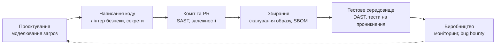
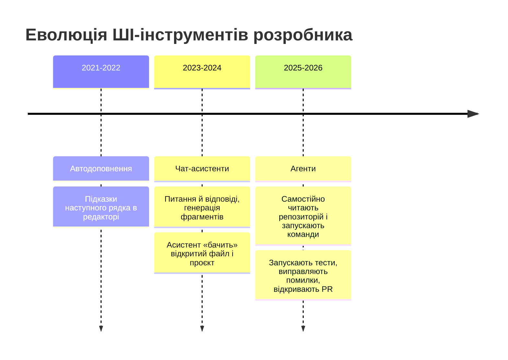
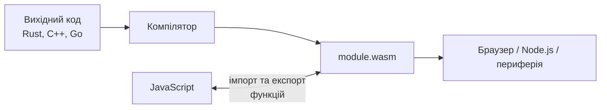
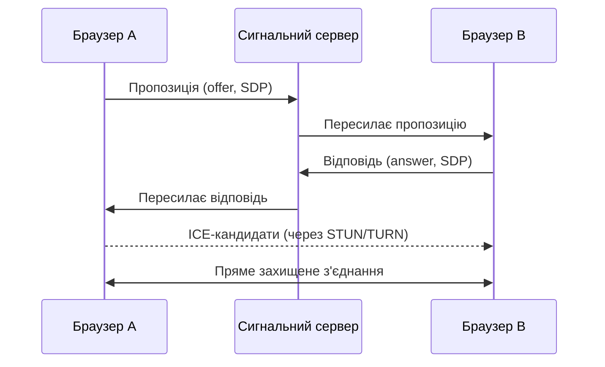

# Безпека вебзастосунків та сучасні тенденції

## Про що лекція

### Частина I — безпека

OWASP Top 10:2025 · валідація · XSS і CSRF · заголовки й CSP · тестування

### Частина II — майбутнє

ШІ та агенти · WebAssembly · WebGPU · edge · нові можливості платформи · доступність · кар'єра

### Зв'язок

Кожна нова технологія розширює **поверхню атаки**

---

## Масштаби проблеми

- Середня вартість витоку даних (IBM, 2025): **≈ 4,44 млн $**
- Виявлення й локалізація: **≈ 241 день**
- США: понад 10 млн $

Більшість атак використовують **відомі, давно описані помилки**

---

## Правове поле

**GDPR** — захист за задумом, повідомлення про витік за 72 години, штрафи до 4% обороту

**Закон України «Про захист персональних даних»** (2010) — актуальність норм перевіряйте на початку проєкту

**EU Cyber Resilience Act**

- повідомлення про активно експлуатовані вразливості — з **11.09.2026**
- повне застосування — **11.12.2027**
- SBOM, оновлення, розкриття вразливостей — обов'язкові практики

---

## Принципи безпечної розробки

- **Захист у глибину** — кілька шарів
- **Найменші привілеї**
- **Безпека за замовчуванням**
- **Fail closed** — у разі збою доступ закривається
- **Недовіра до вхідних даних**
- **Простота** — менше коду, менше залежностей
- Не вигадуйте криптографію

---

## OWASP Top 10:2025

| № | Категорія | Зміна відносно 2021 |
|---|-----------|---------------------|
| A01 | Порушення контролю доступу | включає SSRF |
| A02 | Неправильна конфігурація | піднялася з 5-го |
| A03 | Збої ланцюга постачання ПЗ | розширила «вразливі компоненти» |
| A04 | Криптографічні збої | було 2-ге |
| A05 | Ін'єкції | включає XSS |
| A06 | Небезпечне проєктування | було 4-те |
| A07 | Збої автентифікації | збережено |
| A08 | Порушення цілісності ПЗ чи даних | збережено |
| A09 | Збої журналювання та сповіщення | акцент на сповіщенні |
| A10 | Неправильна обробка виняткових ситуацій | **нова** |

---

## A01: IDOR

```typescript
// ❌ Перевірено вхід, але не належність ресурсу
const order = await prisma.order.findUnique({ where: { id: Number(req.params.id) } });

// ✅ Власник — із сесії
const order = await prisma.order.findFirst({
    where: { id: Number(req.params.id), userId: req.user!.id },
});
if (!order) { res.status(404).json({ /* ... */ }); return; }
```

Чужий ресурс → **404**, а не 403

---

## A01: ролі та масове присвоєння

```typescript
export const requireRole = (...roles: UserRole[]): RequestHandler => (req, res, next) => {
    if (!req.user || !roles.includes(req.user.role)) {
        res.status(403).json({ error: { code: "FORBIDDEN", message: "Недостатньо прав" } });
        return;
    }
    next();
};

const UpdateProfileSchema = z.object({
    firstName: z.string().min(1).max(100),
    lastName: z.string().min(1).max(100),
}).strict();   // role, isAdmin → помилка
```

---

## A01: SSRF

Сервер завантажує URL від користувача → `http://169.254.169.254/` (метадані хмари), `localhost`

Захист:

1. **Список дозволених доменів**
2. Лише `https`
3. Перевірити **IP** після DNS: не приватні/локальні діапазони
4. `redirect: "manual"`, таймаут, ліміт розміру
5. Мережеві обмеження для сервера

```typescript
return fetch(url, { redirect: "manual", signal: AbortSignal.timeout(5_000) });
```

---

## A02: Неправильна конфігурація

- Паролі за замовчуванням · режим налагодження у production
- Відкриті порти, бакети, зайві сервіси
- Детальні повідомлення про помилки

```typescript
app.disable("x-powered-by");
app.use(cors({
    origin: ["https://app.example.com"],   // ❌ не "*" разом з credentials
    credentials: true,
}));
```

Інфраструктура як код · перевірка конфігурації при старті · `helmet`

---

## A03: Ланцюг постачання

Атаки: відомі вразливості · тайпосквоттинг · dependency confusion · **компрометація супровідника** · `postinstall`-скрипти · компрометація CI

**2025:** самопоширюваний «хробак» npm (Shai-Hulud) викрадав токени та заражав пакети

---

## A03: Захист

1. Мінімізуйте залежності
2. `package-lock.json` + **`npm ci`**
3. `npm audit`, Dependabot / Renovate, OSV-Scanner
4. `--ignore-scripts`; затримка прийняття щойно опублікованих версій
5. Публікація: 2FA, **trusted publishing (OIDC)**, `--provenance`
6. CI: дії за хешем, мінімальні `permissions`
7. Образи: скан, дайджест
8. **SBOM** (CycloneDX, SPDX)
9. **SRI** для CDN-скриптів

```html
<script src="…/lib.min.js" integrity="sha384-…" crossorigin="anonymous"></script>
```

---

## A04: Криптографія

- HTTPS, TLS 1.2+ (бажано 1.3), **HSTS**
- Паролі — **Argon2id** (далі scrypt, bcrypt ≥ 10); MD5/SHA-256 — ні
- Випадкові значення: `crypto.randomBytes`, **не `Math.random()`**
- AES-256-GCM, унікальний IV, ключі в менеджері секретів
- Мінімізація даних

```typescript
const ARGON_OPTIONS = {
    type: argon2.argon2id,
    memoryCost: 19456,   // 19 МіБ
    timeCost: 2,
    parallelism: 1,
} as const;
```

---

## A05: SQL-ін'єкція

```typescript
// ❌ Конкатенація
await prisma.$queryRawUnsafe(`SELECT * FROM users WHERE email = '${email}'`);

// ✅ Параметризація
const user  = await prisma.user.findUnique({ where: { email } });
const users = await prisma.$queryRaw`SELECT id FROM users WHERE email = ${email}`;
const res   = await pool.query("SELECT id FROM users WHERE email = $1", [email]);
```

- Назви стовпців / сортування — лише зі **списку дозволених**
- «Санітизація» рядків власноруч — ненадійна
- Мінімальні права БД

---

## A05: NoSQL, команди ОС

### NoSQL

```javascript
// { "password": { "$ne": null } } — умова істинна для будь-якого пароля
User.findOne({ email: req.body.email, password: req.body.password });
```

Захист: схема (`z.string()`), `sanitizeFilter: true`, хеші замість паролів

### Команди ОС

```typescript
exec(`convert ${filename} out.png`);              // ❌
execFile("convert", [filename, "out.png"]);       // ✅ без оболонки
```

---

## A05: XSS

**Відбитий** · **збережений** · **на основі DOM**

```tsx
<p>{comment.text}</p>                                       {/* ✅ React екранує */}
<div dangerouslySetInnerHTML={{ __html: comment.text }} />  {/* ❌ */}
<div dangerouslySetInnerHTML={{ __html: DOMPurify.sanitize(comment.html) }} />  {/* ✅ */}
```

Також небезпечні: `href={userUrl}` (`javascript:`), `eval`, `innerHTML`, `document.write`

HTML очищує **DOMPurify**, а не регулярні вирази

Другий рівень: **CSP**, Trusted Types, `HttpOnly`

---

## A06: Небезпечне проєктування

- **Моделювання загроз — STRIDE:** Spoofing · Tampering · Repudiation · Information disclosure · Denial of service · Elevation of privilege
- Сценарії зловживання: «що, якщо надіслати 10 000 разів?»
- Ціни й права — на сервері
- Однакові відповіді для існуючих і неіснуючих облікових записів

```typescript
rateLimit({ windowMs: 15 * 60 * 1000, limit: 10, standardHeaders: "draft-8" });
```

`limit` (раніше `max`)

---

## A07: Автентифікація

**NIST SP 800-63B (ред. 4) та OWASP:**

- **Довжина > складність:** єдиний фактор — мінімум **15 символів**; до 64+ дозволено
- ❌ Правила складності · ❌ примусова ротація
- ✅ Перевірка за списком витеклих (HIBP, k-anonymity)
- ✅ Дозволяти вставляти пароль
- ✅ Обмеження спроб входу

**MFA:** SMS (слабко) → TOTP → **passkeys (WebAuthn)** — стійкі до фішингу

---

## A07: Сесії та токени

```typescript
res.cookie("session", sessionId, {
    httpOnly: true,     // недоступна JS
    secure: true,       // лише HTTPS
    sameSite: "lax",    // проти CSRF
    maxAge: 60 * 60 * 1000,
});
```

- Новий ідентифікатор сесії **після входу**
- JWT: `algorithms: ["HS256"]`, короткий термін, ротація refresh
- Не зберігати токени в `localStorage`
- Не писати автентифікацію самим: перевірені бібліотеки, OAuth 2.1 / OIDC

---

## A08: Цілісність ПЗ і даних

- Небезпечна десеріалізація, `eval`, автооновлення без підпису
- Незахищений CI/CD
- CDN без SRI

Захист:

- `JSON.parse` + **перевірка схемою**
- Контрольні суми й підписи артефактів
- Захищені гілки, рецензія workflow, підписані образи

---

## A09: Журналювання та сповіщення

**Журналюємо:** вхід, зміну пароля/MFA, 401/403, адмін-дії, підозрілі вхідні дані

**Не журналюємо:** паролі, токени, картки, персональні дані

Структурований JSON → проти ін'єкції в журнал

```typescript
logger.warn({ event: "auth.login_failed", email: maskEmail(email), ip: req.ip, requestId },
            "Невдала спроба входу");
```

Головне — щоб на події **хтось реагував**: сповіщення

---

## A10: Виняткові ситуації

```typescript
// ❌ Fail open
try { if (!(await permissions.check(req.user, "orders:read"))) return res.status(403).end(); }
catch { /* ігноруємо */ }
next();

// ✅ Fail closed
catch (error) {
    logger.error({ err: error }, "Не вдалося перевірити права");
    res.status(503).json({ error: { code: "UNAVAILABLE" } });
}
```

Централізований обробник · `express.json({ limit: "100kb" })` · транзакції · обробка `unhandledRejection`

---

## Валідація вхідних даних

- На **сервері** (клієнтська — лише зручність)
- **Allowlist**, а не blocklist
- Якомога **раніше**, на межі системи
- Тип · формат · довжина · діапазон · набір значень · узгодженість полів
- Відхиляти, а не «лагодити»

```typescript
const RegisterSchema = z.object({
    email: z.email().max(254),
    password: z.string().min(15).max(128),
    role: z.enum(["student", "teacher"]),
    username: z.string().regex(/^[a-z0-9_]{3,30}$/i),
});
```

---

## Файли від користувача

- Розмір — ліміт на сервері
- Тип — за **вмістом** («магічні байти»), не за розширенням
- Ім'я — генеруйте власне (проти `../`)
- Зберігайте поза каталогом статики; `nosniff`
- Об'єктне сховище + тимчасові підписані адреси

---

## Кодування на виході

| Контекст | Захист |
|----------|--------|
| HTML-текст | Автоекранування (React) |
| Атрибут | Екранування; перевірка протоколу `href` |
| Сирий HTML | DOMPurify |
| SQL | Параметризація |
| Оболонка ОС | `execFile` + масив |
| URL-параметр | `encodeURIComponent` |
| Ім'я файла | Власне ім'я |

---

## CSRF

Браузер **автоматично додає кукі** до будь-якого запиту до домену

Можлива лише для автентифікації через кукі (не `Authorization: Bearer`)

### Захист (замість застарілого `csurf`)

1. `SameSite=Lax/Strict`
2. Перевірка `Origin` / **`Sec-Fetch-Site`**
3. Токени (`csrf-csrf`, double-submit) для чутливих дій
4. Не змінювати стан через GET

```typescript
const site = req.get("sec-fetch-site");
if (site === "same-origin" || site === "none") return next();
```

---

## Заголовки безпеки

```typescript
app.use(helmet());
```

| Заголовок | Призначення |
|-----------|-------------|
| `Strict-Transport-Security` | Завжди HTTPS |
| `Content-Security-Policy` | Джерела скриптів, стилів; захист від XSS |
| `X-Content-Type-Options: nosniff` | Заборона «вгадувати» тип |
| `Referrer-Policy` | Скільки даних про джерело передавати |
| `Permissions-Policy` | Вимкнути зайві функції браузера |
| `frame-ancestors` (CSP) | Захист від clickjacking |

`X-XSS-Protection` — не використовується (`0`)

Перевірка: securityheaders.com, Mozilla Observatory

---

## CSP з nonce

```typescript
app.use((_req, res, next) => {
    res.locals.cspNonce = crypto.randomBytes(16).toString("base64");
    next();
});

app.use(helmet({ contentSecurityPolicy: { directives: {
    defaultSrc: ["'self'"],
    scriptSrc: ["'self'", (_req, res) => `'nonce-${(res as express.Response).locals.cspNonce}'`],
    objectSrc: ["'none'"],
    baseUri: ["'self'"],
    frameAncestors: ["'none'"],
}}}));
```

- Nonce додається **один раз** (функція-директива)
- Спершу `Content-Security-Policy-Report-Only`
- Next.js 16: `proxy.ts`
- **Trusted Types**: `require-trusted-types-for 'script'`

---

## DevSecOps: тестування безпеки



---

## Інструменти

| Клас | Приклади |
|------|----------|
| **SAST** | CodeQL, Semgrep, `eslint-plugin-security` |
| **SCA** | `npm audit`, Dependabot, OSV-Scanner, Snyk |
| **Секрети** | gitleaks, GitHub push protection |
| **Контейнери / IaC** | Trivy, Docker Scout, Grype |
| **DAST** | OWASP ZAP, Nuclei |
| **Пентест** | Burp Suite |
| **Bug bounty** | HackerOne, Bugcrowd |

---

## Пентест: етика і закон

Фази: розвідка → сканування → експлуатація → закріплення → звіт

⚠️ Лише з **письмовим дозволом** власника. Несанкціонований доступ — злочин (зокрема за Кримінальним кодексом України)

Практика: OWASP Juice Shop, DVWA, WebGoat, PortSwigger Academy, HackTheBox

---

## Контрольний список

- [ ] Доступ + **належність ресурсу** (A01)
- [ ] Схеми на вході; зайві поля відхиляються (A05, A06)
- [ ] Запити параметризовані (A05)
- [ ] Argon2id, 15+ символів, список витеклих (A04, A07)
- [ ] Кукі `HttpOnly`/`Secure`/`SameSite`; rate limiting (A06, A07)
- [ ] `helmet`, CSP, CORS зі списком (A02)
- [ ] Lock-файл, Dependabot, `npm ci`, `npm audit` (A03)
- [ ] Помилки без подробиць; fail closed (A10)
- [ ] Безпекові події → журнал → сповіщення (A09)
- [ ] Секрети поза репозиторієм; `SECURITY.md`

---

## Підсумок частини I

- Атаки використовують **відомі помилки**; OWASP Top 10 — мінімальна карта
- Три питання до кожної функції: **хто може викликати? що зламається? що, якщо дані ворожі?**
- Довіряйте серверу, не клієнту
- Ланцюг постачання — одна з головних проблем індустрії
- **Автоматизуйте** безпеку у CI

---

## Частина II. Що змінюється у веброзробці

**Змінюються інструменти, принципи залишаються**

Чотири сили:

1. **Продуктивність** — швидше й дешевше
2. **Платформа** — браузери вміють усе більше
3. **ШІ** — змінює сам процес створення ПЗ
4. **Регулювання й очікування** — безпека, приватність, доступність

---

## Еволюція ШІ-інструментів



**Асистент** допомагає писати · **Агент** виконує *завдання*

---

## Інженерія з агентом

**Вайб-кодинг** — для прототипів і одноразових скриптів

**Для production — інженерія з агентом:**

1. Спершу **контекст і специфікація**; план перед змінами
2. **Малі кроки**
3. **Тести й типи** — страховка
4. **Рецензуйте як чужий код**
5. **Обмежуйте права** агента; незворотні дії — з підтвердженням

Центр ваги: від набору коду → до **постановки завдання, архітектури й перевірки**

---

## AGENTS.md, контекст і MCP

```markdown
# AGENTS.md
## Команди
- Перевірка: `npm run check`
## Правила
- TypeScript strict, без `any`
- Вхід валідуємо Zod
- Коміти — Conventional Commits
## Безпека
- Без секретів у коді; SQL лише параметризований
```

**Інженерія контексту** — дати моделі саме потрібну інформацію

**MCP** — відкритий протокол підключення інструментів до моделей; MCP та AGENTS.md — під Agentic AI Foundation (Linux Foundation)

---

## Реальний вплив: без ілюзій

- **METR (2025):** досвідчені розробники в знайомих репозиторіях — повільніше (≈ на п'яту частину), хоча вважали, що швидше
- **DORA 2025:** ШІ **підсилює** наявну якість процесів
- Користь: чіткі завдання з легкою перевіркою (тести, міграції, пояснення)
- Слабкість: архітектура, глибока предметна логіка, брак контексту
- Швидкість набору коду — не вузьке місце; **міряйте результат**

---

## Ризики ШІ-коду

- **Вразливий код** — модель відтворює найімовірніше, не найбезпечніше → рецензія + SAST
- **Галюцинації пакетів** → *slopsquatting* → перевіряйте кожну залежність (A03)
- **Витік даних** — секрети й ПД не вставляйте в чат
- **Ін'єкція запитів (prompt injection)** — недовірений текст містить інструкції; є *OWASP Top 10 для LLM-застосунків*
- Вихід моделі — **ворожі дані**: не виконувати й не вставляти в HTML
- Ліцензії й відповідальність

---

## ШІ у власному застосунку

1. **Ключ API — лише на сервері**
2. Валідуйте вхід (довжина) і вихід (схема Zod)
3. **Стрімінг** відповідей
4. Контролюйте вартість: ліміти, кеш, `max_tokens`

```typescript
const message = await client.messages.create({
    model: "claude-sonnet-5-5",
    max_tokens: 1024,
    system: "Ти помічник студентів курсу. Відповідай українською.",
    messages: [{ role: "user", content: question }],
});
```

**RAG** — пошук у вашій базі знань; дотримуйтесь прав доступу!

Chrome built-in AI — як поступове покращення

---

## Що означає для кар'єри

- Рутинний код дешевшає
- Зростає цінність: **предметна область, проєктування, надійність і безпека, комунікація, критичне мислення**
- Початківцям: не «аутсорсьте розуміння»
- ШІ — **наставник**, а не заміна власного мислення

---

## WebAssembly



- **Доповнює** JS, а не замінює
- **Wasm 3.0** (2025): збирач сміття, 64-розрядна пам'ять, кілька пам'ятей, винятки
- **WASI** — Wasm поза браузером, суворі «пісочниці»
- Figma, відеоредактори, SQLite у браузері

Для типового CRUD — не потрібен

---

## WebGPU і WebRTC

### WebGPU

- Сучасний доступ до GPU: графіка **і** обчислення (ML у браузері)
- Підтримка в основних браузерах → перевіряйте `navigator.gpu`
- Three.js, Babylon.js, Transformers.js, WebLLM

### WebRTC

- Аудіо, відео, дані між браузерами
- Сигнальний сервер · STUN/TURN · peer-to-peer



---

## Edge і Serverless

### Edge

Код ближче до користувача: менший TTFB, логіка до основного сервера. **Дані мусять бути поруч**

```typescript
export default {
    async fetch(request: Request, env: Env, ctx: ExecutionContext): Promise<Response> {
        return Response.json({ message: "Привіт з периферії!" });
    },
} satisfies ExportedHandler<Env>;   // модульний синтаксис; addEventListener — застаріло
```

### Serverless (FaaS)

| | Сервер / контейнер | Функції |
|---|---|---|
| Масштабування | Налаштовується | Автоматичне, від нуля |
| Вартість | За час роботи | За виклики |
| Недоліки | Простій оплачується | Холодний старт, ліміти, прив'язка |

---

## Нові можливості CSS і HTML

| Можливість | Що дає |
|-----------|---------|
| Контейнерні запити `@container` | Адаптація до розміру контейнера |
| `:has()` | Батьківський селектор |
| Вкладеність CSS | Без препроцесорів |
| View Transitions | Плавні переходи |
| `<dialog>` та `popover` | Модалки й меню без бібліотек |
| Anchor positioning | Прив'язка підказок без JS |
| Speculation Rules | Попереднє завантаження сторінок |
| **Temporal** | Сучасний API дат |

---

## Temporal

```typescript
const start = Temporal.PlainDate.from("2026-11-30");
const end = start.add({ months: 3 });          // 2027-02-28

const now = Temporal.Now.zonedDateTimeISO("Europe/Kyiv");
```

- Незмінні об'єкти · часові пояси · календарі · точна арифметика
- Chrome 144 · Firefox 139 · Node.js 26
- **Safari — ще ні** → поліфіл

Перевіряйте підтримку: caniuse.com, Baseline

---

## Доступність

**WCAG 2.2 (AA)** · **European Accessibility Act** — діє з 28.06.2025

**POUR:** сприйнятність · керованість · зрозумілість · надійність

- Семантичний HTML: `<button>`, `<nav>`, `<main>`, `<label>`
- Перше правило ARIA: є нативний елемент — не використовуйте ARIA
- Клавіатура + видимий фокус · контраст ≥ 4,5:1 · `alt`
- Помилки пов'язані з полями (`aria-describedby`, `role="alert"`)

```typescript
const results = await new AxeBuilder({ page }).withTags(["wcag2a", "wcag2aa", "wcag22aa"]).analyze();
expect(results.violations).toEqual([]);
```

Автотести ловлять лише частину — потрібна ручна перевірка

---

## Low-code та no-code

- Webflow, Wix · Zapier, Make, n8n · Retool, Appsmith · Airtable
- Сила: швидкість типових речей, автоматизація силами нерозробників
- Роль розробника: **інтеграції, власні компоненти, модель даних, безпека, межі платформи**
- Ризики: прив'язка до постачальника, гнучкість, тестування й версіонування, вартість

---

## Спеціалізації

| Спеціалізація | Фокус |
|---------------|-------|
| **Frontend** | Інтерфейс, продуктивність, доступність |
| **Backend** | API, логіка, дані, надійність |
| **Fullstack** | Обидві частини, TypeScript наскрізь |
| **DevOps / SRE / платформа** | Конвеєри, інфраструктура |
| **AppSec** | Захист, тестування на проникнення |
| **QA / SDET** | Якість, автоматизація |
| **Інженер ШІ-застосунків** | RAG, агенти, оцінювання |
| **Дизайн-системи / UX-інженер** | Компоненти, доступність |

**T-подібний профіль:** широка база + глибока експертиза

---

## Вимоги до розробника

### Технічний мінімум

JavaScript/TypeScript · HTML/CSS · Git і PR · HTTP/REST · SQL · основи безпеки · тестування · CI/CD і Docker · читання чужого коду

### Навички роботи з ШІ

Постановка завдань · контекст · критична оцінка · ризики

### Універсальні

Письмова комунікація · командна робота · навчання впродовж життя · англійська

---

## Як увійти в професію

- **Портфоліо** — якість, а не кількість: 3–4 завершені проєкти
- Кожен проєкт: README, розгорнута версія, типи, тести, CI, безпека
- **Відкритий код:** документація, `good first issue`
- Резюме на одну сторінку; на співбесіді — пояснюйте *чому*
- Стажування, хакатони, мітапи, контакти

### Навчання

Фундамент · проєкти · першоджерела (MDN, специфікації) · не гнатися за кожною новинкою · ділитися знаннями · берегти себе

---

## Ключові висновки

### Безпека

- Закладайте з першого дня; OWASP Top 10:2025 — мінімальна карта
- Захист у глибину; ланцюг постачання; пароль — лише один фактор

### Майбутнє

- **ШІ** змінює процес, але не скасовує інженерії — перевірки дозволяють делегувати
- Платформа розвивається: Wasm, WebGPU, edge, Temporal
- Доступність і безпека — вимоги, а не бонус

---

## Підсумок курсу

> **Будуйте.** Доведіть проєкт до кінця, розгорніть, поставте моніторинг.
>
> **Перевіряйте.** Типи, тести, лінтер, сканери, рецензія.
>
> **Вчіться завжди.** Технології застаріють — уміння вчитися ні.

**Успіхів у професії!**
